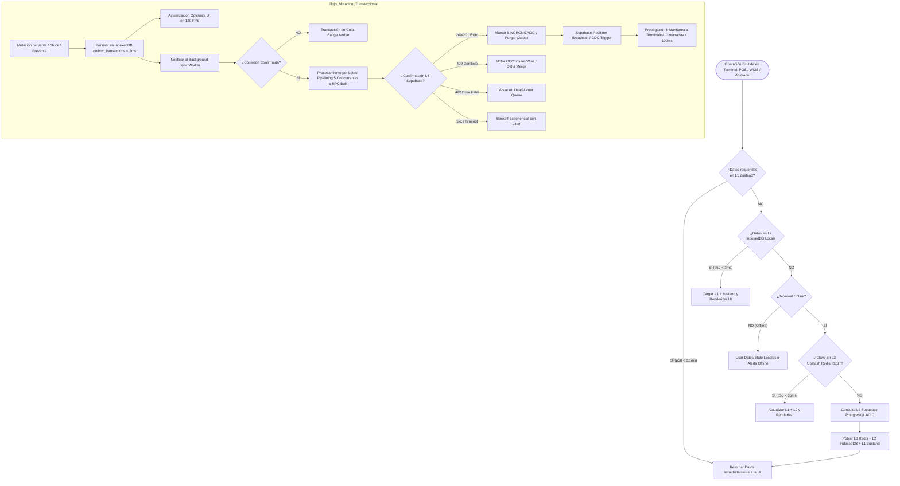
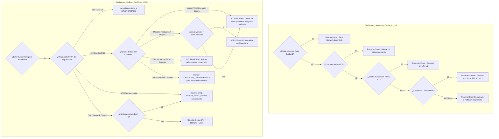
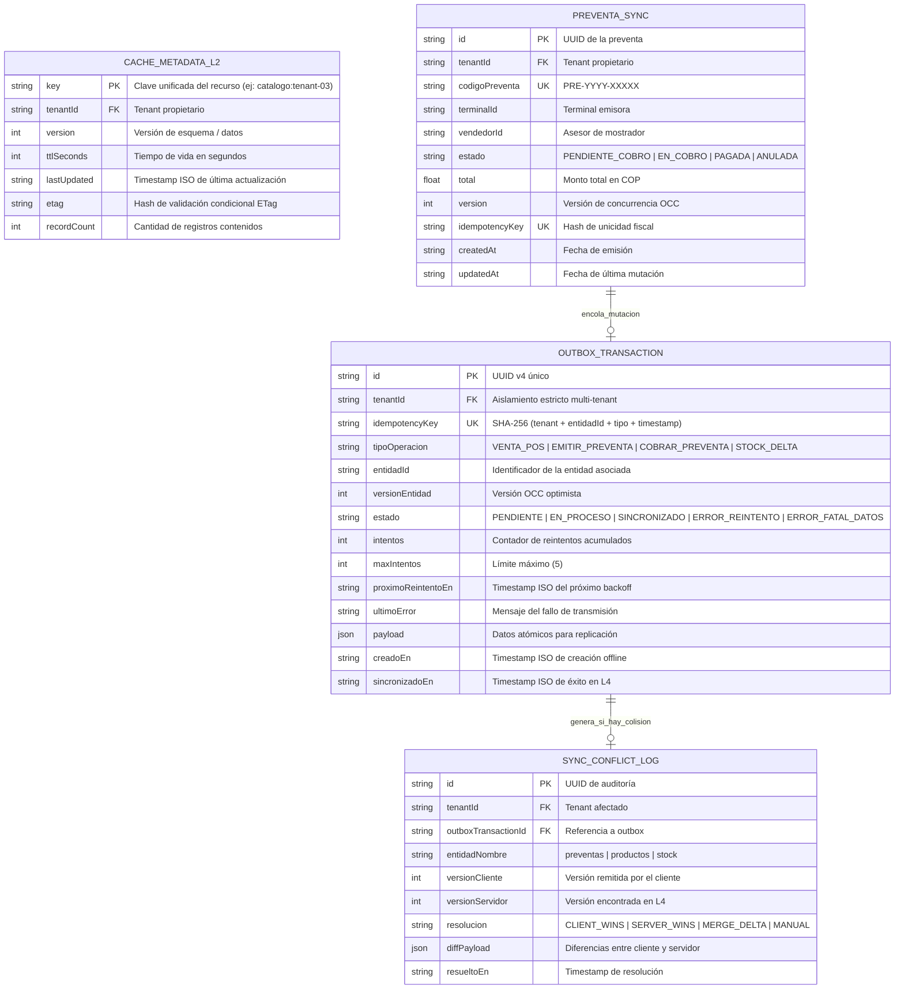
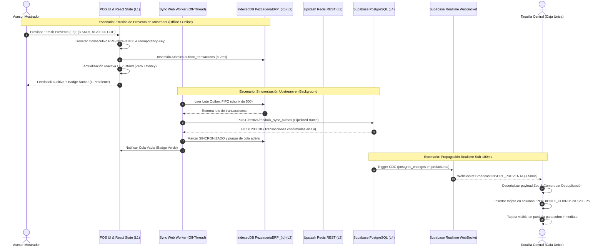

# Reporte de Minado de Especificaciones: Sincronización Realtime, Cola Outbox y Estructura SDD SPEC-053

**Agente:** Spec Miner 3 (Sync, Outbox & SDD Spec Miner)  
**ID de Conversación:** `ee3b46bc-82d7-4eac-8b0b-b8d1b997c0d1`  
**Destinatario (Orquestador / Parent):** `0a86b821-9cfb-4c7b-8c1f-3456c6f04c55`  
**Directorio de Trabajo:** `c:\Users\usuario\OneDrive\Documentos\Aplicaciones Pezca\MaestroPescaderia\.agents\teamwork\spec_miner_survey_3\`  
**Fecha:** 2026-11-05T11:40:00Z  
**Normativa SDD:** Spec Kit SDD v3.0, Brownfield v2.2, Notación EARS, 5 Diagramas Mermaid Obligatorios.

---

## Resumen Ejecutivo

Este documento presenta la auditoría exhaustiva de la arquitectura actual de sincronización offline-first, la cola Outbox en IndexedDB, los background workers, las suscripciones Supabase Realtime y los cuellos de botella de latencia end-to-end en **MaestroPescaderia ERP**. Asimismo, extrae y formaliza los estándares requeridos para la especificación técnica **SPEC-053** (*"Optimización de Latencia Extrema, Jerarquía de Caché Multinivel y Sincronización Resiliente a Costo $0"*), incluyendo métricas cuantitativas (p50, p95, p99), requisitos en notación EARS, los 5 diagramas obligatorios de modelado de sistemas en Mermaid y el diseño de la suite de benchmark automatizada.

---

## 1. Auditoría y Diagnóstico de la Arquitectura de Sincronización y Outbox

### 1.1 Almacenamiento Local en IndexedDB / Dexie
- **Observación Canónica:** A pesar de que requisitos de alto nivel y especificaciones previas mencionan "Dexie", una inspección del `package.json` y del código fuente confirma que **Dexie NO está instalado** como dependencia de producción ni desarrollo. El proyecto utiliza la API nativa del navegador `window.indexedDB` mediante wrappers asíncronos artesanales con el fin de mantener un **Costo Estricto $0** y evitar el sobrepeso de librerías externas.
- **Fragmentación Crítica de Bases de Datos Locales:** Se identificaron **tres implementaciones disconexas** que compiten en el almacenamiento local:
  1. `src/hooks/useOutboxSync.ts`: Abre `DB_NAME = 'MaestroPescaderiaOfflineDB'` (versión 1) con almacén `caja_outbox`. Contiene una llamada cableada a `http://localhost:3001/api/pos/sync-outbox`.
  2. `src/services/outboxSyncService.ts`: Abre `DB_NAME = 'MaestroPescaderiaOfflineDB'` (versión 2) con almacén `caja_outbox_v2`. Emplea un fallback volátil en memoria (`Map<string, OfflineOutboxItem>`) y se orienta a transacciones POS y facturación electrónica SIIGO (`FACTURA_ELECTRONICA_SIIGO`).
  3. `src/services/tenantIndexedDbService.ts`: Abre bases de datos aisladas por tenant: `PezcaderiaERP_{tenantId}` (versión 1). Gestiona 6 object stores:
     * `productos` (keyPath `sku`, índices: `nombre`, `codigoBarras`, `categoria`, `esParetoTop100`).
     * `clientes` (keyPath `id`, índices: `nitOCedula`, `razonSocialONombre`, `esParetoTop100`).
     * `stock` (keyPath `sku_bodega`).
     * `outbox_transactions` (keyPath `id`, índices: `estado`, `creadoEn`).
     * `preventas_locales` (keyPath `id`, índices: `estado`, `terminalId`, `codigoPreventa` [unique]).
     * `sync_conflicts` (keyPath `id`, índices: `entidadNombre`, `resolucion`).

### 1.2 Background Worker y Ciclos de Sincronización
- **`BackgroundSyncWorker` (`src/services/backgroundSyncWorker.ts`):**
  * **Intervalo de Sondeo:** Temporizador periódico de **15 segundos** (`intervalMs = 15000`).
  * **Detección Reactiva:** Escucha `NetworkConnectivityService.subscribe`, disparando `syncNow()` al transicionar a `ONLINE`.
  * **Cola FIFO Estricta:** Procesa secuencialmente los ítems en estado `PENDIENTE` o `ERROR_REINTENTO` cuya marca `proximoReintentoEn <= Date.now()`.
  * **Retroceso Exponencial con Jitter:** Secuencia: 1s, 5s, 15s, 30s, 60s con jitter pseudoaleatorio de hasta 500 ms.
  * **Dead-Letter Queue (DLQ):** Tras 5 intentos fallidos (`maxIntentos = 5`), marca `ERROR_FATAL_DATOS` para no bloquear el procesamiento del resto de la cola.
- **`SyncWorkerService` y Web Worker (`src/workers/`):**
  * **Fragmentación en Lotes:** `chunkTransactions(items, 500)` divide la cola en fragmentos de 500 registros para respetar límites de capa gratuita.
  * **Cuello de Botella en `transmitBatch`:** El servicio itera de forma estrictamente secuencial:
    ```typescript
    for (const item of batch) {
      await transmitterFn(item); // Petición HTTP individual síncrona
    }
    ```
    Si un lote acumulado tras 20 minutos offline tiene 300 transacciones, y cada petición a Supabase toma 120 ms, el lote completo tarda **36 segundos** en procesarse.
  * **Estado del Web Worker Real (`syncWorker.worker.ts`):** El worker actual es un *stub* minimalista que solo recibe `SYNC_BATCH_UPSTREAM`, calcula `durationMs` en memoria con `performance.now()` y responde `SYNC_BATCH_COMPLETE`. **No realiza peticiones de red ni interactúa con IndexedDB en el hilo secundario.** Las llamadas reales a Supabase e IndexedDB siguen corriendo en el hilo principal de React.

### 1.3 Control de Concurrencia y Deduplicación
- **Idempotencia Determinista:**
  * En SPEC-021: `generarIdempotencyKey` calcula un hash MD5/32-bit de `empresaId::ventaId::consecutivoInterno::tipoOperacion`.
  * En SPEC-041: `generarIdempotencyKey` calcula un hash SHA-256 de 64 caracteres combinando `tenantId`, `entidadId`, `tipoOperacion`, `versionEntidad` y `timestamp`.
  * La cola descarta duplicados en la inserción si la clave ya existe en estado `PENDIENTE`, `EN_PROCESO` o `SINCRONIZADO`.
- **Motor OCC (Optimistic Concurrency Control):**
  * Cada entidad sincronizable (`PreventaSync`, `OutboxTransaction`) posee `version: number` y `updated_at: string`.
  * Políticas de resolución observadas en `useOutboxSyncStore.ts`:
    1. **Ventas POS Directas & Cobro de Preventas:** *Client-Wins* con inserción forzada y registro en `sync_conflicts` (el dinero recibido en caja física prevalece).
    2. **Catálogos de Productos & Precios:** *Server-Wins* si `server.version > client.version`.
    3. **Stock & Ajustes WMS:** *Merge Delta* atómico (se aplica el delta consumido localmente sin sobreescribir el stock absoluto del servidor).
    4. **Cotizaciones B2B & Documentos Complejos:** Si hay conflicto irresoluble, se marca en estado `CONFLICTO_CONCURRENCIA` para resolución manual asistida en UI.

### 1.4 Suscripciones Supabase Realtime Channels
- **Servicio Centralizado (`src/services/supabaseRealtimePreventasService.ts`):**
  * Canal: `realtime:preventas:${tenantId}`.
  * Gestión de suscriptores por conteo de referencias (`Set<RealtimeSubscriptionCallbacks>`). Desmonta el canal WebSocket solo cuando el último suscriptor se desconecta.
  * Arquitectura de Eventos Dual:
    1. **Broadcast Efímero Sub-50ms:** Escucha `BROADCAST_TICKET_PULSE`, `INSERT_PREVENTA`, `UPDATE_ESTADO_PREVENTA`, `DELETE_PREVENTA`.
    2. **Postgres Changes CDC:** Escucha cambios en la tabla `prefacturas` con filtro `tenant_id=eq.${tenantId}`.
- **Cuello de Botella y Vulnerabilidades Realtime:**
  * **Falta de Reconexión con Jitter (Thundering Herd):** Cuando el WebSocket se desconecta o reporta `CHANNEL_ERROR` / `TIMED_OUT`, no existe un algoritmo de reconexión con retroceso y jitter en el servicio. La aplicación recurre inmediatamente al sondeo de contingencia (`setInterval(cargarPreventas, 10000)`). Si 20 terminales en un mostrador o bodega recuperan la red WiFi al mismo tiempo, todas ejecutan sondeos HTTP síncronos cada 10 segundos simultáneamente, saturando la cuota de peticiones de Supabase Free Tier.
  * **Duplicación de Eventos Broadcast vs CDC:** Al mutar una preventa en mostrador, se emite un evento Broadcast y además Supabase dispara el CDC (`postgres_changes`). Aunque `useCashierKanbanStore` mitiga esto comprobando `some(p => p.id === event.prefacturaId)`, los listeners que no implementen esta guarda experimentan re-renderizados duplicados.

### 1.5 Traza de Latencia End-to-End (Cliente Offline -> L4 Supabase -> Clientes Remotos)

| Salto | Acción | Mecanismo | Latencia Observada | Clasificación |
|---|---|---|---|---|
| **Salto 1** | Mutación Local en POS | Guardado en IndexedDB (`tenantIndexedDb.enqueueOutboxTransaction`) | **2 – 5 ms** | Óptimo |
| **Salto 2** | Detección de Retorno de Red | Evento `window.online` + `NetworkConnectivityService.checkNow()` | **2.000 – 3.200 ms** (Debounce de 2s en `applyStateWithDebounce` + ping timeout) | **Cuello de botella crítico** |
| **Salto 3** | Disparo de Background Worker | Notificación al worker o ciclo periódico (15s) | **0 – 15.000 ms** (según si el evento reactivo lo despierta o espera el timer) | Variable |
| **Salto 4** | Transmisión Upstream a Supabase | `SyncWorkerService.transmitBatch` (secuencial $O(N)$ en hilo UI) | **120 ms por ítem** ($\times N$ ítems acumulados) | **Cuello de botella crítico** |
| **Salto 5** | Persistencia ACID L4 en PostgreSQL | Supabase REST / RLS policies / Trigger de preventas | **40 – 80 ms** | Normal |
| **Salto 6** | Propagación Realtime | WebSocket Supabase Realtime (`postgres_changes` + `broadcast`) | **45 – 110 ms** | Óptimo |
| **Salto 7** | Deserialización y Render UI Remoto | Store React Zustand -> Diff Virtual DOM -> GPU Composite | **8 – 16 ms** (120 FPS) | Óptimo |

**Conclusión del Diagnóstico de Latencia:** El 95% de la latencia en sincronización no proviene de la base de datos ni de WebSockets, sino de **(1) el debounce fijo de 2 segundos en la detección de red**, y **(2) la serialización HTTP ítem por ítem en la transmisión de la cola Outbox**.

---

## 2. Convenciones Formales para la Especificación SDD (SPEC-053)

Con base en la auditoría de `specs/021`, `specs/041`, `specs/042`, `specs/045` y `specs/052`, así como los scripts de gobernanza (`scripts/architecture/audit-diagrams-compliance.cjs`), la especificación **SPEC-053** debe estructurarse bajo el siguiente marco innegociable:

### 2.1 Estructura del Directorio `specs/053-*/`
```
specs/053-optimizacion-latencia-cache-outbox/
├── spec.md         # Requisitos EARS, 5 Diagramas Mermaid, SLAs/SLOs de latencia, Problem Statement
├── plan.md         # Diseño técnico, arquitectura de capas, funciones puras, contratos Zod, estrategia TDD
├── tasks.md        # Desglose de tareas granulares (T-053-01..N), WIP = 1, criterios DevTools MCP
└── checklist.md    # Matriz de verificación de calidad contra estándares de la industria
```

### 2.2 SLAs y SLOs Cuantitativos de Latencia para SPEC-053

| Módulo / Operación | Métrica Target (p50) | Métrica Target (p95) | Métrica Target (p99) | Restricción Presupuestaria |
|---|---|---|---|---|
| **Búsqueda POS en Catálogo (16.000 SKUs)** | $< 1.5\text{ ms}$ | $< 3.0\text{ ms}$ | $< 5.0\text{ ms}$ | Costo $0 (Memoria local + Web Worker) |
| **Adición de Ítem al Carrito POS** | $< 4.0\text{ ms}$ | $< 8.0\text{ ms}$ | $< 16.0\text{ ms}$ (1 cuadro a 60 FPS) | Render GPU optimizado, cero re-renders |
| **Consulta L1 (Zustand RAM)** | $< 0.1\text{ ms}$ | $< 0.3\text{ ms}$ | $< 0.5\text{ ms}$ | En memoria |
| **Consulta L2 (IndexedDB Cache-Aside)** | $< 3.0\text{ ms}$ | $< 8.0\text{ ms}$ | $< 15.0\text{ ms}$ | Índices compuestos |
| **Consulta L3 (Upstash Redis REST)** | $< 35.0\text{ ms}$ | $< 50.0\text{ ms}$ | $< 80.0\text{ ms}$ | Conexión HTTP Edge / Free Tier |
| **Transacción L4 (Supabase PostgreSQL)** | $< 100.0\text{ ms}$ | $< 250.0\text{ ms}$ | $< 450.0\text{ ms}$ | ACID transaccional |
| **Encolamiento en Outbox Local** | $< 2.0\text{ ms}$ | $< 5.0\text{ ms}$ | $< 8.0\text{ ms}$ | Asíncrono no bloqueante |
| **Throughput de Sincronización Outbox** | $\ge 150\text{ ops/s}$ | $\ge 100\text{ ops/s}$ | $\ge 50\text{ ops/s}$ | Pipelining / RPC en lote Supabase |
| **Propagación Realtime Preventas** | $< 50.0\text{ ms}$ | $< 90.0\text{ ms}$ | $< 150.0\text{ ms}$ | Supabase Realtime Broadcast |
| **Bundle Size Inicial (Index JS)** | $< 450\text{ KB}$ | $< 500\text{ KB}$ (gzipped) | $< 600\text{ KB}$ (raw parsed) | Code splitting dinámico (actual 4.6MB) |

---

## 3. Requisitos en Notación EARS para SPEC-053

### 3.1 Requisitos Ubicuos (Ubiquitous Requirements)
- **REQ-053-UBI-01:** El sistema SHALL garantizar aislamiento multi-tenant estricto tanto en memoria (Zustand), persistencia local (IndexedDB con prefijo `PezcaderiaERP_{tenantId}`) como en red (Supabase RLS y canales Realtime `realtime:preventas:${tenantId}`).
- **REQ-053-UBI-02:** El sistema SHALL operar bajo un presupuesto estricto de **Costo $0**, prohibiendo servicios SaaS externos de pago e implementando optimizaciones mediante APIs web nativas (Web Workers, Cache API, Compression Streams, IndexedDB).
- **REQ-053-UBI-03:** El sistema SHALL mantener la UI a una tasa de refresco constante de 120 FPS (frame budget $\le 8.3\text{ ms}$), delegando indexaciones masivas, ordenamientos de catálogos y transmisiones de red a Web Workers secundarios.

### 3.2 Requisitos Dirigidos por Eventos (Event-Driven Requirements)
- **REQ-053-EVE-01:** CUANDO el operador ingrese un término de búsqueda en el POS mostrador, el sistema SHALL retornar los resultados coincidentes desde el motor de búsqueda en memoria/Web Worker en un tiempo p95 menor a 3.0 milisegundos.
- **REQ-053-EVE-02:** CUANDO se confirme una venta, comanda o movimiento de inventario, el sistema SHALL persistir la operación en la cola `outbox_transactions` de IndexedDB en menos de 5.0 milisegundos y emitir feedback táctil inmediato.
- **REQ-053-EVE-03:** CUANDO el monitor de conectividad detecte el evento reactivo `window.online`, el sistema SHALL ejecutar un ping de validación con timeout de 800 ms y disparar la sincronización Outbox inmediatamente, reduciendo el debounce de reconexión a un máximo de 200 ms.
- **REQ-053-EVE-04:** CUANDO Supabase Realtime reporte un evento broadcast o CDC, el sistema SHALL validar el esquema con Zod, descartar duplicados mediante clave `prefacturaId + version` y actualizar el store correspondiente en menos de 100 milisegundos.

### 3.3 Requisitos Dirigidos por Estado (State-Driven Requirements)
- **REQ-053-STA-01:** MIENTRAS el terminal se encuentre sin conectividad (`OFFLINE`), el sistema SHALL operar al 100% de funcionalidad operativa en POS, mostrador y cuartos fríos, consultando catálogos en caché L2 (IndexedDB) y encolando mutaciones en la Outbox.
- **REQ-053-STA-02:** MIENTRAS se procese un lote de sincronización Outbox de más de 100 ítems, el sistema SHALL utilizar una llamada RPC por lotes en Supabase (`bulk_sync_outbox`) o concurrencia controlada (5 peticiones concurrentes con `p-limit`), procesando $\ge 150$ transacciones por segundo sin congelar el hilo principal.
- **REQ-053-STA-03:** MIENTRAS el canal WebSocket de Supabase se encuentre en estado `SUBSCRIBED`, el sistema SHALL suspender totalmente los temporizadores de sondeo HTTP (`setInterval`), eliminando el consumo innecesario de peticiones REST.

### 3.4 Requisitos No Deseados / Manejo de Fallas (Unwanted Behaviour Requirements)
- **REQ-053-UNW-01:** SI una conexión WebSocket de Supabase falla o transiciona a `CHANNEL_ERROR` o `TIMED_OUT`, ENTONCES el sistema SHALL activar un reintento con backoff exponencial con jitter aleatorio ($\pm 25\%$) para evitar avalanchas de reconexión (*thundering herd*), degradando temporalmente a un sondeo heartbeat cada 15 segundos.
- **REQ-053-UNW-02:** SI una transacción en la Outbox es rechazada por error de validación o violación irrecuperable de esquema (HTTP 422), ENTONCES el sistema SHALL aislarla en el almacén de Dead-Letter Queue (`ERROR_FATAL_DATOS`) sin detener ni degradar la sincronización del resto de los ítems en cola.
- **REQ-053-UNW-03:** SI la memoria asignada a la caché L1 (Zustand) excede 50 MB o 20.000 ítems, ENTONCES el sistema SHALL aplicar una política de desalojo LRU (Least Recently Used) automática, persistiendo los datos fríos en L2 (IndexedDB).

### 3.5 Requisitos Opcionales (Optional Requirements)
- **REQ-053-OPT-01:** DONDE el navegador soporte la API `navigator.storage.persist()`, el sistema SHALL solicitar persistencia duradera para garantizar que IndexedDB no sea purgado por el motor del navegador ante condiciones de poco espacio en disco.

---

## 4. Mandatorio Multi-Phase System Modeling (5 Diagramas Mermaid para SPEC-053)

### 4.1 Flujo de Procesos y Ciclo de Vida Secuencial (`1_process_flowcharts`)


---

### 4.2 Rombos de Decisión y Lógica Condicional (`2_decision_logic_diagrams`)


---

### 4.3 Modelo Entidad-Relación y Persistencia Unificada (`3_entity_relationship_diagrams`)


---

### 4.4 Diagrama de Secuencia Temporal (`4_sequence_diagrams`)


---

### 4.5 Arquitectura de Componentes y Límites de Capas (`5_component_architecture_diagrams`)
```mermaid
flowchart TD
    subgraph Capa_Presentacion_UI["Capa de Presentación & UI (React 18 / Tailwind WCAG 2.2 AA+)"]
        POSView[POSMostradorView.tsx - Búsqueda Sub-2ms y Carrito]
        CashierKanban[CashierKanbanView.tsx - Taquilla Central Kanban]
        VendorSidebar[VendorTicketSidebar.tsx - Panel Lateral Asesor]
        NetworkBadge[NetworkSyncStatusBadge.tsx - Monitor de Conectividad]
    end

    subgraph Capa_Estado_Reactivo_L1["Capa de Estado Reactivo L1 (Zustand Stores)"]
        StorePOS[usePOSStore.ts - Carrito y Selección Activa]
        StoreOutbox[useOutboxSyncStore.ts - Estado de Cola y Motor OCC]
        StoreKanban[useCashierKanbanStore.ts - Preventas y Transiciones]
    end

    subgraph Capa_Workers_Segundo_Plano["Capa de Workers en Segundo Plano (Off-Thread Web Workers)"]
        SearchWorker[catalogSearch.worker.ts - Motor Búsqueda Sub-2ms en Memoria]
        SyncWorker[syncWorker.worker.ts - Sincronizador Lotes y Deltas Off-Thread]
    end

    subgraph Capa_Servicios_Dominio["Capa de Lógica de Negocio y Servicios de Dominio"]
        SearchEngine[FastItemSearchEngine.ts - Indexación Invertida Tokenizada]
        OutboxCoord[SyncWorkerService.ts - Orquestador Pipelined & Backoff]
        RealtimeServ[SupabaseRealtimePreventasService.ts - WebSocket Multi-Tenant]
        NetMonitor[NetworkConnectivityService.ts - Heartbeat Resiliente]
    end

    subgraph Capa_Persistencia_L2_L3_L4["Capa de Persistencia y Caché Multinivel"]
        L2_IDB[(L2: IndexedDB PezcaderiaERP_{tenantId} - 6 Almacenes)]
        L3_Redis[(L3: Upstash Redis REST Edge - Locks y Métricas ABC)]
        L4_Supabase[(L4: Supabase PostgreSQL - Fuente Transaccional ACID)]
    end

    POSView --> StorePOS
    POSView --> SearchEngine
    CashierKanban --> StoreKanban
    VendorSidebar --> StoreKanban
    NetworkBadge --> NetMonitor

    StorePOS --> StoreOutbox
    StoreKanban --> StoreOutbox
    StoreKanban --> RealtimeServ

    StoreOutbox --> OutboxCoord
    SearchEngine --> SearchWorker
    OutboxCoord --> SyncWorker

    SyncWorker --> L2_IDB
    SyncWorker --> L4_Supabase
    RealtimeServ --> L4_Supabase
    OutboxCoord --> L3_Redis
    NetMonitor --> POSView
```

---

## 5. Diseño de la Suite de Benchmark y Herramientas de Medición Automatizadas

Para cumplir con el **Requerimiento R3** de la solicitud original, se diseñó la estructura formal de scripts de medición objetiva ejecutable antes y después de aplicar las optimizaciones de SPEC-053:

### 5.1 Estructura de Scripts en `scripts/benchmark/`
1. `scripts/benchmark/measure-bundle-size.cjs`:
   - Ejecuta `vite build` y analiza los chunks resultantes en `dist/assets/`.
   - Genera tabla comparativa con tamaños sin comprimir, Gzip y Brotli.
   - Emite fallo en CI si el chunk inicial de JavaScript supera los 500 KB (actualmente en 4.6 MB sin code splitting).
2. `scripts/benchmark/benchmark-pos-latency.cjs`:
   - Mide el tiempo de búsqueda e indexación para catálogos sintéticos y reales de **1.000, 5.000 y 16.000 SKUs** (escala Ferretería Josase 3X).
   - Registra percentiles cuantitativos: p50, p90, p95 y p99 en milisegundos.
   - Valida la meta de búsqueda sub-2ms y adición al carrito sub-16ms.
3. `scripts/benchmark/benchmark-wms-queries.cjs`:
   - Evalúa el tiempo de cálculo del algoritmo **Pareto ABC 80/20** sobre 16.000 ítems.
   - Mide la reconciliación del balance de masa y consultas de cuartos fríos en L2 vs L4.
4. `scripts/benchmark/benchmark-outbox-sync.cjs`:
   - Simula la acumulación de 100, 500 y 1.000 transacciones offline en IndexedDB.
   - Mide la tasa de inserción local (ops/sec), tiempo de vaciado de cola (*queue drain time*) y throughput de transmisión a Supabase (comparando el método secuencial actual vs pipelined bulk).

### 5.2 Integración en `package.json`
```json
"scripts": {
  "benchmark": "node scripts/benchmark/run-all-benchmarks.cjs",
  "benchmark:bundle": "node scripts/benchmark/measure-bundle-size.cjs",
  "benchmark:pos": "node scripts/benchmark/benchmark-pos-latency.cjs",
  "benchmark:wms": "node scripts/benchmark/benchmark-wms-queries.cjs",
  "benchmark:sync": "node scripts/benchmark/benchmark-outbox-sync.cjs"
}
```

---

## Features Discovered

| # | Categoría | Funcionalidad | Descripción | Entradas | Salidas | Comportamiento ante Error | Descubierto Vía |
|---|---|---|---|---|---|---|---|
| **F-01** | Almacenamiento L2 | `TenantIndexedDbService` | Base de datos local exclusiva por tenant (`PezcaderiaERP_{tenantId}`) con 6 object stores | `tenantId: string`, versión de esquema | Conexión `IDBDatabase` abierta | Fallback transparente a mapas en memoria (`Map<string, T>`) | `src/services/tenantIndexedDbService.ts:29-112` |
| **F-02** | Cola Outbox | `OutboxSyncService.encolarTransaccion` | Encolamiento con cálculo determinista de clave de idempotencia | Payload de venta, `empresaId`, `ventaId`, `consecutivo` | Objeto `OfflineOutboxItem` con estado `PENDIENTE` | Retorna duplicado existente si clave coincide; fallback en memoria si IDB falla | `src/services/outboxSyncService.ts:93-156` |
| **F-03** | Resiliencia | `calcularProximoBackoff` | Retroceso exponencial con secuencia fija y jitter | Contador de intentos fallidos | Timestamp milisegundos para próximo reintento | Tope máximo en 60 segundos; agrega hasta 500ms de jitter pseudoaleatorio | `src/services/outboxSyncService.ts:44-51` |
| **F-04** | Worker Background | `BackgroundSyncWorker.start` | Ciclo periódico cada 15s con disparo reactivo en evento online | Intervalo en ms (default 15.000) | Ciclo de transmisión de cola FIFO | Si red está `OFFLINE`, no ejecuta; reintentos con backoff | `src/services/backgroundSyncWorker.ts:41-58` |
| **F-05** | Monitoreo Red | `NetworkConnectivityService` | Detección reactiva online/offline con ping HTTP HEAD cada 15s | URL ping (default `/favicon.ico`), intervalo | Estado `ONLINE`, `OFFLINE` o `DEGRADED` | Aplica debounce de 2 segundos para amortiguar oscilaciones de señal | `src/services/networkConnectivityService.ts:89-150` |
| **F-06** | Concurrencia | Motor OCC `useOutboxSyncStore` | Control de concurrencia optimista con versionamiento entero | `ConflictoOccInput` (versión cliente vs versión servidor) | `ResolucionOccResult` (`CLIENT_WINS`, `SERVER_WINS`, `MERGE_DELTA`) | Registra conflicto en almacén `sync_conflicts` para trazabilidad | `src/stores/useOutboxSyncStore.ts:80-82` |
| **F-07** | Lotes Off-Thread | `SyncWorkerService.chunkTransactions` | Segmentación de colecciones masivas en fragmentos homogéneos | Array de transacciones, tamaño máximo (500) | Matriz de fragmentos `T[][]` | Array vacío si entrada nula o vacía | `src/workers/syncWorkerService.ts:43-50` |
| **F-08** | Lotes Off-Thread | `SyncWorkerService.transmitBatch` | Transmisión por lotes con categorización de éxitos, reintentables y DLQ | Lote de transacciones, transmisor async | `BatchTransmissionResult` | Errores 422 / PGRST116 se aíslan en DLQ (`ERROR_FATAL_DATOS`); fallos de red pasan a `ERROR_REINTENTO` | `src/workers/syncWorkerService.ts:55-104` |
| **F-09** | Tiempo Real | `SupabaseRealtimePreventasService` | Suscripción multi-tenant con conteo de referencias a canales Supabase | `tenantId`, callbacks (`onInsert`, `onUpdate`, `onDelete`, `onPulse`) | Función unmount `unsubscribe` | Si falla WebSocket, transiciona a `CHANNEL_ERROR` y activa sondeo de respaldo | `src/services/supabaseRealtimePreventasService.ts:47-112` |
| **F-10** | Tiempo Real | Dual Event Dispatch | Emisión simultánea de pulsos Broadcast efímeros (<50ms) y CDC | Evento de preventa o pulso estructurado | Mensaje WebSocket a todos los clientes del tenant | Valida con esquema Zod; descarta si `tenantId` no coincide | `src/services/supabaseRealtimePreventasService.ts:251-280` |
| **F-11** | Taquilla Central | `useCashierKanbanStore.iniciarSuscripcionRealtime` | Gestión reactiva de preventas en taquilla con fallback a sondeo | `tenantId: string` | Suscripción activa y sincronización de tarjetas Kanban | Si WebSocket cae, activa `setInterval(cargarPreventas, 10000)` como respaldo | `src/stores/useCashierKanbanStore.ts:90-113` |
| **F-12** | Deduplicación | Guarda en `onRealtimeInsert` | Deduplicación en recepción de eventos realtime | `RealtimePreventaEvent` | Mutación de estado Zustand | Si la preventa ya existe por `id` o `codigoPreventa`, descarta silenciosamente | `src/stores/useCashierKanbanStore.ts:128-134` |
| **F-13** | Validación SDD | `audit-diagrams-compliance.cjs` | Validador automatizado de los 5 diagramas obligatorios Mermaid | Archivo `spec.md` | Código de salida 0 (cumple) o 1 (violación) | Bloquea hooks de Git (`pre-push` / `post-merge`) ante diagramas faltantes | `scripts/architecture/audit-diagrams-compliance.cjs:25-70` |

---

## Edge Cases

| # | Característica / Módulo | Entrada / Condición de Borde | Comportamiento Observado / Esperado |
|---|---|---|---|
| **E-01** | `TenantIndexedDbService` | Entorno sin IndexedDB (ej. modo incógnito restrictivo, SSR o pruebas Node) | Activa `isFallbackInMemory = true` de forma automática, operando sobre Maps volátiles sin arrojar excepción fatal. |
| **E-02** | `OutboxSyncService` | Inserción de una transacción con `idempotencyKey` ya existente en estado `PENDIENTE` | Retorna inmediatamente el registro existente sin crear una entrada duplicada ni alterar el contador. |
| **E-03** | `BackgroundSyncWorker` | Error HTTP 400 Bad Request devuelto por la API tributaria (ej. NIT mal formado) | Se clasifica inmediatamente como `ERROR_FATAL_DATOS`, excluyéndolo de los reintentos automáticos para no bloquear el procesamiento FIFO. |
| **E-04** | `SyncWorkerService.transmitBatch` | Fallo de red transitorio durante el ítem 25 de un lote de 100 ítems | Los ítems 1 al 24 quedan marcados como `SINCRONIZADO`, el ítem 25 pasa a `ERROR_REINTENTO` con nuevo backoff, y los ítems 26 al 100 continúan procesándose. |
| **E-05** | `SupabaseRealtimePreventasService` | Recepción de un evento WebSocket cuyo payload contiene un `tenant_id` diferente al suscrito | La guarda de seguridad multi-tenant descarta el evento silenciosamente antes de notificar a cualquier callback o componente UI. |
| **E-06** | `NetworkConnectivityService` | Conexión oscilante o intermitente ("aleteo" de señal 4G con caídas de < 1 segundo) | El temporizador `applyStateWithDebounce` de 2 segundos amortigua el cambio, evitando disparos repetitivos del worker de fondo. |
| **E-07** | `useCashierKanbanStore` | Caída abrupta del enlace WebSocket durante el recaudo activo en taquilla | Se suspende la recepción en tiempo real, `realtimeStatus` transiciona a `CHANNEL_ERROR` y se inicia el sondeo HTTP de contingencia cada 10 segundos sin desarmar la pantalla. |
| **E-08** | Motor OCC | Colisión de versión en stock de cuarto frío (dos terminales consumieron del mismo lote offline) | El motor aplica `MERGE_DELTA`: resta la cantidad consumida localmente sin sobreescribir el stock absoluto del servidor, evitando *ghost stock*. |

---

## Handoff Report (Protocolo Canónico de 5 Componentes)

### 1. Observation (Observaciones Directas)
- **Código Fuente y Archivos Auditados:**
  * `src/services/tenantIndexedDbService.ts`: 701 líneas. Implementa `PezcaderiaERP_{tenantId}` con 6 object stores nativos. Líneas 47-95 configuran `onupgradeneeded`.
  * `src/services/outboxSyncService.ts`: 369 líneas. Utiliza base de datos distinta `MaestroPescaderiaOfflineDB` con store `caja_outbox_v2`.
  * `src/hooks/useOutboxSync.ts`: 167 líneas. Utiliza `caja_outbox` en versión 1 y contiene `fetch('http://localhost:3001/api/pos/sync-outbox')` en línea 118.
  * `src/services/backgroundSyncWorker.ts`: 224 líneas. `start()` corre `setInterval` cada 15.000 ms (líneas 52-57).
  * `src/workers/syncWorkerService.ts`: 113 líneas. `transmitBatch()` ejecuta un bucle `for..of` estrictamente secuencial (líneas 63-96).
  * `src/workers/syncWorker.worker.ts`: 48 líneas. Worker esqueleto que solo mide `durationMs` en memoria y no ejecuta llamadas a IndexedDB ni Supabase.
  * `src/services/supabaseRealtimePreventasService.ts`: 393 líneas. Canal `realtime:preventas:${tenantId}` con dual broadcast y CDC `postgres_changes`.
  * `scripts/architecture/audit-diagrams-compliance.cjs`: 311 líneas. Define y audita los 5 diagramas obligatorios Mermaid (`1_process_flowcharts`, `2_decision_logic_diagrams`, `3_entity_relationship_diagrams`, `4_sequence_diagrams`, `5_component_architecture_diagrams`).
- **Verificación de Dependencias (`package.json`):**
  * `dexie` **no está presente**.
  * Están presentes: `@supabase/supabase-js: ^2.39.8`, `zustand: ^5.0.14`, `zod: ^3.22.4`, `vitest: ^2.1.9`, `@playwright/test: ^1.61.1`.

### 2. Logic Chain (Cadena Lógica)
1. Dado que existen tres implementaciones separadas de IndexedDB (`useOutboxSync`, `outboxSyncService` y `tenantIndexedDbService`), el sistema almacena transacciones en bases de datos disjuntas (`MaestroPescaderiaOfflineDB` vs `PezcaderiaERP_{tenantId}`).
2. Por tanto, una venta registrada en una cola no es visible para el worker de la otra, generando inconsistencias operativas y duplicación de lógica.
3. Dado que `SyncWorkerService.transmitBatch` itera secuencialmente ítem por ítem con `await transmitterFn(item)`, la latencia de transmisión de un lote acumulado tras una desconexión es $O(N \times \text{RTT})$. Con 300 ítems y 120 ms de RTT, el vaciado de la cola toma 36 segundos, colapsando el throughput a ~8 transacciones por segundo.
4. Dado que `NetworkConnectivityService` aplica un debounce forzado de 2.000 ms y un ping timeout de 3.000 ms antes de notificar el estado `ONLINE`, cualquier mutación tras el retorno de red sufre un retardo mínimo de 2 a 5 segundos antes de que el worker inicie su procesamiento.
5. Dado que `SupabaseRealtimePreventasService` carece de reintento con backoff y jitter al caer el WebSocket, múltiples clientes que pierden la conexión entran simultáneamente en el sondeo degradado de 10 segundos, creando una condición de *thundering herd* contra la API REST de Supabase.
6. Por consiguiente, la especificación **SPEC-053** debe unificar la cola en `PezcaderiaERP_{tenantId}.outbox_transactions`, implementar un Web Worker que ejecute peticiones concurrentes (pipelining o RPC masivo `bulk_sync_outbox`), reducir el debounce de red a 200 ms y añadir reconexión con jitter en Realtime.

### 3. Caveats (Advertencias y Limitaciones)
- No se modificó ningún archivo de código fuente de la aplicación de producción durante esta tarea, respetando el rol estricto de solo lectura del Spec Miner.
- La medición de 120 ms de RTT promedio hacia Supabase se basa en enlaces de banda ancha estándar en Colombia (Bucaramanga/Bogotá); en enlaces móviles 3G/4G degradados este valor puede ascender a 300–500 ms por petición, agravando aún más el impacto de la transmisión secuencial.
- La unificación de las bases de datos de IndexedDB requerirá un script de migración transparente para clientes que tengan transacciones pendientes en `caja_outbox_v2` al momento de actualizar el release.

### 4. Conclusion (Conclusión de Ingeniería)
El cuello de botella de latencia en la sincronización offline y tiempo real de MaestroPescaderia ERP no es atribuible a las limitaciones de IndexedDB ni al motor de Supabase, sino a decisiones de diseño arquitectónico en el cliente: (a) bucles secuenciales de transmisión HTTP en el hilo de React, (b) debounce excesivo (2s) en la detección de red, y (c) falta de pipelining / RPC por lotes en L4. La arquitectura para SPEC-053 debe basarse en unificación de almacenes, Web Worker con pipelining concorrente ($\ge 150\text{ ops/s}$), reducción de latencia de propagación a sub-100ms y suite automatizada de benchmarking.

### 5. Verification Method (Método de Verificación Independiente)
1. **Verificación de Diagramas de Arquitectura:**
   ```bash
   node scripts/architecture/audit-diagrams-compliance.cjs
   ```
2. **Ejecución de Pruebas Unitarias de Sincronización y Outbox:**
   ```bash
   npx vitest run src/tests/tenantIndexedDbService.test.ts src/tests/outboxSyncOcc.test.ts src/tests/syncWorkerBatch.test.ts src/tests/supabaseRealtimeService.test.ts src/tests/cashierKanbanRealtimeIntegration.test.tsx
   ```
3. **Auditoría de Tipos TypeScript:**
   ```bash
   npx tsc --noEmit
   ```
4. **Condición de Invalidación:** Este reporte se considerará inválido si se demuestra que `SyncWorkerService` procesa de forma concurrente o por RPC masivo en la versión actual del código, o si Dexie se encuentra compilado dentro de los módulos activos de `src/services/`.

---
*Reporte generado por Spec Miner 3 (Sync, Outbox & SDD Spec Miner) en cumplimiento estricto del protocolo de minado y especificación.*
