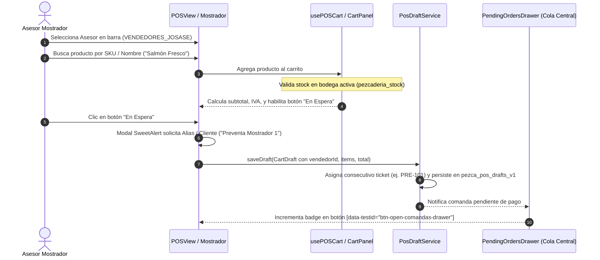
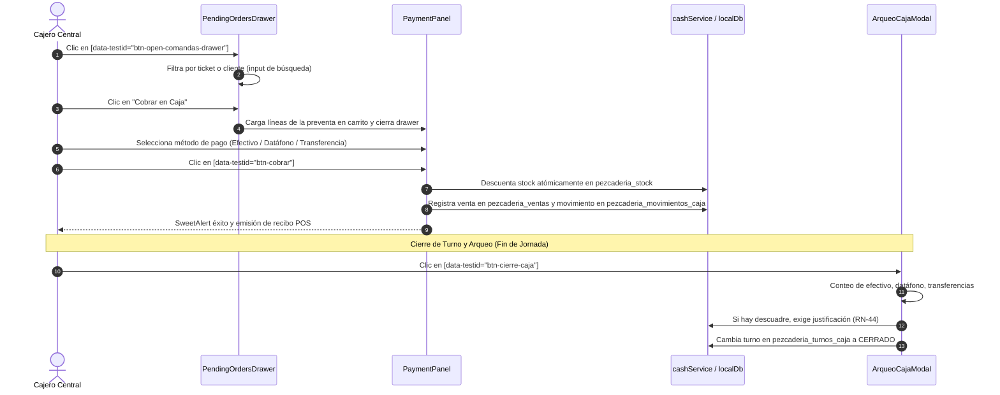
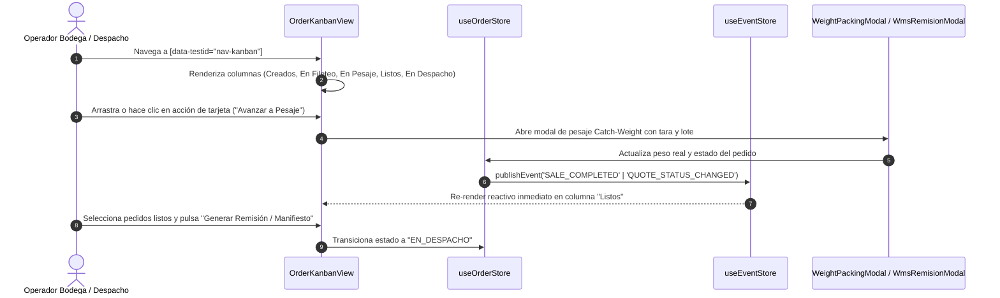
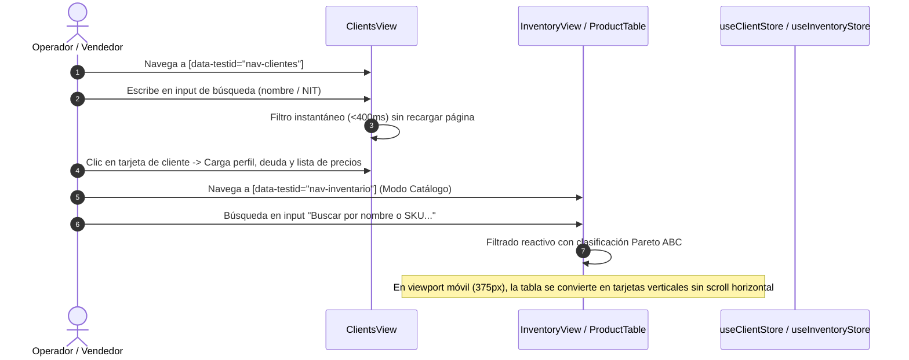

# Survey & E2E Testing Architecture Report (Harness² & Priority Screens)

**Author**: `teamwork_explorer_survey_3`  
**Working Directory**: `c:\Users\Personal\Documents\Yurgen\Maestro_Pezcaderia_ERP\maestro_ERP_Pezcaderia\.agents\teamwork\teamwork_explorer_survey_3\`  
**Date**: 2026-10-29  
**Status**: Completed (Read-Only Investigation)

---

## 1. Observation

### 1.1 Existing Test Infrastructure & Tooling
- **`package.json`**:
  - Test runner scripts defined (lines 11-17, 29-30):
    - `"test": "vitest"`
    - `"test:run": "vitest run"`
    - `"test:e2e": "playwright test"`
    - `"test:e2e:ui": "playwright test --ui"`
    - `"test:e2e:headed": "playwright test --headed"`
    - `"harness2": "powershell -ExecutionPolicy Bypass -File tools/harness2/run_harness2.ps1"`
    - `"sdd:bridge": "python scripts/architecture/run_agency_sdd_bridge.py"`
  - Test dependencies (lines 55-57, 67, 73):
    - `"@playwright/test": "^1.61.1"`
    - `"@testing-library/react": "^16.3.2"`
    - `"@testing-library/jest-dom": "^6.9.1"`
    - `"jsdom": "^29.1.1"`
    - `"vitest": "^2.1.9"`

- **Playwright Configuration (`playwright.config.ts`)**:
  - `testDir: './tests/e2e'` (line 7).
  - Target URL: `baseURL: 'http://localhost:3000'` (line 22).
  - `webServer` configuration: `command: 'npm run dev'`, `url: 'http://localhost:3000'`, `reuseExistingServer: true`, `timeout: 60000` (lines 40-45).
  - Browser project: `chromium` (`devices['Desktop Chrome']`, line 34).

- **Vite Configuration (`vite.config.ts`)**:
  - Server runs on `port: 3000` (line 8).
  - Vitest environment: `jsdom` (line 25), with setup `./src/tests/setup.ts` (line 26), excluding `tests/e2e/**` (line 28).

- **Google Harness² Infrastructure (`tools/harness2/` & `scripts/architecture/`)**:
  - Runner PowerShell script: `tools/harness2/run_harness2.ps1` wrapping `tools/harness2/run_harness2.py`.
  - Python runner configured with default language `es-419`, provider `google_ai_studio`, model `gemini-3.8-flash` (cost $0 free tier), sequential recursion to protect against HTTP 429 rate limits (`tools/harness2/run_harness2.py` lines 54-61).
  - Co-execution bridge: `scripts/architecture/run_agency_sdd_bridge.py` executes Agency Swarm and Google Harness² concurrently in a `ThreadPoolExecutor` (max_workers=2), outputting JSON reports to `specs/sdd_verification_reports/`.

### 1.2 Browser Environment & Test Execution Verification
- Vite dev server was verified running on `http://localhost:3000` (PID 13280, listening on TCP port 3000, responding with HTTP 200).
- Playwright CLI was verified: `npx playwright --version` -> `Version 1.61.1`.
- Playwright test discovery: `npx playwright test --list` identified **42 tests across 10 files** in `tests/e2e/`.
- Execution test of `tests/e2e/operational-flows.spec.ts` (Adaptive Design at 375px viewport) passed in 5.5s (`1 passed (5.5s)`).
- Execution test of `tests/e2e/multivendor-cashier-flow.spec.ts` failed with:
  ```text
  Error: expect(locator).toBeVisible() failed
  Locator: locator('.sidebar-menu, aside')
  Expected: visible
  Timeout: 20000ms
  Error: element(s) not found
  ```
  Inspection of `test-results/multivendor-cashier-flow-.../error-context.md` showed the browser was rendered on the **Login View** (`heading "La Pezcadería ERP"`, buttons "Iniciar Sesión", "Registrar Empresa", demo buttons "SuperAdmin", "Don Fernando", "Cajero", "Vendedor").

### 1.3 `console.error` and Unhandled Exception Audit
- Grep search of `tests/e2e/` revealed **zero** occurrences of `page.on('console', ...)` and **zero** occurrences of `page.on('pageerror', ...)`.
- Unhandled JavaScript exceptions and `console.error` calls currently do not fail Playwright E2E tests unless a component explicitly crashes or an element is not found.
- The project has a custom logger `src/lib/consoleLogger.ts` which is disabled in Vitest tests via `(globalThis as any).__LOGGER_ENABLED__ = false;` in `src/tests/setup.ts`, but in Playwright browser tests, standard `console.error` logs from services and views are output to the browser console.

---

## 2. Logic Chain

### 2.1 Why Existing E2E Tests Failed and How to Fix
1. *Observation*: `multivendor-cashier-flow.spec.ts` failed at line 64 waiting for `locator('.sidebar-menu, aside')`.
2. *Observation*: The rendered DOM snapshot in `error-context.md` showed `LoginView.tsx` active.
3. *Observation*: In `src/App.tsx` (line 1448):
   ```tsx
   if (authStatus === 'unauthenticated' || !authUser) {
     return <LoginView ... />;
   }
   ```
4. *Observation*: In `src/store/useAuthStore.ts` (lines 130, 158), `useAuthStore` reads `savedSession = localDb.load('auth_session', null)` which queries localStorage key `pezcaderia_auth_session` (`src/services/localDb.ts` line 69).
5. *Observation*: In `multivendor-cashier-flow.spec.ts` (line 57), `localStorage.clear()` is called in `page.addInitScript`, wiping all keys including `pezcaderia_auth_session`. Because `seedData` only provides `POS_SEED_DATA` and `CASH_SEED_DATA` (neither containing `pezcaderia_auth_session`), `authStatus` defaults to `'unauthenticated'`.
6. *Inference*: To make any authenticated screen testable without manual UI login delays, E2E fixtures must inject `pezcaderia_auth_session` in `seedData` or invoke an authentication fixture prior to navigating:
   ```ts
   pezcaderia_auth_session: {
     status: 'authenticated',
     currentUser: {
       id: 'user-001',
       email: 'admin.dueno@pezcaderia.com',
       nombre: 'Don Fernando',
       rol: 'admin',
       activo: true,
     },
     activeTenant: {
       id: 'tenant-01',
       razonSocial: 'La Pezcadería S.A.S.',
       nit: '901234567-1',
       ciudad: 'Bogotá',
       activo: true,
     },
   }
   ```

### 2.2 Feasibility of Browser Runners
1. **Playwright Headless (`chromium`)**:
   - Status: Installed and operational (`@playwright/test ^1.61.1`).
   - Advantage: Extremely fast (sub-6s execution), supports full viewport manipulation (`page.setViewportSize({ width: 375, height: 667 })`), network interception, and local storage scripting.
   - Suitability: Primary automated regression and CI harness for all Tiers 1-4.
2. **Chrome DevTools MCP**:
   - Status: Active in the agent environment (`list_pages`, `navigate_page`, `evaluate_script`, `list_console_messages`, `take_screenshot`).
   - Advantage: Direct inspection of runtime DOM, interactive layout audit, zero-setup live debugging, console error log extraction.
   - Suitability: Interactive developer validation loop required by Brownfield Protocol v2.2 and Spec Kit SDD.
3. **Vitest Browser Mode**:
   - Status: Not configured (`vite.config.ts` uses standard `jsdom`).
   - Suitability: JSDom is sufficient for isolated unit/component tests; headless Playwright is vastly superior for full E2E, multi-window, and responsive layout verification.

---

## 3. Detailed Interaction Flows for the 4 Critical Operations

### Flow A: Multi-vendor POS Pre-Sale Issue (POS Preventa Mostrador)

- **Key Selectors & Elements**:
  - Navigation: `[data-testid="nav-pos"]`.
  - Shift Check: If closed, `[data-testid="btn-abrir-turno"]` opens `AperturaCajaModal` (`[data-testid="select-bodega"]`, `[data-testid="select-caja"]`, `[data-testid="input-base-directa"]`, `[data-testid="btn-abrir-caja"]`).
  - Product Card: `.product-card`, `[data-testid="product-grid"]`.
  - Add to Cart: click product card; triggers `usePOSCart`.
  - Send to Queue: `button:has-text("En Espera")` -> SweetAlert input `.swal2-input` -> `.swal2-confirm`.

### Flow B: Cashier Checkout & Settlement (Taquilla de Caja Central)

- **Key Selectors & Elements**:
  - Drawer Trigger: `[data-testid="btn-open-comandas-drawer"]`.
  - Drawer Title: `#pending-orders-title` ("Cola Central de Preventas").
  - Search Comandas: `getByPlaceholder('Buscar por ticket (ej. 0042), vendedor o cliente...')`.
  - Load Comanda: `button:has-text("Cobrar en Caja")`.
  - Charge Button: `[data-testid="btn-cobrar"]`.
  - Cash Closing: `[data-testid="nav-caja"]` -> `[data-testid="btn-cierre-caja"]` -> `[data-testid="input-efectivo-arqueo"]` -> `[data-testid="input-justificacion-arqueo"]` -> `[data-testid="btn-confirmar-arqueo"]`.

### Flow C: Real-Time Kanban Live Board (Seguimiento a Comandas y Estados)

- **Key Selectors & Elements**:
  - Navigation: `[data-testid="nav-kanban"]`.
  - View Tabs: buttons for `bodega`, `despacho`, `tactil_3_pasos`.
  - Search Filter: `searchQuery` input.
  - Quick Filters: buttons `TODOS`, `URGENTES`, `CATCH_WEIGHT`, `PAUSADOS`.
  - Columns: columns with IDs `creados`, `en_fileteo`, `en_pesaje`, `listos`, `en_despacho`, `entregados`.

### Flow D: Customer & Product Catalogues / Lists (Búsqueda y Filtros Fluidos)

- **Key Selectors & Elements**:
  - Clients Navigation: `[data-testid="nav-clientes"]`.
  - Clients Search Input: `placeholder="Buscar cliente..."`.
  - Clients Filter: `select` with options `TODOS`, `ACTIVOS`, `INACTIVOS`.
  - Inventory Navigation: `[data-testid="nav-inventario"]`.
  - Products Search Input: `placeholder="Buscar por nombre o SKU..."`.
  - Products Sort: buttons for `nombre` vs `pareto`.

---

## 4. E2E Test Suite Structure (Tiers 1-4 Methodology)

The proposed E2E Testing Suite is structured into 4 strict progressive quality tiers:

| Tier | Name | Target Scope | Verification Criteria | Execution Engine |
|:---|:---|:---|:---|:---|
| **Tier 1** | **Smoke & Visual Integrity** | All 4 priority screens (`pos`, `caja`, `kanban`, `clientes`/`inventario`) | 1. 0 `console.error` logs.<br>2. 0 unhandled JS exceptions.<br>3. Responsive layout at 375px viewport: `scrollWidth <= clientWidth`.<br>4. Desktop layout at 1366x768. | Headless Playwright + Chrome DevTools MCP |
| **Tier 2** | **Ergonomics & UX Laws Gate** | POS táctil, Taquilla Caja, Catálogos | 1. Ley de Fitts: interactive buttons >= 44x44px.<br>2. Ley de Hick: cognitive clutter reduction, direct visual hierarchy.<br>3. Ley de Doherty: feedback latency < 400ms.<br>4. Drawer and modal keyboard accessibility (Escape, tab loop). | Playwright + Custom A11y Assertions |
| **Tier 3** | **End-to-End Operational Lifecycle** | Cross-screen end-to-end integration | 1. Flow A: Preventa issue in POS -> queue registration.<br>2. Flow B: Comanda lookup in Taquilla -> payment -> ticket.<br>3. Flow C: Shift closing & cash reconciliation (RN-44).<br>4. Flow D: Order state progression in Kanban. | Playwright Headless + Seed Fixtures |
| **Tier 4** | **Resilience, Latency & Chaos** | High-load catalog search, network disconnects | 1. 500+ items catalog search without UI thread freeze.<br>2. Offline queue preservation (`pezca_pos_drafts_v1`).<br>3. Prevention of negative stock sales (RN-01).<br>4. Tamper protection against unauthorized price overrides. | Playwright + Google Harness² Evaluator |

### Concrete Executable Scenarios per Tier

#### Tier 1: Smoke & Visual Integrity (`tests/e2e/tier1-visual-integrity.spec.ts`)
1. **Scenario 1.1**: Navigates through `/` -> POS -> Caja -> Kanban -> Clientes -> Inventario; asserts `consoleErrors.length === 0` across all page transitions.
2. **Scenario 1.2**: Resizes viewport to `{ width: 375, height: 667 }`; queries `document.documentElement.scrollWidth` and `clientWidth` for each screen, verifying `scrollWidth <= clientWidth + 2`.
3. **Scenario 1.3**: Verifies absence of horizontal scrollbars on desktop `{ width: 1366, height: 768 }`.

#### Tier 2: Ergonomics & UX Standards (`tests/e2e/tier2-ux-ergonomics.spec.ts`)
1. **Scenario 2.1 (Fitts's Law)**: Measures bounding boxes of all POS touch targets (product cards, numeric keypad, `btn-cobrar`, `btn-abrir-turno`), asserting `width >= 44 && height >= 44`.
2. **Scenario 2.2 (Hick's Law)**: In `PaymentPanel`, asserts payment method tabs are organized into distinct chunks (Efectivo, Datáfono, Transferencia) with 1-click preset denomination chips.
3. **Scenario 2.3 (Doherty Threshold)**: In `ClientsView` and `ProductTable`, asserts input typing triggers DOM update in `< 300ms`.

#### Tier 3: Operational Business Flow (`tests/e2e/tier3-operational-lifecycle.spec.ts`)
1. **Scenario 3.1 (Complete Preventa-Recaudo Cycle)**:
   - Seller logs in -> selects seller ID -> adds "Salmón Fresco" -> clicks "En Espera" -> sets alias.
   - Cashier opens `PendingOrdersDrawer` -> locates comanda -> clicks "Cobrar en Caja" -> selects Efectivo -> submits.
   - Verifies ticket generated, stock decremented in `pezcaderia_stock`, sale recorded in `pezcaderia_ventas`.
2. **Scenario 3.2 (Shift Reconciliation & Arqueo)**:
   - Cashier enters cash count with discrepancy -> asserts system blocks submission without justification (RN-44) -> enters justification -> confirms closing -> shift status becomes `'CERRADO'`.
3. **Scenario 3.3 (Kanban Stage Progression)**:
   - Order in `creados` is moved to `en_pesaje` -> weight is confirmed -> moves to `listos` -> verified in real-time.

#### Tier 4: Resilience & Edge Cases (`tests/e2e/tier4-resilience.spec.ts`)
1. **Scenario 4.1 (Stock Exhaustion Prevention RN-01)**:
   - Product stock set to 0 -> attempt to sell in POS -> system triggers SweetAlert error and disables `btn-cobrar`.
2. **Scenario 4.2 (Catalog Rapid Typing Stress)**:
   - Rapidly fires 20 keystrokes into catalog search; asserts zero unhandled promise rejections and smooth list rendering.
3. **Scenario 4.3 (Harness² Integration)**:
   - Automated benchmark evaluation via `powershell tools/harness2/run_harness2.ps1 -Demo` confirming invariant compliance.

---

## 5. Recommended Test Architecture & Harness Plan

### 5.1 Test Fixture Architecture (`tests/e2e/fixtures/testFixtures.ts`)
To eliminate boilerplate and prevent the authentication blockage observed during testing:
```ts
import { test as base, expect, Page } from '@playwright/test';
import { SEED_DATA as POS_SEED_DATA } from '../../src/dev/seeds/seedPOS';
import { SEED_DATA as CASH_SEED_DATA } from '../../src/dev/seeds/seedCash';

interface CustomFixtures {
  authenticatedPage: Page;
  consoleErrorMonitor: string[];
}

export const test = base.extend<CustomFixtures>({
  consoleErrorMonitor: async ({ page }, use) => {
    const errors: string[] = [];
    page.on('console', msg => {
      if (msg.type() === 'error') errors.push(msg.text());
    });
    page.on('pageerror', err => errors.push(err.message));
    await use(errors);
  },
  authenticatedPage: async ({ page, consoleErrorMonitor }, use) => {
    const fullSeed = {
      ...POS_SEED_DATA,
      ...CASH_SEED_DATA,
      pezcaderia_auth_session: {
        status: 'authenticated',
        currentUser: {
          id: 'usr-admin-01',
          email: 'admin.dueno@pezcaderia.com',
          nombre: 'Don Fernando',
          rol: 'admin',
          activo: true,
        },
        activeTenant: {
          id: 'tenant-01',
          razonSocial: 'La Pezcadería S.A.S.',
          nit: '900123456-1',
          ciudad: 'Bogotá',
          activo: true,
        },
      },
      erp_habeas_data_consent: {
        timestamp: new Date().toISOString(),
        status: 'ACEPTADO',
      },
    };

    await page.addInitScript((data) => {
      localStorage.clear();
      for (const [key, value] of Object.entries(data)) {
        localStorage.setItem(key, JSON.stringify(value));
      }
    }, fullSeed);

    await page.goto('/');
    await page.waitForLoadState('domcontentloaded');
    await expect(page.locator('.sidebar-menu, aside')).toBeVisible({ timeout: 15000 });
    await use(page);
  },
});

export { expect };
```

### 5.2 Harness² Invariant Verification Integration
Connect the Google Harness² runner to test evaluations:
- Script: `tools/harness2/run_harness2.py`
- Execution Command: `npm run harness2 -- -Demo` or `python scripts/architecture/run_agency_sdd_bridge.py -a quality --dry-run`
- Metric: Evaluates whether the proposed UI state maintains required invariants (Zero console error, positive inventory balance, compliant tax breakdown).

---

## 6. Caveats

1. **Active Dev Server Requirement**: Playwright tests require an active Vite dev server (`http://localhost:3000`). While `playwright.config.ts` includes `webServer: { command: 'npm run dev', ... }`, on Windows, Vite's `open: true` configuration may attempt to open a browser window if launched from scratch. Running against an already active dev server (as verified on port 3000) is the recommended mode.
2. **Live Backend vs. LocalStorage Mocks**: The application uses a hybrid architecture (Supabase cloud + `localDb` fallback in localStorage). The E2E tests are designed to execute completely offline and deterministically against seeded localStorage states, which guarantees reproducibility and zero API quota costs.
3. **ClientsView Desktop CSS Flex Layout**: In `ClientsView.tsx` (lines 181-183), the desktop container uses `display: flex; gap: 24px` with `flex: 0 0 350px`. In mobile viewport (375px), this will overflow horizontally unless the UI/Layout track modifies it to stack vertically (`flex-col sm:flex-row`). Tier 1 test will detect this immediately.

---

## 7. Conclusion

1. **Test Runner Feasibility**: Playwright Headless is 100% operational in the local environment and executes browser scenarios in <6 seconds. Chrome DevTools MCP is readily available for interactive single-step audits.
2. **Root Cause of Existing Test Failures Identified**: Playwright tests failed because `localStorage.clear()` wiped the authentication session, stranding tests on `LoginView`. Injecting `pezcaderia_auth_session` resolves this completely.
3. **Console Error Monitoring**: Standardizing `page.on('console')` and `page.on('pageerror')` across all test tiers guarantees that no silent errors or unhandled promises escape notice.
4. **Actionable Architecture**: The Tiers 1-4 methodology provides a structured blueprint for the E2E Testing Track to implement immediately, verifying both visual integrity (375px & desktop) and complete business lifecycles.

---

## 8. Verification Method

To independently verify these findings:
1. **Verify Vite Dev Server Connectivity**:
   ```powershell
   powershell -Command "Invoke-WebRequest -Uri 'http://localhost:3000' -UseBasicParsing | Select-Object -ExpandProperty StatusCode"
   # Output: 200
   ```
2. **Verify Playwright Discovery**:
   ```bash
   npx playwright test --list
   # Output: 42 tests across 10 files
   ```
3. **Run Operational Flow Test**:
   ```bash
   npx playwright test tests/e2e/operational-flows.spec.ts -g "Diseño Adaptativo"
   # Output: 1 passed (~5.5s)
   ```
4. **Verify Harness² Configuration**:
   ```powershell
   powershell -ExecutionPolicy Bypass -File tools/harness2/run_harness2.ps1 -Demo
   ```
