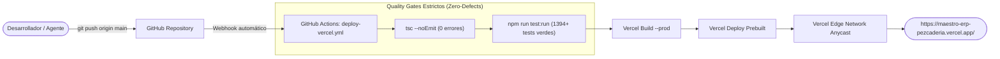

# 🚀 Guía de Despliegue Continuo (CI/CD): Vercel + GitHub Actions
## La Pezcadería ERP (`maestro_ERP_Pezcaderia`)

Esta guía documenta la infraestructura de entrega continua (CI/CD) para mantener la versión de producción ([https://maestro-erp-pezcaderia.vercel.app/](https://maestro-erp-pezcaderia.vercel.app/)) permanentemente sincronizada con la rama `main` del repositorio oficial en GitHub.

---

## 🏛️ 1. Arquitectura de Despliegue



---

## 🔑 2. Configuración de Secretos en GitHub (Paso a Paso)

Para que el runner de GitHub Actions pueda autenticarse de forma desatendida y desplegar sin errores, se requieren tres secretos en GitHub:

### Paso 2.1: Generar el Token de Vercel (`VERCEL_TOKEN`)
1. Inicia sesión en tu cuenta de Vercel: [https://vercel.com/login](https://vercel.com/login).
2. Dirígete a la configuración de tokens de usuario: [https://vercel.com/account/tokens](https://vercel.com/account/tokens).
3. Haz clic en el botón **"Create Token"**.
4. Diligencia los campos:
   - **Token Name:** `github-actions-maestro-erp`
   - **Scope:** Selecciona el equipo u organización (`team_WPyjpiE2nTUFMqd4bn0arY31` o cuenta personal asociada al proyecto).
   - **Expiration:** Selecciona `No Expiration` (o el periodo deseado para rotación periódica).
5. Haz clic en **"Create"** y copia el token generado de inmediato (solo se mostrará una vez).

---

### Paso 2.2: Registrar los Secretos en GitHub Actions
1. Ve al repositorio oficial en GitHub: [https://github.com/PezcaderiaSAS/maestro_ERP_Pezcaderia](https://github.com/PezcaderiaSAS/maestro_ERP_Pezcaderia).
2. Haz clic en la pestaña superior **Settings** $\rightarrow$ en la barra lateral izquierda despliega **Secrets and variables** $\rightarrow$ selecciona **Actions**.
   - URL directa: [https://github.com/PezcaderiaSAS/maestro_ERP_Pezcaderia/settings/secrets/actions](https://github.com/PezcaderiaSAS/maestro_ERP_Pezcaderia/settings/secrets/actions).
3. Haz clic en **"New repository secret"** y añade los siguientes 3 secretos:

| Nombre del Secreto | Valor Exacto | Descripción |
| :--- | :--- | :--- |
| **`VERCEL_TOKEN`** | `tu_token_copiado_en_paso_2.1` | Token personal de acceso a la API de Vercel. |
| **`VERCEL_ORG_ID`** | `team_WPyjpiE2nTUFMqd4bn0arY31` | Identificador del equipo/organización en Vercel. |
| **`VERCEL_PROJECT_ID`** | `prj_g7iK0oZHr5mVrhV9TTh7vWd4V5NZ` | Identificador del proyecto ERP en Vercel. |

> [!NOTE]
> Los identificadores `VERCEL_ORG_ID` y `VERCEL_PROJECT_ID` provienen de la vinculación oficial en [`.vercel/project.json`](file:///c:/Users/usuario/OneDrive/Documentos/Aplicaciones%20Pezca/MaestroPescaderia/.vercel/project.json). Si no se configuran explícitamente en los secretos de GitHub, el workflow [`.github/workflows/deploy-vercel.yml`](file:///c:/Users/usuario/OneDrive/Documentos/Aplicaciones%20Pezca/MaestroPescaderia/.github/workflows/deploy-vercel.yml) cuenta con esos mismos valores como fallback por defecto. El único secreto estrictamente mandatorio es **`VERCEL_TOKEN`**.

---

## ⚡ 3. Métodos de Despliegue Disponibles

### Método A: Despliegue Automático por Push (Recomendado)
- Cualquier commit empujado a la rama `main` activará el workflow de GitHub Actions:
  ```powershell
  git push origin main
  ```
- El workflow ejecutará los Quality Gates (`tsc` y `vitest`) y desplegará automáticamente a producción en menos de 2 minutos.

### Método B: Despliegue Manual bajo Demanda (GitHub UI)
1. Ve a la pestaña **Actions** en GitHub: [https://github.com/PezcaderiaSAS/maestro_ERP_Pezcaderia/actions](https://github.com/PezcaderiaSAS/maestro_ERP_Pezcaderia/actions).
2. En la lista izquierda selecciona **"Despliegue Continuo a Vercel Producción"**.
3. Haz clic en el botón desplegable **"Run workflow"** $\rightarrow$ rama `main` $\rightarrow$ **"Run workflow"**.

### Método C: Despliegue Local Asistido por CLI (`deploy:vercel`)
Si necesitas desplegar directamente desde tu máquina local (por ejemplo, para pruebas urgentes o contingencias de red):
```powershell
# 1. Despliegue directo pasando el token como argumento
npm run deploy:vercel -- --token=tu_vercel_token

# 2. O guarda el token en .env.local (VERCEL_TOKEN=...) y ejecuta simplemente:
npm run deploy:vercel

# 3. Despliegue a entorno de Preview (URL temporal de pruebas)
npm run deploy:vercel -- --preview

# 4. Modo simulación (Dry-run) para verificar configuración sin desplegar
npm run deploy:vercel -- --dry-run
```

---

## 🔄 4. Redundancia Adicional: Integración Nativa con Vercel Git App

Para obtener redundancia completa (de modo que Vercel también pueda desplegar directamente ante commits si GitHub Actions está en mantenimiento):
1. Ingresa a tu panel de Vercel: [https://vercel.com/](https://vercel.com/).
2. Selecciona el proyecto **`maestro-erp-pezcaderia`**.
3. Ve a **Settings** $\rightarrow$ **Git**.
4. En la sección **"Connected Git Repository"**, haz clic en **"Connect"** y selecciona `PezcaderiaSAS/maestro_ERP_Pezcaderia`.
5. Asegura que la **Production Branch** sea `main`.

---

## 🛡️ 5. Gobernanza de Calidad y Fallos en Producción

El pipeline implementa una política innegociable de **Cero-Defectos**:
- **Si `tsc --noEmit` detecta 1 error de tipado:** El runner aborta inmediatamente. No se genera ningún bundle de build.
- **Si Vitest detecta 1 test fallido (de los 1394+ tests):** El runner detiene el proceso y marca el job en rojo.
- **Inmutabilidad de Artefactos:** Vercel despliega exactamente los artefactos preconstruidos y validados por el runner mediante `vercel deploy --prebuilt --prod`.
- **Ruteo SPA:** [`vercel.json`](file:///c:/Users/usuario/OneDrive/Documentos/Aplicaciones%20Pezca/MaestroPescaderia/vercel.json) asegura que las rutas de React Router (ej. `/pos`, `/inventory`, `/cash`) no devuelvan error 404 al recargar la página en el navegador.

---

## 🔍 6. Verificación Post-Despliegue

Tras finalizar cualquier despliegue, verifica que la aplicación en vivo esté actualizada:
1. Abre [https://maestro-erp-pezcaderia.vercel.app/](https://maestro-erp-pezcaderia.vercel.app/).
2. Abre la consola de desarrollo del navegador (`F12`).
3. Confirma que la consola no arroje errores fatales y que los módulos recientes (`SPEC-041` a `SPEC-050`) estén disponibles en el menú de navegación.

