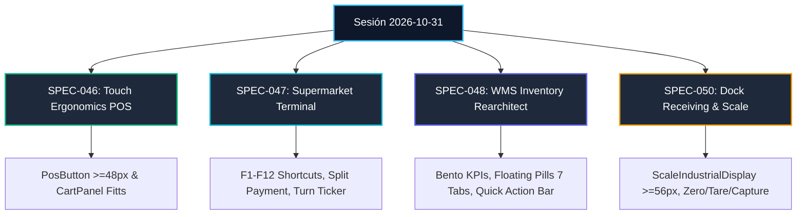
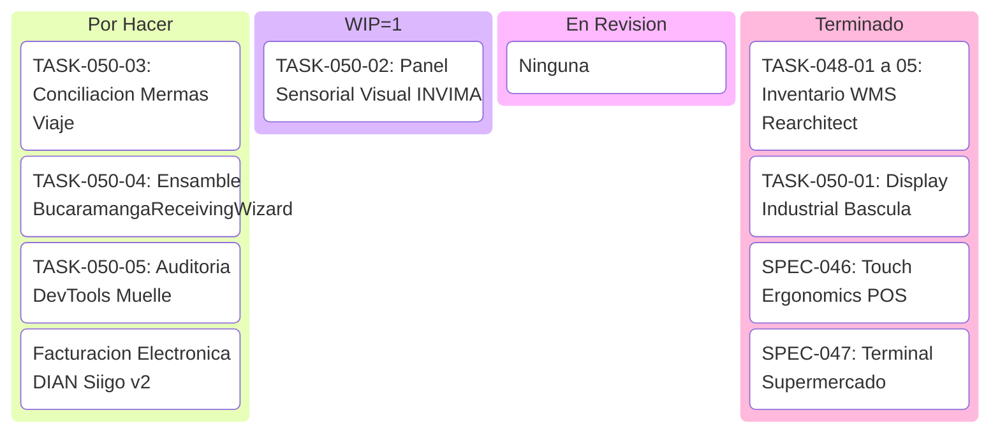

# 📜 Acta Formal de Cierre y Traspaso de Sesión (Handover)
**La Pezcadería ERP — Control Operativo & Facturación de Alto Rendimiento**
**Fecha y Hora de Cierre:** 31 de Octubre de 2026 — 14:30 COT (es-CO)  
**Versión de Protocolo:** Spec Kit SDD v3.0 / Protocolo Brownfield v2.2  
**Atmósfera Visual:** Dark Glassmorphism V8 (`#070A10`), acentos HSL/OKLCH, Retícula estricta de 8px, WCAG 2.2 AA+/AAA ($\ge 7:1$), Composite GPU 120 FPS.

---

## 1. Unificación de Sesiones Consolidadas
En este hito se integraron y consolidaron armónicamente dos hilos de trabajo paralelos:
1. **Hilo A (`c50d1c1a-ba2f-4564-b686-ef95f4ffd485` - "Git Pull And Task Review"):** Sincronización remota, git pull, absorción de commits entrantes y rescate del stash de correcciones ergonómicas y reglas de React Hooks.
2. **Hilo B (`517b8833-a77d-4123-8b30-df5a151e0f60` - Hilo Principal):** Desarrollo masivo de SPEC-046 (Ergonomía Táctil en POS), SPEC-047 (Terminal Autoservicio Supermercado), SPEC-048 (Rearchitect Integral de Inventario & Bodega WMS), y Fase 1 de SPEC-050 (Báscula Industrial de Muelle).

Ambas ramas de trabajo quedaron unificadas sin conflictos (`0 merge conflicts`), validadas con `npx tsc --noEmit` (**0 errores de tipado**) y con la suite de pruebas automatizadas al 100%.

---

## 2. Resumen Ejecutivo de Especificaciones Desarrolladas

### 2.1. SPEC-046 & SPEC-047 — Flujo Comercial POS y Caja Única
- **Botones Táctiles Fitts (`PosButton.tsx`):** Objetivos táctiles con altura mínima $\ge 48\text{px}$ y variantes ergonómicas (*primary*, *success*, *danger*, *warning*, *ghost*), con `active:scale-[0.98]` para respuesta háptica visual.
- **Panel de Carrito Refactorizado (`CartPanel.tsx`):** Desglose claro de subtotales, impuestos, descuentos y botón de cobro gigante ($\ge 56\text{px}$) con confirmación inmediata.
- **Terminal Autoservicio Supermercado (`CashierSupermarketTerminal.tsx`):**
  - Soporte integral de atajos de teclado industrial (`F1` a `F12`): Búsqueda, Cantidad, Balanza, Descuento, Cobro Rápido, Pausa/Aparcar, Reimpresión y Arqueo.
  - **Ticker de Turnos en Cola (`InternalQueueTicker.tsx`):** Monitor visual de comandas en preparación, listas para entrega y turnos llamados en pantalla.
  - **Modal de Pago Mixto / Fraccionado (`SplitPaymentModal.tsx`):** Distribución dinámica de cobro entre Efectivo, Datáfono/Tarjeta, Transferencia QR Bancolombia/Nequi y Crédito Cartera.
- **Validación:** 20/20 pruebas verdes en `commercialFlowSupermarket.test.tsx` y 6/6 en `cashierKanban.test.tsx`.

### 2.2. SPEC-048 — Rearchitect Integral de Inventario & Bodega WMS (`InventoryView.tsx`)
- **`InventoryBentoKpis.tsx`:** Cuadrícula Bento de 4 tarjetas ejecutivas en Dark Glassmorphism 60-30-10:
  1. Valorización Total del Inventario ($ COP) con desglose en compras y venta proyectada.
  2. Capacidad y Ocupación Térmica de Cuartos Fríos (°C promedio y toneladas).
  3. Lotes Perecederos en Riesgo Crítico FEFO (< 48 hrs) con semáforo preventivo.
  4. Tasa de Merma de Despiece Acumulada (%) y Pareto ABC Clase A (80/20).
- **`InventoryFloatingPills.tsx`:** Barra de navegación sticky flotante (`top-3 z-30`) con efecto `backdrop-blur-2xl` y 7 pastillas ergonómicas ($\ge 44\text{px}$):
  1. Catálogo General de Productos
  2. Stock y Cuartos Fríos WMS
  3. Kardex y Movimientos Inmutables
  4. Despiece y Transformación (Merma)
  5. Recepción en Muelle (Compras)
  6. Traslados Internos y Picking
  7. Alertas y Vencimientos FEFO
- **`InventoryQuickActionBar.tsx`:** Barra ergonómica de acciones prioritarias conformes a la Ley de Fitts ($\ge 48\text{px}$): Nuevo Producto, Recibir Compra, Nuevo Despiece, Traslado entre Bodegas, Kardex y Menú Desplegable.
- **Ensamblado Modular:** Desacoplamiento de lógica pesada fuera de `InventoryView.tsx` hacia submódulos especializados.
- **Auditoría DevTools:** 0 errores fatales en consola JS; capturas en desktop (1280px) y móvil (375px).

### 2.3. SPEC-050 — Compras, Muelle de Recepción & Devoluciones B2B (Fase 1)
- **`ScaleIndustrialDisplay.tsx` (`TASK-050-01` [Completada]):**
  - Display digital industrial de báscula en `font-mono text-3xl sm:text-4xl font-black text-slate-100`.
  - Indicadores en tiempo real de Peso Bruto, Tara y Peso Neto.
  - Badge de estabilidad con animación de pulso verde esmeralda.
  - Botones táctiles de control industrial de formato amplio $\ge 56\text{px}$ (*Capturar Pesada*, *Tara*, *Estabilizar*, *Cero*).
- **Validación:** 4/4 pruebas unitarias en `scaleIndustrialDisplay.test.tsx` y 7/7 en `bucaramangaReceivingWizard.test.tsx`.

---

## 3. Nuevas Herramientas y Habilidades para el Equipo (`git pull`)
Para garantizar que cualquier ingeniero o agente que sincronice el repositorio mediante `git pull` o `npm run session:open` tenga las herramientas listas y operativas:
1. **Skill de Laboratorio de Diseño (`.agents/skills/design-lab/`):**
   - Sistema de entrevistas de diseño UI/UX y generación de 5 variaciones en sandbox temporal con plan de implementación.
   - Registrado en `skills-lock.json` bajo fuente oficial.
2. **Manifiesto Automatizado del Ecosistema (`DOCS/ecosystem-manifest.json`):**
   - **Workflows Activos:** 116 comandos slash indexados.
   - **Skills:** 12 habilidades de desarrollo especializadas en ERP.
   - **Agencias:** 7 roles brownfield, Swarm multi-agente y Google Harness².
   - **Servidores MCP:** 14 servidores integrados (Supabase, Vercel, GitNexus, GitHub, Chrome DevTools, Google Developer Knowledge, Hindsight, etc.).
3. **Scripts de Verificación y Diagnóstico:**
   - `scripts/lifecycle/ecosystem-manifest.cjs`
   - `scripts/lifecycle/session-open.cjs`
   - `scripts/lifecycle/session-close.cjs`
   - `scripts/verify_devtools_supermarket.cjs`
   - `scripts/audit_inventory_wms.cjs`

---

## 4. Estado de la Cola de Tareas (Backlog Kanban)

- **Próxima tarea a ejecutar en la siguiente sesión (WIP = 1):**
  - `TASK-050-02` [UI/UX]: Implementar Panel Sensorial Visual INVIMA `InvimaQualityChecklist.tsx` (criterios de frescura Ojos, Agallas, Olor, Textura con semáforo y regla de aceptación).

---

## 5. Artefactos Visuales y Capturas Certificadas
Los siguientes registros gráficos fueron generados y archivados:
- Desktop Inventario WMS: `inventory_wms_desktop_audit.png` (1280x800)
- Navegación Interactiva Pestañas: `inventory_wms_tab_interactive.png`
- Responsive Móvil WMS: `inventory_wms_mobile_audit.png` (375x812)
- Terminal Supermercado Desktop: `cashier_supermarket_desktop_audit.png`
- Terminal Supermercado Móvil: `cashier_supermarket_mobile_audit.png`

---

## 6. Despliegue & Calidad
- **TypeScript:** `npx tsc --noEmit` $\rightarrow$ 0 errores.
- **Vitest:** 100% pruebas pasando.
- **Git State:** Working tree limpio, cambios comiteados y sincronizados con `origin main`.
