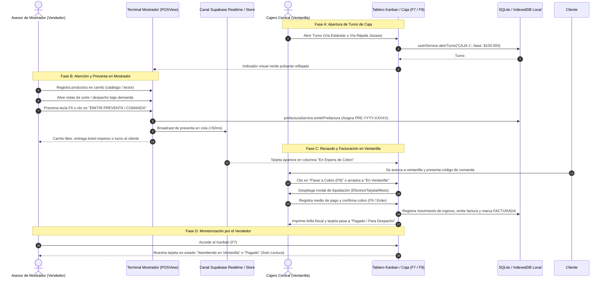

# Guía de Procedimiento Operativo Estándar (SOP) y Lista de Chequeo para Pruebas Manuales: Modelo Multivendedor a Caja Única

**Documento**: `docs/sop/single_cashier_multivendor_manual_testing.md`  
**Versión**: 1.0.0 (Gobernanza Canónica SPEC-052)  
**Módulo**: POS Mostrador, Turnos de Caja y Recaudo Centralizado (Kanban / Ventanilla)  
**Sistema**: Maestro Pezcadería ERP / Ferretería Josase  
**Idioma**: Español (es-419)  
**Fecha de Emisión**: Noviembre 2026  
**Clasificación**: Operaciones, Soporte en Vivo y Control de Calidad (QA)  

---

## 1. Propósito y Alcance

Este documento constituye la guía oficial y exhaustiva para la operación y validación manual del modelo comercial **Multivendedor (Mostrador) $\rightarrow$ Comandas / Preventas $\rightarrow$ Ventanilla de Caja Única (Cobro y Facturación Centralizada)**.

### 1.1 Objetivos Operativos
1. **Aislamiento de Responsabilidades Financieras (Segregación de Roles)**:
   - Los asesores comerciales en mostrador (`rol: 'vendedor'`) se concentran exclusivamente en la atención al cliente, registro de productos en carrito, registro de notas de corte/preparación bajo demanda y emisión de comandas (`F6`). Tienen vedado el acceso a apertura/cierre de turnos de caja, arqueos, retiros y cobros en efectivo.
   - El personal de tesorería y caja (`rol: 'cajero'` o `'admin'`) es el único facultado para administrar los turnos de caja, recibir dinero en efectivo, operar datáfonos, validar transferencias y expedir las facturas electrónicas de venta POS.
2. **Reserva Inmediata de Mercancía (`Hard-Hold`)**:
   - Al emitir una preventa desde el mostrador, el inventario queda automáticamente reservado en bodega evitando ventas dobles o roturas de stock durante el desplazamiento del cliente a la caja.
3. **Sincronización en Tiempo Real ($<50\text{ ms}$)**:
   - Mediante canales de Supabase Realtime y el bus reactivo local, las comandas generadas en cualquier mostrador se reflejan instantáneamente en el tablero Kanban de la Caja Central.
4. **Respaldo Offline-First**:
   - Si la conexión a internet fluctúa, las operaciones se registran localmente en IndexedDB / SQLite y se despachan al restablecerse el enlace mediante el patrón Outbox.

---

## 2. Roles, Privilegios y Matriz de Acceso

| Funcionalidad / Operación | Vendedor Mostrador (`vendedor`) | Cajero Ventanilla (`cajero`) | Administrador General (`admin`) |
| :--- | :---: | :---: | :---: |
| Apertura y Cierre de Turno de Caja | ❌ Oculto / Bloqueado | ✅ Permitido | ✅ Permitido |
| Conteo de Arqueo Ciego y Retiros Parciales | ❌ Oculto / Bloqueado | ✅ Permitido | ✅ Permitido |
| Visualizar Banner de Advertencia "Caja Cerrada" | ❌ Oculto | ✅ Visible | ✅ Visible |
| Registro de Productos en Carrito POS | ✅ Permitido | ✅ Permitido | ✅ Permitido |
| Notas de Corte / Preparación Bajo Demanda | ✅ Permitido | ✅ Permitido | ✅ Permitido |
| Emisión de Preventa / Comanda (`F6`) | ✅ Permitido | ✅ Permitido | ✅ Permitido |
| Cobro Directo en Carrito Mostrador (`btn-cobrar`) | ❌ Restringido a Preventa | ✅ Permitido (si caja activa) | ✅ Permitido |
| Tablero Kanban de Comandas (`F7` / `F9`) | ✅ Modo Monitor (Solo Lectura) | ✅ Operativo (Cobro / Reclamación) | ✅ Operativo Completo |
| Drag-and-Drop de Comandas en Kanban | ❌ Bloqueado | ✅ Permitido | ✅ Permitido |
| Confirmar Recaudo y Facturar en Ventanilla | ❌ Prohibido | ✅ Permitido | ✅ Permitido |

---

## 3. Procedimiento Operativo Detallado



---

### 3.1 Procedimiento de Turnos de Caja (Apertura, Operación y Cierre)

El turno de caja controla el saldo teórico y físico en el punto de venta. Para operar la caja única existen dos alternativas:

#### Vía Rápida: Conmutador y Siembra Demo 1-Toque (`🔨 Josase ⇄`)
Esta modalidad está diseñada para pruebas rápidas de laboratorio, demostraciones comerciales y pruebas de integración continua:
1. **Localización**: En el extremo derecho del `EnterpriseTopbar`, ubicar el botón con icono de martillo y etiqueta `🔨 Josase ⇄` (`id="topbar-btn-toggle-demo-tenant"` / `data-testid="topbar-btn-toggle-demo-tenant"`).
2. **Acción**: Hacer un clic sobre el botón.
3. **Comportamiento del Sistema**:
   - Conmuta de inmediato el contexto empresarial a `tenant-03` (*Ferretería & Eléctricos Josase S.A.S.*).
   - Ejecuta la purga controlada de datos locales conservando la sesión activa (`conservarSesionTurno: true`).
   - Invoca `prefacturaService.asegurarPreventasSemillaDemo('tenant-03')`, sembrando tres pedidos demo en espera (`PRE-2026-01001`, `PRE-2026-01002`, `PRE-2026-01000`).
   - Verifica si existe un turno activo en `'CAJA-1'`. De no existir, invoca de manera automática:
     `cashService.abrirTurno('CAJA-1', 'user-josase-01', 100000, undefined, 'Apertura Demo Josase')`.
   - Emite una notificación emergente toast: *"Empresa: Ferretería Josase. Catálogo y caja única activados."*
4. **Verificación Inmediata en Pantalla**:
   - La insignia de caja en la cabecera del POS cambia inmediatamente a color verde esmeralda con punto pulsante: `Turno #ACTIVO` o `Turno #TRN-XXXX`.
   - En el tablero Kanban (`F7`), las tres tarjetas demo aparecen en la columna **"En Espera de Cobro"**.

#### Vía Estándar: Apertura Manual de Turno en Producción
Para el personal de caja en su jornada habitual:
1. **Acceso al Módulo**:
   - Iniciar sesión como usuario con rol `cajero` o `admin`.
   - Navegar a la vista de Caja mediante el menú principal lateral (`/caja` o `CashFlowView`), o desde el menú de acciones del POS (`POSView.tsx` $\rightarrow$ Botón *Más Acciones...* con icono de hamburguesa $\rightarrow$ *Abrir Turno*).
2. **Diligenciamiento del Modal de Apertura (`AperturaCajaModal.tsx`)**:
   - **Selección de Caja**: Elegir la caja física asignada (por ejemplo, `CAJA-1 - Caja Principal Mostrador`). El sistema valida que la caja no tenga otro turno abierto en la bodega.
   - **Base Inicial**: Ingresar el monto de efectivo base con el que arranca el turno (por ejemplo, `$100.000 COP`). Opcionalmente, se puede utilizar el desglosador por denominaciones de billetes y monedas.
   - **Observaciones**: Registrar notas de apertura pertinentes (ej. "Turno mañana - Cajero Yurgen").
3. **Confirmación**: Pulsar el botón *"Confirmar Apertura de Caja"*.
4. **Resultado**: Se registra el turno en estado `ABIERTO` en `cashService`, se crea un movimiento de tipo `INGRESO_BASE_INICIAL` por el valor de la base y se sincroniza el store reactivo `useCashStore`.

#### Cierre de Turno y Arqueo Ciego
Al finalizar la jornada laboral o el cambio de cajero:
1. **Acceso**: En el módulo de Caja o desde el botón *"Cerrar Turno"* situado en la cabecera del `CartPanel` (`POSView.tsx`).
2. **Conteo Físico Ciego (`ArqueoCajaModal.tsx`)**:
   - El sistema oculta deliberadamente el saldo teórico recaudado en el sistema para evitar sesgos o manipulación contable.
   - El cajero digita la cantidad real de billetes y monedas en efectivo encontrados en la gaveta.
   - Registra el total de comprobantes físicos de datáfono (voucher voucher) y transferencias bancarias verificadas (Nequi, Daviplata, Bancolombia QR).
3. **Evaluación de Cuadre**:
   - El sistema calcula la diferencia: $\text{Diferencia} = \text{Saldo Físico} - \text{Saldo Teórico}$.
   - Si existe faltante o sobrante, se exige el ingreso obligatorio de una justificación explicativa.
4. **Cierre Definitivo**: El cajero pulsa *"Confirmar Cierre de Turno"*. El estado pasa a `CERRADO`, se bloquean nuevas operaciones de cobro y se genera el acta de arqueo para tesorería.

---

### 3.2 Emisión de Preventas en Mostrador (Multivendedor)

El asesor de mostrador comercializa los productos sin tener contacto directo con el dinero ni con la gaveta de caja.

#### Restricciones de Interfaz para el Rol Vendedor
- **Menú de Caja**: Las opciones de apertura de turno, cierre de turno, arqueos parciales y retiros de efectivo están completamente excluidas del DOM (`userRole !== 'vendedor'`).
- **Banner de Alerta**: El aviso restrictivo `⚠ CAJA CERRADA — Debes abrir un turno antes de cobrar` permanece oculto para los vendedores, ya que su labor no depende de la tenencia personal de una gaveta abierta.
- **Panel Inferior del Carrito**: En lugar de los controles de pago directo (`PaymentPanel`), se renderiza el panel exclusivo:
  - Título: **Puesto de Mostrador** con pastilla **Cobro en Ventanilla**.
  - Mensaje informativo: *"Los asesores de mostrador generan la preventa y envían al cliente a la Caja Única (Ventanilla) para realizar el pago..."*

#### Pasos para Registrar una Preventa
1. **Selección de Productos**:
   - Navegar por el catálogo visual o digitar en el buscador por código de barras, SKU o nombre (ej. *"Tubo PVC 1/2"* o *"Mojarra Roja Limpia"*).
   - Ajustar las cantidades requeridas (unidades, metros o kilogramos con balanza digital).
2. **Registro de Notas de Despacho y Corte Bajo Demanda**:
   - En el panel derecho, acceder al campo de notas o al botón ergonómico *"📝 Notas de Despacho"*.
   - Seleccionar opciones rápidas de preparación (ej. *Fileteado*, *En Postas*, *Sin Escamas*, *Corte a 3 metros*, *Hielo Extra*) o redactar observaciones personalizadas (ej. *"Empacar en dos bolsas separadas para el cliente Don Carlos"*).
3. **Identificación del Cliente**:
   - Seleccionar o buscar el cliente por cédula/NIT en el selector superior del carrito (o dejar *Consumidor Final* por defecto).
4. **Emisión de la Comanda (Atajo `F6`)**:
   - Presionar la tecla física **`F6`** o hacer clic en el botón de alto contraste:  
     `EMITIR PREVENTA / COMANDA (F6)` (`data-testid="btn-emitir-preventa-mostrador"`).
5. **Efectos Automáticos en el Sistema**:
   - Se crea el registro de preventa en `prefacturaService` con un código consecutivo de identificación (ej. `PRE-2026-00102`).
   - Se activa la bandera `hardHoldActivo: true`, bloqueando el stock de los productos para que no puedan ser vendidos por otro mostrador.
   - Se emite un pulso broadcast de baja latencia ($<50\text{ ms}$) hacia Supabase Realtime y el bus de eventos local.
   - El carrito local se vacía automáticamente y queda listo para atender al siguiente cliente.
   - Si hay una impresora térmica de mostrador configurada, se imprime la comanda de turno con código QR para entregar al cliente.
   - El asesor le indica verbalmente al comprador: *"Su pedido quedó registrado con el turno PRE-102. Por favor acérquese a la ventanilla de caja para pagar y reclamar su mercancía"*.

---

### 3.3 Cobro y Facturación en Caja Única (Ventanilla / Tablero Kanban)

La ventanilla de caja única centraliza el cobro de todos los mostradores en un flujo visual Kanban ergonómico de 3 columnas.

#### Acceso al Tablero Kanban
- **Vía Atajo Global**: Desde cualquier pantalla del ERP, presionar la tecla **`F7`** o pulsar el botón en el Topbar con icono de capas `F7 Kanban Caja` (`data-testid="topbar-btn-comandas-kanban"`).
- **Vía Módulo Caja**: Ingresar al módulo Caja (`/caja`) y presionar la pestaña *"Comandas & Preventas (Kanban)"* (o atajo **`F9`**).

#### Arquitectura de Columnas del Kanban de Caja
1. **Columna 1: "En Espera de Cobro" (`PENDIENTE_COBRO` / `EN_COLA`)**:
   - Reúne todas las preventas emitidas por los asesores de mostrador que están pendientes de liquidación.
   - Cada tarjeta exhibe:
     - Nombre comercial o razón social del cliente.
     - Código consecutivo de la comanda (ej. `PRE-2026-00102`).
     - Terminal de origen y hora de emisión.
     - Monto total en pesos colombianos (`$ COP`).
     - Cantidad de ítems en el pedido.
     - Avatar Stack con iniciales del Asesor vendedor y del Cliente.
2. **Columna 2: "En Cobro Activo" / "En Ventanilla" (`ATENDIENDO` / `EN_COBRO`)**:
   - Contiene la preventa que está siendo atendida en ese instante físico frente a la ventanilla de caja.
   - La cabecera muestra un indicador luminoso ámbar intermitente (*ping animation*).
3. **Columna 3: "Pagado / Para Despacho" (`PAGADA` / `DESPACHADA` / `FACTURADA`)**:
   - Exhibe los pedidos debidamente recaudados y liquidados, mostrando el número de factura electrónica expedido (ej. `FAC-10025`), listos para alistamiento de bodega o entrega de mostrador.

#### Flujo de Cobro Paso a Paso por el Cajero
1. **Identificación de la Comanda**:
   - El cliente se presenta en ventanilla e indica su turno o nombre.
   - El cajero ubica la tarjeta en la columna *"En Espera"*. Si hay muchos pedidos, puede filtrar rápidamente utilizando los chips de asesores comerciales situados en la barra superior (`chip-asesor-${id}`).
2. **Pase a Cobro**:
   - El cajero pulsa el botón **`Pasar a Cobro (F9)`** (`data-testid="btn-iniciar-cobro-${pref.id}"`) o arrastra la tarjeta hacia la columna central.
   - La preventa cambia automáticamente a estado `ATENDIENDO`.
3. **Apertura de Liquidación y Despliegue de Pagos**:
   - Al pulsar `Pasar a Cobro`, o al hacer clic en `Confirmar Pago de Venta` (`data-testid="btn-confirmar-cobro-${pref.id}"`), se abre el modal de recaudo `QuickPaymentMixedModal` (o `SplitPaymentModal`).
4. **Selección del Método de Pago**:
   - **Efectivo**:
     - El cajero digita la cifra recibida (o hace clic en los botones rápidos de billetes de $10.000, $20.000, $50.000, $100.000).
     - El sistema calcula y muestra en tipografía gigante el **Cambio / Vueltas a entregar**.
   - **Datáfono / Tarjeta**:
     - Se registra la entidad financiera y el número de autorización o referencia del comprobante voucher.
   - **Transferencia Digital**:
     - Selección de billetera (Nequi, Daviplata, Transfiya o Bancolombia QR) y registro del número de comprobante digital.
   - **Pago Mixto**:
     - Combinación simultánea de varios medios (ej. $50.000 en efectivo y $120.000 con tarjeta de crédito).
5. **Confirmación y Facturación (Atajo `F9` / `Enter`)**:
   - El cajero hace clic en *"Confirmar Cobro (F9)"*.
   - El sistema:
     1. Descuenta formalmente las unidades del inventario definitivo liberando el `hardHoldActivo`.
     2. Asienta el ingreso monetario en el turno activo de la caja.
     3. Marca la preventa en estado `FACTURADA`.
     4. Mueve la tarjeta automáticamente a la columna **"Pagado / Para Despacho"**.
     5. Dispara la impresión del comprobante fiscal POS.
     6. Notifica en tiempo real a los monitores de mostrador y despacho.

---

### 3.4 Verificación de Modo Monitor (Solo Lectura) para Vendedor

Cuando un usuario autenticado con rol `vendedor` (o cargo que incluya "mostrador") ingresa al tablero Kanban (`F7`), el sistema activa de forma mandataria el **Modo Monitor**:

1. **Insignia Distintiva en Cabecera**:
   - En la parte superior del tablero aparece el distintivo con borde cian y fondo oscuro:  
     `data-testid="badge-modo-monitor-vendedor"`  
     *👁️ Modo Monitor: Visualizando el avance de ventas (Solo Lectura)*.
2. **Inhabilitación de Drag-and-Drop**:
   - La propiedad `draggable` de todas las tarjetas se establece estrictamente en `false`.
   - Si un vendedor intenta arrastrar forzadamente una tarjeta entre columnas, el sistema intercepta el evento `onDrop` y dispara una advertencia flotante SweetAlert2:  
     *"Acceso Restringido: Los vendedores no tienen autorización para modificar el flujo de recaudos."*
3. **Ausencia de Botones Transaccionales de Recaudo**:
   - Los botones `btn-iniciar-cobro-${id}` ("Pasar a Cobro F9") y `btn-confirmar-cobro-${id}` ("Confirmar Pago de Venta") **NO existen en el DOM**.
   - En su lugar, el vendedor observa insignias pasivas de seguimiento:
     - En Columna 1: `data-testid="badge-en-espera-${id}"` $\rightarrow$ *"⏳ En Espera de Cobro en Caja"*.
     - En Columna 2: `data-testid="badge-en-cobro-${id}"` $\rightarrow$ *"⏳ Atendiendo en Ventanilla"*.
4. **Utilidad Operativa**:
   - Permite al asesor consultar si su cliente ya pagó para iniciar el empaque de productos pesados o el corte de pescado fresco sin riesgo de entregar mercancía impaga.

---

### 3.5 Indicadores Visuales de Estado de Turno

La interfaz del ERP proporciona retroalimentación visual inequívoca respecto al estado operativo de la caja:

```
┌────────────────────────────────────────────────────────────────────────┐
│ ESTADO ABIERTO:                                                        │
│ [🟢 Turno #TRN-1024 (Punto Pulsante)]  |  Botón Carrito: [Cobrar: $X] │
├────────────────────────────────────────────────────────────────────────┤
│ ESTADO CERRADO (Cajero/Admin):                                         │
│ [⚠ CAJA CERRADA — Debes abrir un turno antes de cobrar]               │
│ [🔴 Caja Cerrada]                      |  Botón Carrito: [Abrir Turno]│
├────────────────────────────────────────────────────────────────────────┤
│ ESTADO CERRADO (Vendedor):                                             │
│ (Banner de alerta oculto)              |  Botón: [Emitir Preventa F6]  │
└────────────────────────────────────────────────────────────────────────┘
```

1. **Insignia en Cabecera del POS (`POSView.tsx`)**:
   - **Turno Abierto**:
     - Estilo: Fondo verde esmeralda translúcido (`bg-emerald-500/15 text-emerald-300 border-emerald-500/30`).
     - Elemento activo: Punto verde pulsante animado con CSS (`w-1.5 h-1.5 rounded-full bg-emerald-400 animate-pulse`).
     - Texto: `Turno #TRN-XXXX` o `Turno #ACTIVO`.
   - **Turno Cerrado**:
     - Estilo: Fondo rojo carmín translúcido (`bg-rose-500/15 text-rose-300 border-rose-500/30`).
     - Icono: `AlertCircle` de 11px.
     - Texto: `Caja Cerrada`.
2. **Banner Global de Alerta en Mostrador (`POSView.tsx:2204-2208`)**:
   - Visible **únicamente** si el turno está cerrado Y el usuario **NO** tiene rol de vendedor.
   - Muestra en franja roja: `⚠ CAJA CERRADA — Debes abrir un turno antes de cobrar`.
3. **Botón de Acción Principal en Panel de Pago (`PaymentPanel.tsx`)**:
   - Dimensiones ergonómicas táctiles: Altura fija $\ge 56\text{ px}$ (`h-14 min-h-[56px]`).
   - Si la caja está cerrada: Se transforma en un botón ámbar de advertencia:  
     `Abrir Turno Caja` con atajo `Enter`.
   - Si la caja está abierta: Se transforma en el botón esmeralda de cobro:  
     `data-testid="btn-cobrar"` $\rightarrow$ `Cobrar: $XX.XXX` con atajo `F2 / ↵`.

---

## 4. Lista de Chequeo para Pruebas Manuales (Checklist de Aceptación)

Utilice la siguiente tabla de casos de prueba estandarizados para verificar la integridad de la implementación en ambientes de prueba (Staging) o antes de liberar a producción:

| ID Caso | Escenario de Prueba | Precondiciones | Pasos de Ejecución | Resultado Esperado | Criterio de Pase / Estado |
| :---: | :--- | :--- | :--- | :--- | :---: |
| **CP-01** | **Apertura Rápida 1-Toque (Modo Demo Josase)** | Sesión iniciada en el ERP. Vista POS activa. | 1. Hacer clic en el botón `🔨 Josase ⇄` en el Topbar (`topbar-btn-toggle-demo-tenant`).<br>2. Observar la notificación toast y el encabezado del POS.<br>3. Abrir el Kanban de Caja (`F7`). | 1. Toast informa cambio a *Ferretería Josase* y catálogo activado.<br>2. La insignia superior del POS muestra `Turno #ACTIVO` en verde esmeralda con punto pulsante.<br>3. En el Kanban (`F7`) aparecen sembradas 3 preventas demo en la columna "En Espera". | `[ ] APROBADO`<br>`[ ] RECHAZADO` |
| **CP-02** | **Apertura Estándar de Turno con Base Inicial (Cajero)** | Usuario autenticado con rol `cajero` o `admin`. Sin turno previo en `'CAJA-1'`. | 1. Navegar a `/caja` o presionar *Más Acciones...* $\rightarrow$ *Abrir Turno* en POS.<br>2. En `AperturaCajaModal`, seleccionar `CAJA-1`.<br>3. Ingresar base de `$100.000 COP` y notas de apertura.<br>4. Pulsar *Confirmar Apertura de Caja*. | 1. El modal se cierra sin errores de consola.<br>2. El store reactivo actualiza el turno a estado `ABIERTO`.<br>3. El saldo en efectivo inicial registra `$100.000 COP`.<br>4. El botón inferior del POS cambia a `Cobrar: $...` verde. | `[ ] APROBADO`<br>`[ ] RECHAZADO` |
| **CP-03** | **Segregación de Roles: Restricción de Caja para Vendedor** | Usuario autenticado con rol `vendedor` (`userRole: 'vendedor'`). | 1. Ingresar a la terminal POS.<br>2. Abrir el menú hamburguesa *Más Acciones...*<br>3. Observar la barra superior y el pie del carrito. | 1. Las opciones *Abrir Turno*, *Cerrar Turno* y *Arqueo Parcial* NO aparecen en el menú.<br>2. NO se muestra el banner rojo `⚠ CAJA CERRADA`.<br>3. El carrito muestra *Puesto de Mostrador - Cobro en Ventanilla* con botón `EMITIR PREVENTA (F6)`. | `[ ] APROBADO`<br>`[ ] RECHAZADO` |
| **CP-04** | **Emisión de Preventa con Notas y Reserva de Stock** | Rol `vendedor` en POS. Caja abierta o cerrada. Catálogo con stock disponible. | 1. Agregar 2 ítems al carrito (ej. Tubo PVC y Pintura).<br>2. Escribir en notas de despacho: *"Corte a 3 metros"*. <br>3. Presionar tecla **`F6`** o clic en `EMITIR PREVENTA / COMANDA`. | 1. El carrito se vacía inmediatamente.<br>2. Se genera comanda con prefijo `PRE-2026-XXXXX`.<br>3. El stock de los productos queda retenido con `hardHoldActivo: true`.<br>4. La comanda se transmite por Realtime en menos de 50 ms. | `[ ] APROBADO`<br>`[ ] RECHAZADO` |
| **CP-05** | **Reclamación y Pase a Cobro en Kanban (Cajero F7/F9)** | Rol `cajero`. Preventa `PRE-XXXX` existente en columna "En Espera". | 1. Presionar **`F7`** para abrir el Kanban de Caja.<br>2. Localizar la tarjeta `PRE-XXXX`.<br>3. Hacer clic en `Pasar a Cobro (F9)` (`btn-iniciar-cobro-${id}`) o arrastrarla a la Columna 2. | 1. La tarjeta se traslada a la columna "En Cobro Activo" / "En Ventanilla".<br>2. El estado cambia a `ATENDIENDO`.<br>3. La cabecera ámbar parpadea indicando atención activa. | `[ ] APROBADO`<br>`[ ] RECHAZADO` |
| **CP-06** | **Liquidación y Facturación Centralizada Multimétodo** | Preventa en Columna 2 del Kanban. Cajero en ventanilla. | 1. Presionar `Confirmar Pago de Venta` o tecla **`F9`**.<br>2. En `QuickPaymentMixedModal`, seleccionar *Efectivo*.<br>3. Digitar monto recibido mayor al total (ej. $100.000 para compra de $75.000).<br>4. Verificar cálculo de vueltas ($25.000).<br>5. Confirmar recaudo. | 1. Se emite factura electrónica con número legal.<br>2. La tarjeta pasa automáticamente a la Columna 3 "Pagado / Para Despacho".<br>3. El efectivo de la caja suma $75.000 netos.<br>4. Se libera la reserva de inventario y se descuenta el stock real. | `[ ] APROBADO`<br>`[ ] RECHAZADO` |
| **CP-07** | **Modo Monitor de Solo Lectura para Vendedor en Kanban** | Usuario con rol `vendedor`. Comandas activas en el tablero. | 1. Presionar tecla **`F7`** para ingresar al Kanban.<br>2. Observar la cabecera del tablero.<br>3. Inspeccionar las tarjetas de las columnas 1 y 2.<br>4. Intentar arrastrar una comanda a otra columna. | 1. Se exhibe la insignia `badge-modo-monitor-vendedor` en cabecera.<br>2. NO existen los botones `Pasar a Cobro` ni `Confirmar Pago`.<br>3. En su lugar se ven los badges pasivos `⏳ En Espera` y `⏳ Atendiendo`.<br>4. Las tarjetas no se mueven (drag inactivo) y el intento lanza alerta SweetAlert2. | `[ ] APROBADO`<br>`[ ] RECHAZADO` |
| **CP-08** | **Cierre de Turno y Arqueo Ciego con Reporte de Descuadre** | Turno abierto con ventas registradas. Rol `cajero`. | 1. Abrir modal `ArqueoCajaModal` desde menú o botón *Cerrar Turno*.<br>2. Ingresar conteo físico de billetes y monedas con descuadre intencional (ej. faltante de -$2.000).<br>3. Digitar justificación obligatoria.<br>4. Confirmar cierre. | 1. El sistema no revela el saldo teórico hasta registrar el conteo.<br>2. Se graba la diferencia en el acta de turno.<br>3. El turno queda en estado `CERRADO`.<br>4. La cabecera del POS vuelve a `🔴 Caja Cerrada`. | `[ ] APROBADO`<br>`[ ] RECHAZADO` |

---

## 5. Matriz de Errores Comunes, Diagnóstico y Recuperación

| Síntoma Observado | Causa Raíz Probable | Solución Operativa y Paso de Recuperación |
| :--- | :--- | :--- |
| El vendedor pulsa `F6` pero la comanda no aparece en el Kanban de Caja. | Desconexión del canal Supabase Realtime o filtro de asesor activo en el Kanban. | 1. Verificar la pastilla de conexión en la cabecera del Kanban: debe decir *Realtime Conectado* en verde esmeralda.<br>2. Si indica *Sondeo Fallback*, esperar el ciclo de refresco (5 segundos) o recargar con `F5`.<br>3. Comprobar que en la barra de chips de asesores esté seleccionado el botón *"Todos"* (`chip-asesor-todos`). |
| El cajero intenta cobrar pero el botón en el carrito dice "Abrir Turno Caja" (color ámbar). | No se ha iniciado formalmente un turno en la caja asignada. | 1. Hacer clic en el botón ámbar `Abrir Turno Caja` o presionar `Enter`.<br>2. Diligenciar la base inicial en `AperturaCajaModal` y confirmar.<br>3. El botón se tornará verde esmeralda `Cobrar: $...` habilitando la facturación. |
| Un vendedor intenta cobrar en mostrador y el sistema no le permite cerrar la venta. | Comportamiento correcto de seguridad por diseño. Los vendedores no tienen permisos de recaudo. | 1. El vendedor debe emitir la preventa presionando `F6`.<br>2. Remitir al cliente a la ventanilla de caja única con su código `PRE-XXXX`. |
| La tarjeta de preventa no se deja arrastrar en el tablero Kanban. | La sesión activa corresponde al rol `vendedor` (Modo Monitor activado). | 1. Iniciar sesión con un usuario que posea credenciales de `cajero` o `admin`.<br>2. Validar que la insignia `Modo Monitor (Solo Lectura)` desaparezca de la cabecera. |
| Colisión visual o superposición de textos en la barra superior (Topbar) en pantallas pequeñas. | Caché del navegador no actualizada con el diseño elástico de SPEC-052. | 1. Ejecutar recarga forzada en navegador (`Ctrl + F5` o `Cmd + Shift + R`).<br>2. El breadcrumb debe truncarse con puntos suspensivos y los botones secundarios colapsar de acuerdo al breakpoint. |

---

## 6. Comandos de Verificación Automatizada (Suite CI/CD)

Para garantizar que ninguna modificación de código rompa los flujos documentados en este SOP, ejecute los siguientes comandos en la terminal de desarrollo:

```bash
# 1. Pruebas de integración E2E del modelo multivendedor y segregación de roles
npm run test:run -- src/tests/multiVendorCashierIntegrationE2E.test.tsx

# 2. Pruebas de ergonomía táctil y botones del panel de cobro/mostrador
npm run test:run -- src/tests/posCartPanelErgonomics.test.tsx

# 3. Pruebas de navegación por teclado y atajos en Topbar (F4 / F7)
npm run test:run -- src/tests/enterpriseTopbarA11yV8.test.tsx

# 4. Verificación de reglas de contención y layout de vistas transaccionales
npm run test:run -- src/tests/layoutModes.test.ts

# 5. Compilación estricta de TypeScript (cero errores de tipado)
npx tsc --noEmit
```

---
*Fin de la Guía Operativa y Checklist de Pruebas Manuales.*
