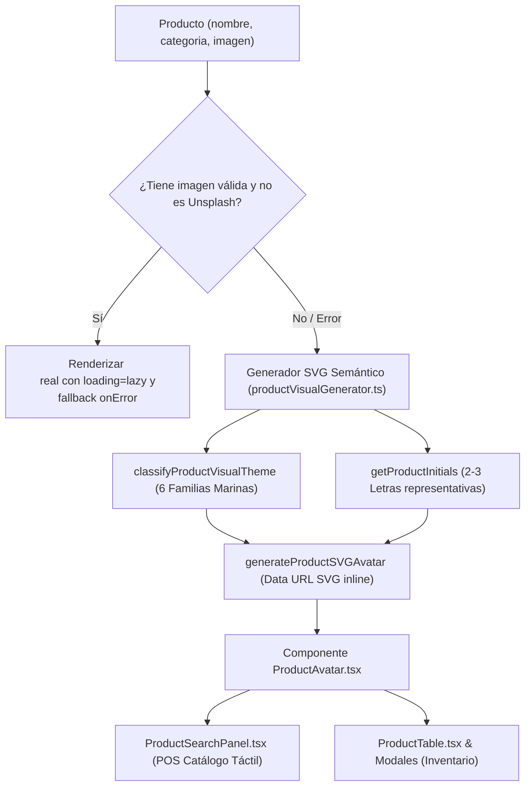

# Plan de Ingeniería Brownfield (SDD 011)
## Optimización de Iconos Ligeros y Visualización Semántica de Productos en POS

**Módulo:** POS Punto de Venta & Catálogo de Productos  
**Versión:** 1.0.0  
**Fecha:** 2026-10-13  

---

### 1. Arquitectura y Enfoque Técnico

---

### 2. Modificaciones de Componentes y Archivos

1. **`src/utils/productVisualGenerator.ts`:**
   - Expandir `classifyProductVisualTheme` para cubrir exhaustivamente las 6 familias:
     - Diferenciación precisa entre `CAMARÓN` (`#F97316` - `#DC2626`) y `MARISCO` (`#7C3AED` - `#D97706`).
     - Refinar siluetas SVG vectoriales internas para cada familia (`CAMARÓN`, `MARISCO`, `PESCADO`, `CORTE_FILETE`, `CONGELADO`, `INSUMO`).
     - Helper `isExternalPlaceholder(url?: string): boolean` que detecta cadenas de `images.unsplash.com` o vacías.

2. **`src/components/common/ProductAvatar.tsx` (Nuevo):**
   - Componente React modular de alto rendimiento.
   - Props: `nombre: string`, `categoria?: string`, `imagen?: string`, `size?: 'sm' | 'md' | 'lg' | 'xl' | 'full'`, `className?: string`, `alt?: string`.
   - Estado interno para gestionar fallos de carga en imágenes reales (`imageError: boolean`).
   - Retorna la imagen optimizada o el SVG vectorial temático con silueta e iniciales.

3. **`src/views/pos/components/ProductSearchPanel.tsx`:**
   - Reemplazar la etiqueta `` hardcodeada por `<ProductAvatar />`.
   - Optimizar el contenedor `.product-image-container` en `src/index.css` o estilos locales de `aspect-ratio: 1.2` a una proporción más compacta (`aspect-ratio: 1.35` / `height: 98px`), ganando densidad táctil en filas del POS.

4. **`src/App.tsx`:**
   - Limpiar las URLs obsoletas de Unsplash en el arreglo `INITIAL_PRODUCTS`, dejando el campo `imagen` limpio o con imágenes de prueba locales para que los avatares SVG operen de forma instantánea y offline sin llamadas a la red.

5. **`src/views/inventory/components/ProductTable.tsx` & `ProductDetailFinancialModal.tsx`:**
   - Integrar `<ProductAvatar />` para reemplazar imágenes vacías o rotas por avatares coherentes.

---

### 3. Plan de Pruebas Unitarias (TDD)
- Crear/actualizar `src/tests/productVisualGenerator.test.ts` validando:
  - Clasificación correcta de las 6 familias temáticas (Camarón, Marisco, Pescado, Corte, Congelado, Insumo).
  - Generación de iniciales para nombres de una palabra, dos palabras y nombres con conectores ("Filete de Tilapia" -> `FTI`, "Camarón Crudo" -> `CCR`).
  - Detección de placeholders de Unsplash (`isExternalPlaceholder`).
  - Renderizado del componente `ProductAvatar` con fallback al fallar imagen real.
