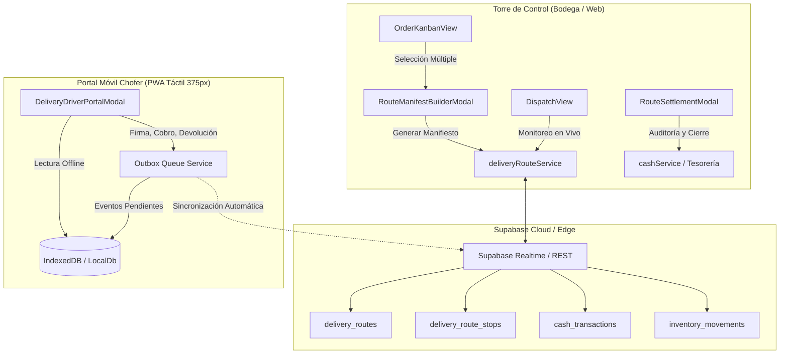

# 02. TRD — Technical Requirements Document
## Módulo de Despachos B2B y Rutas de Entrega — La Pezcadería ERP

- **Versión:** 1.0.0
- **Fecha:** 2026-10-14
- **Stack:** React 18, Vite, TypeScript 5.x, Tailwind CSS, Supabase PostgreSQL, Zustand, IndexedDB
- **Gobernanza:** Estricto Data-Driven, Immutability First, Offline-First Outbox Pattern

---

### 1. Arquitectura del Sistema
El módulo adopta el patrón **Offline-First con Outbox Transaccional**, desacoplando la operación en terreno de la conectividad de red y asegurando la consistencia eventual con Supabase PostgreSQL.



---

### 2. Decisiones Técnicas Clave y Librerías

| Componente / Dominio | Solución Técnica | Justificación Arquitectónica |
| :--- | :--- | :--- |
| **Validación de Datos** | Zod (`packages/validation-schemas/src/deliveryRoute.schema.ts`) | Garantiza contratos de datos idénticos en cliente y servidor, previniendo inyecciones y datos corruptos. |
| **Persistencia Local** | `src/services/localDb.ts` + IndexedDB | Permite que el chofer opere en sótanos o zonas rurales de Bucaramanga y Santander sin conexión 4G. |
| **Firma Digital** | Canvas HTML5 Nativo con interpolación Bezier | Cero librerías externas pesadas; genera salida SVG o PNG Base64 ultraligero (< 25 KB) para auditoría jurídica. |
| **Cálculo Monetario** | `Math.round()` con enteros COP | Elimina discrepancias de coma flotante en pesos colombianos. |
| **Gestión de Estado** | Zustand (`useOrderStore`, `useClientStore`, `useInventoryStore`) | Estado reactivo L1 en memoria de alta velocidad con persistencia sincronizada. |
| **Alertas e Interacción** | SweetAlert2 | Cumplimiento del estándar del ERP para confirmaciones de liquidación y alertas de advertencia. |

---

### 3. Máquina de Estados Finitos (FSM)

#### A. Ciclo de Vida del Manifiesto de Ruta (`DeliveryRouteRecord`)
```text
[PLANIFICADA] 
      │
      ▼ (Chofer o Despachador inicia recorrido)
  [EN_RUTA] 
      │
      ▼ (Chofer completa última parada y regresa a base)
[EN_LIQUIDACION] 
      │
      ▼ (Tesorero audita efectivo, transferencias y averías)
  [LIQUIDADA]
```
*(Transición de excepción: `[PLANIFICADA] -> [CANCELADA]` si se suspende el camión antes de salir).*

#### B. Ciclo de Vida de Cada Parada de Pedido (`DeliveryOrderItem`)
```text
[PENDIENTE]
      │
      ├──> [ENTREGADO_TOTAL]       (Recibido 100% conforme + Firma + Pago/Crédito)
      ├──> [ENTREGADO_PARCIAL]     (Acepta parte + Devuelve sobrante + Desglose)
      └──> [NO_ENTREGADO_RECHAZADO] (Rechazo total con motivo obligatorio)
```

---

### 4. Interfaces y Contratos TypeScript Fundamentales

```typescript
// Contrato de Parada en Ruta
export interface DeliveryOrderItem {
  id: string;
  pedidoId: string;
  numeroPedido: string;
  clienteId: string;
  clienteNombre: string;
  clienteDireccion: string;
  clienteTelefono?: string;
  montoPedidoOriginal: number;
  montoCobradoFinal: number;
  formaPago: 'CREDITO_B2B' | 'EFECTIVO' | 'TRANSFERENCIA_DIGITAL' | 'MIXTO';
  montoEfectivo: number;
  montoDigital: number;
  referenciaTransferencia?: string;
  estadoEntrega: 'PENDIENTE' | 'ENTREGADO_TOTAL' | 'ENTREGADO_PARCIAL' | 'NO_ENTREGADO_RECHAZADO';
  horaLlegadaEnSitio?: string;
  horaEntregaEfectiva?: string;
  tiempoTransitoMinutos?: number;
  tiempoAtencionMinutos?: number;
  firmaClienteUrl?: string;
  novedadObservaciones?: string;
  devoluciones?: RouteReturnItem[];
  cumplimientoSLA?: 'A_TIEMPO' | 'DEMORADO' | 'ANTICIPADO';
}

// Contrato de Manifiesto Consolidado
export interface DeliveryRouteRecord {
  id: string;
  tenantId: string;
  numeroManifiesto: string;
  conductorId: string;
  conductorNombre: string;
  vehiculoPlaca: string;
  fechaDespacho: string;
  estado: 'PLANIFICADA' | 'EN_RUTA' | 'EN_LIQUIDACION' | 'LIQUIDADA' | 'CANCELADA';
  kilometrajeInicial: number;
  kilometrajeFinal?: number;
  temperaturaCavaSalida?: number; // °C para cadena de frío
  temperaturaCavaRetorno?: number;
  pedidos: DeliveryOrderItem[];
  gastosRuta: RouteExpense[];
  totalCobroEsperado: number;
  totalCobradoEfectivo: number;
  totalCobradoDigital: number;
  totalCredito: number;
  totalGastosRuta: number;
  efectivoFisicoEntregado?: number;
  diferenciaLiquidacion?: number; // sobrante (+) o faltante (-)
  liquidadoPor?: string;
  fechaLiquidacion?: string;
  otifPorcentaje?: number;
}
```

---

### 5. Estrategia de Testing (TDD)
1. **Pruebas Unitarias de Servicios (`src/tests/deliveryRoute.test.ts`):**
   - Creación y cálculo de totales de manifiesto.
   - Procesamiento de cobros mixtos y retención de dinero en ruta.
   - Conciliación y cálculo estricto de descuadres en liquidación de tesorería.
   - Cálculo determinista del indicador OTIF y tiempos de atención.
2. **Pruebas de Componentes React (`src/tests/b2bDispatch.test.ts`):**
   - Renderizado de tarjetas de paradas en el portal móvil (375 px).
   - Captura de trazo en modal de firma digital.
   - Validación de formularios con esquemas Zod.
