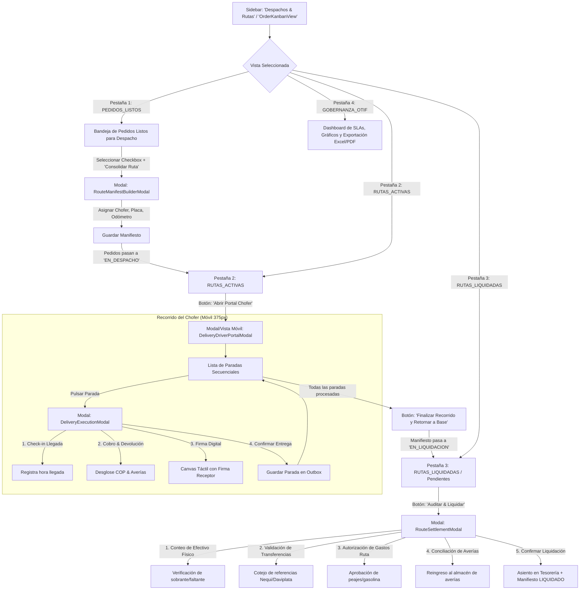

# 03. App Flow & User Journey
## Módulo de Despachos B2B y Rutas de Entrega — La Pezcadería ERP

- **Versión:** 1.0.0
- **Fecha:** 2026-10-14
- **Objetivo:** Definir con precisión quirúrgica el mapa de navegación, recorridos de usuario e interacciones paso a paso.

---

### 1. Mapa General de Navegación

---

### 2. Recorridos de Usuario Detallados (Step-by-Step User Journeys)

---

#### Jornada A: Jefe de Despachos (Creación de Manifiesto en Bodega)
1. **Punto de Partida:** El usuario ingresa a `OrderKanbanView` o `DispatchView` en la pestaña *"Pedidos Listos"*.
2. **Selección de Carga:** Visualiza las tarjetas de pedidos listos con cliente, dirección, peso total en kg y valor a cobrar.
3. **Acción:** Marca 3 o 4 pedidos con casillas de verificación y hace clic en el botón principal **"🚚 Crear Manifiesto de Ruta"**.
4. **Formulario Modal `RouteManifestBuilderModal`:**
   - Selecciona el **Conductor** (ej. *Carlos Rodríguez*).
   - Selecciona el **Vehículo** (ej. *Hino Refrigerado - Placa WXF-456*).
   - Ingresa el **Odómetro Inicial** (ej. *142.500 km*) y la **Temperatura de Cava** (ej. *-18 °C*).
   - Reordena la secuencia de entrega (arrastrando o pulsando subir/bajar) para optimizar la ruta geográfica.
5. **Confirmación:** Pulsa **"Generar Hoja de Ruta"**.
   - *Comportamiento del Sistema:* 
     - Se genera el registro en `delivery_routes` con código consecutivo (ej. `MAN-2026-0045`).
     - Los pedidos en `OrderKanbanView` cambian inmediatamente de columna `listos` $\rightarrow$ `en_despacho`.
     - Se ofrece imprimir la remisión consolidada.
     - La vista cambia automáticamente a la pestaña *"Rutas Activas"*.

---

#### Jornada B: Conductor / Repartidor (Operación en Calle Móvil 375 px)
1. **Punto de Partida:** El chofer abre el ERP en su teléfono o tableta de cabina (`DeliveryDriverPortalModal`).
2. **Pantalla Principal del Chofer:**
   - Banner superior con la placa del camión, cantidad de paradas pendientes y monto total de dinero a recaudar.
   - Indicador de estado de red: **"🟢 Online"** o **"🟡 Modo Offline (Outbox Activo)"**.
   - Lista secuencial de paradas con nombre del restaurante, dirección y teléfono para llamada rápida.
3. **Llegada al Cliente:**
   - El chofer pulsa sobre la primera parada. Se abre `DeliveryExecutionModal`.
   - Hace clic en **"📍 Registrar Llegada (Check-in)"**: el sistema guarda la hora exacta y calcula el tiempo de tránsito desde la bodega o la parada anterior.
4. **Inspección y Descarga:**
   - El cliente recibe el pedido. 
   - *Caso 1 (Entrega Total):* El cliente acepta todo.
   - *Caso 2 (Entrega Parcial):* El cliente rechaza 2 kg de camarón por calibre. El chofer pulsa **"Añadir Devolución"**, digita la cantidad devuelta y selecciona el motivo *"Calibre no corresponde"*. El total a cobrar se recalcula automáticamente restando los kilos devueltos.
5. **Gestión de Pago:**
   - El chofer selecciona la forma de recaudo:
     - **Efectivo:** Digita el valor recibido en billetes (ej. `$250.000 COP`).
     - **Transferencia:** Digita el valor transferido (ej. `$150.000 COP`) y el número de comprobante/aprobación.
     - **Crédito:** Si el cliente tiene cupo B2B, marca la casilla correspondiente.
6. **Firma Digital de Recepción:**
   - En la sección inferior, el receptor firma con el dedo sobre el lienzo táctil.
   - Digita el nombre y cédula de quien recibe.
7. **Confirmar Entrega:**
   - El chofer pulsa **"✅ Registrar Entrega Conforme"**.
   - Si está offline, la parada se guarda de inmediato en la base de datos local y se encola en el Outbox; la tarjeta cambia a color verde con etiqueta *"Entregado (Pendiente sync)"*.
   - Al volver a tener señal, el Outbox sincroniza con Supabase en segundo plano sin intervención del chofer.
8. **Cierre de Ruta:**
   - Una vez finalizada la última parada, el chofer pulsa **"🏁 Finalizar Ruta y Volver a Bodega"**, ingresando el odómetro final y la temperatura de llegada. El manifiesto pasa a `EN_LIQUIDACION`.

---

#### Jornada C: Tesorero / Auditor de Caja (Liquidación Final de Ruta)
1. **Punto de Partida:** El tesorero accede a la pestaña *"Rutas Liquidadas / Por Auditar"* y selecciona la ruta en estado `EN_LIQUIDACION`.
2. **Apertura de `RouteSettlementModal`:**
   - El modal desglosa los 4 cuadrantes financieros de la ruta:
     1. **Efectivo Teórico:** Sumatoria de los recaudos en efectivo registrados en las paradas.
     2. **Transferencias Digitales:** Lista de comprobantes con sus códigos para cotejo en la app bancaria.
     3. **Créditos:** Total facturado a cartera.
     4. **Gastos de Ruta:** Comprobantes de peaje o combustible pagados por el chofer.
3. **Cierre de Caja Físico:**
   - El chofer entrega el dinero en efectivo. El tesorero digita el valor contado en el campo *"Efectivo Físico Recibido"*.
   - El sistema calcula inmediatamente la diferencia:
     $$\text{Diferencia} = \text{Efectivo Físico} - (\text{Efectivo Teórico} - \text{Gastos Autorizados})$$
   - Si hay faltante o sobrante, se exige registrar una observación formal antes de proceder.
4. **Aprobación de Devoluciones:**
   - El tesorero revisa físicamente los productos devueltos en la cava. Confirma el lote y pulsa *"Reingresar a Almacén de Averías / Repesaje"*.
5. **Cierre Definitivo:**
   - El tesorero pulsa **"🔒 Aprobar y Liquidar Manifiesto"**.
   - Se genera el movimiento en `cashService` (ingreso de efectivo a caja principal con folio de ruta).
   - El manifiesto se sella como `LIQUIDADA` y los pedidos asociados quedan en estado `FACTURADO` o `PAGADO`.
