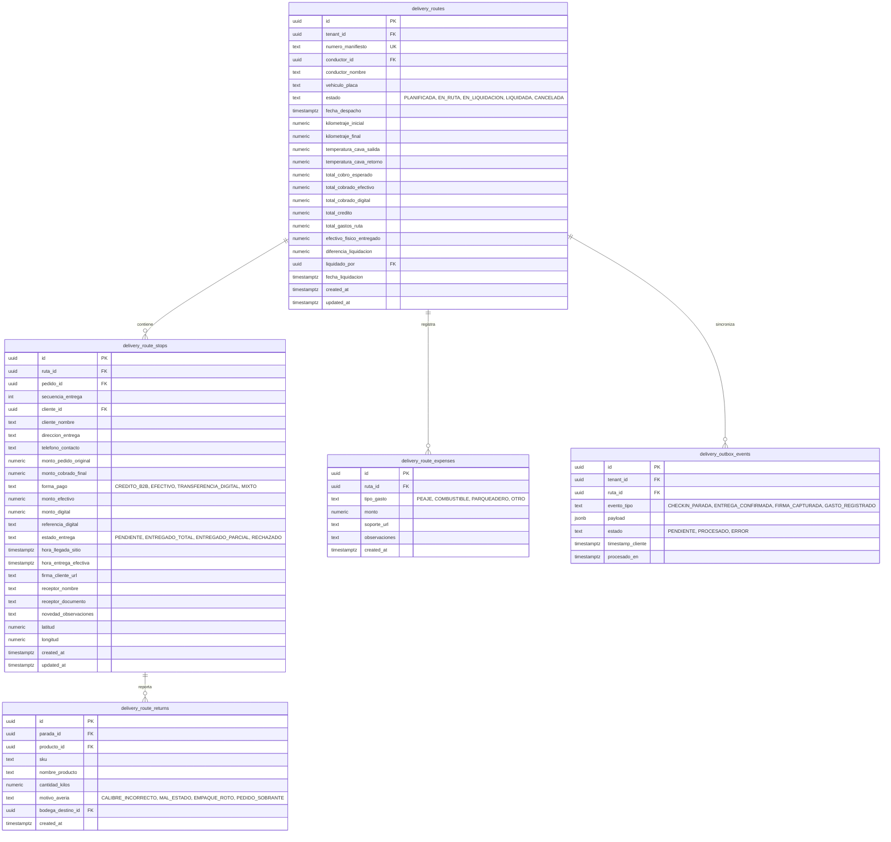

# 05. Backend Schema & Database Architecture
## Módulo de Despachos B2B y Rutas de Entrega — La Pezcadería ERP

- **Versión:** 1.0.0
- **Fecha:** 2026-10-14
- **Motor:** Supabase PostgreSQL 15+
- **Seguridad:** Row Level Security (RLS) Multi-Tenant Estricto por `tenant_id`

---

### 1. Diagrama Entidad-Relación (ERD)



---

### 2. Definición DDL de Tablas SQL (PostgreSQL)

```sql
-- 1. Tabla de Manifiestos de Ruta
CREATE TABLE IF NOT EXISTS public.delivery_routes (
    id UUID PRIMARY KEY DEFAULT gen_random_uuid(),
    tenant_id UUID NOT NULL REFERENCES public.tenants(id) ON DELETE CASCADE,
    numero_manifiesto VARCHAR(50) NOT NULL,
    conductor_id UUID REFERENCES auth.users(id),
    conductor_nombre VARCHAR(150) NOT NULL,
    vehiculo_placa VARCHAR(20) NOT NULL,
    estado VARCHAR(30) NOT NULL DEFAULT 'PLANIFICADA' 
        CHECK (estado IN ('PLANIFICADA', 'EN_RUTA', 'EN_LIQUIDACION', 'LIQUIDADA', 'CANCELADA')),
    fecha_despacho TIMESTAMPTZ NOT NULL DEFAULT NOW(),
    kilometraje_inicial NUMERIC(10, 2) NOT NULL DEFAULT 0,
    kilometraje_final NUMERIC(10, 2),
    temperatura_cava_salida NUMERIC(5, 2),
    temperatura_cava_retorno NUMERIC(5, 2),
    total_cobro_esperado NUMERIC(14, 2) NOT NULL DEFAULT 0,
    total_cobrado_efectivo NUMERIC(14, 2) NOT NULL DEFAULT 0,
    total_cobrado_digital NUMERIC(14, 2) NOT NULL DEFAULT 0,
    total_credito NUMERIC(14, 2) NOT NULL DEFAULT 0,
    total_gastos_ruta NUMERIC(14, 2) NOT NULL DEFAULT 0,
    efectivo_fisico_entregado NUMERIC(14, 2),
    diferencia_liquidacion NUMERIC(14, 2) DEFAULT 0,
    liquidado_por UUID REFERENCES auth.users(id),
    fecha_liquidacion TIMESTAMPTZ,
    observaciones_liquidacion TEXT,
    created_at TIMESTAMPTZ NOT NULL DEFAULT NOW(),
    updated_at TIMESTAMPTZ NOT NULL DEFAULT NOW(),
    CONSTRAINT uq_manifiesto_tenant UNIQUE(tenant_id, numero_manifiesto)
);

-- Índices de alto rendimiento
CREATE INDEX idx_delivery_routes_tenant_estado ON public.delivery_routes(tenant_id, estado);
CREATE INDEX idx_delivery_routes_conductor ON public.delivery_routes(conductor_id, fecha_despacho);

-- 2. Tabla de Paradas de Entrega
CREATE TABLE IF NOT EXISTS public.delivery_route_stops (
    id UUID PRIMARY KEY DEFAULT gen_random_uuid(),
    ruta_id UUID NOT NULL REFERENCES public.delivery_routes(id) ON DELETE CASCADE,
    pedido_id UUID NOT NULL REFERENCES public.ventas(id) ON DELETE RESTRICT,
    secuencia_entrega INT NOT NULL DEFAULT 1,
    cliente_id UUID NOT NULL REFERENCES public.clientes(id),
    cliente_nombre VARCHAR(150) NOT NULL,
    direccion_entrega TEXT NOT NULL,
    telefono_contacto VARCHAR(50),
    monto_pedido_original NUMERIC(14, 2) NOT NULL,
    monto_cobrado_final NUMERIC(14, 2) NOT NULL DEFAULT 0,
    forma_pago VARCHAR(30) NOT NULL DEFAULT 'CREDITO_B2B' 
        CHECK (forma_pago IN ('CREDITO_B2B', 'EFECTIVO', 'TRANSFERENCIA_DIGITAL', 'MIXTO')),
    monto_efectivo NUMERIC(14, 2) NOT NULL DEFAULT 0,
    monto_digital NUMERIC(14, 2) NOT NULL DEFAULT 0,
    referencia_digital VARCHAR(100),
    estado_entrega VARCHAR(30) NOT NULL DEFAULT 'PENDIENTE'
        CHECK (estado_entrega IN ('PENDIENTE', 'ENTREGADO_TOTAL', 'ENTREGADO_PARCIAL', 'NO_ENTREGADO_RECHAZADO')),
    hora_llegada_sitio TIMESTAMPTZ,
    hora_entrega_efectiva TIMESTAMPTZ,
    firma_cliente_url TEXT,
    receptor_nombre VARCHAR(150),
    receptor_documento VARCHAR(50),
    novedad_observaciones TEXT,
    latitud NUMERIC(10, 7),
    longitud NUMERIC(10, 7),
    created_at TIMESTAMPTZ NOT NULL DEFAULT NOW(),
    updated_at TIMESTAMPTZ NOT NULL DEFAULT NOW(),
    CONSTRAINT uq_ruta_pedido UNIQUE(ruta_id, pedido_id)
);

CREATE INDEX idx_route_stops_ruta_secuencia ON public.delivery_route_stops(ruta_id, secuencia_entrega);

-- 3. Tabla de Devoluciones y Averías en Ruta
CREATE TABLE IF NOT EXISTS public.delivery_route_returns (
    id UUID PRIMARY KEY DEFAULT gen_random_uuid(),
    parada_id UUID NOT NULL REFERENCES public.delivery_route_stops(id) ON DELETE CASCADE,
    producto_id UUID NOT NULL,
    sku VARCHAR(50) NOT NULL,
    nombre_producto VARCHAR(150) NOT NULL,
    cantidad_kilos NUMERIC(10, 3) NOT NULL CHECK (cantidad_kilos > 0),
    motivo_averia VARCHAR(50) NOT NULL,
    bodega_destino_id UUID,
    created_at TIMESTAMPTZ NOT NULL DEFAULT NOW()
);

-- 4. Tabla de Gastos Operativos en Ruta
CREATE TABLE IF NOT EXISTS public.delivery_route_expenses (
    id UUID PRIMARY KEY DEFAULT gen_random_uuid(),
    ruta_id UUID NOT NULL REFERENCES public.delivery_routes(id) ON DELETE CASCADE,
    tipo_gasto VARCHAR(30) NOT NULL CHECK (tipo_gasto IN ('PEAJE', 'COMBUSTIBLE', 'PARQUEADERO', 'OTRO')),
    monto NUMERIC(12, 2) NOT NULL CHECK (monto > 0),
    soporte_url TEXT,
    observaciones TEXT,
    created_at TIMESTAMPTZ NOT NULL DEFAULT NOW()
);

-- 5. Tabla de Eventos Outbox (Resiliencia Offline)
CREATE TABLE IF NOT EXISTS public.delivery_outbox_events (
    id UUID PRIMARY KEY DEFAULT gen_random_uuid(),
    tenant_id UUID NOT NULL REFERENCES public.tenants(id) ON DELETE CASCADE,
    ruta_id UUID NOT NULL REFERENCES public.delivery_routes(id) ON DELETE CASCADE,
    evento_tipo VARCHAR(50) NOT NULL,
    payload JSONB NOT NULL,
    estado VARCHAR(20) NOT NULL DEFAULT 'PENDIENTE' CHECK (estado IN ('PENDIENTE', 'PROCESADO', 'ERROR')),
    timestamp_cliente TIMESTAMPTZ NOT NULL,
    procesado_en TIMESTAMPTZ,
    error_mensaje TEXT,
    created_at TIMESTAMPTZ NOT NULL DEFAULT NOW()
);

CREATE INDEX idx_outbox_pending ON public.delivery_outbox_events(tenant_id, estado) WHERE estado = 'PENDIENTE';
```

---

### 3. Políticas de Seguridad RLS (Row Level Security)

```sql
-- Habilitar RLS en todas las tablas
ALTER TABLE public.delivery_routes ENABLE ROW LEVEL SECURITY;
ALTER TABLE public.delivery_route_stops ENABLE ROW LEVEL SECURITY;
ALTER TABLE public.delivery_route_returns ENABLE ROW LEVEL SECURITY;
ALTER TABLE public.delivery_route_expenses ENABLE ROW LEVEL SECURITY;
ALTER TABLE public.delivery_outbox_events ENABLE ROW LEVEL SECURITY;

-- Política 1: Despachadores y Administradores (Acceso Completo dentro de su Tenant)
CREATE POLICY "Admins y Despachadores gestionan rutas"
ON public.delivery_routes
FOR ALL
USING (
    tenant_id = (auth.jwt() ->> 'tenant_id')::uuid
    AND (auth.jwt() ->> 'role') IN ('admin', 'despachador', 'gerencia')
);

-- Política 2: Choferes (Lectura y Actualización únicamente de sus Rutas Asignadas)
CREATE POLICY "Choferes ven y actualizan sus rutas asignadas"
ON public.delivery_routes
FOR SELECT
USING (
    tenant_id = (auth.jwt() ->> 'tenant_id')::uuid
    AND conductor_id = auth.uid()
);

CREATE POLICY "Choferes actualizan odómetro y temperatura en su ruta"
ON public.delivery_routes
FOR UPDATE
USING (
    tenant_id = (auth.jwt() ->> 'tenant_id')::uuid
    AND conductor_id = auth.uid()
    AND estado IN ('PLANIFICADA', 'EN_RUTA')
);

-- Política 3: Paradas accesibles por el chofer de la ruta
CREATE POLICY "Choferes gestionan paradas de su ruta"
ON public.delivery_route_stops
FOR ALL
USING (
    EXISTS (
        SELECT 1 FROM public.delivery_routes r
        WHERE r.id = delivery_route_stops.ruta_id
        AND r.tenant_id = (auth.jwt() ->> 'tenant_id')::uuid
        AND (r.conductor_id = auth.uid() OR (auth.jwt() ->> 'role') IN ('admin', 'despachador'))
    )
);
```

---

### 4. Función Transaccional de Liquidación de Ruta (RPC)

```sql
CREATE OR REPLACE FUNCTION public.fn_liquidar_manifiesto_ruta(
    p_ruta_id UUID,
    p_efectivo_fisico NUMERIC,
    p_liquidado_por UUID,
    p_observaciones TEXT DEFAULT NULL
)
RETURNS JSONB
LANGUAGE plpgsql
SECURITY DEFINER
AS $$
DECLARE
    v_ruta RECORD;
    v_diferencia NUMERIC;
    v_total_cobrado_efectivo NUMERIC;
    v_total_gastos NUMERIC;
BEGIN
    -- 1. Validar existencia y estado
    SELECT * INTO v_ruta FROM public.delivery_routes WHERE id = p_ruta_id FOR UPDATE;
    IF NOT FOUND THEN
        RAISE EXCEPTION 'Ruta no encontrada: %', p_ruta_id;
    END IF;

    IF v_ruta.estado NOT IN ('EN_RUTA', 'EN_LIQUIDACION') THEN
        RAISE EXCEPTION 'La ruta % no está lista para liquidar. Estado actual: %', p_ruta_id, v_ruta.estado;
    END IF;

    -- 2. Recalcular totales desde las paradas confirmadas
    SELECT 
        COALESCE(SUM(monto_efectivo), 0) INTO v_total_cobrado_efectivo
    FROM public.delivery_route_stops
    WHERE ruta_id = p_ruta_id AND estado_entrega IN ('ENTREGADO_TOTAL', 'ENTREGADO_PARCIAL');

    SELECT 
        COALESCE(SUM(monto), 0) INTO v_total_gastos
    FROM public.delivery_route_expenses
    WHERE ruta_id = p_ruta_id;

    -- Cálculo estricto de diferencia
    v_diferencia := p_efectivo_fisico - (v_total_cobrado_efectivo - v_total_gastos);

    -- 3. Actualizar estado del manifiesto a LIQUIDADA
    UPDATE public.delivery_routes
    SET 
        estado = 'LIQUIDADA',
        efectivo_fisico_entregado = p_efectivo_fisico,
        diferencia_liquidacion = v_diferencia,
        liquidado_por = p_liquidado_por,
        fecha_liquidacion = NOW(),
        observaciones_liquidacion = p_observaciones,
        updated_at = NOW()
    WHERE id = p_ruta_id;

    -- 4. Registrar asiento en Tesorería (cash_transactions)
    IF p_efectivo_fisico > 0 THEN
        INSERT INTO public.cash_transactions (
            tenant_id,
            tipo,
            monto,
            concepto,
            referencia_id,
            creado_por,
            created_at
        ) VALUES (
            v_ruta.tenant_id,
            'INGRESO_LIQUIDACION_RUTA',
            p_efectivo_fisico,
            CONCAT('Liquidación Manifiesto ', v_ruta.numero_manifiesto, ' - Conductor: ', v_ruta.conductor_nombre),
            p_ruta_id,
            p_liquidado_por,
            NOW()
        );
    END IF;

    -- 5. Actualizar pedidos a FACTURADO / PAGADO
    UPDATE public.ventas v
    SET 
        estado = CASE 
            WHEN s.forma_pago = 'CREDITO_B2B' THEN 'FACTURADO'
            ELSE 'PAGADO'
        END,
        updated_at = NOW()
    FROM public.delivery_route_stops s
    WHERE s.ruta_id = p_ruta_id 
      AND s.pedido_id = v.id 
      AND s.estado_entrega IN ('ENTREGADO_TOTAL', 'ENTREGADO_PARCIAL');

    RETURN jsonb_build_object(
        'success', true,
        'ruta_id', p_ruta_id,
        'numero_manifiesto', v_ruta.numero_manifiesto,
        'efectivo_liquidado', p_efectivo_fisico,
        'diferencia', v_diferencia,
        'estado', 'LIQUIDADA'
    );
END;
$$;
```
