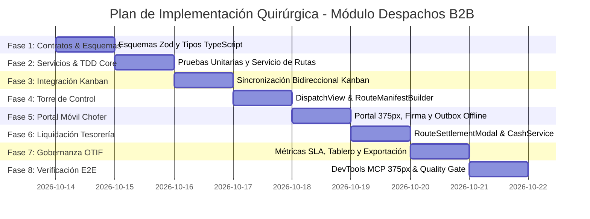

# 06. Implementation Plan & Construction Roadmap
## Módulo de Despachos B2B y Rutas de Entrega — La Pezcadería ERP

- **Versión:** 1.0.0
- **Fecha:** 2026-10-14
- **Modelo:** Continuous-Kanban-Flow (Flujo Continuo sin Sprints Fijos)
- **Límite WIP (Work In Progress):** **Estricto = 1 tarea activa simultánea**
- **Metodología:** TDD Estricto (Red -> Green -> Refactor), Spec Kit SDD v3.0, Interrogatorio Permanente `/grill-me`
- **Tablero Operativo:** [`kanban-board.md`](./kanban-board.md)

---

### 1. Fases Secuenciales de Construcción

---

### 2. Detalle de Tareas Granulares por Fase

#### Fase 1: Esquemas de Validación Zod y Contratos de Datos
- [ ] **Tarea 1.1:** Auditar y consolidar `packages/validation-schemas/src/deliveryRoute.schema.ts` para cubrir:
  - Creación de Manifiesto (`CreateRouteManifestSchema`).
  - Ejecución de Parada (`RegisterDeliveryExecutionSchema` con firma digital base64 y geolocalización opcional).
  - Devoluciones y Averías (`RouteReturnItemSchema`).
  - Liquidación de Manifiesto (`SettleRouteManifestSchema` con validación de enteros COP).
- **Quality Gate 1:** `npx vitest run packages/validation-schemas/` pasando al 100%.

#### Fase 2: Lógica de Servicios y TDD Core (`deliveryRouteService.ts`)
- [ ] **Tarea 2.1:** Escribir suite de pruebas unitarias comprensiva en `src/tests/deliveryRoute.test.ts`:
  - Cálculo de totales de manifiesto (kilos y cobro esperado).
  - Transición FSM de estados (`PLANIFICADA` $\rightarrow$ `EN_RUTA` $\rightarrow$ `EN_LIQUIDACION` $\rightarrow$ `LIQUIDADA`).
  - Desglose de cobros mixtos (Efectivo + Transferencia digital + Crédito B2B).
  - Cálculo exacto de descuadre de caja en liquidación (tolerancia $0 COP).
- [ ] **Tarea 2.2:** Implementar métodos en `deliveryRouteService.ts`:
  - `crearManifiesto(data: CreateRouteManifest)`
  - `iniciarRuta(rutaId: string)`
  - `registrarParadaEntrega(paradaId: string, data: RegisterDeliveryExecution)`
  - `liquidarRuta(rutaId: string, data: SettleRouteManifest)`
- **Quality Gate 2:** 100% pruebas de `deliveryRoute.test.ts` en verde.

#### Fase 3: Integración Bidireccional en `OrderKanbanView.tsx`
- [ ] **Tarea 3.1:** Agregar barra de acciones contextuales en `OrderKanbanView.tsx` al seleccionar pedidos en la columna `listos`.
- [ ] **Tarea 3.2:** Conectar la acción *"Crear Manifiesto de Carga"* para abrir `RouteManifestBuilderModal`.
- [ ] **Tarea 3.3:** Al confirmarse la ruta, actualizar los pedidos seleccionados al estado `en_despacho`.
- [ ] **Tarea 3.4:** Suscribir la vista a los eventos del Outbox / servicio para mover tarjetas automáticamente a `entregados` al confirmarse en calle.
- **Quality Gate 3:** `npx vitest run src/tests/orderKanbanView.test.tsx` en verde.

#### Fase 4: Torre de Control `DispatchView.tsx` y Creador de Manifiestos
- [ ] **Tarea 4.1:** Pulir `DispatchView.tsx` asegurando el estándar visual Light Mode WCAG 2.2 AA+ y densidad táctil.
- [ ] **Tarea 4.2:** Integrar `RouteManifestBuilderModal.tsx` con validación de capacidad de carga del camión (kg) y secuencia de paradas.
- [ ] **Tarea 4.3:** Incorporar generación de Hoja de Ruta / Remisión impresa o descargable en PDF.

#### Fase 5: Portal Móvil del Chofer (375 px) con Firma Digital y Outbox
- [ ] **Tarea 5.1:** Diseñar `DeliveryDriverPortalModal.tsx` con ergonomía táctil (targets $\ge 44\text{ px}$) para pantallas móviles de 375 px.
- [ ] **Tarea 5.2:** Implementar el canvas táctil de firma digital en `DeliveryExecutionModal.tsx` con renderizado vectorial nítido y botón de limpiar firma.
- [ ] **Tarea 5.3:** Conectar la cola de eventos local con `useOutboxSync.ts` para permitir funcionamiento 100% offline con sincronización en background.
- **Quality Gate 5:** Bucle DevTools MCP en viewport 375 px con 0 errores de consola JS.

#### Fase 6: Modal de Auditoría y Liquidación en Tesorería (`RouteSettlementModal.tsx`)
- [ ] **Tarea 6.1:** Implementar la interfaz de liquidación con desglose de los 4 cuadrantes (Efectivo, Transferencias, Créditos y Gastos).
- [ ] **Tarea 6.2:** Integrar la calculadora de arqueo físico vs teórico y cálculo en tiempo real de sobrante/faltante en pesos COP.
- [ ] **Tarea 6.3:** Conectar la aprobación con `cashService.ts` para registrar el ingreso formal a la caja principal de Tesorería.
- [ ] **Tarea 6.4:** Integrar el reingreso de producto rechazado al almacén de averías/repesaje en `inventoryService`.

#### Fase 7: Tablero de Gobernanza y Métricas OTIF (`DeliveryGovernanceTab.tsx`)
- [ ] **Tarea 7.1:** Implementar cálculo automático del porcentaje OTIF (On-Time In-Full) por chofer y por día.
- [ ] **Tarea 7.2:** Visualizar tiempos promedio de tránsito vs descarga con semáforo de colores (Verde $\le 30\text{ min}$, Amarillo $30-60\text{ min}$, Rojo $> 60\text{ min}$).
- [ ] **Tarea 7.3:** Generar exportación de reporte consolidado de rutas en formato Excel y PDF.

#### Fase 8: Bucle DevTools MCP en Vivo, E2E y Quality Gate Pre-Push
- [ ] **Tarea 8.1:** Ejecutar suite completa de Vitest (100% tests verdes sin regresiones).
- [ ] **Tarea 8.2:** Verificación estricta de TypeScript (`tsc --noEmit`) con 0 advertencias.
- [ ] **Tarea 8.3:** Auditoría en vivo con Chrome DevTools MCP:
  - Inspección de consola JS en navegación completa (0 errores).
  - Prueba táctil en resolución móvil de 375 px.
  - Validación de contraste visual WCAG 2.2 AA+.
- [ ] **Tarea 8.4:** Commit atómico y push controlado por el Quality Gate de cierre (`npm run session:push`).
