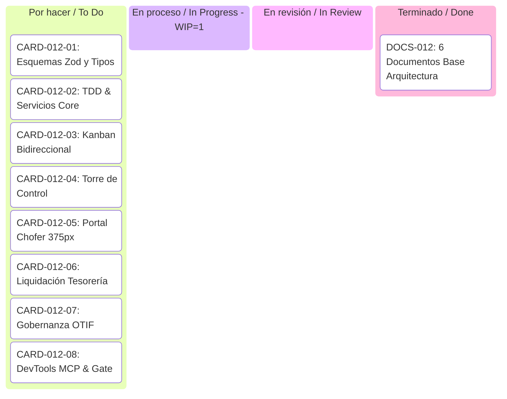

# Tablero Kanban de Flujo Continuo (Continuous-Kanban-Flow)
## Spec 012: Módulo de Despachos B2B y Rutas de Entrega — La Pezcadería ERP

- **Modelo:** Flujo Continuo Lean Kanban (Sin Sprints Fijos)
- **Límite WIP (Work In Progress):** **Máximo 1 tarea activa simultánea en "En proceso"**
- **Estado Actual del Tablero:** Inicializado tras aprobación de los 6 Documentos Base
- **Última Actualización:** 2026-10-14

---

### Tablero Visual Kanban

| 📋 Por hacer (To Do) | ⚙️ En proceso (In Progress) `[WIP: 0/1]` | 🔍 En revisión (In Review) | ✅ Terminado (Done) |
| :--- | :--- | :--- | :--- |
| **CARD-012-08:** Bucle DevTools MCP en Vivo (Consola 0 errores, Vista 375px) y Quality Gate Pre-Push | *(Listo para asignar en próxima tarjeta)* | *(Sin tareas en revisión)* | **CARD-012-07:** Tablero de Gobernanza y Métricas OTIF (`DeliveryGovernanceTab`) con Exportación (4 tests unitarios verdes, tsc 0 errores, semáforo y CSV listos) |
| | | | **CARD-012-06:** Modal de Liquidación de Tesorería (`RouteSettlementModal`) e Integración con `cashService` (4 tests integración verdes, tsc 0 errores, DevTools 375px verificado) |
| | | | **CARD-012-05:** Portal Móvil Chofer 375px (`DeliveryDriverPortalModal`) + Firma Digital Canvas + Outbox Offline (50 tests verdes, tsc 0 errores, DevTools 375px verificado) |
| | | | **CARD-012-04:** Torre de Control `DispatchView.tsx`, Creador de Manifiestos y Hoja de Ruta PDF (43 tests verdes, tsc 0 errores, capacidad kg) |
| | | | **CARD-012-03:** Integración Bidireccional `OrderKanbanView.tsx` (Pedidos Listos a En Despacho y sincronización a Entregado - 7 tests verdes) |
| | | | **CARD-012-02:** Servicios Core y Suite TDD (`deliveryRouteService.ts` + `deliveryRoute.test.ts` - 20 tests verdes) |
| | | | **CARD-012-01:** Esquemas Zod y Tipos TypeScript (`deliveryRoute.schema.ts` - 11 tests verdes) |
| | | | **DOCS-012:** Los 6 Documentos Base aprobados (PRD, TRD, App Flow, Design Brief, Backend Schema, Plan) |

---

### Detalle de Tarjetas del Tablero

---

### Protocolo de Transición de Tarjetas
1. **Transición `To Do` $\rightarrow$ `In Progress`:**
   - Requiere verificar que `In Progress` esté vacío (`WIP = 0`).
   - Se activan las verificaciones de `/grill-me` ante cualquier duda de implementación.
2. **Transición `In Progress` $\rightarrow$ `In Review`:**
   - La tarea debe tener el código escrito con sus pruebas asociadas (TDD).
   - Se ejecutan las pruebas unitarias pertinentes en Vitest.
3. **Transición `In Review` $\rightarrow$ `Done`:**
   - Auditoría de 0 errores en consola JS con Chrome DevTools MCP.
   - Renderizado en 375 px validado si afecta UI.
   - Confirmación y aprobación explícita del usuario.
