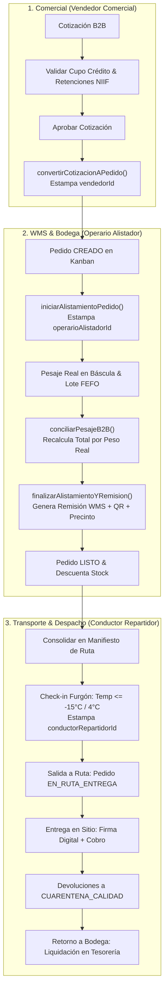

# Plan Técnico de Implementación (/speckit.plan)

**Código:** SPEC-015  
**Título:** Plan de Arquitectura e Implementación Técnica: Flujo Completo de Integración B2B (Cotizaciones $\rightarrow$ Pedidos $\rightarrow$ Alistamiento $\rightarrow$ Rutas de Entrega)  
**Estado:** DRAFT (Esperando Aprobación Humana)  
**Autor:** Principal Software Architect & Operations Lead  
**Fecha:** 2026-10-15  
**Fase de Ciclo:** Spec Kit v3.0 — `/speckit.plan`  

---

## 1. Arquitectura General y Flujo de Información

El sistema B2B opera bajo una arquitectura dirigida por eventos (*Data-Driven & Event-Sourced*), garantizando que ningún pedido se mueva de estado sin un actor identificado, sin validación financiera de cupo/retenciones y sin conciliación física de peso real de lote en cuarto frío.



---

## 2. Contratos de Datos y Ampliación de Esquemas TypeScript

### 2.1. Ampliación de `Pedido` en `src/types/orders.types.ts`
Garantizar la trazabilidad de los 3 actores operativos y el encadenamiento de auditoría:

```typescript
export interface Pedido {
  // Identificadores y Metadatos Base
  id: string;
  numeroPedido: string;
  fecha: string;
  origen: 'VISITA' | 'RAPPI' | 'TELEFONO' | 'B2B_COTIZACION';
  clienteId: string;
  bodegaId: string;
  branch_id: string;

  // Actor 1: Vendedor Comercial
  vendedorId: string;
  vendedorNombre?: string;
  cotizacionIdOriginal?: string;

  // Actor 2: Operario Alistador de Bodega
  operarioAlistadorId?: string;
  operarioAlistadorNombre?: string;
  horaInicioAlistamiento?: string;
  horaFinAlistamiento?: string;
  remisionId?: string;
  tokenQrRemision?: string;
  precintoCanastilla?: string;

  // Actor 3: Conductor Repartidor
  conductorRepartidorId?: string;
  conductorRepartidorNombre?: string;
  manifiestoRutaId?: string;
  horaDespachoRuta?: string;
  horaLlegadaCliente?: string;
  horaEntregaEfectiva?: string;
  firmaClienteUrl?: string;

  // Lógica Financiera & NIIF
  formaPago: 'CONTADO' | 'CREDITO';
  tipoEntrega: 'EN_RUTA' | 'RECOGE';
  fechaEntrega: string;
  jornada: 'MANANA' | 'TARDE';
  estado: EstadoPedido;
  observaciones: string;
  lineas: LineaPedido[];
  subtotal: number;
  descuentoGlobalPct: number;
  descuentoGlobalValor: number;
  retefuenteValor?: number;
  reteicaValor?: number;
  totalFinal: number;
  idempotencyKey: string;
  rutaId: string | null;
  facturacionElectronica: boolean;
  idSiigo: string | null;
  inventarioDescontado?: boolean;
}
```

### 2.2. Ampliación de `LineaPedido` en `src/types/orders.types.ts`
Soporte formal de Catch Weight y pesaje real en bodega:

```typescript
export interface LineaPedido {
  productoId: string;
  cantidadSolicitada: number;     // Kilos o unidades solicitadas
  cantidadAlistada: number;        // Kilos o unidades empacadas
  cantidadDespachada: number;      // Kilos entregados efectivamente
  estadoLinea: EstadoLineaPedido;
  pesoEstimado?: number;          // Peso teórico cotizado (kg)
  pesoReal?: number;              // Peso real pesado en báscula de cuarto frío
  variacionPesoPct?: number;      // % de diferencia vs peso teórico
  toleranciaAceptada?: boolean;   // True si variación <= +-5%
  subtotalRealAjustado?: number;  // COP = pesoReal * precioPactado
  loteSeleccionado?: string;      // Lote FEFO
  temperaturaC?: number;          // Temperatura en empaque (-18°C o <= 4°C)
  precioPactado: number;
  totalLinea: number;
  modalidadVenta?: 'PESO_DIRECTO' | 'CATCH_WEIGHT_PIEZAS' | 'UNIDADES_FIJAS';
  piezasSolicitadas?: number;
  piezasAlistadas?: number;
  corte?: string;
  empaque?: string;
}
```

---

## 3. Servicio Central de Orquestación B2B (`b2bIntegrationService.ts`)

Se implementará `src/services/b2bIntegrationService.ts` como punto único de gobernanza para ejecutar de manera transaccional cada fase del ciclo:

### 3.1. Fase Comercial (`VendedorComercial`)
* `convertirCotizacionAPedido(input: ConvertirCotizacionInput): Promise<Pedido>`
  * Ejecuta `B2BSalesService.verificarCupoCredito` si la forma de pago es `CREDITO`.
  * Liquida retenciones fiscales mediante `B2BSalesService.calcularTotalesCotizacionNIIF`.
  * Genera el `Pedido` en estado `CREADO`, con `vendedorId`, `vendedorNombre` y referencia a `cotizacionIdOriginal`.
  * Actualiza la cotización a `CONVERTIDA_A_PEDIDO`.
  * Registra evento inmutable en `useEventStore`.

### 3.2. Fase Alistamiento WMS (`OperarioAlistador`)
* `iniciarAlistamiento(pedidoId: string, operarioId: string, operarioNombre: string): Promise<Pedido>`
  * Transiciona de `CREADO` a `EN_ALISTAMIENTO`.
  * Estampa `operarioAlistadorId` y hora de inicio.
* `registrarPesajeLinea(pedidoId: string, input: PesajeLineaInput): Promise<Pedido>`
  * Invoca `b2bDispatchService.conciliarPesajeB2B`.
  * Valida tolerancia de $\pm 5\%$.
  * Actualiza la línea con peso real, lote FEFO y temperatura.
  * Recalcula el total del pedido ($COP = \sum \text{peso\_real} \times \text{precio\_pactado}$).
  * Cuantifica merma de picking si aplica (`B2BSalesService.calcularAjusteMermasPicking`).
* `finalizarAlistamiento(pedidoId: string, input: FinalizarAlistamientoInput): Promise<Pedido>`
  * Valida que todas las líneas tengan peso real y lote.
  * Emite remisión WMS con código QR y precinto (`WmsDispatchRemision`).
  * Transiciona a `LISTO`.
  * Descuenta el stock físico de la bodega de despacho correspondiente.

### 3.3. Fase Rutas y Despacho (`ConductorRepartidor`)
* `crearYDespacharManifiesto(input: CrearManifiestoInput): Promise<DeliveryRouteRecord>`
  * Invoca `deliveryRouteService.crearManifiestoRuta`.
  * Ejecuta check-in de carga con temperatura ($\le -15^\circ\text{C}$ o $\le 4^\circ\text{C}$) y odómetro inicial.
  * Transiciona pedidos asociados a `EN_DESPACHO` / `EN_RUTA_ENTREGA`, estampando `conductorRepartidorId`.
* `registrarEntregaEnSitio(input: RegistrarEntregaInput): Promise<DeliveryRouteRecord>`
  * Registra llegada, firma digital táctil del cliente en pantalla y medio de pago.
  * Si existen devoluciones por no conformidad, las descuenta en tiempo real del cobro y las asigna a `CUARENTENA_CALIDAD`.
  * Transiciona pedido a `ENTREGADO_TOTAL` o `ENTREGADO_PARCIAL`.
* `liquidarManifiestoRuta(input: LiquidarManifiestoInput): Promise<DeliveryRouteRecord>`
  * Registra odómetro final y temperatura de retorno.
  * Concilia efectivo recaudado contra tesorería (`cashService`).
  * Pasa el manifiesto a `LIQUIDADO`.

---

## 4. Estrategia de Pruebas TDD (Vitest)

Se implementará una suite exhaustiva `src/tests/b2bIntegrationFlowE2E.test.ts` con pruebas encadenadas:
1. **Test 1:** Conversión de Cotización a Pedido con validación de crédito y retenciones NIIF (Vendedor Comercial).
2. **Test 2:** Inicio de Alistamiento WMS y estampa de `operarioAlistadorId`.
3. **Test 3:** Pesaje real en cuarto frío, asignación de lote FEFO y recálculo automático de precio por peso real (Catch Weight $\pm 5\%$).
4. **Test 4:** Generación de Remisión WMS con QR, precinto de canastilla y pase a estado `LISTO`.
5. **Test 5:** Consolidación en Manifiesto de Ruta, check-in de temperatura y salida a ruta con `conductorRepartidorId`.
6. **Test 6:** Entrega con firma táctil, descuento por devolución parcial a cuarentena y cobro en sitio.
7. **Test 7:** Liquidación final de ruta con arqueo en tesorería y validación de odómetro.
8. **Test 8:** Auditoría completa de eventos inmutables en `useEventStore` verificando los 3 IDs de actores.

---

## 5. Criterios de Aceptación y Quality Gate
- **Compilación TypeScript:** Cero errores (`tsc --noEmit`).
- **Suites Vitest:** 100% pasando en verde.
- **Validación DevTools MCP:** Cero errores de consola JS en navegador y responsividad en 375 px y 1280 px.
- **Gobernanza Kanban:** Respeto estricto del límite WIP = 1.

---

**Siguiente Paso del Flujo:** Esperar aprobación del usuario sobre este Plan Técnico (`/speckit.plan`) para proceder con el desglose en Tareas Granulares (`/speckit.tasks`).
