# Especificación de Requerimiento (Spec): Flujo Integral B2B End-to-End

**Código:** SPEC-015  
**Título:** Flujo Completo de Integración B2B: Cotizaciones $\rightarrow$ Pedidos de Clientes $\rightarrow$ Alistamiento en Bodega $\rightarrow$ Despacho a Rutas de Entrega con Trazabilidad Estricta de 3 Actores Operativos  
**Estado:** DRAFT (Esperando Aprobación Humana)  
**Autor:** Principal Software Architect, Operations Coordinator & SDD Lead  
**Fecha:** 2026-10-15  
**Fase de Ciclo:** Spec Kit v3.0 — `/speckit.specify`  

---

## 1. Resumen Ejecutivo y Propósito ("Por qué")

En el modelo de negocio mayorista, institucional y de distribución de **La Pezcadería**, la comercialización de productos perecederos del mar hacia restaurantes, hoteles, cevicherías y distribuidores no sigue la dinámica de mostrador minorista del POS. Requiere un ciclo operativo encadenado, trazable y gobernado que articula tres actores indispensables:

1. **Vendedor Comercial:** Asesora, negocia precios institucionales, verifica cupo de crédito y emite cotizaciones formales con retenciones tributarias NIIF (Retefuente 2.5%, ReteICA 4.14 x 1000). Al recibir la orden de compra del cliente, transforma la cotización en pedido en firme.
2. **Operario Alistador de Bodega (WMS):** Recibe el pedido en cuarto frío, realiza el picking físico seleccionando lotes perecederos bajo política FEFO (First Expired, First Out), registra el pesaje real de cada línea (el peso de pescados enteros o filetes nunca es idéntico al peso nominal teórico), concilia mermas o tolerancias de catch weight, empaca y emite la Remisión de Despacho WMS.
3. **Conductor Repartidor:** Recibe las canastillas en el muelle de carga, valida la temperatura del furgón refrigerado ($-18^\circ\text{C}$ o $0-4^\circ\text{C}$), ejecuta la ruta de entrega geolocalizada en Bucaramanga y área metropolitana, recaba la firma digital del cliente en pantalla, cobra según la forma de pago (efectivo, transferencia con comprobante o crédito contra cupo) y regresa a bodega para la liquidación final y segregación de posibles devoluciones a cuarentena.

### Problema que Resuelve
Actualmente, las piezas del flujo (cotizaciones, kanban de pedidos, conciliación de pesaje en bodega y manifiestos de ruta) existen de forma aislada en diferentes servicios (`b2bSalesService`, `b2bDispatchService`, `deliveryRouteService`, `OrderKanbanView`). Falta una **integración hermética end-to-end** que garantice la trazabilidad de los 3 IDs de actores en cada estado, evite pedidos huérfanos, asegure que el precio facturado refleje con exactitud el peso real del pescado pesado en bodega, y certifique que el conductor entregue con evidencia inmutable.

---

## 2. Definición del Requerimiento ("Qué")

### 2.1. Matriz de Actores y Trazabilidad Estricta
Cada evento y transición de estado registrará de forma obligatoria e inmutable los siguientes identificadores y metadatos:

| Actor Operativo | Identificador | Rol en Sistema | Responsabilidad Principal |
| :--- | :--- | :--- | :--- |
| **Vendedor Comercial** | `vendedorId` / `vendedorNombre` | `VendedorComercial` / `Admin` | Cotización, negociación de precios, verificación de cupo de crédito y conversión a Pedido. |
| **Operario Alistador** | `operarioAlistadorId` / `operarioAlistadorNombre` | `OperarioAlistador` / `Bodeguero` | Picking en cuarto frío, pesaje real manual/balanza, asignación de lote FEFO, empaque y remisión WMS. |
| **Conductor Repartidor**| `conductorRepartidorId` / `conductorRepartidorNombre` | `ConductorRepartidor` / `Transportador` | Check-in de temperatura en furgón, recorrido en ruta, entrega con firma y cobro/devolución. |

### 2.2. Ciclo de Vida y Máquinas de Estado Encadenadas

```mermaid
stateDiagram-v2
    direction LR
    
    state "Fase 1: Comercial (Vendedor)" as F1 {
        [*] --> Cotizacion_BORRADOR
        Cotizacion_BORRADOR --> Cotizacion_ENVIADA : Enviar al Cliente
        Cotizacion_ENVIADA --> Cotizacion_APROBADA : Cliente Acepta
        Cotizacion_ENVIADA --> Cotizacion_RECHAZADA : Cliente Rechaza
        Cotizacion_APROBADA --> Pedido_CREADO : Convertir a Pedido
    }

    state "Fase 2: WMS Bodega (Operario)" as F2 {
        Pedido_CREADO --> Pedido_EN_ALISTAMIENTO : Iniciar Picking
        Pedido_EN_ALISTAMIENTO --> Pedido_PESADO : Pesaje Real & FEFO
        Pedido_PESADO --> Pedido_LISTO : Remisión WMS Generada
    }

    state "Fase 3: Rutas & Entrega (Conductor)" as F3 {
        Pedido_LISTO --> Manifiesto_CARGADO : Check-in Furgón
        Manifiesto_CARGADO --> Pedido_EN_RUTA : Salida a Despacho
        Pedido_EN_RUTA --> Pedido_ENTREGADO : Firma & Cobro
        Pedido_EN_RUTA --> Pedido_NOVEDAD : Devolución / Rechazo
        Pedido_ENTREGADO --> Manifiesto_LIQUIDADO : Retorno a Bodega
        Pedido_NOVEDAD --> Manifiesto_LIQUIDADO : Retorno & Cuarentena
    }
```

#### Fase 1: Cotización B2B $\rightarrow$ Pedido en Firme
- **Entidades:** `Cotizacion` $\rightarrow$ `Pedido`.
- **Reglas de Negocio:**
  - El vendedor selecciona cliente B2B institucional.
  - Validación de cupo de crédito (`B2BSalesService.verificarCupoCredito`): Si el total supera el cupo disponible, bloquea o requiere autorización administrativa.
  - Cálculo tributario NIIF automático: Retefuente (2.5%) y ReteICA (4.14‰) si el cliente es Gran Contribuyente / Autorretenedor.
  - Al aprobarse la cotización, la acción `convertirCotizacionAPedido()` crea un `Pedido` en estado `CREADO` manteniendo el vínculo histórico (`cotizacionIdOriginal`), el `vendedorId`, fecha comprometida de entrega y jornada (AM/PM).

#### Fase 2: Alistamiento en Cuarto Frío $\rightarrow$ Remisión WMS
- **Entidades:** `Pedido`, `LineaPedido`, `PesajeAlistamiento`, `WmsDispatchRemision`.
- **Reglas de Negocio:**
  - El operario toma el pedido desde el Kanban o pestaña WMS y pasa el pedido a `EN_ALISTAMIENTO`, estampando su `operarioAlistadorId`.
  - Para cada línea perecedera (kg o catch weight):
    - Digita el peso real obtenido en báscula de cuarto frío.
    - Selecciona el lote perecedero bajo política FEFO.
    - Registra temperatura del producto (ej. $-18^\circ\text{C}$ congelado o $\le 4^\circ\text{C}$ fresco).
  - El sistema ejecuta la conciliación (`b2bDispatchService.conciliarPesajeB2B`):
    - Verifica si la variación está dentro de la tolerancia pactada ($\pm 5\%$).
    - Ajusta el total de la línea al peso real exacto $\times$ precio pactado por kg.
    - Si existe merma o diferencia de peso, genera el cálculo de ajuste de merma (`calcularAjusteMermasPicking`).
  - Al completar todas las líneas, el operario confirma el alistamiento:
    - Genera la Remisión WMS con código QR y precinto de canastillas (`WmsDispatchRemision`).
    - Pasa el pedido a estado `LISTO` (listo para despacho).
    - Descuenta o reserva el inventario de la bodega de despacho correspondiente.

#### Fase 3: Manifiesto de Ruta $\rightarrow$ Entrega y Liquidación
- **Entidades:** `DeliveryRouteRecord`, `RouteCheckpoint`, `OrderDeliveryRecord`.
- **Reglas de Negocio:**
  - El despachador crea el Manifiesto de Ruta agrupando pedidos en estado `LISTO` por zona geográfica (Bucaramanga, Floridablanca, Girón, Piedecuesta).
  - Asigna vehículo (placa, tipo) y conductor repartidor (`conductorRepartidorId`).
  - **Check-in de Carga:** El conductor verifica la temperatura inicial del termo-king ($-18^\circ\text{C}$ o frío óptimo), odómetro de salida y pasa la ruta a `EN_RUTA` (los pedidos pasan a `EN_DESPACHO` / `EN_RUTA_ENTREGA`).
  - **Entrega en Destino:**
    - Registro de llegada (`horaLlegadaEnSitio`).
    - Captura de firma digital táctil del receptor (`firmaClienteUrl`).
    - Cobro según modalidad: Efectivo, Transferencia electrónica con foto de comprobante, o Crédito validado.
    - En caso de producto rechazado (ej. empaque averiado o temperatura no conforme), se registra la devolución inmediata con destino a `CUARENTENA_CALIDAD`.
  - **Liquidación en Bodega:**
    - Registro de odómetro final y temperatura de retorno.
    - Arqueo de recaudos en efectivo contra tesorería (`cashService`).
    - Reingreso de devoluciones a bodega de averías/cuarentena.
    - Cierre del manifiesto a `LIQUIDADO`.

---

## 3. Requerimientos Funcionales en Notación EARS

### EARS-01: Conversión Transaccional de Cotización B2B a Pedido
* **Evento (When):** Cuando un vendedor comercial aprueba una cotización formal B2B y confirma su conversión a pedido,
* **Acción:** El sistema debe verificar el cupo de crédito disponible del cliente, aplicar retenciones NIIF si aplican, generar un `Pedido` en estado `CREADO` con número consecutivo correlativo, estampar el `vendedorId` de forma inmutable y cambiar el estado de la cotización a `CONVERTIDA_A_PEDIDO`.

### EARS-02: Inicio de Alistamiento WMS con Asignación de Operario
* **Evento (When):** Cuando un operario de bodega abre un pedido en estado `CREADO` y hace clic en "Iniciar Alistamiento",
* **Acción:** El sistema debe transicionar el pedido a `EN_ALISTAMIENTO`, registrar el `operarioAlistadorId` y la hora exacta de inicio, habilitando la captura de pesaje y lotes FEFO por línea.

### EARS-03: Conciliación de Pesaje Real de Lote Perecedero (Catch Weight)
* **Condición Ubicua:** El sistema SIEMPRE debe liquidar el valor final de cada línea de pescado fresco o congelado multiplicando el **peso real pesado en bodega** por el precio pactado por kilo, calculando la variación porcentual contra el peso nominal cotizado y alertando si la tolerancia supera el $\pm 5\%$.

### EARS-04: Cierre de Alistamiento y Generación de Remisión WMS
* **Evento (When):** Cuando el operario completa el pesaje de todas las líneas del pedido y confirma el cierre de empaque,
* **Acción:** El sistema debe generar una `WmsDispatchRemision` con token QR, número de precintos y temperatura de salida, cambiar el estado del pedido a `LISTO` y registrar la salida física o reserva en inventario.

### EARS-05: Check-in de Carga y Salida a Ruta con Conductor
* **Evento (When):** Cuando el despachador consolida los pedidos `LISTO` en un `ManifiestoRuta` y el conductor confirma la inspección del furgón refrigerado con temperatura $\le -15^\circ\text{C}$ (congelados) o $\le 4^\circ\text{C}$ (frescos),
* **Acción:** El sistema debe transicionar el manifiesto a `EN_RUTA`, pasar todos los pedidos asociados a `EN_RUTA_ENTREGA`, registrar el `conductorRepartidorId`, odómetro de salida y hora de despacho.

### EARS-06: Entrega Certificada en Cliente con Firma y Cobro
* **Evento (When):** Cuando el conductor entrega el pedido en las instalaciones del cliente,
* **Acción:** El sistema debe registrar la hora de llegada, capturar la firma digital táctil del cliente, registrar el cobro (efectivo, digital o crédito) o las devoluciones a cuarentena si existieron rechazos, y actualizar el pedido a `ENTREGADO_TOTAL` o `ENTREGADO_PARCIAL`.

### EARS-07: Liquidación Final de Ruta y Cierre en Tesorería
* **Evento (When):** Cuando el furgón regresa a bodega y el conductor entrega la planilla de ruta,
* **Acción:** El sistema debe validar el kilometraje final, conciliar el efectivo recaudado contra el módulo de caja/tesorería (`cashService`), segregar físicamente las devoluciones a cuarentena/averías y transicionar el manifiesto a `LIQUIDADO`.

---

## 4. Criterios de Aceptación (Gobernanza & Quality Gate)

1. **Trazabilidad Inmutable de 3 Actores:**
   - Todo pedido en el flujo almacena `vendedorId`, `operarioAlistadorId` y `conductorRepartidorId` con sus nombres y marcas temporales auditables.
2. **Exactitud Financiera y de Inventario:**
   - El monto facturado coincide exactamente con el peso real pesado en bodega ($COP = \text{peso\_real\_kg} \times \text{precio\_kg}$).
   - Las mermas de picking quedan registradas y cuantificadas contablemente.
3. **Calidad de Código y Pruebas Unitarias TDD:**
   - Suite de pruebas completa en Vitest cubriendo el ciclo end-to-end (Cotización $\rightarrow$ Pedido $\rightarrow$ Alistamiento $\rightarrow$ Manifiesto $\rightarrow$ Entrega $\rightarrow$ Liquidación).
   - 100% de tests pasando (`vitest run`).
   - Cero errores de compilación (`tsc --noEmit`).
4. **Validación en Vivo Chrome DevTools MCP:**
   - Cero errores / advertencias en consola JS (`list_console_messages`).
   - Renderizado responsivo verificado en vista móvil de 375 px y escritorio de 1280 px.
5. **Gobernanza Continuous Kanban:**
   - Límite WIP = 1 respetado estrictamente.
   - Ninguna línea de código de producción será escrita hasta completar las fases `/speckit.clarify`, `/speckit.checklist`, `/speckit.plan`, `/speckit.tasks` y `/speckit.analyze` con las respectivas aprobaciones del usuario.

---

**Siguiente Paso del Flujo:** Esperar aprobación del usuario sobre esta Especificación (`/speckit.specify`) para proceder con el Control de Calidad 1 (`/speckit.clarify`).
