# Plan Técnico de Implementación (/speckit.plan)

**Código:** SPEC-016  
**Título:** Arquitectura y Plan Técnico: Sistema de Ventas Externas B2B para Bodega Principal (Regla del Niño de 12 Años)  
**Estado:** DRAFT (Esperando Aprobación Humana)  
**Autor:** Principal Software Architect, Operations Lead & Frontend Lead  
**Fecha:** 2026-10-15  
**Fase de Ciclo:** Spec Kit v3.0 — `/speckit.plan`  

---

## 1. Arquitectura General y Flujo de Información

El sistema de ventas externas B2B está diseñado para operar con **fricción cero** en dispositivos móviles y de escritorio, comunicándose de manera reactiva con la Bodega Principal (Bodega 1) a través de `b2bIntegrationService` y el Event Store inmutable.

```mermaid
flowchart TD
    subgraph UI_Vendedor["1. Terminal Móvil Vendedor B2B (B2BExternalSalesView)"]
        P1["Paso 1: Selector de Cliente + Semáforo de Crédito a la Vista"]
        P2["Paso 2: Catálogo Visual con Stock Real en Bodega Principal"]
        P3["Selector Catch Weight: Piezas x Calibre (ej. 5 truchas 450-500g)"]
        P4["Paso 3: Carrito Rápido + Fecha/Jornada de Entrega"]
        P1 --> P2 --> P3 --> P4
    end

    subgraph Core_Service["2. Lógica Transaccional (b2bIntegrationService)"]
        P4 --> S1{"Evaluar Cupo Crédito (B2BSalesService)"}
        S1 -- Cupo Suficiente o Contado --> S2["crearPedidoVentaExternaB2B()<br/>Estado: CREADO (vendedorId)"]
        S1 -- Cupo Excedido --> S3["crearPedidoVentaExternaB2B()<br/>Estado: PAUSADO_POR_CREDITO"]
        S3 -- Autorización Cartera --> S2
        S2 --> S4["Publicar Evento Inmutable en useEventStore"]
    end

    subgraph WMS_Bodega["3. Alistamiento Cuarto Frío WMS (WeightPackingModal)"]
        S4 --> W1["Operario inicia Alistamiento (operarioAlistadorId)"]
        W1 --> W2["Ficha Catch Weight: Muestra 5 piezas calibre 450-500g"]
        W2 --> W3["Báscula de Piso: Digita peso decimal real (ej. 2.45 kg)"]
        W3 --> W4["Valida calibre (490g/pieza OK) y recalcula COP exacto"]
        W4 --> W5["Checklist Calidad: Temp, empaque, precinto canastilla"]
        W5 --> W6["Genera Remisión WMS con QR (Estado: LISTO)"]
    end

    subgraph Rutas_Devolucion["4. Despacho, Rutas & Devoluciones"]
        W6 --> R1["Consolidación en Manifiesto + Check-in Frío furgón"]
        R1 --> R2["Salida a Ruta: EN_RUTA_ENTREGA (conductorRepartidorId)"]
        R2 --> R3["Entrega en Destino: Firma Digital Táctil en Celular"]
        R3 --> R4{"¿Devolución Parcial?"}
        R4 -- Sí --> R5["Descuenta cobro en tiempo real y rota a CUARENTENA_CALIDAD"]
        R4 -- No --> R6["Cobro Efectivo / Transferencia / Crédito"]
        R5 --> R7["Retorno a Bodega y Liquidación en Tesorería"]
        R6 --> R7
    end
```



---

## 2. Definición de Contratos y Esquemas TypeScript

### 2.1. Nueva Entrada de Ruta en `src/routes/AppRoute.ts`
```typescript
export enum AppRouteId {
  // ... rutas existentes
  B2B_EXTERNAL_SALES = 'ventas_b2b',
}

// Registro en el Dominio Comercial con RBAC: VENDEDOR, ADMIN, COMERCIAL
```

### 2.2. Contrato de Entrada para Venta Externa en `src/services/b2bIntegrationService.ts`
```typescript
export interface CrearPedidoVentaExternaInput {
  vendedorId: string;
  vendedorNombre: string;
  clienteId: string;
  clienteNombre: string;
  bodegaId?: string; // Default: '1' (Bodega Principal)
  formaPago: 'CONTADO' | 'CREDITO';
  fechaEntrega: string; // YYYY-MM-DD
  jornada: 'MANANA' | 'TARDE';
  observaciones?: string;
  lineas: Array<{
    productoId: string;
    sku: string;
    nombre: string;
    modalidadVenta: 'PESO_DIRECTO' | 'CATCH_WEIGHT_PIEZAS' | 'UNIDADES_FIJAS';
    cantidadSolicitada: number;     // Piezas solicitadas o kilos nominales
    pesoEstimado?: number;          // Kilos calculados para referencia inicial
    precioPactado: number;          // Precio por kilo
    calibreMinGramos?: number;      // ej. 450
    calibreMaxGramos?: number;      // ej. 500
    corte?: string;
    empaque?: string;
  }>;
}
```

---

## 3. Componentes Frontend (Regla del Niño de 12 Años)

### 3.1. `src/views/b2b/B2BExternalSalesView.tsx`
* **Contenedor Principal:**
  - Stepper visual táctil en la parte superior: `1. Cliente` $\rightarrow$ `2. Catálogo` $\rightarrow$ `3. Confirmar`.
  - Transición fluida con animación (`animate-in fade-in slide-in-from-right-4`).
  - Botón de cambio rápido de vendedor con PIN o avatar activo.

### 3.2. `src/views/b2b/components/B2BClientSelectorStep.tsx`
* **Paso 1: Cliente con Cupo a la Vista:**
  - Buscador predictivo instantáneo con auto-focus continuo.
  - Tarjetas de cliente con dimensiones mínimas táctiles $\ge 48\text{ px}$.
  - Indicador visual del Cupo de Crédito:
    - Barra de progreso cromática: Verde ($\le 75\%$), Amarillo ($76-99\%$), Rojo ($\ge 100\%$).
    - Cifras en texto grande y legible: `Cupo Disponible: $1.250.000 COP`.
  - Toggle de 1 toque: `Condición: CRÉDITO` vs `Condición: CONTADO`.

### 3.3. `src/views/b2b/components/B2BProductCatalogStep.tsx`
* **Paso 2: Catálogo Visual con Stock de Bodega Principal:**
  - Filtros por chips de categoría táctil $\ge 48\text{ px}$ (Pescados Enteros, Filetes, Mariscos, Congelados).
  - Tarjetas de producto mostrando: Foto/icono representativo, Precio/kg en COP y badge de `Stock en Bodega Principal: 140 kg`.
  - Botón de adición que despliega el selector Catch Weight:
    - Contador de piezas táctil `+` y `-` ($48 \times 48\text{ px}$).
    - Chips de selección rápida de calibre (`350-400g`, `400-450g`, `450-500g`, `500-600g`, `600g+`).
    - Leyenda visible: *"Se factura por kilo real en báscula"*.

### 3.4. `src/views/b2b/components/B2BCartSummaryStep.tsx`
* **Paso 3: Carrito Rápido y Envío:**
  - Detalle condensado de cada línea: `5 piezas (450-500g) ~ 2.38 kg nominales x $28.000 = ~$66.500`.
  - Selector de fecha de entrega pactada y selector de jornada (`MAÑANA` / `TARDE`).
  - Botón prominente de envío $\ge 56\text{ px}$ (`h-14`):
    - Verde si el cupo es suficiente: *"ENVIAR PEDIDO A BODEGA PRINCIPAL"*.
    - Ámbar/Rojo si excede el cupo: *"ENVIAR PARA APROBACIÓN DE CRÉDITO"*.

---

## 4. Alistamiento WMS Asistido en Cuarto Frío (`WeightPackingModal.tsx`)

* **Integración del Modelo Catch Weight en Bodega:**
  - La fila del producto muestra claramente: `Solicitado: 5 piezas (calibre 450-500g)`.
  - Input de pesaje real decimal en kilos de $52\text{ px}$ con auto-select.
  - Validación de Calibre en tiempo real:
    - Si el operario digita `2.45 kg`, calcula $2450 / 5 = 490\text{ g/pieza}$.
    - Emite check verde: `Calibre Conforme (490g dentro de 450-500g)`.
    - Si digita `1.80 kg`, emite advertencia: `Calibre Bajo (360g por pieza, inferior a 450g)`.
  - Asignación de lote FEFO y temperatura.
  - Checklist de calidad de empaque (3 checks) $\rightarrow$ Generación de Remisión WMS con QR y precinto de canastilla.

---

## 5. Despacho a Rutas, Entrega en Destino y Cuarentena

* **En el Manifiesto de Ruta:**
  - Check-in de temperatura del furgón refrigerado ($-18^\circ\text{C}$ o $\le 4^\circ\text{C}$) y odómetro inicial.
* **En el Sitio del Cliente (App Móvil del Conductor):**
  - Botón de firma digital táctil del receptor.
  - En caso de producto devuelto o rechazado:
    - Se descuenta el valor en vivo del cobro.
    - Se registra el motivo del rechazo.
    - Se programa el reingreso físico automático a la bodega `CUARENTENA_CALIDAD`.

---

## 6. Estrategia de Pruebas TDD (Vitest)

Se implementarán 3 suites exhaustivas de pruebas:
1. `src/tests/b2bExternalSalesService.test.ts`:
   - Creación de pedido externo en estado `CREADO` (cupo suficiente) y `PAUSADO_POR_CREDITO` (cupo insuficiente).
   - Cálculo nominal estimado para Catch Weight Dual y trazabilidad inmutable de `vendedorId`.
2. `src/tests/b2bExternalSalesView.test.tsx`:
   - Flujo en 3 pasos táctiles, selector de cliente con cupo visual, catálogo con stock de Bodega 1 y targets $\ge 48\text{ px}$.
3. `src/tests/b2bCatchWeightWarehouseAndReturn.test.ts`:
   - Validación de calibre en báscula de cuarto frío ($490\text{ g/pieza}$ dentro de rango).
   - Generación de remisión con QR y precinto.
   - Entrega con firma táctil, descuento por devolución parcial y reingreso a `CUARENTENA_CALIDAD`.

---

## 7. Criterios de Aceptación & Quality Gate
- **Compilación TypeScript:** Cero errores (`tsc --noEmit`).
- **Vitest:** 100% de pruebas pasando en verde.
- **Validación DevTools MCP:** Cero errores en consola JS en `http://localhost:3000/` y renderizado óptimo en vista móvil de 375 px.

---

**Siguiente Paso del Flujo:** Esperar la aprobación del usuario sobre este Plan Técnico (`/speckit.plan`) para proceder con el desglose en Tareas Granulares (`/speckit.tasks`).
