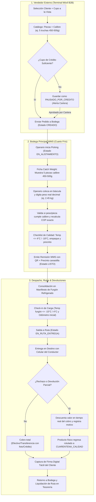
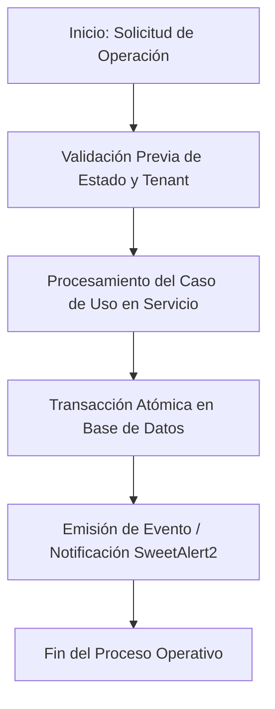
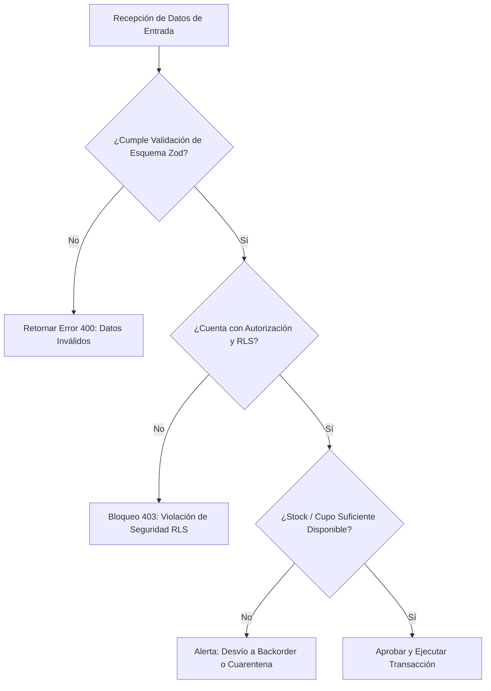
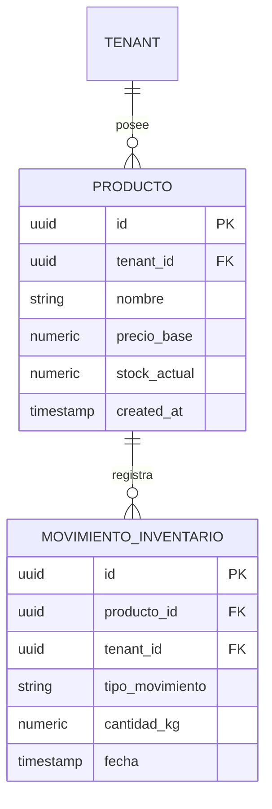
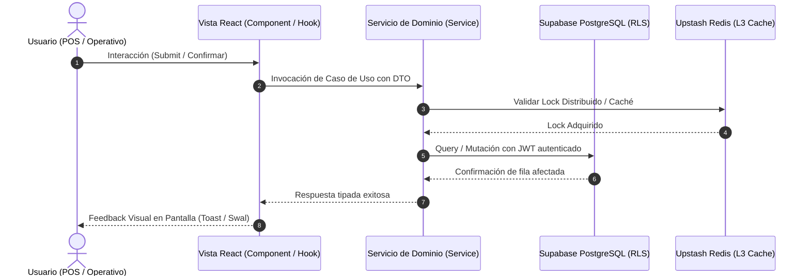
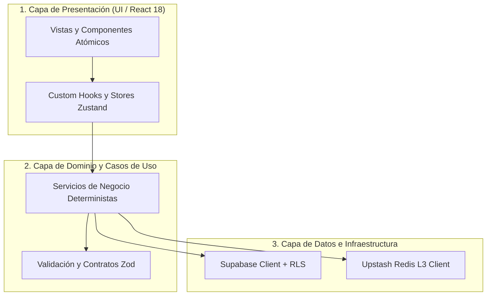

# Especificación de Requerimiento (Spec): Sistema de Ventas Externas B2B — Regla del Niño de 12 Años

**Código:** SPEC-016  
**Título:** Sistema de Ventas Externas B2B para Bodega Principal (Regla del Niño de 12 Años: Terminal Móvil Fricción Cero, Catch Weight Dual Piezas/Calibre, Alistamiento WMS, Despacho, Entrega y Devoluciones a Cuarentena)  
**Estado:** DRAFT (Esperando Aprobación Humana)  
**Autor:** Principal Software Architect, Operations Lead & UX Accessibility Lead  
**Fecha:** 2026-10-15  
**Fase de Ciclo:** Spec Kit v3.0 — `/speckit.specify`  

---

## 1. Resumen Ejecutivo y Propósito ("Por qué")

En la operación comercial mayorista de **La Pezcaderia**, los vendedores externos recorren restaurantes, hoteles, cevicherías y distribuidores en Bucaramanga y su área metropolitana. Actualmente, el registro de pedidos B2B dependía de formularios densos de escritorio o procesos fragmentados de cotización que no están adaptados a la dinámica ágil de la calle ni al perfil de vendedores que operan desde teléfonos inteligentes bajo condiciones de iluminación variable, movimiento continuo y necesidad de rapidez sin margen de error.

Adicionalmente, en la venta de pescados frescos y congelados (como trucha, róbalo, salmón o corvina), el cliente suele formular su pedido por **unidades y rangos de calibre específicos** (por ejemplo: *"5 unidades de trucha de 450 a 500 gramos"*), pero la política comercial innegociable de la empresa establece que **el producto se vende, valora y factura estrictamente por KILOS REALES**.

La **"Regla del Niño de 12 Años"** aplicada a las ventas externas B2B establece:
> *Cualquier persona, incluso un niño de 12 años sin conocimientos contables, debe ser capaz de abrir la terminal del vendedor en su teléfono, seleccionar el cliente viendo su cupo de crédito disponible a simple vista, agregar productos especificando piezas y calibre deseado en menos de 3 toques, programar la fecha de entrega y enviar el pedido en firme directo a la Bodega Principal en menos de 30 segundos sin cometer errores.*

### Objetivos Clave de Negocio
1. **Velocidad y Fricción Cero en Calle:** Disminuir a menos de 30 segundos el tiempo de toma de pedido por cliente B2B.
2. **Modelo Catch Weight Dual (Piezas/Calibre $\rightarrow$ Facturación por Kilo Real):** Permitir al vendedor capturar las piezas deseadas y el rango de calibre (ej. 5 truchas de 450-500g) calculando un peso nominal aproximado para referencia, garantizando que el alistamiento en cuarto frío capture el peso decimal real y liquide el valor final exacto.
3. **Gobernanza de Crédito con Semáforo Visual:** Si el pedido supera el cupo de crédito disponible o el cliente presenta mora, no se bloquea en seco; se muestra un badge rojo explicativo y se permite guardar como `PAUSADO_POR_CREDITO` para que Cartera/Admin lo autorice, o cambiarlo a Contado con 1 toque.
4. **Encadenamiento Hermético con Bodega (WMS), Rutas y Cuarentena:** El pedido entra de inmediato al Kanban de Bodega Principal, donde el operario valida piezas y calibre al pesar en báscula, empaqueta con precinto numerado de canastilla, genera la Remisión WMS con QR, el furgón refrigerado ejecuta el despacho con check-in de temperatura, el conductor recaba firma táctil en destino y descuenta devoluciones inmediatas con destino físico a `CUARENTENA_CALIDAD`.

---

## 2. Definición del Requerimiento ("Qué")

### 2.1. Terminal Móvil del Vendedor B2B (Vista Externa Dedicada: `B2BExternalSalesView`)
La interfaz opera como una aplicación web progresiva y táctil en 3 pasos secuenciales:

* **Paso 1: Selección Rápida de Cliente con Semáforo de Crédito a la Vista**
  - Buscador predictivo por nombre comercial, razón social o NIT con auto-focus.
  - Tarjeta del cliente seleccionado mostrando de forma prominente:
    - Razón social y dirección de entrega.
    - Barra de crédito visual: Cupo total, cupo usado y **Cupo Disponible en COP**.
    - Semáforo: Verde si el cupo es suficiente; Rojo si está excedido o en mora.
    - Toggle de 1 toque para cambiar entre condición `CREDITO` y `CONTADO / CONTRA-ENTREGA`.

* **Paso 2: Catálogo Visual Táctil con Stock en Bodega Principal**
  - Tarjetas de producto de $48\text{ px}+$ con fotografía/icono, nombre y stock físico disponible en tiempo real en la **Bodega Principal** (Bodega 1).
  - Selector de modalidad de venta:
    - *Peso Directo en Kilos* (ej. 10 kg).
    - *Catch Weight Dual (Piezas x Calibre)*: El vendedor indica número de piezas (ej. 5 unidades) y selecciona el calibre objetivo (ej. 450-500g, 500-600g). El sistema calcula un peso nominal estimado ($5 \times 0.475 = 2.375\text{ kg}$) pero alerta claramente: *"Se factura por kilo real en báscula de bodega"*.
    - Botones táctiles grandes `+` y `-` con keypad numérico integrado.

* **Paso 3: Carrito de Pedido Externo y Confirmación Directa**
  - Resumen claro de ítems con especificación de corte y empaque.
  - Selector de fecha de entrega pactada (mínimo día siguiente o fecha personalizada) y jornada (`MAÑANA` / `TARDE`).
  - Botón gigante de confirmación $\ge 56\text{ px}$ verde esmeralda:
    - Si el cupo es suficiente: *"ENVIAR PEDIDO A BODEGA PRINCIPAL"* (Pasa directo a `CREADO` en Kanban de Alistamiento).
    - Si el cupo excede el límite: *"ENVIAR PARA APROBACIÓN DE CRÉDITO"* (Pasa a `PAUSADO_POR_CREDITO`).

---

### 2.2. Flujo Completo Encadenado de Bodega, Rutas y Devoluciones

---

## 3. Requerimientos Funcionales en Notación EARS

### EARS-01: Terminal de Venta Externa de Fricción Cero (Regla del Niño de 12 Años)
* **Condición Ubicua:** El sistema SIEMPRE debe permitir al vendedor externo consultar el catálogo de productos con stock en tiempo real de la Bodega Principal, ver el cupo de crédito disponible del cliente seleccionado en COP y registrar un pedido en menos de 3 pasos táctiles con controles de dimensión mínima $\ge 48 \times 48\text{ px}$.

### EARS-02: Modelo Catch Weight Dual (Piezas x Calibre con Facturación por Kilo Real)
* **Evento (When):** Cuando el vendedor externo agrega un producto perecedero vendido por peso pero especificado en piezas (ej. Trucha, Salmón, Pargo) indicando cantidad de unidades y rango de calibre en gramos,
* **Acción:** El sistema debe calcular un peso nominal estimado para la cotización inicial, pero estampar de forma obligatoria que **la facturación y cobro final se liquidarán multiplicando el peso real decimal obtenido en la báscula de cuarto frío por el precio pactado por kilo**.

### EARS-03: Gobernanza Preventiva de Crédito con Semáforo Visual
* **Evento (When):** Cuando el monto del pedido supera el cupo disponible del cliente o el cliente presenta facturas vencidas,
* **Acción:** El sistema debe resaltar visualmente la tarjeta de crédito en color rojo de alto contraste (WCAG AA+), impedir la confirmación directa a bodega y habilitar los botones de acción rápida para: a) Guardar como `PAUSADO_POR_CREDITO` enviando notificación a Cartera; o b) Cambiar en 1 solo toque a condición `CONTADO / CONTRA-ENTREGA`.

### EARS-04: Ficha de Alistamiento Asistida en Cuarto Frío
* **Evento (When):** Cuando el operario de Bodega Principal abre una orden con productos Catch Weight en la pantalla de alistamiento,
* **Acción:** El sistema debe mostrar el número de piezas solicitadas, el rango de calibre pactado (ej. 450-500g), sugerir el lote perecedero bajo política FEFO, y al digitar el peso decimal real de la báscula (ej. 2.45 kg), calcular el peso promedio por pieza, emitir un check verde de conformidad de calibre y actualizar el subtotal en COP automáticamente.

### EARS-05: Verificación de Empaque, Precinto y Remisión WMS
* **Evento (When):** Cuando el operario finaliza el pesaje de todos los ítems del pedido,
* **Acción:** El sistema debe requerir la verificación rápida de 3 puntos (temperatura conforme, empaque íntegro y precinto numerado de canastilla), generar la `WmsDispatchRemision` con código QR y transicionar el pedido al estado `LISTO` para despacho.

### EARS-06: Entrega Certificada en Destino con Firma Táctil
* **Evento (When):** Cuando el conductor repartidor llega a las instalaciones del cliente,
* **Acción:** El sistema debe capturar la firma digital táctil del receptor en la pantalla del dispositivo móvil, estampar la hora de entrega y registrar el cobro según la forma de pago (efectivo, comprobante digital o crédito validado).

### EARS-07: Devolución Parcial en Sitio y Segregación a Cuarentena
* **Evento (When):** Cuando el cliente rechaza parte del pedido por no conformidad en el momento de la entrega,
* **Acción:** El sistema debe permitir el registro de la devolución parcial indicando ítem, kilos devueltos y causal, descontar inmediatamente el monto del cobro del conductor y programar el reingreso físico del producto devuelto a la bodega de `CUARENTENA_CALIDAD` al retorno del vehículo.

---

## 4. Criterios de Aceptación (Quality Gate & Gobernanza)

1. **Ergonomía Táctil y Accesibilidad:**
   - 100% de los elementos interactivos en la terminal del vendedor y del operario cumplen con un target size $\ge 48 \times 48\text{ px}$.
   - Contraste estricto en Light Mode cumpliendo con WCAG 2.2 AA+ (ratios $\ge 4.5:1$ en textos y $\ge 3:1$ en componentes UI).
2. **Exactitud Matemática e Inventario:**
   - Liquidación al centavo: $COP = \text{peso\_real\_decimal} \times \text{precio\_kg}$.
   - Mermas de picking calculadas y registradas contablemente.
   - Devoluciones segregadas físicamente hacia `CUARENTENA_CALIDAD`.
3. **Calidad de Código y Pruebas Unitarias TDD:**
   - Suites de pruebas completas en Vitest cubriendo todo el ciclo (Terminal Vendedor $\rightarrow$ Validación Cupo $\rightarrow$ Catch Weight Alistamiento $\rightarrow$ Despacho $\rightarrow$ Devolución).
   - 100% de tests pasando en verde.
   - Compilación estricta con `tsc --noEmit` en 0 errores.
4. **Validación en Vivo Chrome DevTools MCP:**
   - 0 errores / advertencias en consola JS en `http://localhost:3000/`.
   - Inspección en viewport móvil (375 px) demostrando fluidez y usabilidad sin scroll horizontal.
5. **Gobernanza Continuous Kanban:**
   - Límite WIP = 1 respetado estrictamente.
   - Ninguna línea de código de producción será escrita sin la aprobación explícita del usuario en cada fase.

---

**Siguiente Paso del Flujo:** Esperar la aprobación del usuario sobre esta Especificación (`/speckit.specify`) para proceder con el Control de Calidad 1 (`/speckit.clarify`).

<!-- MANDATORY MULTI-PHASE SYSTEM MODELING (Mermaid.js) -->
## 5 Diagramas de Ingeniería Obligatorios (Mermaid.js)

### 1. Flujo de Procesos: Ciclo de Vida Operativo (`1_process_flowcharts`)

### 2. Rombos de Decisión: Lógica Condicional y Edge Cases (`2_decision_logic_diagrams`)

### 3. Modelo Entidad-Relación: Persistencia y Llaves (`3_entity_relationship_diagrams`)

### 4. Diagrama de Secuencia: Mensajería entre Capas y Servicios (`4_sequence_diagrams`)

### 5. Arquitectura de Componentes y Límites de Capas (`5_component_architecture_diagrams`)

<!-- END MANDATORY MULTI-PHASE SYSTEM MODELING -->
