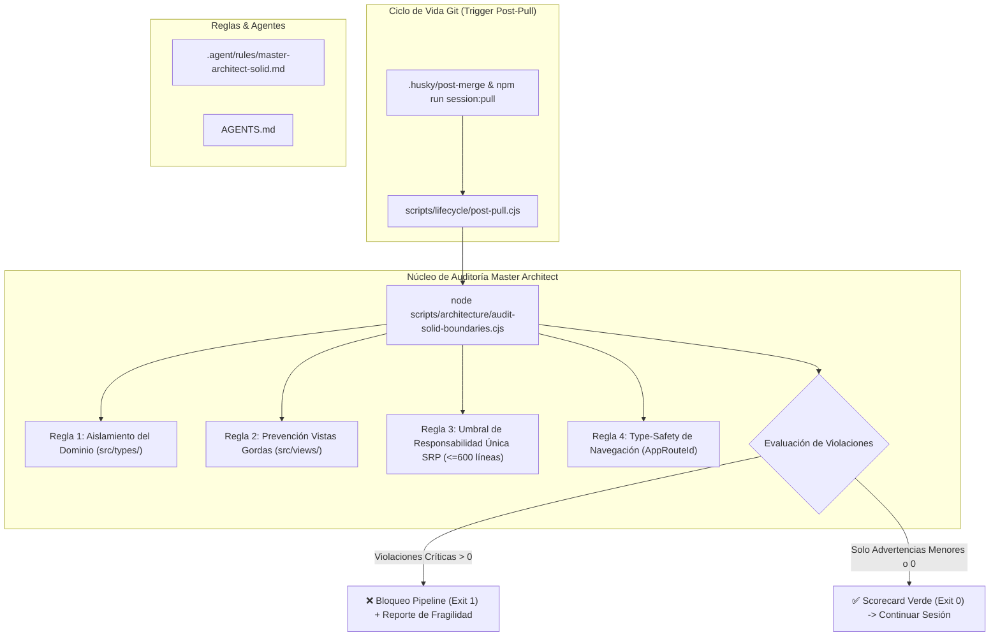

# Plan de Implementación Técnica (/speckit.plan)

**Código:** SPEC-017  
**Título:** Plan de Arquitectura y Harness de Auditoría Continua SOLID Post-Git-Pull (Master Architect)  
**Estado:** PENDIENTE DE APROBACIÓN HUMANA  
**Fecha:** 2026-10-15  
**Fase de Ciclo:** Spec Kit v3.0 — Paso 4 (`/speckit.plan`)  
**Política de Gobernanza:** `MANDATORY_GLOBAL_ENFORCEMENT`  

---

## 1. Arquitectura de Componentes y Flujo de Información

---

## 2. Especificación Detallada de Módulos

### 2.1. Regla Constitucional de Gobernanza (`.agent/rules/master-architect-solid.md`)
* **Propósito:** Documento de gobernanza perpetua para todos los subagentes del IDE Antigravity y desarrolladores.
* **Secciones:**
  1. *Declaración de Autoridad:* Rol de Master Architect como guardián supremo del código.
  2. *Matriz de Infracciones Arquitectónicas:* Tipificación de violaciones (Crítica, Alta, Media).
  3. *Guía de Buenas Prácticas:* Ejemplos concretos de separación en 3 capas (Presentación $\rightarrow$ Servicios $\rightarrow$ Datos).
  4. *Protocolo de Refactorización Quirúrgica:* Procedimiento paso a paso para desacoplar código frágil sin regresiones.

### 2.2. Motor de Análisis Arquitectónico (`scripts/architecture/audit-solid-boundaries.cjs`)
* **Propósito:** Analizador estático determinista de alta velocidad ($< 1.5\text{ s}$) sin librerías pesadas.
* **Módulos de Inspección:**
  - `checkDomainPurity()`: Escanea recursivamente `src/types/` y archivos de lógica determinista. Si encuentra `import ... from '@supabase/supabase-js'`, `axios`, `localStorage` o similares, emite infracción **CRÍTICA**.
  - `checkViewSeparation()`: Escanea `src/views/` buscando importaciones directas de clientes de bases de datos o queries SQL en crudo. Si encuentra acceso a datos directo en UI sin pasar por store o service, emite infracción **CRÍTICA**.
  - `checkSingleResponsibilityFileLength()`: Identifica archivos que excedan las 600 líneas de código útil (descontando comentarios), emitiendo advertencia de refactorización por violación al principio de Responsabilidad Única.
  - `checkRouteTypeSafety()`: Verifica que las referencias de navegación en el código comercial utilicen `AppRouteId` en vez de magic strings.
* **Formato de Salida:**
  - Tabla visual cromática en terminal con conteo de archivos inspeccionados, violaciones clasificadas y recomendaciones de subsanación.

### 2.3. Integración en el Pipeline de Ciclo de Vida (`scripts/lifecycle/post-pull.cjs`)
* **Modificación:** Incorporar la auditoría como Paso 4 en la secuencia de puesta en marcha:
  1. Graphify Update (Grafo Estructural)
  2. GitNexus AST Index (Call Graph)
  3. TypeScript Check (`tsc --noEmit`)
  4. **NUEVO:** Auditoría Master Architect SOLID & Boundaries (`audit-solid-boundaries.cjs`)
  5. Verificación de Servidor Vite (:3000)
* **Script npm:** Agregar `"audit:architecture": "node scripts/architecture/audit-solid-boundaries.cjs"` en `package.json`.

### 2.4. Suite de Pruebas TDD (`src/tests/architecturalBoundaries.test.ts`)
* **Propósito:** Garantizar que el motor de auditoría funcione de forma determinista y confiable:
  - Valida que detecte violaciones inyectadas de prueba.
  - Valida que el código base actual del ERP pase la auditoría limpia con 0 violaciones críticas.

---

## 3. Plan de Mitigación de Riesgos y Regresión

| Riesgo | Probabilidad | Impacto | Mitigación |
| :--- | :--- | :--- | :--- |
| **Falsos positivos que bloqueen el trabajo diario** | Baja | Alto | Umbrales calibrados: solo violaciones críticas de límites de capas (ej. infraestructura en dominio) generan código de salida 1; advertencias de tamaño emiten recomendación no bloqueante. |
| **Tiempo excesivo de ejecución en post-pull** | Muy Baja | Medio | Escaneo mediante streams asíncronos en Node.js nativo con tiempo de respuesta estimado menor a 1.5 segundos. |
| **Regresión en tests existentes** | Nula | Alto | La auditoría es una herramienta de verificación pasiva sobre el código fuente; no modifica lógica funcional en tiempo de ejecución. |

---

**Siguiente Paso Obligatorio del Flujo:** Esperar la aprobación explícita del usuario sobre este Plan Técnico (`/speckit.plan`) para proceder con el desglose de tareas (`/speckit.tasks`).
