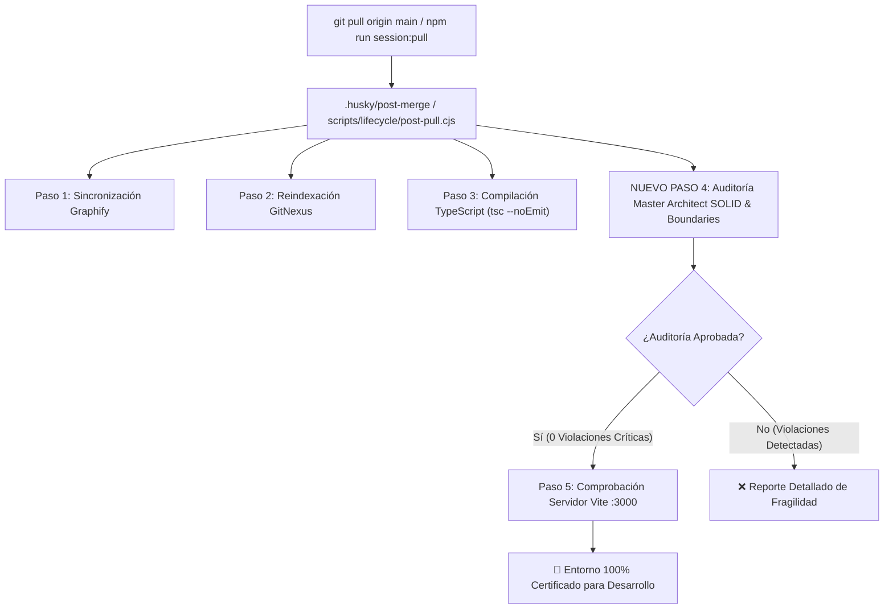
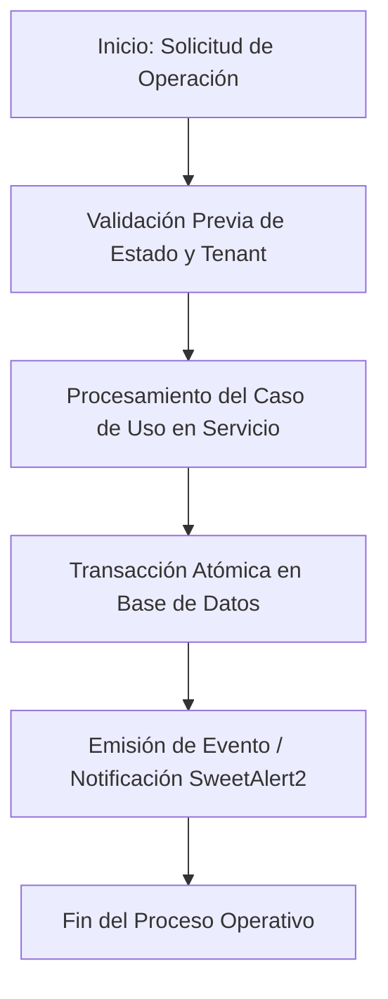
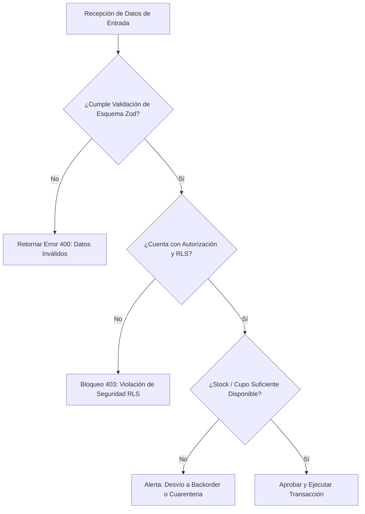
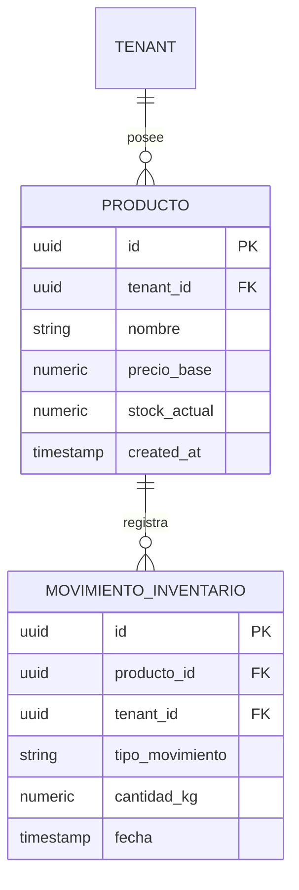
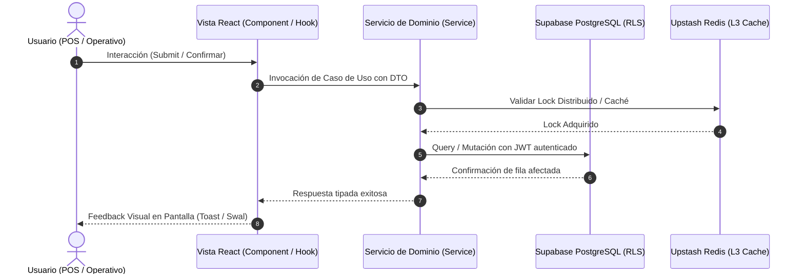
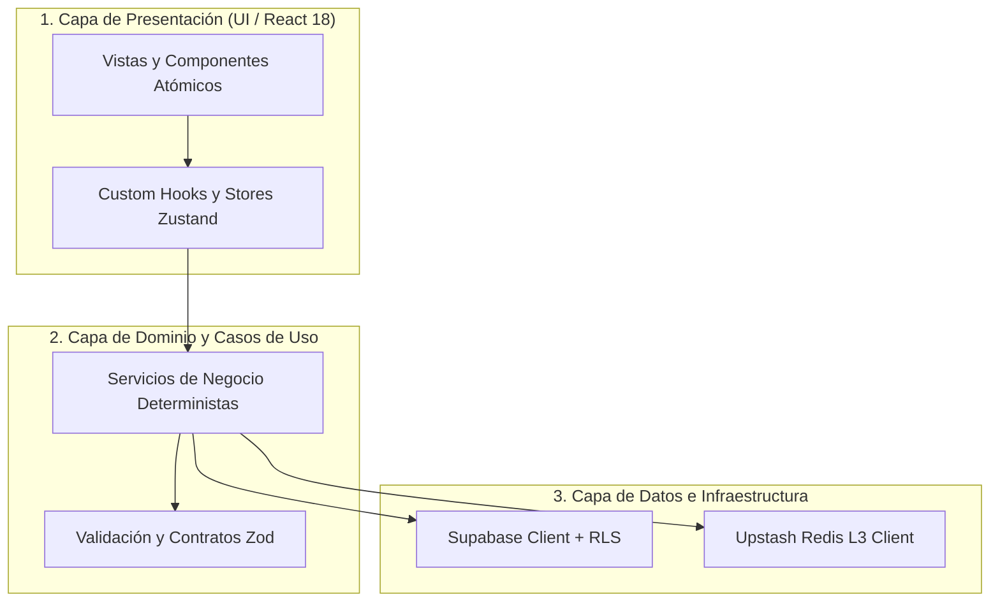

# Especificación de Requerimientos del Sistema (/speckit.specify)

**Código:** SPEC-017  
**Título:** Guardián de Arquitectura Supremo y Auditoría Continua de Código SOLID Post-Git-Pull (Master Architect)  
**Estado:** DRAFT — PENDIENTE DE APROBACIÓN HUMANA  
**Fecha:** 2026-10-15  
**Fase de Ciclo:** Spec Kit v3.0 — Paso 1 (`/speckit.specify`)  
**Política de Gobernanza:** `MANDATORY_GLOBAL_ENFORCEMENT`  
**Rol del Agente:** Arquitecto Supremo y Guardián del Código (Master Architect)  
**Evento Disparador:** `post_git_pull` (`.husky/post-merge` y `npm run session:pull`)  
**Audiencia Objetivo:** Todos los agentes de IA (Subagents, Agency Swarm, Claude/Antigravity) y desarrolladores del proyecto.  

---

## 1. Declaración de Misión y Justificación ("Por Qué")

En arquitecturas empresariales "Data-Driven" de alta escala, las integraciones periódicas de código (`git pull`) y el trabajo multi-agente introducen el riesgo continuo de incorporar "código frágil":
- Acoplamiento estrecho entre vistas React y llamadas directas de infraestructura/Supabase.
- Violaciones al principio de Responsabilidad Única (componentes monolíticos o servicios saturados).
- Duplicación de lógica de negocio o cálculos fiscales/inventario en múltiples pantallas (violación DRY).
- Ausencia de abstracciones e interfaces (violación de Inversión de Dependencias).
- Anti-patrón de "Controlador/Vista Gorda".

Esta especificación institucionaliza la figura del **Arquitecto Supremo y Guardián del Código (Master Architect)** con mandato constitucional ineludible: **cada vez que se ejecute un `git pull` o inicio de sesión (`npm run session:pull`), se dispara una auditoría automatizada y multidimensional que valida la integridad estructural antes de permitir cualquier nuevo desarrollo.**

---

## 2. Requerimientos Funcionales en Notación EARS ("Qué")

### EARS-01: Auditoría Automática en Trigger Post-Pull
- **Condición Ubicua:** **El sistema DEBE** ejecutar el script de auditoría del Master Architect cada vez que ocurra un evento `post_git_pull` mediante `.husky/post-merge` o `npm run session:pull`.
- **Comportamiento:** Si se detectan violaciones arquitectónicas críticas (código frágil o acoplamiento de infraestructura en dominio), **el sistema DEBE** reportar el diagnóstico detallado y bloquear el avance operativo.

### EARS-02: Cumplimiento de Principios SOLID
- **Single Responsibility (SRP):** **El sistema DEBE** rechazar clases, servicios o componentes que presenten múltiples razones para cambiar (ej. un componente UI que calcule impuestos, gestione estado y haga mutaciones directas de base de datos).
- **Open/Closed (OCP):** **El sistema DEBE** asegurar que las nuevas características extiendan el comportamiento existente mediante composición, plugins o estrategias, sin modificar el núcleo funcional probado.
- **Liskov Substitution (LSP):** **El sistema DEBE** garantizar que las implementaciones de interfaces (`IDataService`, `IB2BService`, etc.) cumplan plenamente los contratos y tipos esperados sin alterar la semántica del padre.
- **Interface Segregation (ISP):** **El sistema DEBE** exigir interfaces pequeñas, cohesivas y orientadas al cliente (ej. segregar lectura de ventas de alistamiento y liquidación).
- **Dependency Inversion (DIP):** **El sistema DEBE** bloquear el acoplamiento directo a implementaciones concretas; los módulos de alto nivel deben depender exclusivamente de abstracciones (interfaces y contratos).

### EARS-03: Blindaje de Límites Arquitectónicos (Hexagonal / Clean Architecture)
- **Aislamiento del Dominio:** **El sistema DEBE** prohibir cualquier importación de librerías de infraestructura (Supabase client, Prisma, Axios, LocalStorage) dentro de las entidades y modelos puros del Dominio (`src/types/`, lógica de cálculo determinista, reglas de negocio).
- **Regla de Dependencia:** **El sistema DEBE** exigir que las dependencias fluyan estrictamente desde la Infraestructura/Presentación hacia el Dominio, nunca del Dominio hacia afuera.
- **Prevención de Controlador Gordo:** **El sistema DEBE** prohibir lógica de negocio pesada, validaciones tributarias o persistencia directa dentro de las vistas React; la arquitectura debe respetar la tríada: `Presentación (UI/Hooks) -> Casos de Uso/Servicios -> Repositorios/Adaptadores de Datos`.

### EARS-04: Código Limpio y Principio DRY (Don't Repeat Yourself)
- **Tolerancia Cero Duplicación:** **El sistema DEBE** auditar y señalar bloques de código o lógicas de cálculo idénticas repetidas en más de un archivo.
- **Punto Único de Cambio (Single Point of Truth):** **El sistema DEBE** exigir que cualquier regla compartida (retenciones NIIF, factores de calibre Catch Weight, cálculo ABC Pareto) resida en un único módulo canónico exportado.

### EARS-05: Patrones de Diseño Canónicos y Lenguaje Ubicuo
- **Selección de Patrones Canónicos:** Cuando se identifiquen estructuras condicionales repetitivas (`switch`/`if-else` masivos de creación), **el sistema DEBE** estructurarse bajo patrones formales (Factory, Strategy, Repository, Outbox).
- **Vocabulario Ubicuo:** **El sistema DEBE** adoptar convenciones semánticas consistentes en el nomenclátor de clases y archivos (`B2BSalesStrategy`, `CatchWeightCalculator`, `OrderRepository`, etc.).

---

## 3. Arquitectura de Integración en el Pipeline Existente

---

## 4. Criterios de Aceptación del Requerimiento

1. **Constitución de Regla Global:** Registro formal en `.agent/rules/master-architect-solid.md` y `.opencode/` para conocimiento vinculante de todos los agentes.
2. **Harness Automatizado en `post-pull.cjs`:** Integración de la rutina de análisis de límites arquitectónicos, acoplamiento y duplicación dentro del ciclo de vida de `session:pull`.
3. **Reporte Automático de Salud Arquitectónica:** Emisión de un resumen visual con métricas SOLID tras cada sincronización de repositorio.
4. **Cero Impacto Negativo:** La suite completa de 72+ tests y compilación TypeScript deben permanecer en 100% de éxito.

---

**Siguiente Paso Obligatorio del Flujo:** Esperar la aprobación explícita del usuario sobre este `/speckit.specify` antes de avanzar al Control de Calidad 1 (`/speckit.clarify`).

<!-- MANDATORY MULTI-PHASE SYSTEM MODELING (Mermaid.js) -->
## 5 Diagramas de Ingeniería Obligatorios (Mermaid.js)

### 1. Flujo de Procesos: Ciclo de Vida Operativo (`1_process_flowcharts`)

### 2. Rombos de Decisión: Lógica Condicional y Edge Cases (`2_decision_logic_diagrams`)

### 3. Modelo Entidad-Relación: Persistencia y Llaves (`3_entity_relationship_diagrams`)

### 4. Diagrama de Secuencia: Mensajería entre Capas y Servicios (`4_sequence_diagrams`)

### 5. Arquitectura de Componentes y Límites de Capas (`5_component_architecture_diagrams`)

<!-- END MANDATORY MULTI-PHASE SYSTEM MODELING -->
