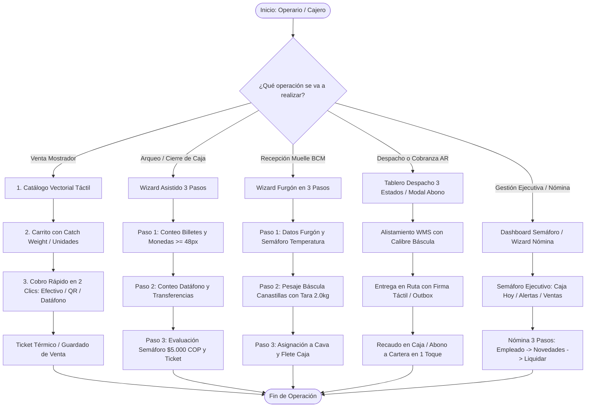
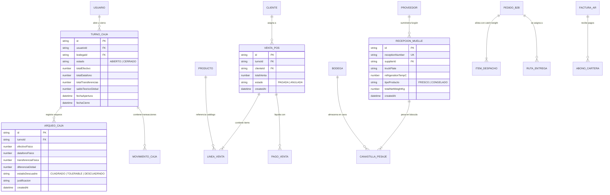
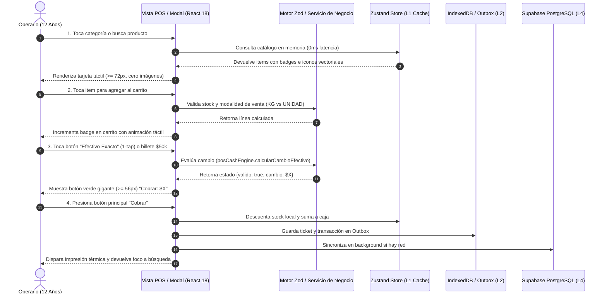

# SPEC-018: Auditoría Global y Plan Maestro UX/UI "Regla del Niño de 12 Años"

## 1. Resumen Ejecutivo y Propósito
El propósito de esta especificación es auditar la totalidad de los módulos de **La Pezcadería ERP** bajo la **Regla del Niño de 12 Años** (Fricción Cero, controles táctiles ergonómicos $\ge 48\text{ px}$, botón de acción principal $\ge 56\text{ px}$, flujos $\le 3$ pasos, retroalimentación sensorial inmediata con 0 errores de consola) y establecer un **Plan Maestro de Implementación Quirúrgica** estructurado en **4 Fases Operacionales Prioritarias**.

### Mandato de Cero Imágenes (Zero-Cost Vector Graphics)
- **Prohibición absoluta:** Queda terminantemente prohibido el uso de etiquetas ``, llamadas a servicios de imágenes externos (Unsplash, Picsum, Cloudinary) y assets rasterizados que introduzcan latencia o fallos de red.
- **Estandarización Canónica:** Sustituir todo avatar de producto por **Tarjetas Visuales Semánticas Vectoriales** generadas mediante **Lucide React** (`Fish`, `Waves`, `Snowflake`, `Scissors`, `Package`, `Shell`, `Scale`, `ShieldCheck`), combinadas con contenedores cromáticos HSL / Tailwind de alto contraste (Light Mode WCAG 2.2 AA+).

---

## 2. Hallazgos de la Auditoría Módulo por Módulo

| Módulo | Archivos Clave | Estado Actual vs Regla de 12 Años | Brecha / Deficiencia Detectada | Acción Quirúrgica Requerida |
| :--- | :--- | :--- | :--- | :--- |
| **Fase 1: POS Mostrador & Offline** | `src/views/POSView.tsx`<br>`src/views/pos/components/ProductSearchPanel.tsx`<br>`src/views/pos/components/PaymentPanel.tsx`<br>`src/views/pos/components/LineaVentaRow.tsx`<br>`src/components/common/ProductAvatar.tsx` | - `PaymentPanel` y `LineaVentaRow` tienen targets $\ge 48\text{ px}$.<br>- `ProductAvatar` aún renderiza etiquetas ``.<br>- `ProductSearchPanel` tiene estilos inline y carece de tarjetas táctiles de 72px fijas. | - Presencia de etiquetas `` residuales en `ProductAvatar.tsx`.<br>- La cuadrícula de productos en POS no aprovecha la iconografía vectorial semántica probada en B2B.<br>- El botón de cobro rápido en efectivo requiere 3 clics en lugar de 2 clics (1-tap exacto). | - Reemplazar el renderizado de `ProductAvatar` por iconos vectoriales puros sin ``.<br>- Crear tarjeta táctil de producto `min-h-[72px]` con badge Kilos/Unidad y semáforo de stock.<br>- Integrar botón "Efectivo Exacto" visible en el carrito. |
| **Fase 1: Control de Caja & Arqueos** | `src/views/cash/components/ArqueoCajaModal.tsx`<br>`src/views/cash/components/CalculadorDenominaciones.tsx`<br>`src/views/cash/components/CierreCajaModal.tsx` | - `ArqueoCajaModal` implementa Arqueo Ciego y tolerancia de $5.000 COP.<br>- `CalculadorDenominaciones` tiene botones de 44px (falla regla 48px).<br>- Coexisten dos modales de cierre (`ArqueoCajaModal` y `CierreCajaModal`). | - Botones táctiles de incremento/decremento en billetes son de $44\text{ px}$ en vez de $\ge 48\text{ px}$.<br>- Duplicidad de lógica entre `CierreCajaModal` y `ArqueoCajaModal`.<br>- Falta el Wizard guiado en 3 pasos secuenciales aprobado en `/grill-me`. | - Unificar en un Wizard Táctil de 3 Pasos: 1. Billetes y Monedas, 2. Datáfono y QR, 3. Confirmación y Ticket.<br>- Aumentar botones del calculador a `min-w-[48px] min-h-[48px]`. |
| **Fase 2: Bodega & Muelle BCM** | `src/views/inventory/components/BucaramangaReceivingWizard.tsx`<br>`src/views/inventory/components/DockReceivingTab.tsx`<br>`src/views/inventory/components/WarehouseTransferPanel.tsx` | - Flujo de 3 pasos bien concebido (Furgón $\rightarrow$ Báscula $\rightarrow$ Frío).<br>- Estilo en Dark Mode que reduce legibilidad bajo luz solar o lámparas industriales.<br>- Botón de historial de 44px. | - Contraste visual no optimizado para ambiente de muelle/bodega (requiere Light Mode WCAG 2.2 AA+).<br>- El panel de traslados a sucursales tiene demasiados campos técnicos sin guía táctil. | - Estandarizar en Light Mode WCAG 2.2 AA+ (fondos blancos/pizarra, bordes definidos, badges de colores vivos).<br>- Wizard de traslados internos en 2 toques (Seleccionar sucursal $\rightarrow$ Cantidad rápida). |
| **Fase 2: Cuarto Frío WMS & Catch Weight** | `src/views/inventory/components/WeightPackingModal.tsx`<br>`src/views/inventory/components/ColdRoomPreparation.tsx` | - `WeightPackingModal` certificado en SPEC-016 con cero imágenes y lectura de balanza.<br>- `ColdRoomPreparation` requiere unificación estética. | - Inconsistencias de tokens entre los componentes antiguos de inventario y los nuevos modales B2B. | - Propagar el componente `WeightPackingModal` y tokens ergonómicos a todo el WMS. |
| **Fase 3: Despachos & Rutas B2B** | `src/views/OrderKanbanView.tsx`<br>`src/views/inventory/components/DeliveryExecutionModal.tsx`<br>`src/views/inventory/components/RouteManifestBuilderModal.tsx` | - Tablero Kanban con múltiples columnas que saturan pantallas táctiles pequeñas.<br>- Modal de ejecución de entrega cuenta con firma táctil offline outbox. | - Demasiadas columnas en vista móvil (requiere pestañas o simplificación a 3 macro-estados: Preparación, En Ruta, Entregado). | - Simplificar el tablero de despacho a 3 macro-estados operativos con chips de filtro táctil $\ge 48\text{ px}$. |
| **Fase 3: Cartera & Cuentas por Cobrar (AR)** | `src/views/ARView.tsx` | - Módulo funcional con cálculo de mora y notas de crédito.<br>- Registro de abono usa prompts de `Swal.fire` con HTML plano e inputs pequeños. | - Registro de cobro no táctil, susceptible a errores de digitación.<br>- No cuenta con botones de abono rápido (Total, 50%, etc.). | - Crear `QuickAbonoModal.tsx` táctil: Factura $\rightarrow$ Botones rápidos ('Total', '50%') o numpad $\ge 48\text{ px}$ $\rightarrow$ Sincronización instantánea con caja. |
| **Fase 4: Personal, Nómina & Contabilidad** | `src/views/PayrollView.tsx`<br>`src/views/AccountingView.tsx`<br>`src/views/DashboardView.tsx` | - `PayrollView` tiene lógica de 360 días sólida pero formulario denso.<br>- `DashboardView` cuenta con diseño Light Mode moderno pero métricas dispersas. | - Curva de aprendizaje empinada para liquidación de nómina.<br>- Falta semáforo ejecutivo consolidado en Dashboard. | - Wizard de nómina en 3 pasos (1. Empleado, 2. Novedades, 3. Pagar).<br>- Dashboard con Semáforo Ejecutivo (Caja Hoy, Ventas B2B, Stock Crítico). |

---

## 3. Modelado de Sistema Multi-Fase (Mermaid.js Mandatorio)

### 3.1. Diagrama 1: Flujo de Procesos Unificado (Process Flowchart)


---

### 3.2. Diagrama 2: Lógica de Decisión y Tolerancia (Decision Logic Diagram)
```mermaid
flowchart TD
    Start[Inicio de Validación en Frontera] --> Modulo{Módulo Activo}
    
    %% DECISIÓN POS
    Modulo -->|POS Mostrador| CheckPago{¿Medio de Pago Seleccionado?}
    CheckPago -->|Efectivo| ValEfectivo{¿Efectivo Recibido >= Total?}
    ValEfectivo -->|Sí| CalcCambio[Calcular Vuelto / Cambio Exacto]
    CalcCambio --> AllowCobro[Habilitar Botón Verde >= 56px: Cobrar]
    ValEfectivo -->|No| BlockCobro[Mostrar Faltante en Rojo y Bloquear Cobro]
    CheckPago -->|Crédito| ValCliente{¿Cliente Asignado y con Cupo?}
    ValCliente -->|Sí| AllowCobro
    ValCliente -->|No| AlertCredito[Alerta Ámbar: Requiere Cliente Válido]
    
    %% DECISIÓN ARQUEO CAJA
    Modulo -->|Arqueo Caja Ciega| CalcDiff[Calcular Diferencia = Físico Declarado - Teórico]
    CalcDiff --> CheckTol{¿|Diferencia| <= $5.000 COP?}
    CheckTol -->|Sí: Tolerancia Aceptable| GreenClose[Semáforo Verde: Permitir Cierre Directo]
    CheckTol -->|No: Descuadre Excesivo| AmberClose[Semáforo Rojo/Ámbar: Exigir Justificación Escrita Obligatoria]
    AmberClose --> CheckJustif{¿Justificación diligenciada?}
    CheckJustif -->|Sí| EnableClose[Habilitar Cierre con Registro de Auditoría]
    CheckJustif -->|No| DisableClose[Bloquear Cierre de Turno]
    
    %% DECISIÓN MUELLE WMS
    Modulo -->|Muelle BCM Frío| CheckTemp{¿Temperatura dentro del rango?}
    CheckTemp -->|Fresco: 0°C a 2°C / Congelado: <= -18°C| TempOptima[Semáforo Verde: Temperatura Óptima]
    CheckTemp -->|Fresco: 2.1°C a 4°C / Congelado: -15°C a -17°C| TempWarn[Semáforo Amarillo: Precaución Sanitaria]
    CheckTemp -->|Fresco: > 4°C / Congelado: > -15°C| TempAlert[Semáforo Rojo: Alerta de Cadena de Frío / Descongelamiento]
```

---

### 3.3. Diagrama 3: Modelo Entidad-Relación Integral (ERD)


---

### 3.4. Diagrama 4: Secuencia Temporal de Interacción Táctil (Sequence Diagram)


---

### 3.5. Diagrama 5: Arquitectura de Componentes por Capas (Component Architecture)
```mermaid
graph TB
    subgraph Presentation_Layer [Capa de Presentación UI (React 18 + Tailwind WCAG 2.2 AA+)]
        direction TB
        V1[POS Mostrador: ProductSearchPanel + CartPanel + PaymentPanel]
        V2[Caja: ArqueoCajaModal Wizard 3 Pasos + CalculadorDenominaciones]
        V3[WMS Muelle: BucaramangaReceivingWizard Light Mode + WeightPackingModal]
        V4[Despachos & Cartera: OrderKanbanView + QuickAbonoModal]
        V5[Dashboard: ExecutiveTrafficLightWidget + PayrollWizard3Steps]
    end

    subgraph Logic_Layer [Capa de Lógica & Validación Científica (Zod + Servicios)]
        direction TB
        S1[posCashEngineService: Denominaciones & Tolerancia $5k]
        S2[purchasesBucaramangaService: Taras, Canastillas & Mermas]
        S3[b2bDispatchService: Catch Weight, Precintos & Rutas]
        S4[cashService: Turnos, Gaveta, Alivios & Cuadres]
    end

    subgraph State_Layer [Capa de Estado Reactivo & Caché Multinivel (L1 + L2)]
        direction TB
        Z1[Zustand Stores: useInventoryStore, useCashStore, useOrderStore, useARStore]
        Z2[LocalDB / IndexedDB Outbox: Sincronización Resiliente Offline-First]
    end

    subgraph Data_Layer [Capa de Persistencia & Cloud (Supabase PostgreSQL)]
        direction TB
        DB1[(PostgreSQL: Tablas con RLS, tenant_id y RPCs transaccionales)]
    end

    Presentation_Layer --> Logic_Layer
    Logic_Layer --> State_Layer
    State_Layer --> Data_Layer
```
