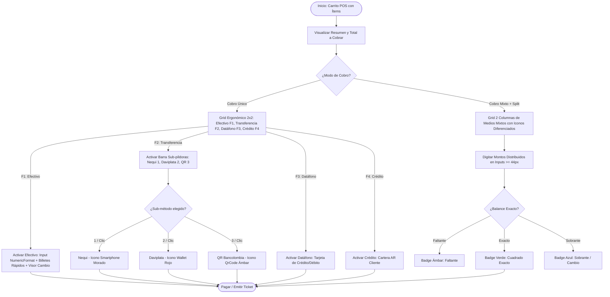
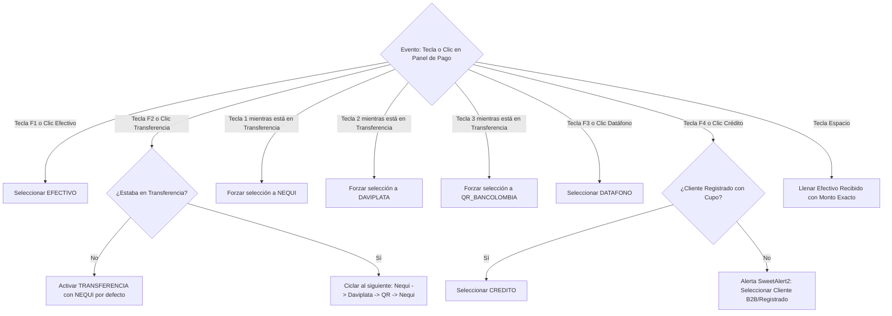
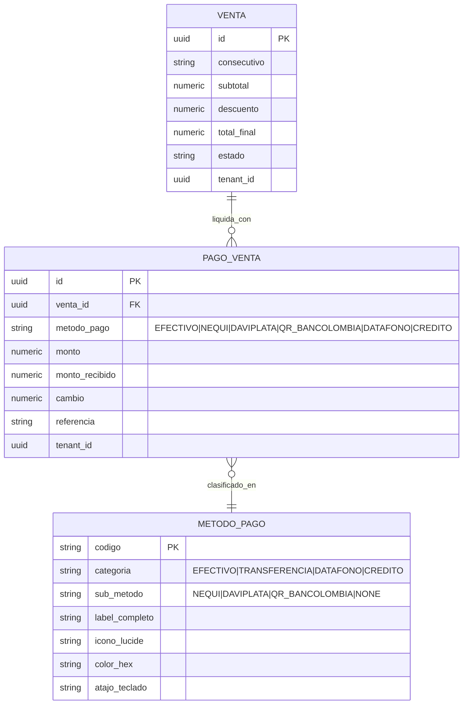
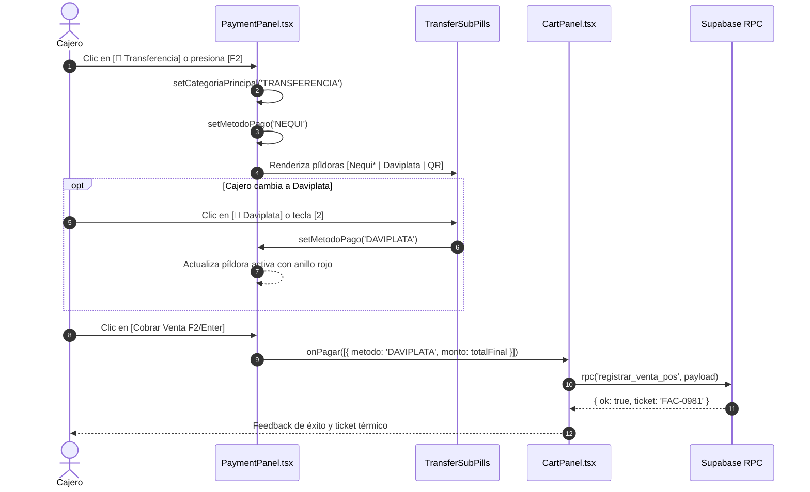
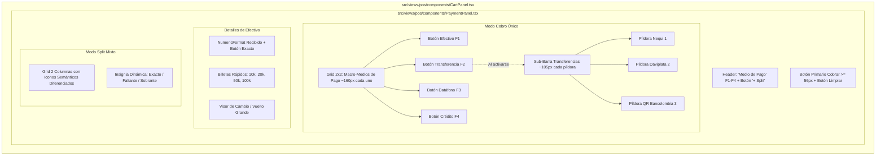

# SPEC-019: Optimización de Legibilidad, Ergonometría Táctil y Desbordamiento en Medios de Pago POS

## 1. Resumen Ejecutivo y Propósito (EARS Notation)
- **Problema:** En la vista de caja del Punto de Venta (`PaymentPanel.tsx`), los botones de selección de medios de pago sufrían un colapso de desbordamiento horizontal severo debido a la clase `sm:grid-cols-6` dentro de una columna lateral fija de ~340px en pantallas de escritorio y laptop (viewport $\ge 640\text{ px}$). Cada botón se comprimía a ~55px de ancho, forzando un truncado de texto que generaba etiquetas ilegibles e ininteligibles: **"Ef..."**, **"N..."**, **"D..."**, **"Q..."**, **"D..."** y **"C..."**. Además, Nequi y Daviplata compartían el mismo icono genérico telefónico (`Phone`), y existía una discrepancia de atajos entre la cabecera y el tooltip.
- **Propósito:** Reestructurar ergonómicamente el contenedor de medios de pago bajo los estándares de **Rico UI**, **Google Stitch** y los tokens canónicos de **Light Mode WCAG 2.2 AA+** (`.agents/skills/erp-pos-design-tokens/SKILL.md`).
- **Solución Acordada en `/grill-me`:**
  1. **Jerarquía 4+3:** Reducir la botonera principal a 4 botones macro en grilla ergonómica 2x2 (`[💵 Efectivo]`, `[📲 Transferencia]`, `[💳 Datáfono]`, `[🏛️ Crédito]`), con un ancho generoso de ~160px $\times \ge 50\text{px}$ cada uno.
  2. **Sub-píldoras de Transferencias:** Al seleccionar `Transferencia`, se activa una sub-barra accesible con 3 píldoras semánticas diferenciadas (`[🟣 Nequi]`, `[🔴 Daviplata]`, `[🟡 QR Bancolombia]`) de ~105px cada una, con cero truncado y colores de marca.
  3. **Atajos Armónicos:** `F1` Efectivo, `F2` Transferencia (con sub-atajos `1` Nequi, `2` Daviplata, `3` QR Bancolombia), `F3` Datáfono, `F4` Crédito; y `Enter` para Cobrar.
  4. **Modo Split (+ Split):** Grilla de 2 columnas con iconos diferenciados y inputs táctiles de $44\text{ px}$.

### Especificación de Requisitos EARS
- **[Ubiquitous]** El sistema POS siempre debe mostrar el nombre completo de cada medio de pago sin puntos suspensivos (`truncate`), con contraste de texto WCAG AAA ($\ge 7:1$) sobre fondo blanco/slate.
- **[Event-driven]** Cuando el cajero seleccione `Transferencia` (vía clic o tecla `F2`), el panel debe desplegar suavemente la barra de sub-métodos con Nequi preseleccionado, permitiendo alternar a Daviplata o QR Bancolombia en 1 solo clic o con teclas `1`, `2`, `3`.
- **[Event-driven]** Cuando el cajero presione `F1-F4`, el sistema debe enfocar o activar el medio de pago correspondiente sin necesidad de interacción con el cursor.
- **[State-driven]** Mientras el modo `+ Split` esté activo, el panel debe presentar los 6 campos de recaudo con sus iconos específicos (`Banknote`, `Smartphone`, `Wallet`, `QrCode`, `CreditCard`, `Landmark`), actualizando el estado de cuadre (Exacto / Faltante / Sobrante).
- **[Unwanted Behavior]** En ningún caso un botón de medio de pago debe tener un ancho inferior a $90\text{ px}$ ni una altura menor a $48\text{ px}$.

---

## 2. Modelado de Sistema Multi-Fase Mandatorio (Mermaid.js)

### 2.1. Diagrama 1: Flujo de Proceso Secuencial (Process Flowchart)

### 2.2. Diagrama 2: Lógica de Decisión y Edge Cases (Decision Logic Diagram)

### 2.3. Diagrama 3: Modelo Entidad-Relación (Entity Relationship Diagram)

### 2.4. Diagrama 4: Secuencia Temporal de Interacción (Sequence Diagram)

### 2.5. Diagrama 5: Arquitectura de Componentes (Component Architecture)

---

## 3. Matriz Canónica de Tokens UI/UX y Acentos

| Medio / Sub-método | Label Completo | Icono Lucide | Contenedor Activo | Borde Activo | Texto / Icono Activo | Shortcut |
| :--- | :--- | :--- | :--- | :--- | :--- | :--- |
| **Efectivo** | `Efectivo` | `Banknote` | `bg-emerald-50` | `border-emerald-500` | `text-emerald-700` | `[F1]` |
| **Transferencia** | `Transferencia` | `Smartphone` | `bg-indigo-50` | `border-indigo-500` | `text-indigo-700` | `[F2]` |
| *↳ Sub: Nequi* | `Nequi` | `Smartphone` | `bg-fuchsia-50` | `border-fuchsia-500` | `text-fuchsia-700` | `[1]` |
| *↳ Sub: Daviplata* | `Daviplata` | `Wallet` | `bg-rose-50` | `border-rose-500` | `text-rose-700` | `[2]` |
| *↳ Sub: QR Bancolombia*| `QR Bancolombia` | `QrCode` | `bg-amber-50` | `border-amber-500` | `text-amber-700` | `[3]` |
| **Datáfono** | `Datáfono` | `CreditCard` | `bg-sky-50` | `border-sky-500` | `text-sky-700` | `[F3]` |
| **Crédito** | `Crédito` | `Landmark` | `bg-slate-100` | `border-slate-500` | `text-slate-800` | `[F4]` |
