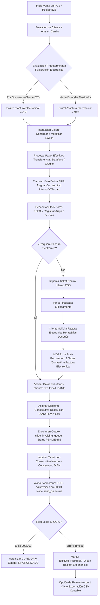
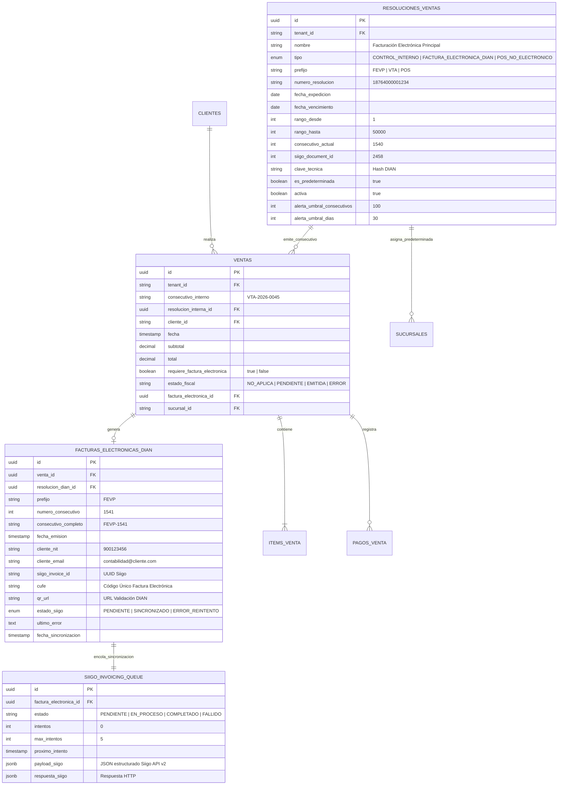
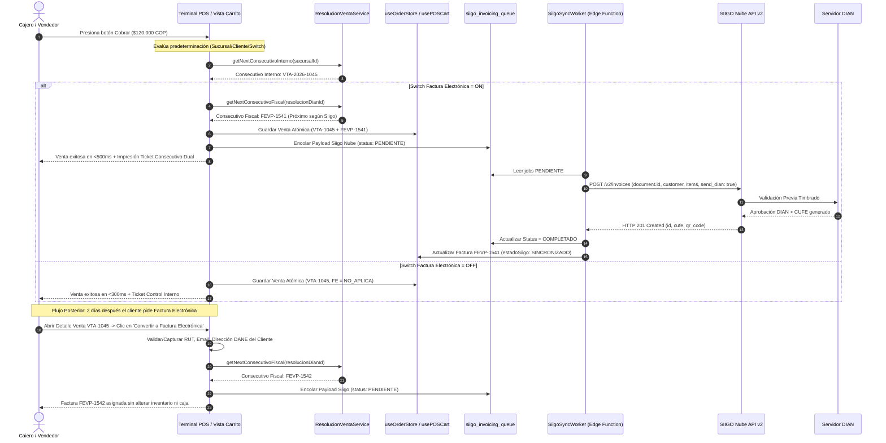
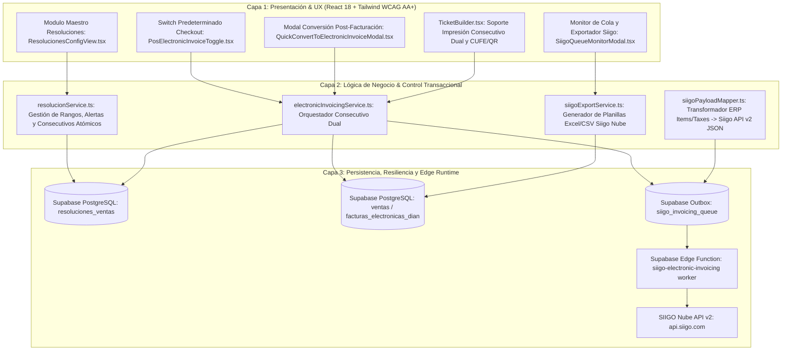

# Especificación de Requerimiento (SPEC-020)

**Código:** SPEC-020  
**Título:** Sistema Maestro de Resoluciones de Ventas, Consecutivo Dual y Facturación Electrónica DIAN para SIIGO Nube API V2  
**Fecha:** 2026-10-16  
**Estado:** ESPECIFICACIÓN EN REVISIÓN (SDD v3.0)  
**Normativa / Estándar:** DIAN Colombia (Anexo Técnico Factura Electrónica de Venta) + SIIGO Nube API V2 (`/v2/invoices`, `/v2/customers`) + WCAG 2.2 AA+ Light Mode.

---

## 1. El "Qué" y el "Por Qué" (Business Drivers & Problem Statement)

### 1.1 El Problema Operativo Actual
En la operación de *La Pezcadería SAS*, se generan dos flujos comerciales distintos:
1. **Flujo de Mostrador / POS / Canal Rápido:** Cientos de transacciones diarias donde clientes adquieren productos del mar al detal. La mayoría solo requiere tirilla de control interno, pero por disposiciones de la DIAN o a solicitud del cliente, una fracción exige Factura Electrónica de Venta (FEV) con su RUT/NIT, correo electrónico y código de municipio DANE.
2. **Flujo Institucional B2B / Restaurantes / Despachos:** Venta mayorista donde el 100% de los clientes exigen factura electrónica válida ante la DIAN para soportar costos y deducciones tributarias.
3. **Desafío de Sincronización:** La empresa ya cuenta con una **Resolución de Facturación Electrónica en uso activo en SIIGO Nube** con un consecutivo avanzado (ej. `FEVP-1540`). Si el ERP no concilia el número actual de SIIGO o genera consecutivos de forma ciega, se provocan colisiones, huecos fiscales o parálisis en caja cuando la API de SIIGO o la DIAN presentan intermitencia.

### 1.2 La Solución de Ingeniería
Implementar un **Sistema de Resoluciones de Venta y Consecutivo Dual Desacoplado**:
- **Consecutivo Operativo Interno Inmutable (100% de transacciones):** Toda venta (POS, B2B, Crédito, Contado) recibe un número interno continuo (`VTA-0001` / `POS-0001`). Este consecutivo gobierna de forma absoluta el kardex, el inventario, las mermas de despiece, los arqueos de caja ciega y la auditoría.
- **Resolución DIAN Fiscal y Consecutivo Electrónico (Condicional / Predeterminado):** Asignación de numeración oficial autorizada (`FEVP-xxxx`) con rango DIAN, vigencia y `document.id` de SIIGO Nube.
- **Mapeo a Triple Nivel de Predeterminación:**
  1. *Nivel Sucursal/Caja:* Configuración de emisión electrónica por defecto (Sí/No).
  2. *Nivel Cliente:* Clientes marcados con `exigeFacturaElectronica = true` fuerzan la resolución fiscal automáticamente.
  3. *Nivel Checkout:* Switch táctil ergonómico ($\ge 48\text{ px}$) en la pantalla de cobro para activar/desactivar a solicitud del cliente.
- **Post-Facturación con 1 Toque:** Capacidad de convertir un ticket interno previo en Factura Electrónica oficial a solicitud tardía del cliente, sin duplicar inventario ni movimientos de caja.
- **Arquitectura Outbox y Exportación Contable:** Cola asíncrona hacia SIIGO Nube (`send_dian: true`) con visor de estado (`PENDIENTE`, `SINCRONIZADO`, `ERROR`) y exportación alternativa en Excel/CSV para contabilidad.

---

## 2. Modelado de Sistema Multifase (MANDATORY MERMAID DIAGRAMS)

### 2.1 Flujo de Procesos y Ciclo de Vida Secuencial (`1_process_flowcharts`)



---

### 2.2 Rombos de Decisión y Lógica de Frontera (`2_decision_logic_diagrams`)

```mermaid
flowchart TD
    subgraph Decisiones_Venta_Checkout
        D1{¿Cliente es Consumidor Final Anónimo?}
        D1 -->|SÍ| D2{¿Se activó Switch<br/>Factura Electrónica?}
        D1 -->|NO| D3[Cliente Registrado con NIT/Cédula]
        
        D2 -->|SÍ| D4[Modal Táctil: Capturar NIT/Cédula, Razón Social, Email, Dirección, Municipio]
        D2 -->|NO| D5[Venta Continúa con Consecutivo Interno Único]
        
        D3 --> D6{¿Cliente tiene Email y NIT Válidos?}
        D6 -->|SÍ| D7[Habilitar Emisión Electrónica DIAN Directa]
        D6 -->|NO| D8[Alerta Bloqueante: Completar Email y Dirección para DIAN]
    end

    subgraph Decisiones_Resolucion_DIAN
        R1{¿Resolución DIAN Activa?}
        R1 -->|NO o Vencida| R2[Error: Resolución Vencida. Requiere Actualizar en Configuración]
        R1 -->|SÍ| R3{¿Consecutivo Actual < Rango Hasta?}
        
        R3 -->|NO| R4[Error Crítico: Rango de Facturación Agotado]
        R3 -->|SÍ| R5{¿Faltan < 100 Números o < 30 Días?}
        R5 -->|SÍ| R6[Advertencia Preventiva Toast: Próximo a Agotar Rango DIAN]
        R5 -->|NO| R7[Numeración Válida y Disponible]
        
        R6 --> R8[Incremento Atómico: ConsecutivoFiscal = ConsecutivoActual + 1]
        R7 --> R8
    end

    subgraph Decisiones_Sincronizacion_Siigo
        S1{¿Conexión a Internet y Token Siigo Válido?}
        S1 -->|SÍ| S2[Enviar Payload JSON v2 a Siigo Nube API]
        S1 -->|NO| S3[Mantener en Cola PENDIENTE para Sincronización Automática]
        
        S2 --> S4{¿Código HTTP?}
        S4 -->|200 / 201| S5[Guardar CUFE y URL Factura Siigo]
        S4 -->|400 Datos Inválidos| S6[Marcar ERROR_VALIDACION y Notificar Inconsistencia]
        S4 -->|500 / Timeout / 429| S7[Programar Reintento Outbox con Backoff Exponencial]
    end
```



---

### 2.3 Modelo Entidad-Relación (`3_entity_relationship_diagrams`)



---

### 2.4 Diagrama de Secuencia Temporal (`4_sequence_diagrams`)



---

### 2.5 Arquitectura por Capas (`5_component_architecture_diagrams`)



---

## 3. Requerimientos Funcionales EARS

- **EARS-01:** *CUANDO* se configure una resolución en el sistema, el sistema *DEBE* validar que el tipo sea `CONTROL_INTERNO`, `FACTURA_ELECTRONICA_DIAN` o `POS_NO_ELECTRONICO`, exigiendo para las electrónicas el número de resolución DIAN, prefijo, rango de números, fecha de vigencia y el `document_id` de SIIGO Nube.
- **EARS-02:** *DADO* que una resolución electrónica ya está en uso en SIIGO Nube, el sistema *DEBE* permitir ingresar el "Último Consecutivo Emitido en Siigo", garantizando que la siguiente venta inicie exactamente en el número correlativo siguiente.
- **EARS-03:** *CUANDO* se ejecute cualquier venta en el POS o pedido B2B, el sistema *DEBE* generar de forma obligatoria e inmutable un consecutivo interno operativo, garantizando el 100% de trazabilidad de inventario, kardex y arqueos de caja.
- **EARS-04:** *SI* la sucursal tiene predeterminada la facturación electrónica, o si el cliente seleccionado tiene activa la exigencia tributaria, o si el cajero enciende el switch manual en el checkout, el sistema *DEBE* asignar adicionalmente el consecutivo autoincremental de la resolución fiscal DIAN.
- **EARS-05:** *CUANDO* falten menos de 100 números para finalizar el rango de la resolución DIAN o queden menos de 30 días de vigencia, el sistema *DEBE* emitir una alerta visual preventiva al administrador.
- **EARS-06:** *DADO* un ticket emitido previamente bajo control interno, *CUANDO* el usuario presione "Convertir a Factura Electrónica", el sistema *DEBE* solicitar/confirmar los datos fiscales del cliente, asignar el siguiente consecutivo DIAN y encolar el payload a SIIGO sin descontar doble stock ni duplicar ingresos de caja.
- **EARS-07:** *CUANDO* se encole una factura para SIIGO, el sistema *DEBE* registrar el payload pre-formateado bajo el esquema de Siigo Nube API v2 (`send_dian: true`) y ofrecer adicionalmente un botón de exportación en Excel/CSV compatible con la plantilla contable de Siigo.

---

## 4. Criterios de Aceptación (Gherkin)

```gherkin
Escenario: Venta rápida con control interno e inventario auditado
  Dado que la caja está abierta y hay stock disponible
  Cuando el cajero registra la venta con el switch de Factura Electrónica apagado
  Entonces se genera un consecutivo interno inmutable (ej. VTA-2026-0001)
  Y el stock de los productos se descuenta del inventario físico
  Y el dinero entra a la gaveta de caja activa
  Y no se consume ningún consecutivo de la resolución DIAN

Escenario: Venta con Facturación Electrónica DIAN y Consecutivo Dual
  Dado que existe una resolución DIAN activa con último consecutivo en Siigo 1540
  Cuando se procesa una venta con el switch de Factura Electrónica encendido
  Entonces se genera el consecutivo interno VTA-2026-0002
  Y se asigna de inmediato el consecutivo fiscal FEVP-1541
  Y el payload formateado para Siigo se almacena en siigo_invoicing_queue
  Y el ticket impreso refleja ambos números (Control Interno y Factura Electrónica)

Escenario: Post-facturación electrónica de ticket previo sin duplicidad
  Dado un ticket previo registrado únicamente con consecutivo interno VTA-2026-0001
  Cuando el cliente regresa solicitando factura electrónica con su NIT y correo
  Y el usuario pulsa "Convertir a Factura Electrónica" en el detalle de la venta
  Entonces se valida el NIT, correo y municipio del cliente
  Y se asigna el siguiente consecutivo fiscal FEVP-1542
  Y no se descuenta nuevamente el inventario en bodega
  Y no se altera el arqueo de caja del turno actual
  Y se genera el job de sincronización hacia SIIGO Nube
```
