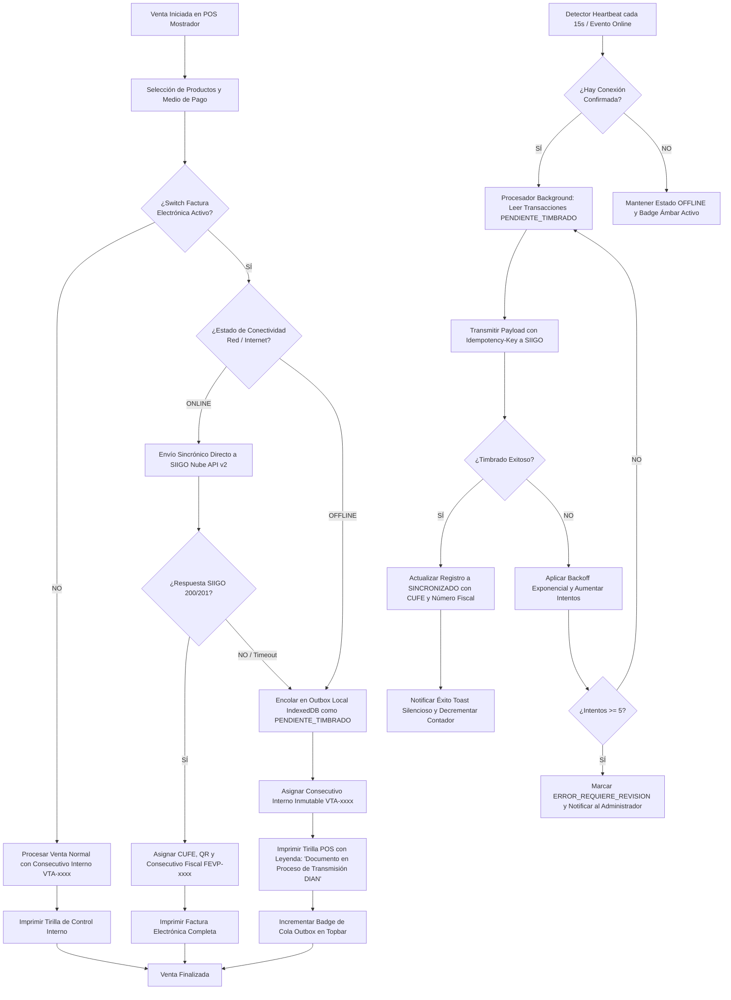
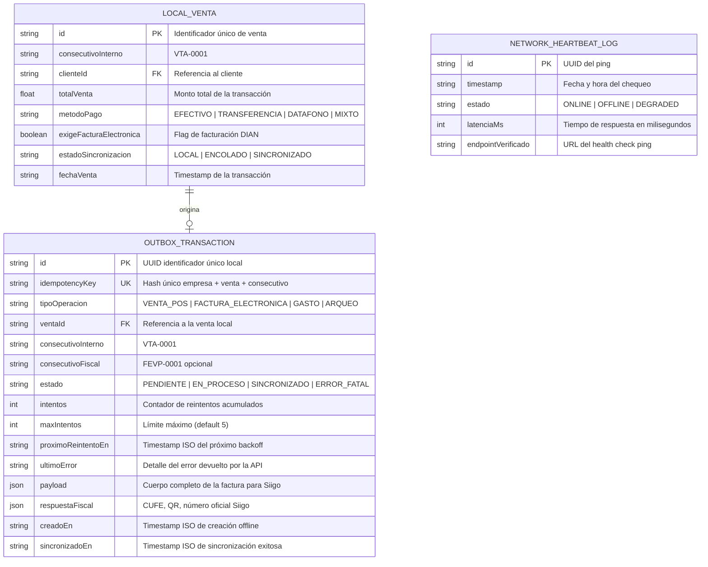
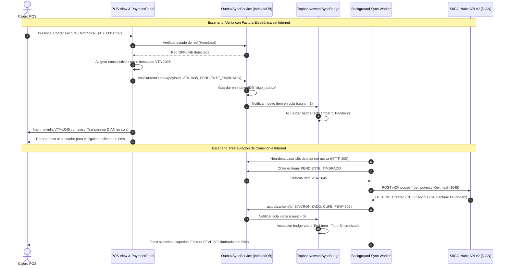
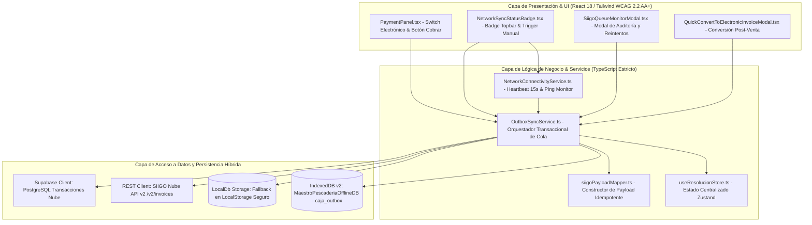

# Especificación de Requerimiento (SPEC-021)

**Código:** SPEC-021  
**Título:** Sincronización Resiliente Offline-First, Heartbeat de Conectividad y Cola Outbox Avanzada para POS y Facturación SIIGO Nube API v2  
**Fecha:** 2026-10-18  
**Estado:** ESPECIFICACIÓN EN REVISIÓN (SDD v3.0 / /grill-me Aprobado)  
**Normativa / Estándar:** Offline-First Architecture + IndexedDB v2 + SIIGO Nube API v2 (`/v2/invoices`) + WCAG 2.2 AA+ Light Mode.

---

## 1. El "Qué" y el "Por Qué" (Business Drivers & Problem Statement)

### 1.1 El Problema Operativo Actual
En los puntos de venta físicos de *La Pezcadería SAS* (mostrador de pescado fresco y cuartos fríos), se presentan caídas y micro-cortes frecuentes en el enlace de fibra óptica o servicio 4G. En la actualidad:
1. **Fricción en Mostrador por Espera de Red:** Si un cliente en fila solicita Factura Electrónica y la conexión falla en el momento del pago, el POS no debe congelarse ni obligar al cliente a esperar mientras la API de SIIGO o la DIAN responden.
2. **Riesgo de Pérdida de Transacciones:** Sin un almacenamiento local transaccional transitorio y garantizado (IndexedDB / Outbox), las transacciones offline corren el riesgo de perderse si el cajero recarga el navegador o cierra la pestaña.
3. **Falta de Feedback Táctil Claro:** El personal de caja requiere saber de forma inmediata su estado de conexión (`ONLINE` en verde, `OFFLINE` en ámbar con contador de transacciones en cola) y tener la potestad de presionar un botón manual de "Forzar Sincronización" o dejar que el sistema auto-sincronice con reintentos exponenciales.
4. **Consistencia Fiscal sin Duplicidad:** El consecutivo interno (`VTA-xxxx`) debe emitirse de forma instantánea e inmutable en papel físico, mientras que el timbrado fiscal de SIIGO (`FEVP-xxxx`) queda debidamente encolado en estado `PENDIENTE_TIMBRADO` para emitirse en segundo plano apenas retorne el enlace.

### 1.2 Resoluciones Acordadas en Sesión de Interrogatorio `/grill-me`
1. **Cobro Inmediato con Tirilla Interna:** Ante pérdida de red, el sistema emite inmediatamente la Tirilla Interna de Venta (`VTA-xxxx`) física, sin frenar la fila, encolando el timbrado fiscal de Siigo en la tabla Outbox con estado `PENDIENTE_TIMBRADO`.
2. **Heartbeat y Detección Dual de Conectividad:** 
   - Monitoreo periódico mediante Heartbeat cada 15 segundos hacia el endpoint de health check.
   - Escucha reactiva instantánea de los eventos del navegador `window.addEventListener('online')` y `'offline'`.
   - Badge táctil interactivo en el Topbar con contador visible de transacciones pendientes y modal de gestión de cola.
3. **Reintentos Exponenciales Resilientes (Exponential Backoff):**
   - Intervalos de reintento con jitter: 1s, 5s, 15s, 30s, hasta un máximo de 5 intentos por documento.
   - Si un documento sobrepasa los reintentos por error de validación tributaria (ej. NIT inválido), pasa a estado `ERROR_REQUIERE_REVISION` sin bloquear el procesamiento del resto de la cola.
4. **Garantía Cero Duplicidad:**
   - La cola Outbox almacena una clave única de idempotencia `idempotencyKey = md5(empresaId + ventaId + consecutivoInterno)`.
   - SIIGO no recibirá peticiones duplicadas ante timeouts de red intermedios.

---

## 2. Modelado de Sistema Multifase (MANDATORY MERMAID DIAGRAMS)

### 2.1 Flujo de Procesos y Ciclo de Vida Secuencial (`1_process_flowcharts`)



---

### 2.2 Rombos de Decisión y Lógica de Frontera (`2_decision_logic_diagrams`)

```mermaid
flowchart TD
    subgraph Decisiones_Deteccion_Conectividad
        D1{¿navigator.onLine es true?}
        D1 -->|NO| D2[Estado OFFLINE Inmediato]
        D1 -->|SÍ| D3{¿Heartbeat Ping responde<br/>HTTP 200 en < 3000ms?}
        D3 -->|SÍ| D4[Estado ONLINE Confirmado]
        D3 -->|NO| D5[Estado DEGRADADO / Conexión Falsa: Tratar como OFFLINE]
    end

    subgraph Decisiones_Cobro_POS_Outbox
        O1{¿Venta requiere Factura Electrónica?}
        O1 -->|NO| O2[Guardar localmente y cerrar venta en POS]
        O1 -->|SÍ| O3{¿Estado Conexión == ONLINE?}
        O3 -->|SÍ| O4[Intentar transmisión HTTP inmediata con timeout de 4000ms]
        O3 -->|NO| O5[Encolar directamente en IndexedDB 'siigo_outbox']
        
        O4 --> O6{¿SIIGO respondió exitoso?}
        O6 -->|SÍ| O7[Venta Sincronizada en Tiempo Real]
        O6 -->|NO / Timeout| O5
    end

    subgraph Decisiones_Procesamiento_Cola
        Q1{¿Existen ítems en cola Outbox?}
        Q1 -->|NO| Q2[Dormir worker hasta siguiente heartbeat o evento]
        Q1 -->|SÍ| Q3{¿Item está en estado PENDIENTE?}
        Q3 -->|SÍ| Q4{¿Tiempo transcurrido >= delay de backoff?}
        Q4 -->|SÍ| Q5[Ejecutar llamada a SIIGO API v2 con Idempotency-Key]
        Q4 -->|NO| Q6[Esperar ventana de reintento]
        
        Q5 --> Q7{¿Respuesta exitosa?}
        Q7 -->|SÍ| Q8[Actualizar a SINCRONIZADO y guardar CUFE]
        Q7 -->|NO| Q9{¿Código de error es 400/Unprocessable?}
        Q9 -->|SÍ (Error Datos)| Q10[Marcar ERROR_FATAL_DATOS: No reintentar automáticamente]
        Q9 -->|NO (500/Timeout)| Q11[Incrementar reintentos y programar siguiente backoff]
    end
```

---

### 2.3 Modelo Entidad-Relación y Persistencia (`3_entity_relationship_diagrams`)



---

### 2.4 Diagrama de Secuencia Temporal (`4_sequence_diagrams`)



---

### 2.5 Arquitectura de Componentes y Límites de Capas (`5_component_architecture_diagrams`)



---

## 3. Especificación Formal de Requerimientos (Notación EARS)

### 3.1 Requerimientos Ubicuos (Ubiquitous Requirements)
- **REQ-021-01:** El sistema SHALL garantizar que toda transacción completada en el POS mantenga su consecutivo interno inmutable (`VTA-xxxx`) independientemente de si la red está en línea u offline.
- **REQ-021-02:** El sistema SHALL utilizar una clave de idempotencia única basada en el hash MD5 de la empresa, el identificador de venta y el consecutivo interno antes de emitir cualquier petición HTTP a la API de SIIGO.

### 3.2 Requerimientos Guiados por Eventos (Event-Driven Requirements)
- **REQ-021-03:** CUANDO el cajero confirme una venta con Facturación Electrónica y no exista conexión a internet, el sistema SHALL registrar el payload en la cola `caja_outbox` de IndexedDB en estado `PENDIENTE_TIMBRADO` e imprimir la tirilla física en menos de 800 milisegundos.
- **REQ-021-04:** CUANDO el monitor de conectividad detecte el evento `window.online` o un heartbeat exitoso, el sistema SHALL disparar automáticamente el worker de sincronización en segundo plano sin congelar la interfaz de usuario.
- **REQ-021-05:** CUANDO una transacción en la cola Outbox sea timbrada exitosamente por SIIGO, el sistema SHALL actualizar el registro local con el CUFE, código QR y número de factura oficial (`FEVP-xxxx`), decrementando el contador de pendientes del badge superior.

### 3.3 Requerimientos de Estado (State-Driven Requirements)
- **REQ-021-06:** MIENTRAS el sistema se encuentre en estado `OFFLINE` o `DEGRADADO`, el sistema SHALL mostrar un badge táctil en color ámbar en el Topbar con el texto `"Sin Conexión"` y la cantidad exacta de documentos encolados.
- **REQ-021-07:** MIENTRAS existan transacciones en estado `PENDIENTE_TIMBRADO` y la conexión esté activa, el worker SHALL reintentar los envíos aplicando un algoritmo de retroceso exponencial (`1s, 5s, 15s, 30s`) hasta un tope de 5 intentos.

### 3.4 Requerimientos Opcionales / Asistidos (Optional Requirements)
- **REQ-021-08:** DONDE el cajero o supervisor presione el badge de conectividad en el Topbar, el sistema SHALL abrir un modal táctil con el detalle de las transacciones encoladas y un botón de acción primaria `min-h-[48px]` para "Forzar Sincronización Ahora".
- **REQ-021-09:** DONDE un documento falle 5 veces consecutivas por error de validación tributaria, el sistema SHALL cambiar su estado a `ERROR_REQUIERE_REVISION` y permitir la edición manual del NIT/Email desde el modal del monitor de cola.

---

## 4. Criterios de Aceptación (Gherkin Given-When-Then)

```gherkin
Escenario: Venta con Factura Electrónica sin conexión a Internet
  Dado que el POS se encuentra sin conexión a internet (modo OFFLINE)
  Y el cajero tiene activo el switch de "Factura Electrónica" en PaymentPanel
  Cuando el cajero presiona el botón "Cobrar" y confirma el pago
  Entonces el sistema debe generar el consecutivo interno inmutable "VTA-xxxx"
  Y debe guardar la transacción en IndexedDB con estado "PENDIENTE_TIMBRADO"
  Y debe imprimir la tirilla física de control interno inmediatamente
  Y el badge de conectividad del Topbar debe mostrar "1 Pendiente" en color ámbar.

Escenario: Auto-Sincronización al restablecer la conexión a Internet
  Dado que existen 3 transacciones en la cola Outbox con estado "PENDIENTE_TIMBRADO"
  Cuando el Heartbeat detecta respuesta exitosa HTTP 200 en el ping de red
  Entonces el worker de sincronización debe procesar las transacciones en orden FIFO
  Y debe enviar cada payload a SIIGO API v2 con su Idempotency-Key
  Y al recibir respuesta HTTP 201 debe registrar el CUFE y número fiscal "FEVP-xxxx"
  Y el contador del badge en el Topbar debe decrementar hasta llegar a 0 (Verde).

Escenario: Manejo de error de validación de datos tributarios
  Dado que una transacción encolada tiene un NIT de cliente mal formulado
  Cuando el worker envía la factura a SIIGO y recibe HTTP 400 Bad Request
  Entonces el sistema no debe reintentar infinitamente en bucle
  Y debe marcar el estado del ítem como "ERROR_FATAL_DATOS"
  Y debe continuar procesando las siguientes facturas válidas de la cola
  Y debe mostrar un indicador de advertencia en el monitor de cola para corrección manual.
```
