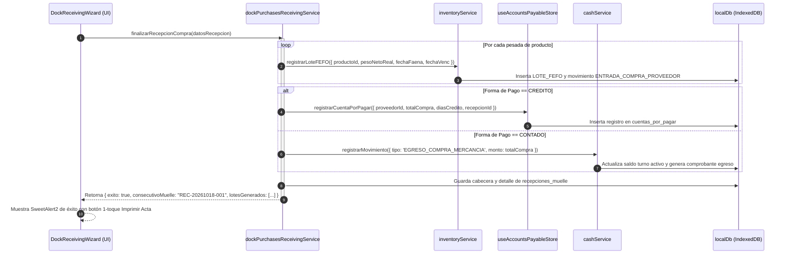

# Plan Técnico de Implementación: SPEC-022 (/speckit.plan)

- **Especificación:** SPEC-022: Compras, Proveedores y Recepción con Trazabilidad FEFO en Muelle
- **Versión:** 1.0.0
- **Fecha:** 2026-10-18
- **Estado:** PENDIENTE DE APROBACIÓN DEL USUARIO

---

## 1. Arquitectura del Módulo y Separación de Responsabilidades (SRP)

El módulo se estructura respetando estrictamente Clean Architecture, desacoplamiento por capas y el límite máximo de líneas por archivo ($< 600$ líneas útiles):

```
packages/validation-schemas/
  └── src/
      └── dockPurchasesReceiving.schema.ts      <-- Contratos Zod, validaciones y funciones matemáticas puras

src/
  ├── types/
  │   └── accountsPayable.types.ts             <-- Tipos e interfaces de Cuentas por Pagar (CxP)
  ├── services/
  │   ├── accountsPayableService.ts            <-- CRUD transaccional de CxP en IndexedDB/LocalDb
  │   └── dockPurchasesReceivingService.ts     <-- Orquestador de Recepción, Lote FEFO, Caja y WMS
  ├── store/
  │   └── useAccountsPayableStore.ts           <-- Store Zustand para gestión reactiva de pasivos CxP
  ├── views/
  │   ├── purchases/
  │   │   ├── PurchasesReceivingView.tsx       <-- Vista principal de Muelle y Compras (AppRouteId.DOCK_PURCHASES)
  │   │   └── components/
  │   │       ├── DockReceivingWizard.tsx      <-- Wizard táctil asistido en 3 Pasos ("Niño de 12 Años")
  │   │       ├── MuelleWeightScaleWidget.tsx  <-- Display gigante báscula y control de canastillas/hielo
  │   │       ├── ThermalTrafficLightBadge.tsx <-- Semáforo térmico HACCP (<= 4°C, 4.1-7°C, > 7°C)
  │   │       └── QuickSupplierModal.tsx       <-- Creación rápida de proveedor táctil sin salir del flujo
  │   └── inventory/
  │       └── components/
  │           └── BucaramangaReceivingWizard.tsx <-- Enlace y reutilización modular hacia el nuevo DockReceivingWizard
  └── tests/
      ├── dockPurchasesReceiving.schema.test.ts  <-- Pruebas unitarias de Zod y matemáticas de pesaje
      ├── dockPurchasesReceivingService.test.ts  <-- Pruebas de integración transaccional (Lote, Stock, Caja, CxP)
      └── dockReceivingWizard12YearsRule.test.tsx <-- Pruebas de componentes táctiles y ergonomía
```

---

## 2. Contratos de Datos y Esquemas Zod (`dockPurchasesReceiving.schema.ts`)

### 2.1 Esquema de Furgón y Cadena de Frío
```typescript
export const DatosFurgonMuelleSchema = z.object({
  proveedorId: z.string().min(1, 'El proveedor es obligatorio'),
  proveedorNombre: z.string().min(1),
  placaVehiculo: z.string().min(5, 'Placa de vehículo inválida').max(10),
  conductorNombre: z.string().min(2, 'Nombre del conductor obligatorio'),
  temperaturaCava: z.number().min(-30).max(40),
  fechaFaena: z.string().regex(/^\d{4}-\d{2}-\d{2}$/, 'Formato de fecha YYYY-MM-DD inválido'),
  tipoConservacion: z.enum(['FRESCO_ENHIELADO', 'CONGELADO_PLANTA']),
  loteOrigenManual: z.string().optional()
});
```

### 2.2 Esquema de Pesada de Canastilla Catch Weight
```typescript
export const PesadaCanastillaMuelleSchema = z.object({
  id: z.string(),
  productoId: z.string().min(1, 'Producto obligatorio'),
  productoNombre: z.string().min(1),
  cantidadCanastillas: z.number().int().min(1, 'Mínimo 1 canastilla'),
  pesoBrutoKg: z.number().positive('El peso bruto debe ser positivo'),
  taraCanastillaKg: z.number().default(2.0), // Fijo 2.0 kg/canastilla
  porcentajeHielo: z.number().min(0).max(15).default(0),
  precioKgAcordado: z.number().positive('Precio pactado por kg obligatorio')
}).refine(
  data => data.pesoBrutoKg > (data.cantidadCanastillas * data.taraCanastillaKg),
  {
    message: 'El peso bruto debe ser superior al peso de las canastillas plásticas',
    path: ['pesoBrutoKg']
  }
);
```

### 2.3 Funciones Matemáticas Puras de Metrología
```typescript
export function calcularPesajeMuelleNeto(
  pesoBrutoKg: number,
  cantidadCanastillas: number,
  porcentajeHielo: number,
  taraPorCanastillaKg = 2.0
): {
  pesoTaraTotalKg: number;
  pesoConHieloKg: number;
  descuentoHieloKg: number;
  pesoNetoRealKg: number;
} {
  const pesoTaraTotalKg = Number((cantidadCanastillas * taraPorCanastillaKg).toFixed(2));
  const pesoConHieloKg = Math.max(0, Number((pesoBrutoKg - pesoTaraTotalKg).toFixed(2)));
  const factorHielo = Math.min(Math.max(porcentajeHielo, 0), 15) / 100;
  const descuentoHieloKg = Number((pesoConHieloKg * factorHielo).toFixed(2));
  const pesoNetoRealKg = Number((pesoConHieloKg - descuentoHieloKg).toFixed(2));

  return {
    pesoTaraTotalKg,
    pesoConHieloKg,
    descuentoHieloKg,
    pesoNetoRealKg
  };
}
```

---

## 3. Lógica del Wizard en 3 Pasos ("Regla del Niño de 12 Años")

### Paso 1: Proveedor y Furgón (Inspección Sanitaria)
- Selector táctil de Proveedor con tarjetas de `min-h-[56px]`, buscador predictivo y botón `+ Nuevo Proveedor`.
- Entrada de placa del furgón y nombre de conductor con teclado numérico/alfabético táctil.
- Display de temperatura de cava con el componente `ThermalTrafficLightBadge.tsx`:
  - $\le 4.0^\circ\text{C}$: Banner verde `bg-emerald-50 text-emerald-900 border-emerald-400` ("Óptimo: Cadena de Frío Preservada").
  - $4.1\text{ a }7.0^\circ\text{C}$: Banner ámbar `bg-amber-50 text-amber-900 border-amber-400` ("Precaución: Reforzar con Hielo Escama").
  - $> 7.0^\circ\text{C}$: Banner rojo `bg-rose-50 text-rose-900 border-rose-400` ("Peligro Sanitario: Rechazo o Autorización Especial").
- Botón principal de avance $\ge 56\text{ px}$: `CONTINUAR A BÁSCULA DE MUELLE ->`.

### Paso 2: Báscula de Muelle y Descuento de Hielo
- Selector táctil de producto recibido (tarjetas táctiles vectoriales con `Fish`, `Waves`, etc. - Cero imágenes).
- Controles de canastillas: Botones gigantes `+1`, `+5`, `-1` de `48x48 px`.
- Display de peso bruto gigante con tipografía monospace `text-4xl font-extrabold text-slate-900`.
- Chips táctiles de porcentaje de hielo: `0%`, `3%`, `5%`, `7%`, `10%`, `12%`, `15%` (`min-h-[48px]`).
- Visualización en tiempo real de la deducción: Bruto $\rightarrow$ Tara canastillas ($2.0\text{ kg/ud}$) $\rightarrow$ Hielo $\rightarrow$ **Neto Real**.
- Botón táctil $\ge 48\text{ px}$: `+ GUARDAR PESADA DE PRODUCTO`.
- Tabla resumen de partidas pesadas con botón eliminar $\ge 48\text{ px}$.
- Botón principal de avance $\ge 56\text{ px}$: `IR A LIQUIDACIÓN Y ENTRADA A FRÍO ->`.

### Paso 3: Liquidación de Compra y Entrada a Frío
- Resumen consolidado: Total Kilos Netos, Total Canastillas y Total a Pagar COP.
- Selector táctil de forma de pago (`min-h-[48px]`):
  - `CRÉDITO COMERCIAL`: Despliega selector de plazo pactado (`8 días`, `15 días`, `30 días`).
  - `CONTADO EFECTIVO`: Valida saldo en caja activa del turno y emite comprobante de egreso.
  - `TRANSFERENCIA BANCARIA`: Solicita banco y número de comprobante/aprobación.
- Asignación de ubicación en cava/cuarto frío (ej. `Cámara 1 - Pescado Fresco`, `Cámara 2 - Congelados`).
- Botón gigante de confirmación $\ge 56\text{ px}$ (`btn-confirm-dock-receiving`):
  `✓ GUARDAR RECEPCIÓN, GENERAR LOTES FEFO Y FINALIZAR`.

---

## 4. Orquestación Transaccional e Integración Financiera



---

## 5. Cuentas por Pagar (CxP): Modelo y Store Reactivo

### 5.1 Estructura `CuentaPorPagar`
- `id`: Identificador unívoco (`CXP-YYYYMMDD-XXXX`).
- `recepcionMuelleId`: Enlace a la recepción en muelle originadora.
- `proveedorId`: ID del proveedor.
- `proveedorNombre`: Razón social.
- `proveedorNit`: NIT / Cédula.
- `montoTotal`: Valor total de la compra en COP.
- `saldoPendiente`: Saldo pendiente por cancelar.
- `fechaEmision`: Fecha de recepción del furgón.
- `fechaVencimiento`: Fecha calculada ($\text{fechaEmision} + \text{diasCredito}$).
- `estado`: `'PENDIENTE' | 'PAGADO_PARCIAL' | 'PAGADO' | 'VENCIDO'`.
- `historialAbonos`: Array con `{ fecha, monto, medioPago, comprobante, usuarioId }`.

---

## 6. Integración en Navegación y Rutas

1. **`AppRouteId.DOCK_PURCHASES`:**
   - Asignar ruta `'compras_muelle'` en `src/routes/AppRoute.ts` para renderizar `PurchasesReceivingView.tsx`.
   - Incluir en `EnterpriseSidebar.tsx` bajo la sección **"Operaciones & WMS"** con icono `Anchor` o `Truck` y altura $\ge 48\text{ px}$.
2. **Acceso Dual desde Inventario:**
   - En `InventoryView.tsx`, la pestaña "Recepción Furgón BCM" se conecta directamente con `DockReceivingWizard.tsx`, unificando la experiencia y eliminando duplicación de lógica.

---

## 7. Plan de Validación TDD (Quality Gate)

1. **Test Suite 1: Esquemas y Cálculos de Pesaje (`dockPurchasesReceiving.schema.test.ts`)**
   - 8 tests mínimos: deducción de canastillas ($2.0\text{ kg/ud}$), porcentajes de hielo ($0-15\%$), validación de semáforo térmico, rechazo de peso bruto menor a tara.
2. **Test Suite 2: Orquestador Transaccional (`dockPurchasesReceivingService.test.ts`)**
   - 8 tests mínimos: creación atómica de Lotes FEFO, incremento de inventario, debito de caja para compras de contado, creación de cuenta por pagar para crédito y generación de consecutivo inmutable.
3. **Test Suite 3: Ergonomía Táctil y Wizard de 3 Pasos (`dockReceivingWizard12YearsRule.test.tsx`)**
   - 8 tests mínimos: targets $\ge 48\text{ px}$, botón principal $\ge 56\text{ px}$, cero imágenes externas (``), semáforo térmico dinámico y navegación de 3 pasos sin pérdidas de estado.
4. **Verificaciones Globales:**
   - `tsc --noEmit` en 0 errores.
   - 100% suites Vitest verdes.
   - Master Architect SOLID en 0 violaciones críticas.
   - Chrome DevTools MCP en vivo con 0 errores en consola JS y responsive móvil 375 px.
