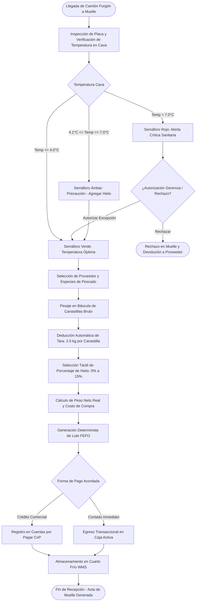
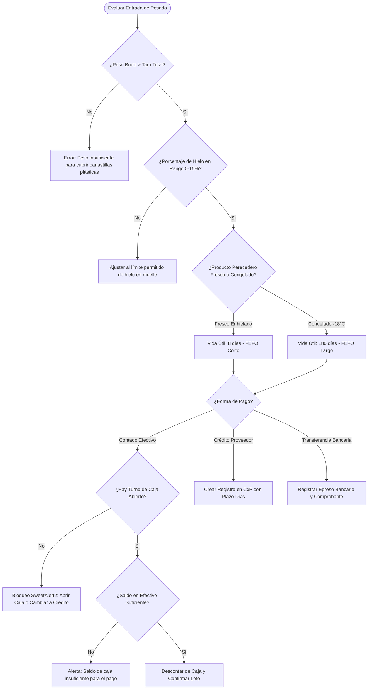
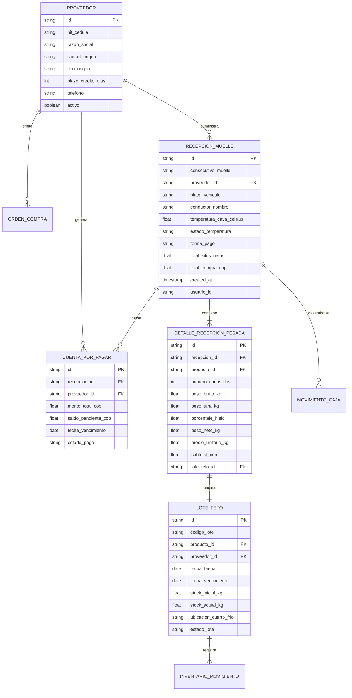
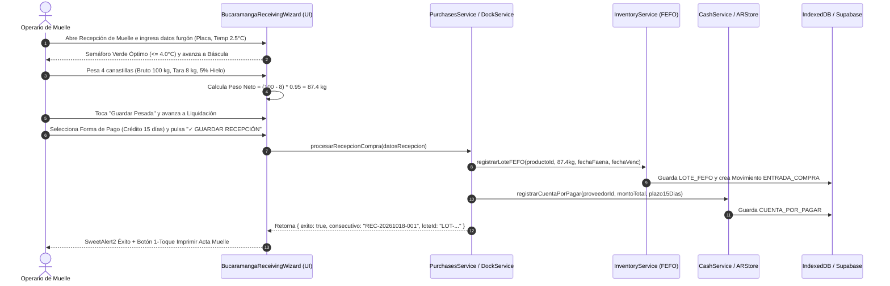

# SPEC-022: Módulo de Compras, Proveedores y Recepción con Trazabilidad FEFO en Muelle

- **ID de Especificación:** SPEC-022
- **Título:** Compras a Proveedores, Recepción de Furgón en Muelle y Trazabilidad FEFO de Perecederos
- **Versión:** 1.0.0
- **Fecha:** 2026-10-18
- **Estado:** EN REVISIÓN DE ESPECIFICACIÓN (Check 1 - /speckit.specify)
- **Autor:** La Pezcadería ERP Architecture Committee & Spec Kit Agent

---

## 1. Propósito y Contexto del Negocio ("Por qué")

En la industria de pescados y mariscos frescos/congelados, el aprovisionamiento de materia prima desde las costas (Pacífico, Atlántico o piscifactorías) es el eslabón más crítico de la cadena de valor. Una mala recepción en muelle provoca:
1. **Pérdida de Calidad e Inocuidad:** Pescado recibido a temperaturas $> 4^\circ\text{C}$ sin verificación rompe la cadena de frío, detonando mermas bacterianas y rechazos sanitarios.
2. **Inexactitud de Pesaje y Fraude:** El camión furgón transporta canastillas con peso bruto, hielo protector y agua de deshielo. Si no se descuenta la tara estándar de la canastilla ($2.0\text{ kg}$) y el porcentaje real de hielo ($0\text{ a }15\%$), la empresa sobrepaga materia prima inexistente.
3. **Pérdida de Trazabilidad FEFO (First Expired, First Out):** Mezclar producto recibido hoy con producto de faenas previas sin código de lote ni fecha de vencimiento clara arruina la rotación en cuarto frío, causando merma por descomposición.
4. **Descoordinación Administrativa y Financiera:** Las compras a crédito no se integran de inmediato con Cuentas por Pagar (CxP), y las compras de contado en muelle generan descuadres con el turno de caja activa.

**Objetivo de SPEC-022:**
Construir el módulo unificado de **Compras, Proveedores y Recepción en Muelle con Trazabilidad FEFO**, optimizado bajo la **Regla del Niño de 12 Años** (Light Mode WCAG 2.2 AA+, targets táctiles $\ge 48\text{ px}$, botón principal $\ge 56\text{ px}$, Stepper de 3 toques guiados, y Cero Imágenes externas).

---

## 2. Especificación de Requerimientos en Notación EARS

### 2.1 Requerimientos Ubicuos (Ubiquitous Requirements)
- **EARS-UBI-01:** El sistema DEBE mantener un catálogo de Proveedores clasificados por tipo de origen (Mar Abierto, Piscifactoría, Distribuidor Congelados) con NIT/Cédula, contacto, teléfono, ciudad de origen y plazo comercial de crédito en días.
- **EARS-UBI-02:** El sistema DEBE operar 100% en Modo Claro (Light Mode) de alto contraste WCAG 2.2 AA+ (ratio $\ge 4.5:1$ y $\ge 7:1$) con tipografía slate pizarra y cero etiquetas `` externas (100% iconos Lucide React).
- **EARS-UBI-03:** El sistema DEBE exigir un tamaño táctil mínimo de $48\times 48\text{ px}$ en todos los botones e inputs interactivos, y un botón de acción principal de al menos $56\text{ px}$ de altura con micro-animación `active:scale-95`.

### 2.2 Requerimientos Guiados por Eventos (Event-Driven Requirements)
- **EARS-EVT-01:** CUANDO el operario de muelle inicie la recepción de un furgón, el sistema DEBE registrar: proveedor, placa del camión furgón, conductor, temperatura de la cava del camión ($^\circ\text{C}$), fecha de faena y fecha de vencimiento proyectada.
- **EARS-EVT-02:** CUANDO el operario coloque canastillas en la báscula y presione "Capturar Peso", el sistema DEBE calcular automáticamente:
  $$\text{Peso Bruto} - (\text{Cantidad Canastillas} \times 2.0\text{ kg}) = \text{Peso con Hielo}$$
  $$\text{Peso Neto Real} = \text{Peso con Hielo} \times \left(1 - \frac{\% \text{Hielo}}{100}\right)$$
- **EARS-EVT-03:** CUANDO se finalice la pesada y se confirme la recepción, el sistema DEBE:
  1. Generar automáticamente un Lote FEFO inmutable (`LOT-YYYYMMDD-PROV-SEC`).
  2. Incrementar el stock en Bodega Principal / Cuarto Frío correspondiente.
  3. Si la compra es a crédito: crear la factura de compra por pagar en Cuentas por Pagar (CxP).
  4. Si la compra es de contado: registrar el egreso transaccional `EGRESO_COMPRA_MERCANCIA` en el turno activo de `cashService`.

### 2.3 Requerimientos de Estado (State-Driven Requirements)
- **EARS-STA-01:** MIENTRAS la temperatura registrada en la cava del camión sea $\le 4.0^\circ\text{C}$, el sistema DEBE mostrar el semáforo térmico en estado **ÓPTIMO (Verde Esmeralda)** permitiendo continuar la recepción.
- **EARS-STA-02:** MIENTRAS la temperatura registrada esté entre $4.1^\circ\text{C}$ y $7.0^\circ\text{C}$, el sistema DEBE mostrar el semáforo térmico en estado **PRECAUCIÓN (Ámbar)** exigiendo adición inmediata de hielo escama y justificación del jefe de calidad.
- **EARS-STA-03:** MIENTRAS la temperatura registrada sea $> 7.0^\circ\text{C}$, el sistema DEBE mostrar el semáforo en estado **ALERTA CRÍTICA (Rojo)** y bloquear por defecto la recepción hasta autorización expresa de gerencia o descarte fitosanitario.

### 2.4 Requerimientos ante Comportamiento No Deseado (Unwanted Behavior)
- **EARS-UNW-01:** SI el operario intenta capturar un peso bruto menor o igual al peso de tara de las canastillas, el sistema DEBE bloquear la pesada y alertar "El peso bruto debe ser superior al peso de las canastillas ($2.0\text{ kg/ud}$)".
- **EARS-UNW-02:** SI no hay un turno de caja abierto y la compra se selecciona como "Contado Efectivo", el sistema DEBE alertar con SweetAlert2 e instruir la apertura de turno o el cambio a medio "Transferencia / Crédito".
- **EARS-UNW-03:** SI se intenta registrar un proveedor con un NIT ya existente, el sistema DEBE sugerir la selección del proveedor existente evitando duplicidad de terceros.

### 2.5 Requerimientos Opcionales (Optional Features)
- **EARS-OPT-01:** DONDE exista conectividad con báscula serial USB/WebHID, el sistema PODRÁ leer el peso en tiempo real automáticamente con 1 toque.
- **EARS-OPT-02:** DONDE se requiera, el sistema PODRÁ imprimir de inmediato el Acta de Recepción en Muelle en formato ticket térmico de 80 mm o PDF de remisión de muelle.

---

## 3. Reglas de Negocio del Dominio (RN-COMP)

| Regla | Nombre | Descripción Técnica |
| :--- | :--- | :--- |
| **RN-COMP-01** | Tara Canastilla Estándar | Cada canastilla plástica de muelle tiene una tara invariable de $2.0\text{ kg}$. Si se pesan 5 canastillas simultáneas, tara total $= 10.0\text{ kg}$. |
| **RN-COMP-02** | Rango Porcentaje Hielo | El descuento por hielo se limita a valores discretos táctiles de 1 toque: `0%`, `3%`, `5%`, `7%`, `10%`, `12%`, `15%`. |
| **RN-COMP-03** | Código de Lote FEFO | Estructura canónica: `LOT-{YYYYMMDD}-{ID_PROV_CORTO}-{CONSECUTIVO}` (ej: `LOT-20261018-MARP-001`). Inmutable e indexado en `lotes_fefo`. |
| **RN-COMP-04** | Fecha de Expiración FEFO | Se calcula como: $\text{Fecha Faena} + \text{Días Vida Útil Especie}$ (por defecto: 8 días para pescado fresco enhielado en cava a $0-2^\circ\text{C}$, o 180 días para congelado a $-18^\circ\text{C}$). |
| **RN-COMP-05** | Catch Weight y Costo Unitario | El costo pactado con el proveedor es por kilogramo neto real: $\text{Total Compra} = \text{Peso Neto Real} \times \text{Precio/Kg Acordado}$. |
| **RN-COMP-06** | Integración CxP vs Caja | Compras con forma de pago 'CRÉDITO' alimentan la tabla `cuentas_por_pagar` con fecha de vencimiento según plazo del proveedor. Compras 'CONTADO' debitan de caja activa en `cashService`. |
| **RN-COMP-07** | Estandarización de Calibres | Permite asociar calibres comerciales al lote (ej: `400-600g`, `600-800g`, `800-1000g`, `Parejo`) para trazabilidad de ventas B2B. |
| **RN-COMP-08** | Cero Duplicidad de Stock | Al confirmar la recepción, la transacción de inventario `ENTRADA_COMPRA_PROVEEDOR` debe ser atómica e idempotente para evitar duplicación ante reintentos. |

---

## 4. Ergonomía Táctil y UX/UI: "Regla del Niño de 12 Años"

1. **Light Mode WCAG 2.2 AA+:**
   - Fondo general: `bg-slate-50` / `bg-white`.
   - Textos: `text-slate-900` para títulos principales y `text-slate-700` para etiquetas.
   - Bordes: `border-slate-200` y `border-slate-300`.
   - Estados de éxito: `bg-emerald-600 text-white` (contraste $> 4.5:1$).
2. **Stepper Guiado en 3 Pasos (Sin Perderse):**
   - **Paso 1: Datos de Proveedor y Furgón** (Proveedor táctil, placa, termómetro cava $\le 4^\circ\text{C}$, fecha faena).
   - **Paso 2: Báscula de Muelle y Descuento de Hielo** (Display de peso gigante, botones rápidos de canastillas `+1`, `+5`, selector de % hielo).
   - **Paso 3: Liquidación de Compra y Entrada a Frío** (Resumen de Kilos netos, costo total COP, forma de pago Contado/Crédito, botón gigante $\ge 56\text{ px}$ `✓ GUARDAR RECEPCIÓN Y LOTEAR`).
3. **Cero Imágenes Externas:** 100% iconos vectoriales Lucide React (`Truck`, `Thermometer`, `Scale`, `Snowflake`, `Building2`, `Calendar`, `DollarSign`, `CheckCircle2`).
4. **Targets Táctiles:** Ningún botón o selector interactivo medirá menos de $48\text{ px}$ de altura/ancho.

---

## 5. MANDATORIO MULTI-PHASE SYSTEM MODELING (5 Diagramas Mermaid)

### Diagrama 1: Flujo de Procesos y Ciclo de Vida Secuencial (`1_process_flowcharts`)



---

### Diagrama 2: Rombos de Decisión y Lógica de Bifurcaciones (`2_decision_logic_diagrams`)



---

### Diagrama 3: Modelo Entidad-Relación (`3_entity_relationship_diagrams`)



---

### Diagrama 4: Diagrama de Secuencia Temporal (`4_sequence_diagrams`)



---

### Diagrama 5: Arquitectura por Capas (`5_component_architecture_diagrams`)

```mermaid
flowchart TD
    subgraph PRESENTATION_LAYER ["Capa de Presentación (UI / Componentes Táctiles)"]
        W1[PurchasesReceivingView.tsx]
        W2[DockReceivingWizard.tsx - Stepper 3 Pasos]
        W3[SupplierSelectorModal.tsx - Buscador Táctil]
        W4[MuelleWeightScaleWidget.tsx - Display Gigante Báscula]
        W5[ThermalTrafficLightBadge.tsx - Semáforo Inocuidad]
    end

    subgraph DOMAIN_LOGIC_LAYER ["Capa de Lógica de Dominio y Validación"]
        D1[purchasesReceiving.schema.ts - Zod Validation]
        D2[dockCatchWeightCalculator.ts - Tara 2.0kg y Hielo]
        D3[fefoBatchGenerator.ts - Formato Canónico Lotes]
        D4[useSupplierStore.ts - Gestión de Proveedores]
        D5[useReceivingStore.ts - Estado del Wizard]
    end

    subgraph DATA_ACCESS_LAYER ["Capa de Servicios y Acceso a Datos"]
        S1[purchasesReceivingService.ts - Orquestador Transaccional]
        S2[inventoryService.ts - registrarLoteFEFO]
        S3[cashService.ts / accountsPayableService.ts]
        S4[IndexedDB / Supabase DB (PostgreSQL)]
    end

    W1 --> W2
    W2 --> W3
    W2 --> W4
    W2 --> W5
    W2 --> D1
    W2 --> D5
    D5 --> D2
    D5 --> D3
    D5 --> D4
    D5 --> S1
    S1 --> S2
    S1 --> S3
    S2 --> S4
    S3 --> S4
```

---

## 6. Criterios de Aceptación y Pruebas TDD

1. **CA-01 (Ergonomía Táctil y WCAG 2.2 AA+):** Todos los botones del Wizard tienen $\ge 48\text{ px}$ de altura y el botón final de confirmación $\ge 56\text{ px}$. Cero etiquetas ``.
2. **CA-02 (Cálculo Determinista de Pesaje Catch Weight):** Dados 4 canastillas con peso bruto de $100.0\text{ kg}$ y $5\%$ de hielo, el peso neto debe ser exactamente:
   $$\text{Tara} = 4 \times 2.0 = 8.0\text{ kg} \implies \text{Peso sin canastillas} = 92.0\text{ kg} \implies \text{Neto} = 92.0 \times 0.95 = 87.40\text{ kg}$$
3. **CA-03 (Semáforo de Temperatura de Inocuidad):**
   - $\le 4.0^\circ\text{C} \implies$ Verde Esmeralda.
   - $4.1\text{ a }7.0^\circ\text{C} \implies$ Ámbar Precaución.
   - $> 7.0^\circ\text{C} \implies$ Rojo Alerta Crítica (Bloqueo preventivo).
4. **CA-04 (Generación de Lote FEFO Inmutable):** El lote generado debe registrarse en la tabla/almacén de lotes con fecha de faena, fecha de vencimiento y stock inicial igual al peso neto real.
5. **CA-05 (Integración Financiera):**
   - Compra a Crédito: crea cuenta por pagar con fecha calculada.
   - Compra de Contado: debita caja del turno activo con comprobante `EGRESO_COMPRA_MERCANCIA`.
6. **CA-06 (Calidad de Código):** 100% tests verdes en Vitest, `tsc --noEmit` en 0 errores, y Master Architect SOLID en 0 violaciones críticas.

---

## 7. Próximos Pasos (Flujo Spec Kit)
- **Check 1 (/speckit.specify):** Este documento.
- **Check 2 (/speckit.clarify):** Preguntas de aclaración y reducción de ambigüedades.
- **Check 3 (/speckit.checklist):** Lista de verificación de calidad.
- **Check 4 (/speckit.plan):** Plan técnico detallado.
- **Check 5 (/speckit.tasks):** Desglose atómico de tareas con límite WIP = 1.
- **Check 6 & 7 (/speckit.analyze y actualización):** Auditoría cruzada.
- **Check 8 (/speckit.implement):** Implementación TDD quirúrgica.
