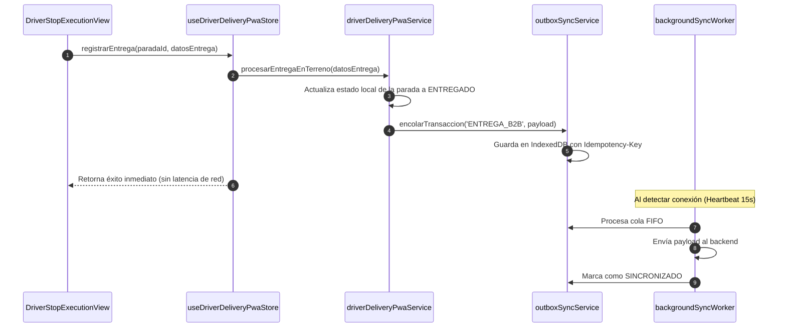

# Plan de Implementación Técnica (SPEC-023)

**Código:** SPEC-023  
**Fase de Ciclo:** Spec Kit v3.0 — `/speckit.plan`  
**Fecha:** 2026-10-19  

---

## 1. Arquitectura General y Separación de Responsabilidades

La solución se estructura en 4 capas desacopladas que garantizan el cumplimiento de los principios SOLID y la política de archivos enfocados ($< 400$ líneas):

```
┌────────────────────────────────────────────────────────┐
│ 1. CAPA UI PWA STANDALONE (/repartidor)               │
│    - DriverPortalView.tsx (Shell PWA sin sidebar)      │
│    - DriverLoginView.tsx (Credenciales corporativas)   │
│    - DriverRouteOverview.tsx (Hoja de ruta del día)   │
│    - DriverStopExecutionView.tsx (Ejecución entrega)   │
│    - DriverSignaturePadCanvas.tsx (Canvas HTML5 nativo)│
│    - DriverPartialReturnModal.tsx (Mermas/Cuarentena) │
└────────────────────────────────────────────────────────┘
                           │
┌──────────────────────────▼─────────────────────────────┐
│ 2. CAPA DE ESTADO Y ORQUESTACIÓN (Zustand + Services)   │
│    - useDriverDeliveryPwaStore.ts                      │
│    - driverDeliveryPwaService.ts                       │
└────────────────────────────────────────────────────────┘
                           │
┌──────────────────────────▼─────────────────────────────┐
│ 3. CAPA DE VALIDACIÓN Y METROLOGÍA (Zod)               │
│    - driverDeliveryPwa.schema.ts                       │
│    - dockPurchasesReceiving.schema.ts (Semáforo HACCP) │
└────────────────────────────────────────────────────────┘
                           │
┌──────────────────────────▼─────────────────────────────┐
│ 4. CAPA DE PERSISTENCIA Y SINCRONIZACIÓN OFFLINE       │
│    - outboxSyncService.ts (IndexedDB caja_outbox_v2)   │
│    - networkConnectivityService.ts (Heartbeat 15s)     │
│    - backgroundSyncWorker.ts                           │
└────────────────────────────────────────────────────────┘
```

---

## 2. Definición de Esquemas Zod y Contratos de Datos

Archivo: `packages/validation-schemas/src/driverDeliveryPwa.schema.ts`

```ts
// 1. Credenciales corporativas del conductor
export const DriverLoginCredentialsSchema = z.object({
  email: z.string().email('Ingrese un correo electrónico corporativo válido'),
  password: z.string().min(6, 'La contraseña debe tener mínimo 6 caracteres')
});

// 2. Registro de firma y evidencia de entrega
export const EvidenciaEntregaClienteSchema = z.object({
  nombreReceptor: z.string().min(3, 'El nombre de quien recibe es obligatorio'),
  cedulaReceptor: z.string().min(5, 'La cédula del receptor es obligatoria'),
  firmaCanvasBase64: z.string().startsWith('data:image/png;base64,', 'Firma digital en formato PNG inválida'),
  temperaturaLlegada: z.number().min(-30).max(40, 'Temperatura fuera de rango válido')
});

// 3. Devolución parcial de mercancía
export const DevolucionItemRutaSchema = z.object({
  sku: z.string().min(1),
  nombre: z.string(),
  kilosDevueltos: z.number().positive('Los kilos devueltos deben ser mayores a 0'),
  motivoRechazo: z.enum(['CALIBRE_INCORRECTO', 'CADENA_FRIO_ROTA', 'EMPAQUE_DANADO', 'EXCESO_PEDIDO', 'OTRO']),
  observaciones: z.string().optional()
});

// 4. Registro completo de parada ejecutada
export const RegistroEjecucionParadaSchema = z.object({
  paradaId: z.string(),
  pedidoId: z.string(),
  manifiestoId: z.string(),
  estadoFinal: z.enum(['ENTREGADO_TOTAL', 'ENTREGADO_PARCIAL', 'NO_ENTREGADO_RECHAZADO']),
  evidencia: EvidenciaEntregaClienteSchema,
  devoluciones: z.array(DevolucionItemRutaSchema).default([]),
  montoCobradoEfectivo: z.number().int().min(0).default(0),
  montoCobradoTransferencia: z.number().int().min(0).default(0),
  comprobanteTransferencia: z.string().optional()
});
```

---

## 3. Especificación de Componentes Táctiles ("Regla del Niño de 12 Años")

### 3.1 `DriverSignaturePadCanvas.tsx`
- **Lienzo HTML5 Canvas:** Dimensión adaptable responsive ($100\%$ de ancho, $220\text{ px}$ de alto).
- **Listeners Duales:** Eventos touch (`touchstart`, `touchmove`, `touchend`) con `{ passive: false }` para evitar scroll accidental de la pantalla mientras se firma.
- **Botones de Control:**
  - Botón táctil `Limpiar / Repetir`: $\ge 48\times 48\text{ px}$ con icono `RotateCcw`.
  - Botón táctil `Confirmar Firma`: $\ge 56\text{ px}$ (`h-14`) con icono `CheckCircle2`.

### 3.2 `DriverLoginView.tsx`
- **Autenticación Corporativa:** Inputs táctiles $\ge 48\text{ px}$ (`min-h-[48px]`), selector de conductor o ingreso de correo corporativo y contraseña con toggle de visualización.
- **Botón de Inicio:** $\ge 56\text{ px}$ (`h-14`) `INICIAR TURNO DE RUTA ->`.

### 3.3 `DriverRouteOverview.tsx`
- **Cabecera de Ruta:** Barra de progreso visual (ej: `3 de 7 entregadas - 42% completado`).
- **Lista de Paradas:** Tarjetas táctiles $\ge 56\text{ px}$ con estado tricolor, dirección destacada, hora estimada y monto a cobrar si es contraentrega.

### 3.4 `DriverStopExecutionView.tsx`
- **Acciones Rápidas 1-Toque:** Botón gigante para llamar (`tel:`) y botón para abrir Waze/Maps (`https://waze.com/ul?q=...` o `https://maps.google.com/?q=...`).
- **Inspección Térmica:** Input numérico de temperatura con semáforo tricolor HACCP en vivo (`ThermalTrafficLightBadge`).
- **Verificación de Canastillas:** Lista de productos con checkbox táctil gigante.
- **Firma & Recaudo:** Modal de firma Canvas y selector de medio de cobro.
- **Botón Final de Parada:** $\ge 56\text{ px}$ (`h-14`): `✓ CONFIRMAR ENTREGA Y CONTINUAR RUTA`.

### 3.5 `DriverPortalView.tsx`
- **Shell PWA Móvil:** Detecta el modo standalone; cuando la ruta es `/repartidor`, no renderiza `EnterpriseSidebar` ni `EnterpriseTopbar`.
- **Badge de Conectividad:** Muestra si está `ONLINE` o `OFFLINE (X pendientes por sincronizar)`.

---

## 4. Orquestación Transaccional y Persistencia Offline-First



---

## 5. Plan de Validación TDD (Quality Gate)

1. **Suite 1: `driverDeliveryPwa.schema.test.ts` (Mínimo 8 tests)**
   - Validación de credenciales de login corporativo.
   - Validación de formato PNG Base64 en firma Canvas.
   - Validación de rango de temperatura HACCP.
   - Validación de desglose de devolución parcial a cuarentena.

2. **Suite 2: `driverDeliveryPwaService.test.ts` (Mínimo 8 tests)**
   - Autenticación corporativa de conductor.
   - Carga de hoja de ruta activa y paradas.
   - Registro de entrega completa y persistencia en IndexedDB Outbox.
   - Ajuste de devolución parcial y saldo a cobrar.
   - Idempotencia determinista en reintentos.

3. **Suite 3: `driverDeliveryComponents.test.tsx` (Mínimo 8 tests)**
   - Targets táctiles $\ge 48\text{ px}$ y botón principal $\ge 56\text{ px}$.
   - Lienzo Canvas de firma táctil (`SignaturePad`).
   - Cero etiquetas `` (100% Lucide React).
   - Semáforo térmico HACCP tricolor.
   - Botón de llamada `tel:` y navegación Waze/Maps.

4. **Suite 4: `driverPortalView.test.tsx` (Mínimo 6 tests)**
   - Shell PWA standalone sin barras de navegación de escritorio.
   - Transición fluida entre login, hoja de ruta y detalle de parada.
   - Badge reactivo de conectividad online/offline.

---

*Fin del Plan de Implementación Técnica. Esperando confirmación humana.*
