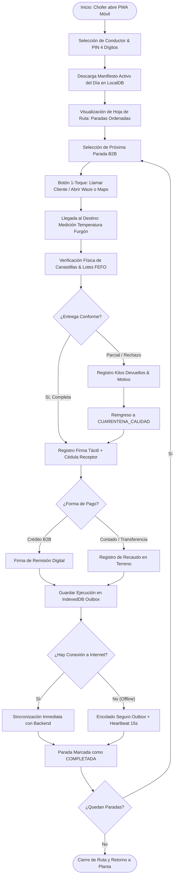
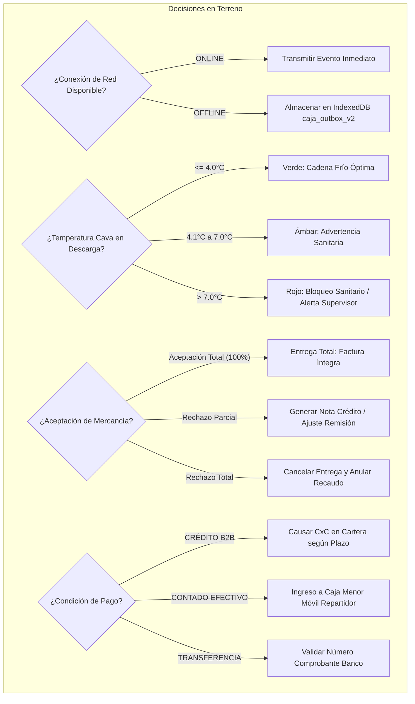
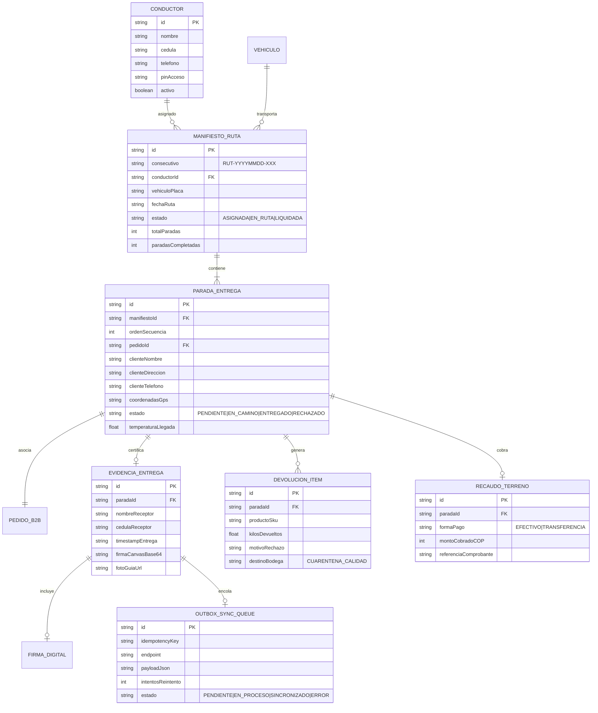
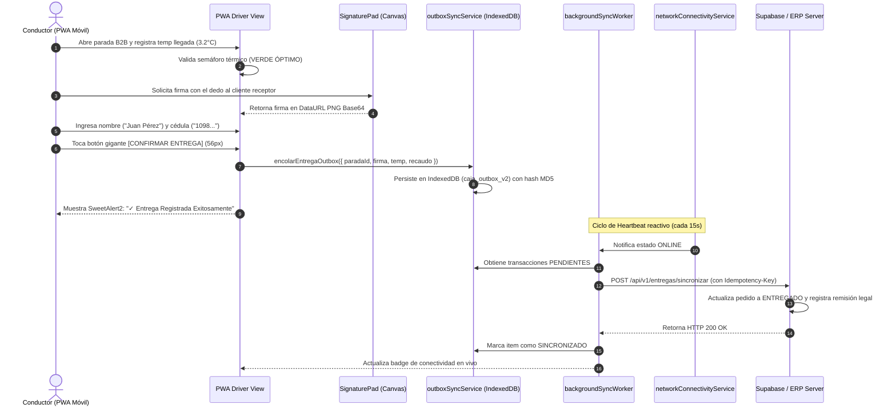

# SPEC-023: App PWA Móvil para Repartidores y Conductores (Rutas B2B, Entrega en Terreno, Firma Digital Táctil y Sincronización Offline)

**Código:** SPEC-023  
**Estado:** PROPUESTA (Fase 1: `/speckit.specify`)  
**Fecha:** 2026-10-19  
**Autor:** Antigravity AI & Equipo de Arquitectura La Pezcadería ERP  
**Gobernanza:** Spec Kit SDD v3.0 • Flujo Continuo Kanban (WIP = 1) • Regla del Niño de 12 Años • Master Architect SOLID • Bucle Chrome DevTools MCP  

---

## 1. Problema de Negocio y Justificación ("Por Qué")

En la distribución de pescados y mariscos perecederos a hoteles, restaurantes y distribuidores institucionales (B2B):
1. **Pérdida de Señal Móvil en Rutas:** Los repartidores descargan mercancía en sótanos de centros comerciales, cámaras frigoríficas de muelles y zonas costeras con nula conectividad celular. Una app que requiera conexión permanente bloquea la entrega y paraliza la flota.
2. **Disputas de Entrega y Fricción Legal:** Entregas sin firma digital ni captura de nombre/cédula generan reclamaciones de facturas ("yo no recibí ese pedido"). Se requiere acta de entrega digital con firma táctil en pantalla y georreferenciación.
3. **Pérdida de Cadena de Frío en Tránsito:** La inocuidad sanitaria exige registrar la temperatura del furgón o cava isotérmica al momento exacto de la descarga en el local del cliente.
4. **Devoluciones Parciales Descontroladas:** Cuando el cliente rechaza piezas por calibre o daño físico, el conductor no cuenta con un mecanismo para ajustar la remisión, causando descuadres en inventario y cartera.
5. **Ergonomía en Terreno ("Regla del Niño de 12 Años"):** El repartidor opera con guantes, humedad y luz solar directa. Los botones deben ser gigantes ($\ge 48\text{ px}$ y $\ge 56\text{ px}$), contrastes WCAG 2.2 AA+, cero imágenes pesadas y llamadas telefónicas/GPS a 1 toque.

---

## 2. Definición del Requerimiento en Notación EARS ("Qué")

### RN-PWA-01: Autenticación Rápida en Terreno (Ubiquitous & Event-Driven)
- El sistema **DEBERÁ** permitir el ingreso del conductor mediante selección táctil de su nombre de conductor registrado en `useDriverStore` y un PIN numérico de 4 dígitos, sin requerir contraseñas complejas.

### RN-PWA-02: Hoja de Ruta Secuencial del Día (State-Driven)
- **MIENTRAS** el conductor tenga un manifiesto de ruta activo asignado (`EN_RUTA`), la PWA **DEBERÁ** mostrar la lista ordenada de paradas con estados visuales unívocos:
  - `PENDIENTE` (Gris / Azul)
  - `EN_CAMINO` (Ámbar con botón Waze / Google Maps)
  - `ENTREGADO_TOTAL` (Verde Esmeralda)
  - `ENTREGADO_PARCIAL` (Amarillo Mostaza con detalle de devolución)
  - `NO_ENTREGADO_RECHAZADO` (Rojo con causal registrada)

### RN-PWA-03: Monitoreo Térmico HACCP en Descarga (Unwanted Behavior)
- **CUANDO** el conductor inicie la descarga en el local del cliente, la PWA **DEBERÁ** solicitar la temperatura de cava medida (°C).
- **SI** la temperatura es $> 7.0^\circ\text{C}$, el sistema **DEBERÁ** emitir una alerta crítica sanitaria tricolor en el componente semáforo, exigiendo confirmación del cliente o autorización de supervisor antes de liberar la mercancía.

### RN-PWA-04: Firma Táctil Digital en Pantalla (Event-Driven)
- **CUANDO** el cliente reciba el pedido, la PWA **DEBERÁ** desplegar un lienzo Canvas táctil (`SignaturePad`) de alta sensibilidad para firma con el dedo, capturando nombre completo y número de cédula del receptor.

### RN-PWA-05: Ajuste de Novedades y Devolución Parcial (Optional)
- **DONDE** el cliente rechace items o kilos por calibre, presentación o merma, el sistema **DEBERÁ** permitir registrar la cantidad rechazada y el motivo técnico, reingresando automáticamente el lote devuelto a inventario en estado `CUARENTENA_CALIDAD`.

### RN-PWA-06: Recaudo Contraentrega en Terreno (Event-Driven)
- **CUANDO** el pedido tenga condición de pago de contado o contraentrega, la PWA **DEBERÁ** registrar el monto recaudado en efectivo o el comprobante de transferencia digital, recalculando el saldo en tiempo real si hubo devolución parcial.

### RN-PWA-07: Resiliencia Offline-First Total (State-Driven)
- **MIENTRAS** el dispositivo no tenga conexión a internet, la PWA **DEBERÁ** operar de manera transparente guardando las entregas, firmas en Base64, temperaturas y novedades en la cola local IndexedDB (`caja_outbox_v2` / `entregas_outbox`).
- **CUANDO** el `NetworkHeartbeat` detecte restauración de conectividad (cada 15s), el worker en segundo plano **DEBERÁ** sincronizar automáticamente los registros pendientes con el backend sin intervención del usuario ni duplicidad de registros (idempotencia determinista).

---

## 3. MANDATORIO: Multi-Phase System Modeling (Mermaid.js)

### Diagrama 1: Flujo de Procesos y Ciclo de Vida de la Entrega (Process Flowchart)



---

### Diagrama 2: Rombos de Decisión y Edge Cases (Decision Logic Diagram)



---

### Diagrama 3: Modelo Entidad-Relación de Ruta y Entrega (Entity-Relationship)



---

### Diagrama 4: Diagrama de Secuencia Temporal (Sequence Diagram)



---

### Diagrama 5: Arquitectura de Componentes por Capas (Component Architecture)

```mermaid
graph TD
    subgraph Capa 1: Presentación PWA Móvil (Mobile Touch UI >= 48px)
        A[DriverAppShell.tsx: Layout Standalone Móvil]
        B[DriverLoginPinView.tsx: Teclado Numérico PIN]
        C[DriverRouteManifestView.tsx: Lista de Paradas del Día]
        D[DriverStopDetailView.tsx: Info Cliente, Waze y Teléfono]
        E[DriverDeliveryFormStep.tsx: Báscula, Temperatura y Devolución]
        F[DriverSignaturePadModal.tsx: Canvas Táctil de Firma]
        G[DriverNetworkBadge.tsx: Semáforo Offline/Online 15s]
    end

    subgraph Capa 2: Lógica de Aplicación & Hooks
        H[useDriverRouteStore.ts: Estado Reactivo de Ruta]
        I[useNetworkHeartbeat.ts: Detección Red 15s]
        J[useDeliveryOutbox.ts: Encolado de Entregas]
        K[deliveryRouteService.ts: Orquestador Transaccional]
    end

    subgraph Capa 3: Validación y Metrología
        L[deliveryRoute.schema.ts: Zod Schemas]
        M[dockPurchasesReceiving.schema.ts: Semáforo Térmico]
    end

    subgraph Capa 4: Persistencia Local & Sincronización
        N[IndexedDB: MaestroPescaderiaOfflineDB]
        O[caja_outbox_v2: Cola de Eventos Offline]
        P[backgroundSyncWorker.ts: Worker de Sincronización FIFO]
    end

    A --> B
    A --> C
    C --> D
    D --> E
    E --> F
    A --> G

    B & C & D & E --> H
    G --> I
    E --> J
    H & J --> K
    K --> L & M
    J --> N & O
    I --> P
    P --> O
```

---

## 4. Criterios de Aceptación y Quality Gate (DoD)

1. **Ergonomía Táctil Extrema:**
   - Targets táctiles secundarios $\ge 48\times 48\text{ px}$.
   - Botón principal de confirmación $\ge 56\text{ px}$ (`h-14`, fuente bold).
   - Acciones de llamada telefónica (`tel:`) y apertura de Waze/Google Maps a 1 solo toque.
2. **Cero Imágenes Externas:** 100% iconos Lucide React sin dependencias externas.
3. **Firma Digital Vectorial/Canvas:** Captura nítida de firma en pantalla táctil con botón de limpiar y guardar.
4. **Resiliencia Offline:** Permite completar 10 entregas consecutivas sin internet y sincronizarlas automáticamente al recuperar señal.
5. **Calidad de Código:**
   - Archivos modulares $< 400$ líneas (respetando SRP).
   - TypeScript estricto (`tsc --noEmit` en 0 errores).
   - Cobertura de pruebas unitarias $\ge 80\%$ en suites dedicadas.
   - Master Architect SOLID en 0 violaciones críticas.
   - Bucle Chrome DevTools MCP en vivo con 0 errores en consola y vista móvil 375 px validada.

---

*Fin de la Especificación Base. Prohibido generar código hasta aprobación del usuario.*
