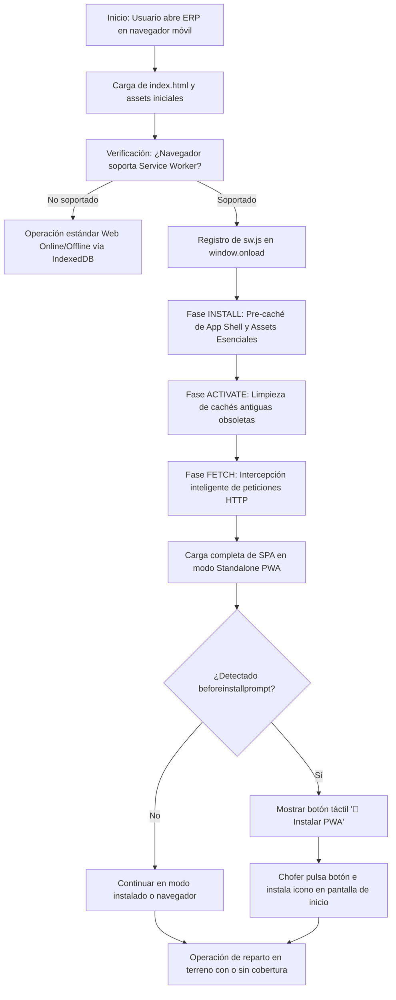
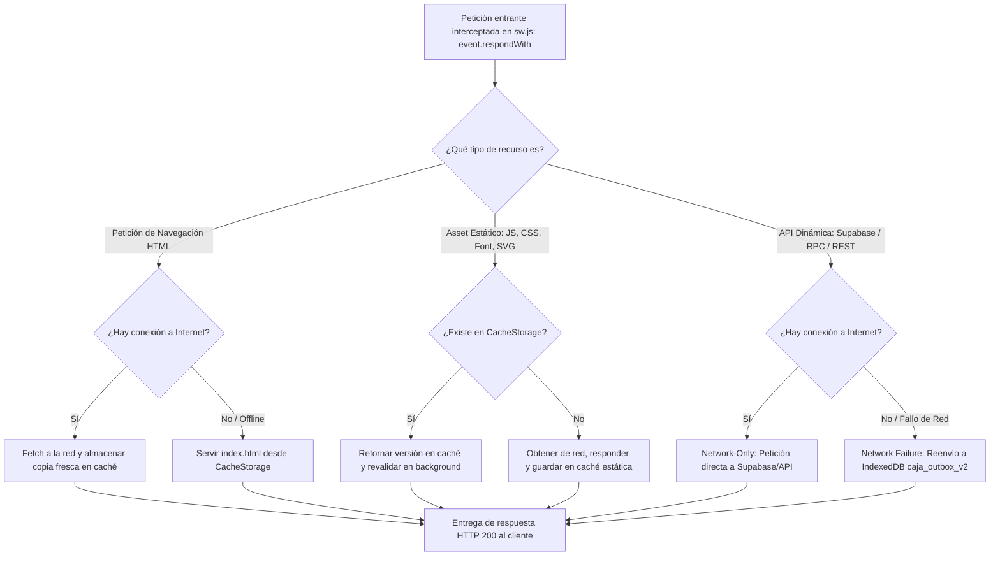
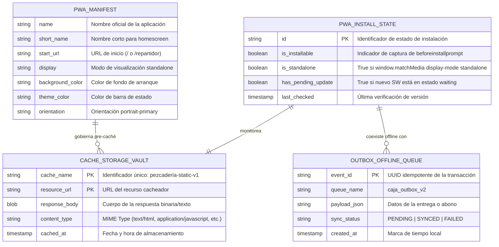
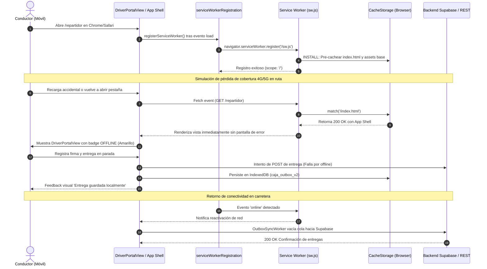
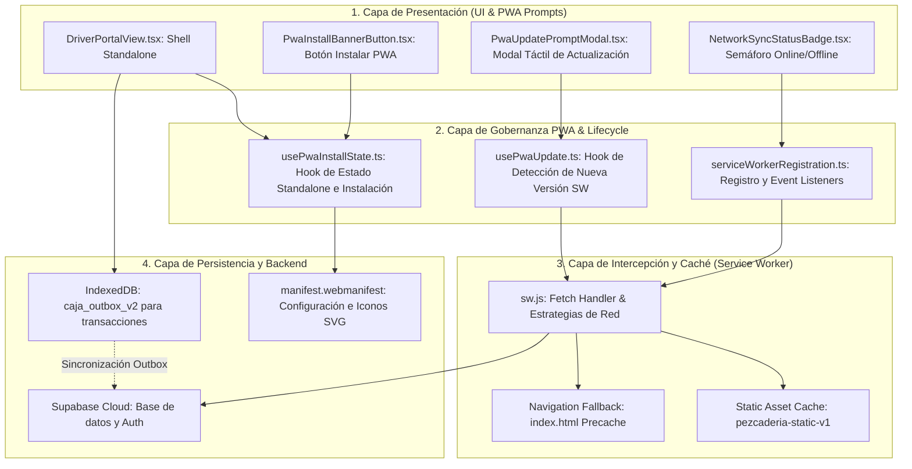

# Especificación de Requerimientos: Service Worker PWA, Web App Manifest y Caché Offline de Recursos

**Código:** SPEC-024  
**Título:** Service Worker PWA, Web App Manifest y Caché Offline de Recursos (PWA Standalone para Repartidores y Operación en Campo)  
**Fase:** Spec Kit v3.0 — `/speckit.specify`  
**Gobernanza:** Flujo Continuo Kanban (`WIP = 1`) | Estándar Brownfield Protocol v2.2 | RULE-SDD-001 (Cero Dependencias Adicionales)

---

## 1. Contexto de Negocio y Planteamiento del Problema

En la especificación **SPEC-023** se culminó con éxito el portal móvil de entregas para conductores (`DriverPortalView.tsx`, accesible en `/repartidor`), dotándolo de firma digital táctil con Canvas HTML5 nativo, registro de paradas, gestión de devoluciones a `CUARENTENA_CALIDAD` y encolado transaccional en IndexedDB (`caja_outbox_v2`).

No obstante, la operación en terreno de los conductores de La Pezcadería en el área metropolitana de Bucaramanga y zonas rurales adyacentes presenta las siguientes limitaciones de infraestructura:
1. **Falta de Caché a Nivel de Red del Navegador:** Si un repartidor pierde la cobertura 4G/5G y accidentalmente refresca la pantalla o abre el navegador desde cero, el navegador lanza el error "Sin conexión a Internet" porque los archivos base (HTML shell, bundles JavaScript de Vite, CSS compilado, tipografías e iconos SVG) no residen en una caché gestionada por Service Worker.
2. **Inexistencia de Web App Manifest:** Al carecer de `manifest.webmanifest`, los navegadores móviles (Chrome en Android, Safari en iOS) no despliegan el prompt de instalación nativa ("Añadir a la pantalla principal") ni reconocen la aplicación en modo `standalone`, obligando al conductor a operar dentro de la barra de URL del navegador, lo que reduce la ergonomía y propicia cierres accidentales.
3. **Gestión de Actualizaciones sin Pérdida de Trabajo en Marcha:** Cuando la empresa publica una nueva versión del ERP, los repartidores con rutas activas en campo no deben sufrir recargas forzadas ni rotura de sesión; se requiere un mecanismo táctil de notificación de actualización disponible (`SKIP_WAITING` controlado).
4. **Cumplimiento de RULE-SDD-001:** Debe lograrse una arquitectura PWA completa a **Costo $0 de dependencias**, implementando un Service Worker nativo modular y robusto (`public/sw.js`), junto a un gestor de registro en TypeScript (`src/services/serviceWorkerRegistration.ts`) sin alterar la lista cerrada de 38 dependencias oficiales del ERP.

---

## 2. Requerimientos Funcionales y No Funcionales (Notación EARS)

### Requerimientos Ubicuos (Ubiquitous Requirements)
- **REQ-024-01:** El sistema **debe** proveer un manifiesto web canónico (`public/manifest.webmanifest`) configurado con nombre `"La Pezcadería ERP"`, nombre corto `"Pezcadería"`, modo de visualización `standalone`, orientación `portrait-primary`, tema `#0f172a` (slate-900) y fondo `#ffffff`.
- **REQ-024-02:** El sistema **debe** incluir iconos de aplicación en formatos SVG y resoluciones estándar (192x192, 512x512 y maskable) para compatibilidad multiplataforma Android e iOS.
- **REQ-024-03:** El sistema **debe** vincular en `index.html` los meta tags requeridos para PWA (`theme-color`, `apple-mobile-web-app-capable`, `apple-mobile-web-app-status-bar-style`, `apple-touch-icon`).

### Requerimientos Condicionados por Eventos (Event-Driven Requirements)
- **REQ-024-04:** **Cuando** el navegador soporte la API de Service Workers, el sistema **debe** registrar de manera asíncrona y no bloqueante el worker `sw.js` tras el evento `load` de la ventana.
- **REQ-024-05:** **Cuando** el Service Worker se instale (`install`), **debe** pre-cachear (Precache) en `CacheStorage` (`pezcaderia-static-v1`) el app shell esencial: HTML raíz, iconos SVG centrales, fuentes tipográficas y assets base.
- **REQ-024-06:** **Cuando** ocurra una petición de red de navegación (`mode === 'navigate'`), el Service Worker **debe** intentar la red primero (`Network-First`) y, en caso de fallo o timeout offline, retornar inmediatamente el shell cacheado (`index.html`) para garantizar la carga del SPA.
- **REQ-024-07:** **Cuando** se solicite un asset estático (JS, CSS, fuentes, imágenes SVG), el Service Worker **debe** aplicar una estrategia `Stale-While-Revalidate` o `Cache-First` con actualización en segundo plano.
- **REQ-024-08:** **Cuando** se detecte una petición hacia APIs dinámicas (Supabase REST, RPC, polling o analítica externa), el Service Worker **debe** operar en modo `Network-Only`, derivando el manejo de contingencia offline a la capa de IndexedDB (`caja_outbox_v2`) existente.

### Requerimientos Condicionados por Estado (State-Driven Requirements)
- **REQ-024-09:** **Mientras** exista un nuevo Service Worker en estado `waiting` (esperando para activarse), el sistema **debe** exponer de forma reactiva en la interfaz un micro-banner táctil no intrusivo (`PwaUpdatePromptModal.tsx`) informando "Nueva versión disponible" con botón de 1-toque $\ge 48\text{ px}$ para recargar sin fricción.
- **REQ-024-10:** **Mientras** el evento nativo `beforeinstallprompt` sea capturado en Android/Chrome, el portal del repartidor **debe** ofrecer un botón accesible "📲 Instalar en este celular" para facilitar el enrolamiento de nuevos choferes.

---

<!-- MANDATORY MULTI-PHASE SYSTEM MODELING (Mermaid.js) -->
## 3. Los 5 Diagramas de Ingeniería Obligatorios (Mermaid.js)

### 3.1. Flujo de Procesos: Ciclo de Vida Operativo (`1_process_flowcharts`)

---

### 3.2. Rombos de Decisión y Lógica Condicional (`2_decision_logic_diagrams`)

---

### 3.3. Modelo Entidad-Relación: Persistencia y Metadatos PWA (`3_entity_relationship_diagrams`)

---

### 3.4. Diagrama de Secuencia Temporal (`4_sequence_diagrams`)

---

### 3.5. Arquitectura de Componentes y Límites de Capas (`5_component_architecture_diagrams`)

---

## 4. Definición de Hecho (Definition of Done - DoD)
1. `public/manifest.webmanifest` creado y referenciado en `index.html` con todos los metadatos estándar y temas visuales.
2. Iconos vectoriales semánticos a Costo $0 creados para resoluciones 192x192, 512x512 y maskable en `public/icons/`.
3. `public/sw.js` implementado con precaché de app shell, estrategia `Stale-While-Revalidate` para recursos estáticos y bypass `Network-Only` para APIs dinámicas.
4. Módulo TypeScript `src/services/serviceWorkerRegistration.ts` para registro limpio, gestión de eventos y control de `skipWaiting`.
5. Hooks y micro-componentes táctiles `usePwaInstallState.ts`, `PwaInstallBannerButton.tsx` y `PwaUpdatePromptModal.tsx` bajo la "Regla del Niño de 12 Años" (targets $\ge 48\text{ px}$, botón $\ge 56\text{ px}$, cero imágenes).
6. Suite de pruebas unitarias TDD con 100% de tests verdes simulando instalación, caché y fallbacks.
7. Cumplimiento de RULE-SDD-001 (0 dependencias añadidas a `package.json`).
8. Cero errores en `tsc --noEmit` y Master Architect SOLID aprobado sin críticas.
