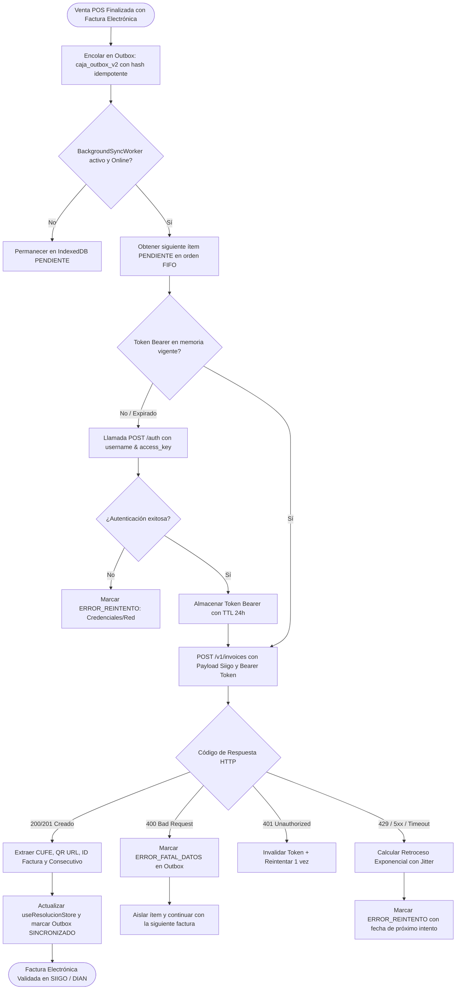
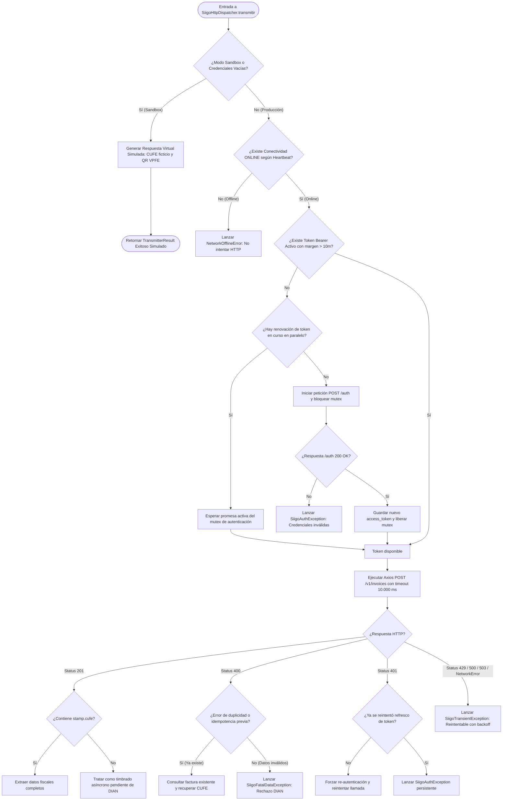
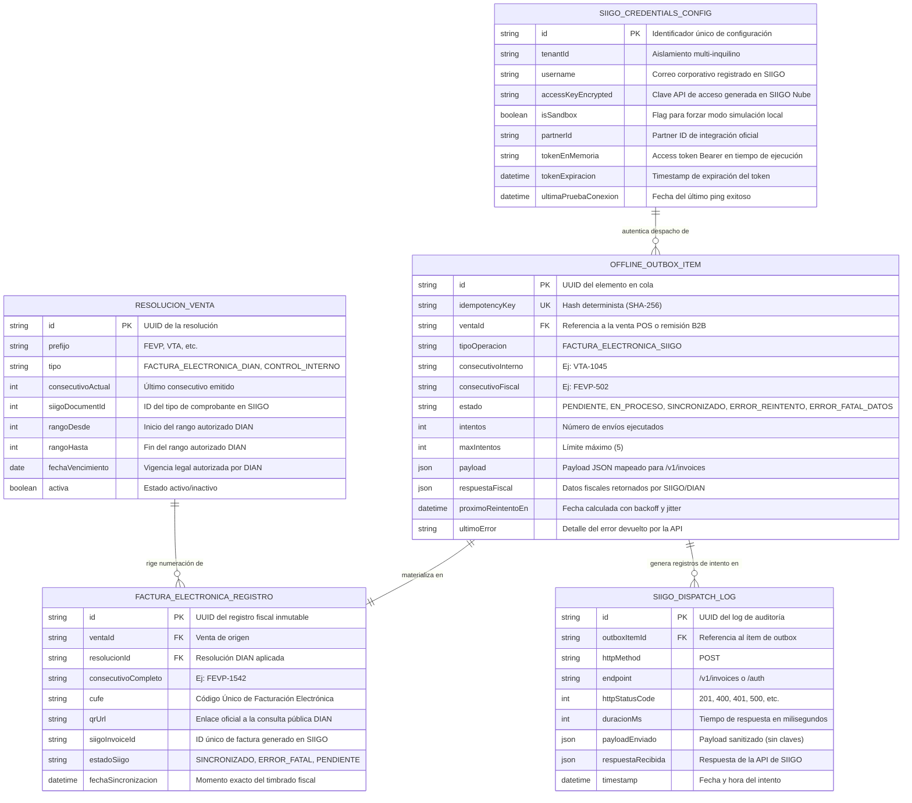
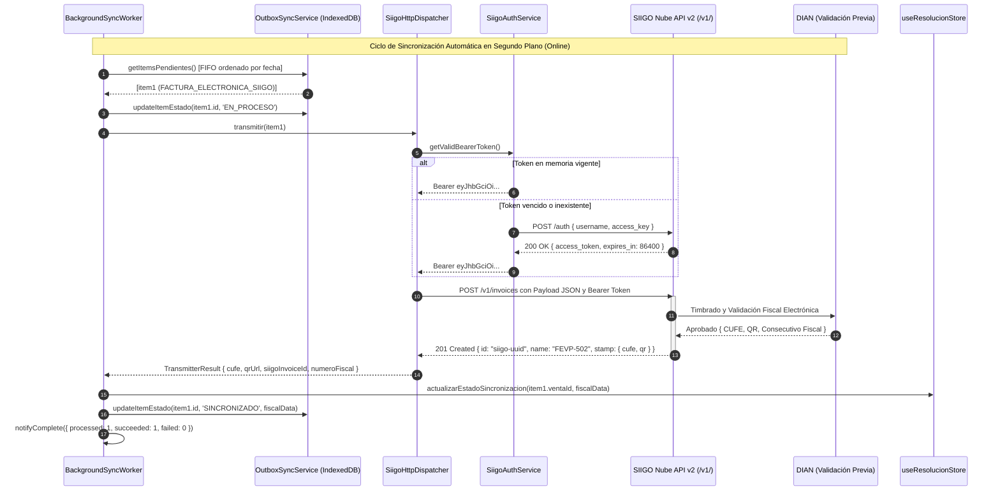
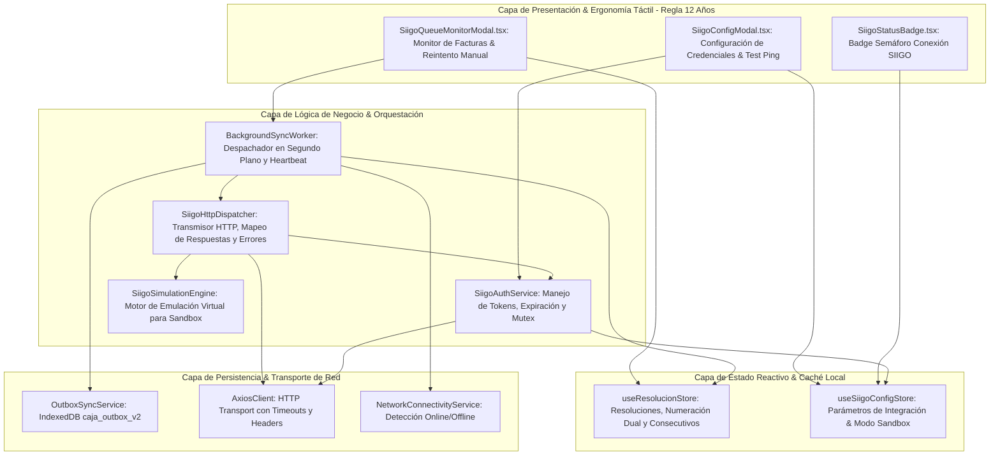

# Especificación Técnica Formal: SPEC-025

**Código:** SPEC-025  
**Título:** Dispatcher HTTP Real SIIGO Nube API v2 (Autenticación Bearer, Transmisor Outbox, Validación Fiscal DIAN y Modo Simulación)  
**Versión:** 1.0.0  
**Fecha:** 2026-10-21  
**Autor:** @coordinator & @planner (Spec Kit v3.0)  
**Gobernanza:** Flujo Continuo Kanban (Límite estricto `WIP = 1`). Protocolo Brownfield v2.2.  
**Estado:** PROPUESTA / ESPECIFICACIÓN BASE (`/speckit.specify` — Checkpoint de Aprobación Humana)

---

## 1. Resumen Ejecutivo y Justificación ("El Qué" y "El Por Qué")

### 1.1 El Problema Actual
En la especificación `SPEC-020`, La Pezcadería ERP implementó el sistema de resoluciones duales (control interno `VTA-` y facturación fiscal `FEVP-`), el mapeador canónico de payloads para SIIGO (`siigoPayloadMapper.ts`) y la exportación masiva contable. Posteriormente, en `SPEC-021`, se construyó la infraestructura resiliente de cola Outbox (`caja_outbox_v2` en IndexedDB), el detector de conectividad dual (`NetworkConnectivityService`) y el despachador en background (`BackgroundSyncWorker.ts`).

No obstante, el método de transmisión (`defaultTransmit`) opera actualmente con un simulador en memoria que genera números de CUFE y URLs de consulta DIAN sintéticas. No existe una capa de cliente HTTP real contra los endpoints de producción de SIIGO Nube (`https://api.siigo.com/v1/`), ni un gestor seguro del ciclo de vida del token Bearer (adquisición con `username` y `access_key`, caché en memoria con expiración y renovación transparente ante 401 Unauthorized).

### 1.2 La Solución Propuesta (SPEC-025)
Construir el **Dispatcher HTTP Real para SIIGO Nube API v2** mediante una arquitectura desacoplada y modular:
1. **`SiigoAuthService`:** Gestor de autenticación y tokens Bearer. Consume `POST https://api.siigo.com/auth` con credenciales corporativas, almacena el JWT en memoria/sesión con TTL de 24 horas y provee refresco transparente con mutex para evitar condiciones de carrera por peticiones simultáneas.
2. **`SiigoHttpDispatcher`:** Cliente de red HTTP (usando `axios` ya disponible en dependencias sin agregar paquetes de terceros). Conecta como transmisor oficial (`OutboxTransmitterFn`) dentro de `BackgroundSyncWorker.setTransmitter(...)`.
3. **Manejo Estructurado de Respuestas y Clasificación de Errores HTTP:**
   - **200/201 Creado:** Extrae `id`, `name` (consecutivo fiscal real emitido por SIIGO), `stamp.cufe` y `stamp.qr`. Actualiza la resolución fiscal y asocia la respuesta al comprobante.
   - **400 Bad Request:** Datos fiscales inválidos (e.g., NIT erróneo, DANE no reconocido). Clasifica inmediatamente como `ERROR_FATAL_DATOS` en la outbox sin bloquear la cola de otras ventas.
   - **401 Unauthorized:** Invalida el token en caché, renueva credenciales con SIIGO y reintenta la petición.
   - **429 Too Many Requests / 5xx Server Error:** Desencadena reintento exponencial con jitter (`ERROR_REINTENTO`).
4. **Modo Dual (Producción vs. Sandbox / Simulación):**
   - Si no se configuran credenciales válidas o el flag `isSandbox` está activo, conmuta de forma transparente a un motor de simulación fiscal sin fallar las operaciones de caja ni interrumpir el POS.
5. **Panel Táctil de Monitoreo y Diagnóstico SIIGO (Ergonomía "Regla del Niño de 12 Años"):**
   - Modal accesible de diagnóstico rápido con botón de ping "Probar Conexión", estado del token (activo/expirado/simulado) y visualización del log de los últimos 10 despachos.

---

## 2. Requisitos del Sistema en Notación EARS

### 2.1 Requisitos Ubicuos (Ubiquitous Requirements)
- **EARS-UBI-01:** El sistema SIEMPRE autenticará las peticiones a SIIGO Nube API v2 utilizando el encabezado HTTP estándar `Authorization: Bearer <access_token>` y el header identificador de empresa `Partner-Id: LaPezcaderiaERP`.
- **EARS-UBI-02:** El sistema NUNCA almacenará claves secretas (`access_key`) en texto plano en repositorios ni en logs del navegador.

### 2.2 Requisitos Basados en Eventos (Event-Driven Requirements)
- **EARS-EVT-01:** CUANDO el `BackgroundSyncWorker` procese un ítem de la cola Outbox con `tipoOperacion === 'FACTURA_ELECTRONICA_SIIGO'`, ENTONCES invocará al `SiigoHttpDispatcher.transmitirFactura(item)` para enviar el payload vía `POST /v1/invoices`.
- **EARS-EVT-02:** CUANDO SIIGO Nube retorne un código de estado `201 Created` con el nodo `stamp` diligenciado, ENTONCES el sistema capturará el CUFE, la URL del código QR y el consecutivo fiscal oficial, actualizando atómicamente el registro en `useResolucionStore` y marcando el ítem de la outbox como `SINCRONIZADO`.
- **EARS-EVT-03:** CUANDO el usuario presione el botón táctil "Probar Conexión con SIIGO", ENTONCES el sistema enviará un ping de autenticación a `POST /auth` y reportará en menos de 2.000 ms si las credenciales son válidas y la API está operativa.

### 2.3 Requisitos de Comportamiento no Deseado (Unwanted Behavior Requirements)
- **EARS-UWB-01:** SI SIIGO Nube responde con un error `400 Bad Request` debido a validaciones fiscales rechazadas (NIT inexistente, código DANE inválido o inconsistencia de impuestos), ENTONCES el sistema NO bloqueará el resto de la cola, SINO QUE marcará el registro afectado con estado `ERROR_FATAL_DATOS`, registrará el mensaje exacto devuelto por SIIGO en `ultimoError` y notificará al administrador.
- **EARS-UWB-02:** SI una petición falla con `401 Unauthorized` por expiración anticipada del token Bearer, ENTONCES el sistema invalidará de inmediato el token en memoria, obtendrá uno nuevo mediante `SiigoAuthService.refreshToken()` y reintentará la petición fallida una única vez antes de marcar error.
- **EARS-UWB-03:** SI se pierde la conexión a Internet o SIIGO devuelve `429 Too Many Requests` o `503 Service Unavailable`, ENTONCES el sistema conservará la factura en estado `ERROR_REINTENTO` con cálculo de retroceso exponencial y jitter, garantizando que ninguna venta se pierda.

### 2.4 Requisitos Basados en Estado (State-Driven Requirements)
- **EARS-STA-01:** MIENTRAS el sistema se encuentre en `Modo Simulación / Sandbox`, las solicitudes a SIIGO generarán respuestas estructuralmente idénticas a la API oficial con identificadores virtuales `SIM-SIIGO-*` y prefijo `FEVP-`, permitiendo pruebas y capacitación de cajeros sin timbrar documentos reales en la DIAN.
- **EARS-STA-02:** MIENTRAS el token de acceso sea válido y falten más de 10 minutos para su expiración, el sistema reutilizará el token en memoria sin generar llamadas redundantes al endpoint de autenticación.

---

## 3. Modelado Multi-Fase de Sistemas (5 Diagramas Mermaid Canónicos)

### 3.1 Diagrama 1: Flujo de Procesos y Ciclo de Vida (`1_process_flowcharts`)

---

### 3.2 Diagrama 2: Lógica de Decisiones y Casos de Borde (`2_decision_logic_diagrams`)

---

### 3.3 Diagrama 3: Modelo Entidad-Relación (`3_entity_relationship_diagrams`)

---

### 3.4 Diagrama 4: Diagrama de Secuencia Temporal (`4_sequence_diagrams`)

---

### 3.5 Diagrama 5: Arquitectura de Componentes por Capas (`5_component_architecture_diagrams`)

---

## 4. Criterios de Aceptación y Quality Gate (Métrica de Éxito)

1. **Autenticación e Idempotencia:**
   - Adquisición de token Bearer mediante `POST /auth`.
   - Caché en memoria con deduplicación de peticiones concurrentes (Mutex/Promise caching).
   - Manejo de token con TTL y renovación automática transparente ante código 401.
2. **Transmisión y Despacho:**
   - Implementación de `SiigoHttpDispatcher` conforme a la interfaz `OutboxTransmitterFn` de `BackgroundSyncWorker`.
   - Envío de comprobantes a `POST /v1/invoices` con mapeo exacto de items, cliente, impuestos y métodos de pago.
3. **Resiliencia ante Fallos:**
   - Errores 400 catalogados como `ERROR_FATAL_DATOS` sin detener la cola de ventas.
   - Errores de red, 429 y 5xx catalogados como `ERROR_REINTENTO` con retroceso exponencial.
4. **Modo Simulación / Sandbox:**
   - Ejecución 100% libre de fallos cuando no existen credenciales configuradas o se activa el flag `isSandbox`.
5. **Calidad de Código y Estándares:**
   - 0 dependencias externas añadidas (RULE-SDD-001; utiliza `axios` existente).
   - `tsc --noEmit` en 0 errores.
   - Auditoría Master Architect SOLID con 0 violaciones críticas (`passed = true`).
   - Cobertura de pruebas unitarias TDD $\ge 90\%$ con Vitest.
   - Verificación en vivo con Chrome DevTools (0 errores en consola JS).

---

*Fin del documento de especificación técnica formal SPEC-025.*
