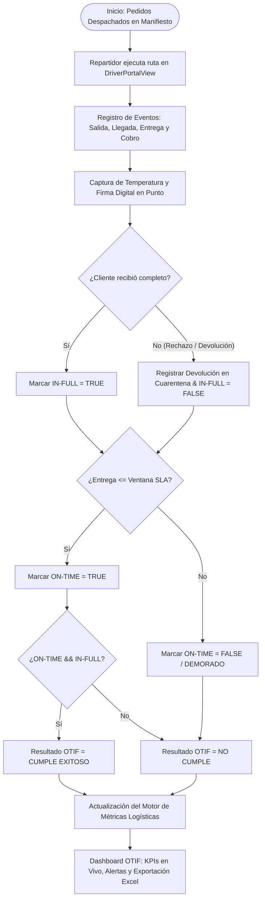
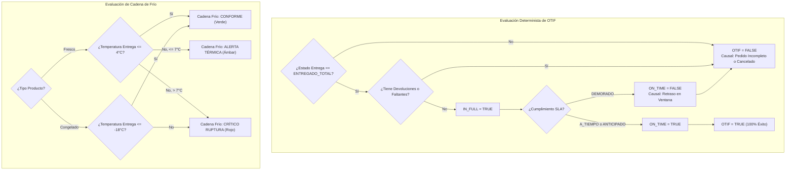
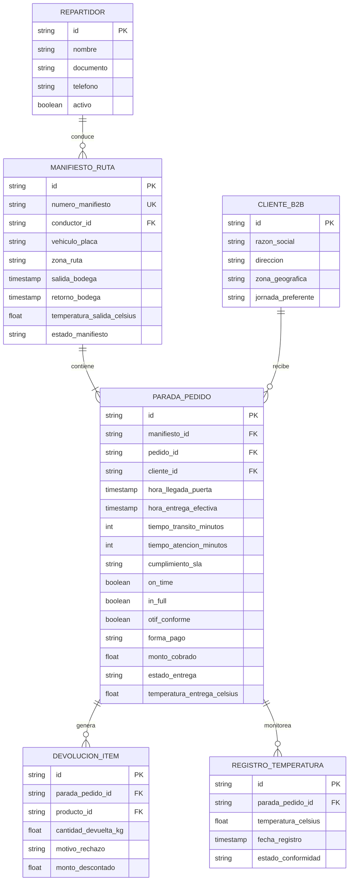
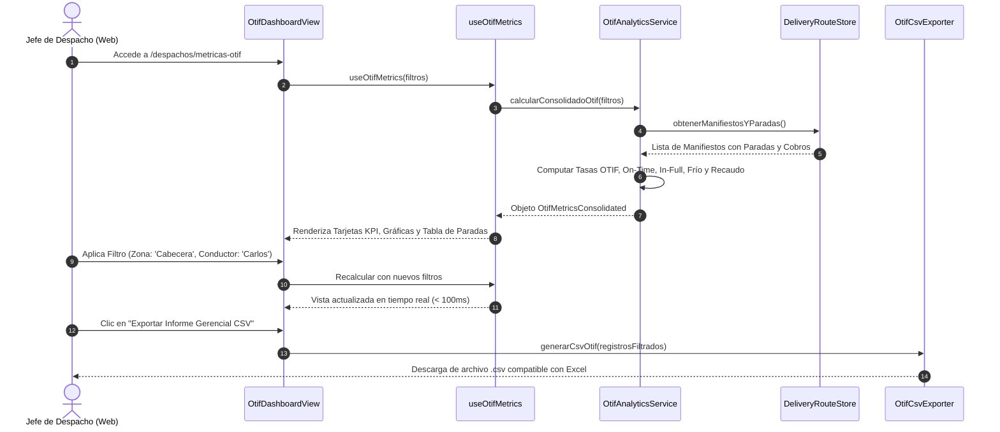
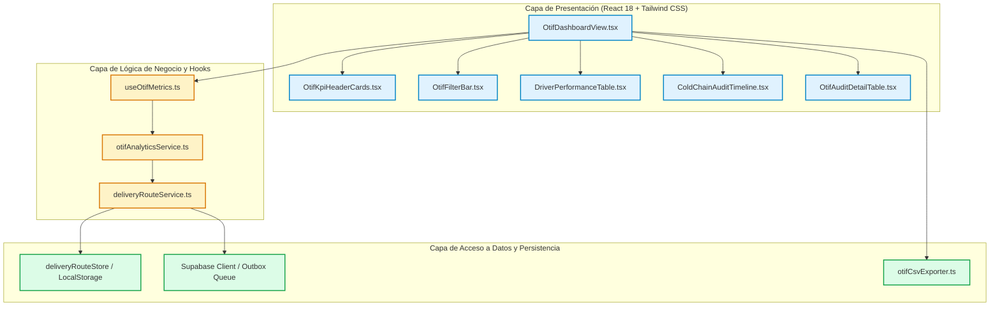

# Especificación de Requerimiento: SPEC-026

**Código:** SPEC-026  
**Título:** Dashboard de Métricas Logísticas y Tiempos de Entrega OTIF (On-Time In-Full) para Despachos B2B  
**Fase:** Spec Kit SDD v3.0 — `/speckit.specify`  
**Gobernanza:** Flujo Continuo Kanban (Límite estricto `WIP = 1`). Arquitectura Data-Driven.  
**Estado:** PENDIENTE DE APROBACIÓN HUMANA (Checkpoint 1)  

---

## 1. El "Por Qué" (Problema de Negocio y Justificación)

La Pezcadería S.A.S. despacha a diario productos del mar perecederos a hoteles, restaurantes, casinos y pescaderías aliadas (canal B2B / HORECA). La operación de despacho requiere dos condiciones críticas para evitar rechazos y pérdidas económicas:
1. **Puntualidad Crítica (On-Time):** Los restaurantes necesitan el pescado antes de su hora pico de cocina (almuerzo ~11:30 AM). Entregar con retraso causa cancelación del pedido o penalizaciones comerciales.
2. **Cumplimiento Íntegro (In-Full):** El cliente institucional exige recibir exactamente los kilos, calibres y referencias pactadas. Cualquier faltante o producto en mal estado rompe la cadena de valor y genera devoluciones a cuarentena.
3. **Preservación de Cadena de Frío:** Los productos frescos deben mantenerse entre $0^\circ\text{C}$ y $4^\circ\text{C}$, y los congelados a $\le -18^\circ\text{C}$. Una subida térmica en el vehículo compromete la inocuidad.

**Problema Actual:**
Aunque existen manifiestos de ruta y una app móvil para repartidores (`DriverPortalView`), la torre de control y la gerencia carecen de un panel ejecutivo centralizado que consolide en tiempo real:
- El indicador industrial **OTIF estricto** ($OTIF = On\text{-}Time \land In\text{-}Full$).
- El semáforo de tiempo de ciclo en ruta (tránsito, llegada y atención por parada).
- La auditoría de cadena de frío (temperatura de salida vs. temperatura registrada en entrega).
- La efectividad de recaudo en calle (Contado, Transferencia, Crédito B2B).
- El rendimiento comparativo de repartidores y rutas por zona geográfica.

---

## 2. El "Qué" (Alcance y Solución Propuesta)

Se construirá el **Dashboard Ejecutivo y Operativo de Métricas Logísticas OTIF B2B**, integrado en el ERP bajo la ruta de navegación dedicada y accesible en la vista de Despachos/Inventario:

1. **KPI Header Cards Semafóricos (Light Mode WCAG AA+):**
   - **Tasa Global OTIF (%):** Cumplimiento simultáneo de tiempo y completitud.
   - **Tasa On-Time (%):** Porcentaje de pedidos entregados dentro de la ventana SLA pactada.
   - **Tasa In-Full (%):** Porcentaje de pedidos entregados al 100% sin mermas ni devoluciones parciales.
   - **Cumplimiento Cadena de Frío (%):** Entregas con temperatura dentro del rango térmico permitido.
   - **Efectividad de Cobro en Calle (%):** Desglose total recaudado ($) vs. valor despachado.

2. **Panel de Filtros Analíticos Multidimensionales:**
   - Rango temporal: Hoy, Ayer, Últimos 7 Días, Mes en Curso, Personalizado.
   - Selector de Conductor / Repartidor activo.
   - Selector de Zona Logística (Bucaramanga Centro, Cabecera, Floridablanca, Girón, Piedecuesta, etc.).
   - Filtro semafórico de SLA: Todos, Cumple OTIF, Demorado, Incompleto / Devolución, Rechazado.

3. **Matriz de Rendimiento por Repartidor (Driver Scorecard):**
   - Nombre, vehículo, pedidos asignados, entregados, % OTIF individual, tiempo promedio de atención por cliente (min) y monto recaudado en calle.

4. **Monitor de Tiempos de Ciclo y Cadena de Frío (Timeline / Auditoría):**
   - Visualización de cada parada con semáforo térmico (azul $\le 4^\circ\text{C}$, ámbar $4.1^\circ\text{C} - 7^\circ\text{C}$, rojo $> 7^\circ\text{C}$).
   - Tiempo de tránsito en calle (bodega $\rightarrow$ cliente) y tiempo de descarga/atención en puerta.

5. **Exportador Corporativo Excel CSV (BOM UTF-8, delimitador `;`):**
   - Exportación nativa a un clic para auditorías de gerencia y análisis en Microsoft Excel.

6. **Diseño Ergonómico Táctil ("Regla del Niño de 12 Años"):**
   - Todo en Modo Claro (Light Mode) con contraste $\ge 4.5:1$ y $\ge 7:1$.
   - Controles interactivos con altura mínima $\ge 48\text{ px}$ y botones de acción principal $\ge 56\text{ px}$.
   - Cero imágenes bitmap externas (100% iconos Lucide React vectoriales a Costo $0$).

---

## 3. Mandatory Multi-Phase System Modeling (Mermaid.js)

### Diagrama 1: Flujo de Procesos (Process Flowchart)

---

### Diagrama 2: Rombos de Decisión y Lógica Condicional (Decision Logic Diagram)

---

### Diagrama 3: Modelo Entidad-Relación (Entity-Relationship Diagram)

---

### Diagrama 4: Diagrama de Secuencia Temporal (Sequence Diagram)

---

### Diagrama 5: Arquitectura de Componentes y Límites de Capas (Component Architecture)

---

## 4. Requisitos del Sistema y Criterios de Aceptación (EARS Notation)

### [REQ-OTIF-001] Cálculo Determinista de OTIF
* **Ubiquitous:** El sistema calculará el indicador OTIF para un pedido como `true` si y solo si `on_time == true` Y `in_full == true`.
* **Cálculo Global:** $\% OTIF = (\text{Entregas OTIF Conformes} / \text{Total Pedidos Entregados}) \times 100$.

### [REQ-OTIF-002] Monitoreo Térmico de Cadena de Frío
* **Event-Driven:** Cuando un repartidor registra una parada en `DriverPortalView`, el sistema registrará la temperatura en grados Celsius y la evaluará contra los límites de frescura ($\le 4^\circ\text{C}$ para frescos).
* **State-Driven:** Mientras la temperatura supere los $7^\circ\text{C}$, el panel mostrará un indicador visual de ALERTA CRÍTICA de cadena de frío.

### [REQ-OTIF-003] Rendimiento y Auditoría por Repartidor
* **Ubiquitous:** El sistema presentará para cada conductor el volumen de entregas, su porcentaje de puntualidad, tasa de devolución y tiempo promedio de descarga en el cliente.

### [REQ-OTIF-004] Filtros en Vivo sin Parpadeo
* **Event-Driven:** Cuando el usuario seleccione una fecha, conductor o zona geográfica, el panel recalculará las métricas instantáneamente en memoria sin recargar la página (< 100 ms).

### [REQ-OTIF-005] Ergonomía Táctil y Accesibilidad ("Regla del Niño de 12 Años")
* **Ubiquitous:** Todos los inputs, selectores y tarjetas interactivas tendrán un área de contacto mínima de $48\text{ px}$.
* **Ubiquitous:** El botón principal de exportación o refresco medirá al menos $56\text{ px}$ de altura.
* **Ubiquitous:** Todo el diseño operará en Modo Claro estricto con ratio de contraste WCAG AA+ ($\ge 4.5:1$ y $\ge 7:1$) sin imágenes externas tipo bitmap.

---

## 5. Checkpoint de Aprobación Humana

> **Directiva SDD v3.0:** La fase `/speckit.specify` concluye aquí. Queda formalmente prohibido escribir código de producción hasta recibir la aprobación expresa del usuario.
