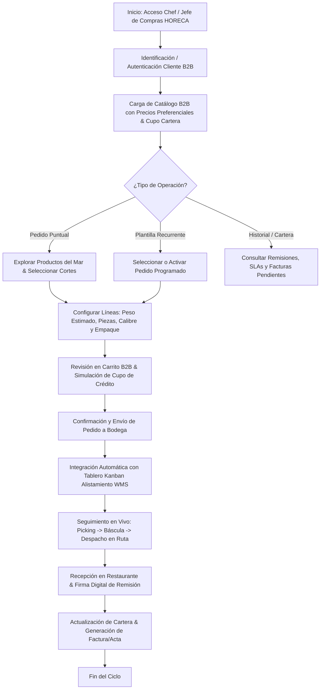
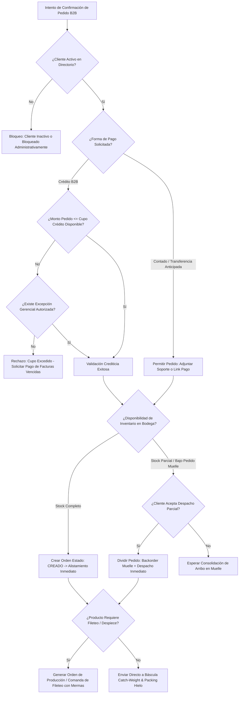
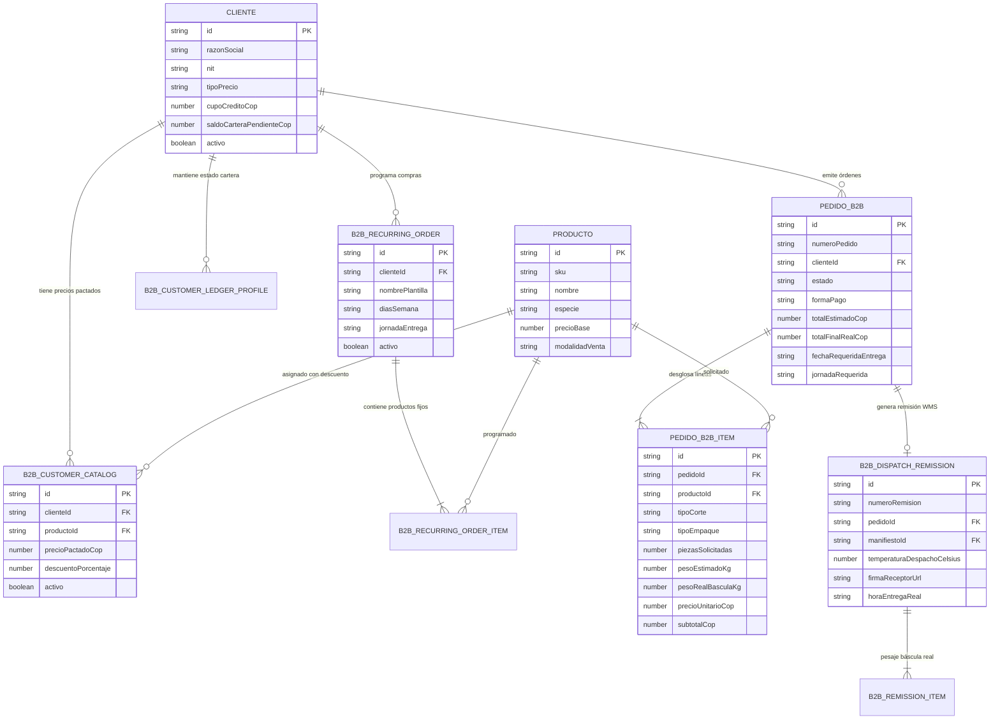
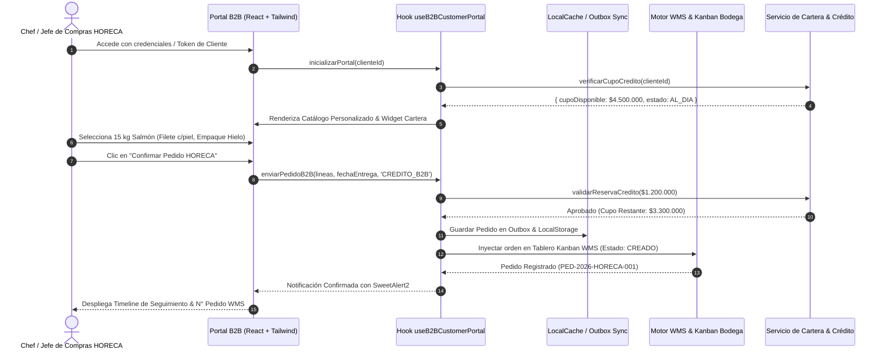
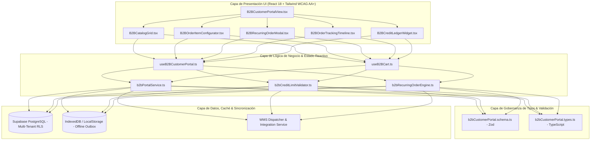

# Especificación Técnica: SPEC-027 — Portal de Clientes B2B Auto-Servicio HORECA

**Estado:** EN ESPECIFICACIÓN (Fase 1: /speckit.specify)  
**Fecha:** 2026-10-23  
**Autores:** Equipo de Arquitectura La Pezcadería ERP & Agency Swarm + Google Harness²  
**Gobernanza:** SDD v3.0 | Protocolo Brownfield v2.2 | WCAG 2.2 AA+ Light Mode & Ergonomía Táctil  

---

## 1. El "Por Qué" (Objetivo de Negocio y Justificación)
Actualmente, los clientes del canal HORECA (Hoteles, Restaurantes, Casinos y Catering) tramitan sus pedidos de pescados y mariscos de forma telefónica o por mensajes de chat informal. Esto genera:
1. **Ineficiencias operativas:** Errores en digitación de calibres, cortes (filete, rodaja, eviscerado, entero) y modalidades de empaque.
2. **Incertidumbre en tiempos de entrega:** Los jefes de cocina desconocen si su pedido ya está en alistamiento, empaque con hielo o en ruta de frío.
3. **Fricción en cartera:** Falta de visibilidad de facturas pendientes, notas crédito por devoluciones y cupo de crédito disponible en tiempo real.

**Solución:** Un Portal B2B Web/Móvil Auto-Servicio optimizado para chefs, jefes de compras y administradores de cocina, con catálogo de precios preferenciales según contrato, pedidos recurrentes programables, trazabilidad en vivo de remisiones y balance financiero de cuenta corriente.

---

## 2. El "Qué" (Alcance Funcional y Reglas de Negocio)
1. **Autenticación y Aislamiento Multi-Tenant / Multi-Cliente:**
   - Selección o autenticación por NIT/Código de Cliente HORECA.
   - Aislamiento estricto de catálogo y precios preferenciales pactados (`tipoPrecio`: RESTAURANTE, MAYORISTA, ESPECIAL).
2. **Catálogo de Pescados & Mariscos B2B con Calibres y Cortes:**
   - Visualización de disponibilidad física y comprometida.
   - Selector táctil de corte: *Entero Eviscerado*, *Filete con Piel*, *Filete sin Piel*, *Rodajas*, *Porciones Catch-Weight*.
   - Selector de empaque: *Caja Térmica con Hielo*, *Bolsa al Vacío*, *Canastilla Plástica Retornable*.
3. **Motor de Pedidos Recurrentes (Plantillas HORECA):**
   - Configuración de compras fijas programadas (ej: "Lunes y Jueves - 30 kg Trucha + 20 kg Salmón").
   - Activación, pausa y edición táctil con 1 clic.
4. **Trazabilidad de Remisiones WMS y Cadena de Frío:**
   - Visualización del estado del pedido en tiempo real: `CREADO` $\rightarrow$ `EN_ALISTAMIENTO` $\rightarrow$ `EN_BASCULA_PACKING` $\rightarrow$ `EN_RUTA_FRIO` $\rightarrow$ `ENTREGADO`.
   - Consulta de temperatura de despacho y firma de remisión digital.
5. **Estado de Cuenta & Cartera B2B:**
   - Cupo de crédito total, saldo consumido y disponible.
   - Descarga de facturas electrónicas y actas de remisión en PDF.

---

## 3. Mandatorio Multi-Phase System Modeling (Mermaid.js)

### Diagrama 1: Flujo de Procesos y Ciclo de Vida Secuencial (`1_process_flowcharts`)

### Diagrama 2: Lógica de Decisión con Rombos y Edge Cases (`2_decision_logic_diagrams`)

### Diagrama 3: Modelo Entidad-Relación (`3_entity_relationship_diagrams`)

### Diagrama 4: Diagrama de Secuencia Temporal (`4_sequence_diagrams`)

### Diagrama 5: Arquitectura por Capas (`5_component_architecture_diagrams`)

---

## 4. Criterios de Aceptación Preceptivos
1. **Multi-Tenant y Precios:** Ningún cliente puede ver precios de otros clientes.
2. **Corte y Empaque:** Cada ítem del pedido debe especificar el tipo de corte y empaque.
3. **Control de Crédito:** No se permite tramitar pedidos que superen el cupo de crédito sin autorización previa.
4. **Ergonomía:** Interfaces táctiles ergonómicas ($\ge 48\text{ px}$) operables en tabletas de cocina.
5. **Calidad:** 100% tipado estricto TypeScript, 0 errores `tsc --noEmit` y cobertura unitaria $\ge 80\%$.
