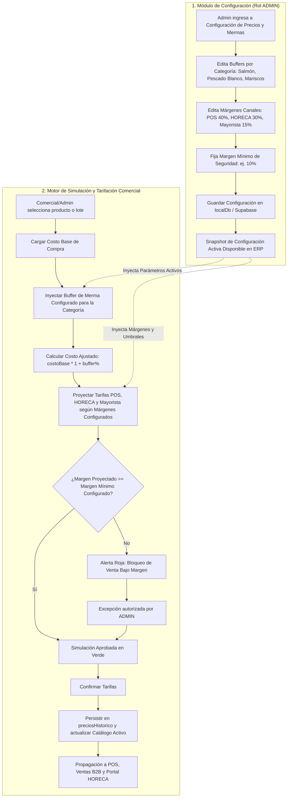
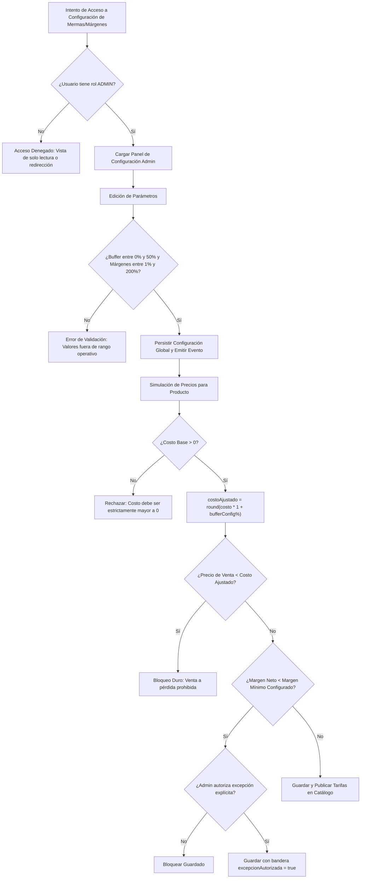
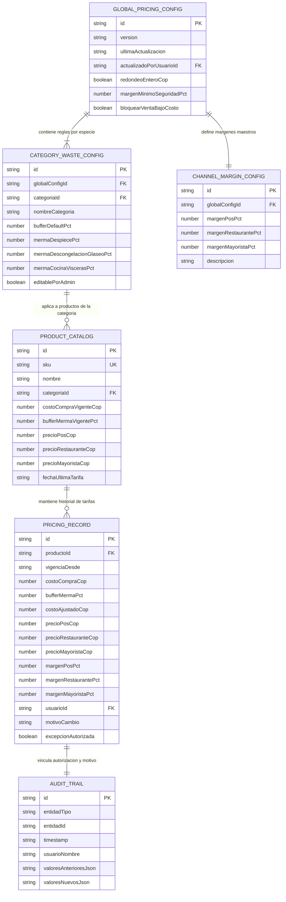
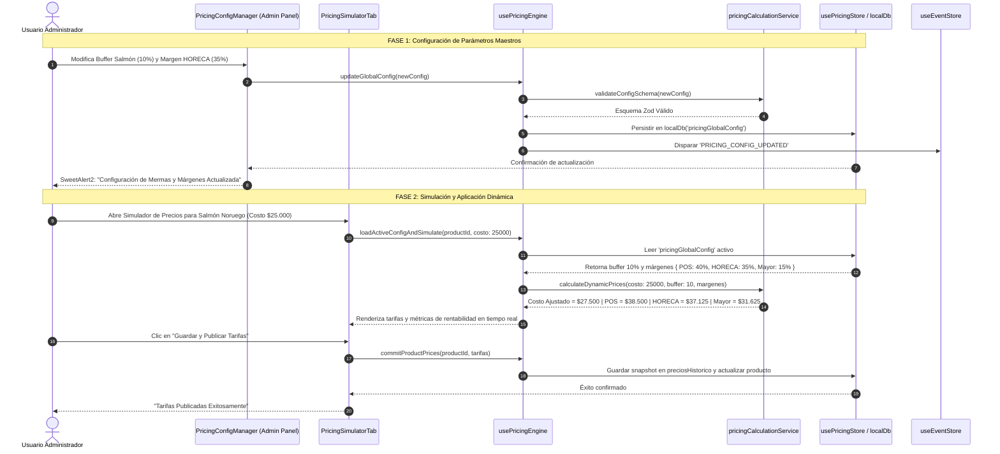
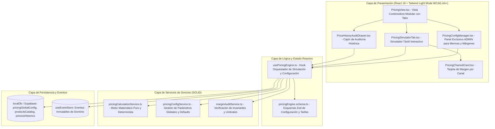

# Especificación de Requerimiento: SPEC-028 — Precios Dinámicos, Márgenes Multicanal y Módulo de Configuración de Mermas (Admin)

**Código:** SPEC-028  
**Fase:** /speckit.specify (SDD v3.0)  
**Dominio:** Comercial / Finanzas / Pricing / WMS  
**Estado:** PENDIENTE_APROBACION_USUARIO  
**Fecha:** 2026-10-24  
**Regla Constitucional:** PROHIBIDO escribir código de implementación en esta fase. Esperar aprobación formal del usuario.

---

## 1. Resumen Ejecutivo y Planteamiento del Problema ("Qué" y "Por qué")

### 1.1 Contexto y Necesidad
En el negocio de pescados y mariscos perecederos, el costo base de adquisición fluctúa diariamente en muelle/puerto según la captura, el hielo, la temporada y la merma de transporte. Además, la comercialización de productos del mar implica una merma natural inevitable (por despiece, vísceras, escamas o descongelación pasiva) estimada típicamente entre el 3% y el 15%.

**Directiva Mandatoria del Usuario:**
> *"Todos los valores de buffer, mermas y demás deben estar en un módulo de configuración donde se puedan editar a consideración del usuario Admin."*

Por consiguiente, este módulo NO contendrá valores hardcodeados en el código. Toda variable (buffers por especie/categoría, márgenes por canal, umbrales de alerta y reglas de redondeo) será administrable y configurable dinámicamente desde un panel de control exclusivo para usuarios con rol `ADMIN`.

### 1.2 Objetivo de SPEC-028
Construir el ecosistema integral de **Precios Dinámicos, Simulación de Márgenes Multicanal y Módulo Centralizado de Configuración de Mermas**:
1. **Módulo de Configuración de Precios y Mermas (Admin Only):**
   - Interfaz visual para parametrizar buffers de merma por categoría/especie (despiece, desvicerado, descongelación).
   - Parametrización de márgenes objetivo por canal de venta:
     - Canal POS / Mostrador (ej. 40%).
     - Canal Restaurante / HORECA (ej. 30%).
     - Canal Mayorista / Institucional (ej. 15%).
     - Margen mínimo de seguridad / umbral de bloqueo (ej. 10%).
   - Auditoría de modificaciones de configuración con timestamp y usuario responsable.
2. **Motor Determinista de Cálculo (`pricingCalculationService.ts`):**
   - Consumo dinámico de los parámetros configurados por el Admin.
   - Fórmula determinista de costo ajustado por merma y proyección de tarifas con redondeo al peso entero COP.
3. **Simulador Reactivo Multicanal:**
   - Vista en tiempo real para gerentes comerciales con semáforos de ganancia, alertas de venta bajo costo y aplicación individual o en lote.

---

## 2. Requisitos EARS (Easy Approach to Requirements Syntax)

- **[EARS-028-01 Parametrización Centralizada Admin]:** MIENTRAS un usuario con rol `ADMIN` acceda a la pestaña/módulo **"Configuración de Precios y Mermas"**, el sistema PERMITIRÁ crear, editar, activar o restaurar los parámetros globales:
  - Buffers de merma por categoría/especie (% despiece, % descongelación, % total).
  - Márgenes objetivo por defecto para cada canal de venta (POS %, HORECA %, Mayorista %).
  - Umbral mínimo de rentabilidad permitido (% margen de seguridad).
  - Regla de redondeo matemático para moneda COP (al entero más cercano).

- **[EARS-028-02 Ubicuo]:** El sistema SIEMPRE calculará el **Costo Ajustado por Merma** mediante la fórmula matemática basada en los parámetros activos configurados por el Admin:
  `costoAjustado = Math.round(costoCompra * (1 + bufferSeguridadConfiguradoPct / 100))`
  redondeado al entero más cercano en COP.

- **[EARS-028-03 Basado en Estado]:** MIENTRAS el usuario comercial interactúe con el simulador de precios y modifique el costo base de compra o ajuste un producto, el sistema recalculará en tiempo real (<50ms) los precios de venta sugeridos para los 3 canales utilizando los márgenes parametrizados:
  - Canal POS: `precioPos = Math.round(costoAjustado * (1 + margenPosConfiguradoPct / 100))`
  - Canal HORECA: `precioRestaurante = Math.round(costoAjustado * (1 + margenRestauranteConfiguradoPct / 100))`
  - Canal Mayorista: `precioMayorista = Math.round(costoAjustado * (1 + margenMayoristaConfiguradoPct / 100))`

- **[EARS-028-04 Manejo de Errores / No Deseado]:** SI el precio fijado para cualquier canal resulta menor que el `costoAjustado` o genera un margen de utilidad menor al `margenMinimoSeguridadPct` configurado en el panel Admin, ENTONCES el sistema mostrará un distintivo cromático de advertencia severa en rojo (`#DC2626`) y bloqueará el guardado a menos que un usuario con rol `ADMIN` autorice la excepción explícitamente.

- **[EARS-028-05 Evento de Negocio]:** CUANDO el administrador guarde cambios en el módulo de configuración de mermas o en las tarifas de un producto, el sistema persistirá los datos en `localDb` / Supabase, emitirá un evento inmutable en `useEventStore` y actualizará en caliente todos los componentes dependientes sin requerir recargar la página.

- **[EARS-028-06 Seguridad y RBAC]:** SI un usuario con rol distinto a `ADMIN` (ej. `CAJERO`, `VENDEDOR`) intenta acceder al panel de configuración de mermas o editar los parámetros maestros, el sistema RESTRINGIRÁ el acceso, ocultará los controles de edición y limitará la vista a solo lectura o al rol comercial permitido.

---

## 3. Mandatory Multi-Phase System Modeling (Mermaid.js)

### Diagrama 1: Flujo de Procesos y Ciclo de Vida Secuencial (`1_process_flowcharts`)



---

### Diagrama 2: Rombos de Decisión y Edge Cases (`2_decision_logic_diagrams`)



---

### Diagrama 3: Modelo Entidad-Relación (`3_entity_relationship_diagrams`)



---

### Diagrama 4: Diagrama de Secuencia Temporal (`4_sequence_diagrams`)



---

### Diagrama 5: Arquitectura por Capas (`5_component_architecture_diagrams`)



---

## 4. Criterios de Aceptación (Gherkin)

```gherkin
Escenario: Configuración administrativa dinámica de mermas y márgenes
  Dado que un usuario con rol "ADMIN" ingresa a la pestaña de "Configuración de Mermas y Márgenes"
  Cuando actualiza el buffer de merma para "Salmón y Pescado Graso" al 12%
  Y actualiza el margen comercial para canal HORECA al 35%
  Y presiona "Guardar Configuración Maestra"
  Entonces los nuevos parámetros deben persistirse en "pricingGlobalConfig"
  Y cualquier simulación posterior para productos de esa categoría debe utilizar el 12% de buffer y 35% de margen sin requerir recarga

Escenario: Restricción de acceso a configuración para usuarios no administradores
  Dado que un usuario tiene rol "VENDEDOR" o "CAJERO"
  Cuando navega al módulo de Precios
  Entonces la pestaña "Configuración de Mermas y Márgenes" debe estar oculta o en modo de solo lectura
  Y cualquier intento de mutación debe ser rechazado con error de permisos

Escenario: Cálculo dinámico de costo ajustado con parámetros del Admin
  Dado un costo base de compra de 20.000 COP
  Y una configuración activa con buffer de merma del 10%
  Y márgenes de POS (+40%), HORECA (+30%) y Mayorista (+15%)
  Cuando el motor de precios evalúa el producto
  Entonces el costo ajustado por merma debe ser 22.000 COP (20.000 * 1.10)
  Y el precio POS debe ser 30.800 COP (22.000 * 1.40)
  Y el precio HORECA debe ser 28.600 COP (22.000 * 1.30)
  Y el precio Mayorista debe ser 25.300 COP (22.000 * 1.15)
  Y todos los valores deben estar redondeados al entero más cercano en COP

Escenario: Bloqueo estricto ante venta por debajo de costo ajustado
  Dado un costo ajustado de 22.000 COP
  Cuando el usuario comercial intenta digitar un precio de venta de 21.000 COP para Mayorista
  Entonces el sistema debe mostrar una alerta en rojo de "Venta Bajo Costo"
  Y deshabilitar el botón de guardado regular
```

---

## 5. Checkpoint de Control de Calidad SDD v3.0

Esta especificación formal integra de forma explícita el **módulo de configuración administrable para el usuario Admin**, eliminando cualquier valor hardcodeado en la lógica de negocio.

Siguiendo la gobernanza estricta:
- **No se ha generado ninguna línea de código de producción.**
- Se espera la confirmación explícita del usuario para avanzar al paso `/speckit.clarify` o `/speckit.checklist`.
