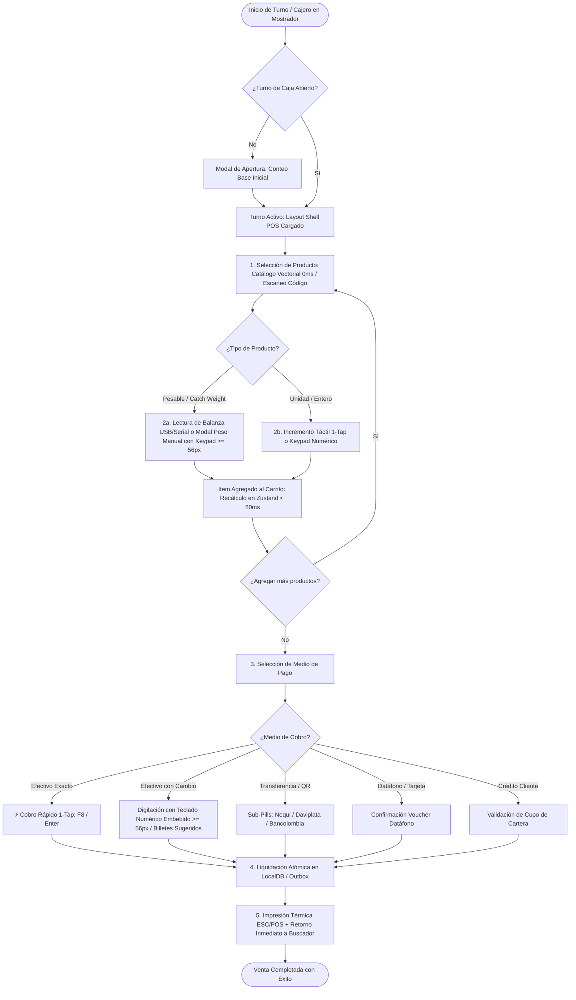
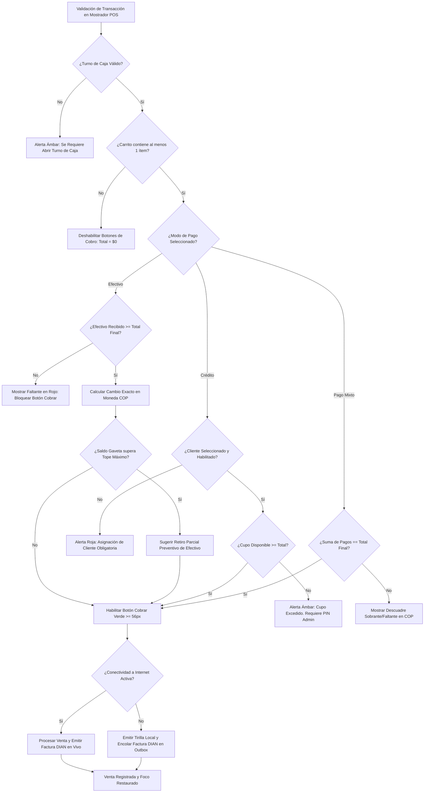
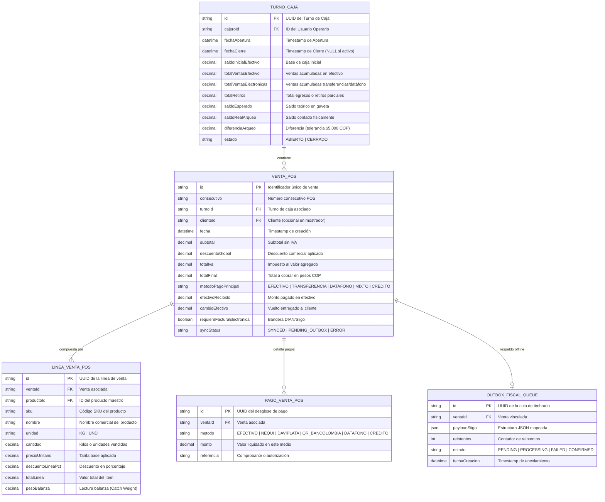
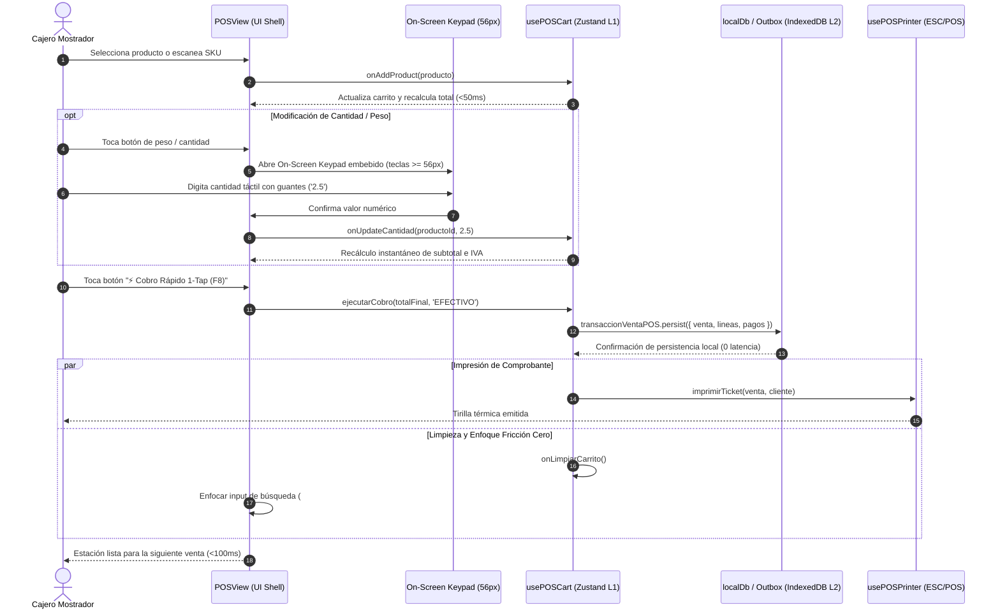

# Especificación de Requerimiento: SPEC-029 — Saneamiento UI/UX Industrial de Punto de Venta POS, Ergonomía Táctil y Keypad Numérico (Regla del Niño de 12 Años)

**Código:** SPEC-029  
**Fase:** /speckit.specify (SDD v3.0)  
**Dominio:** Ventas POS / Mostrador / UI-UX Industrial / Caja  
**Estado:** PENDIENTE_APROBACION_USUARIO  
**Fecha:** 2026-10-26  
**Directiva Base:** DTV-UIUX-2026-001-UNIVERSAL (.agent/rules/industrial-uiux-directive.md)  
**Regla Constitucional:** PROHIBIDO escribir código de implementación en esta fase. Esperar aprobación formal del usuario.

---

## 1. Resumen Ejecutivo y Planteamiento del Problema ("Qué" y "Por qué")

### 1.1 Contexto y Necesidad Operativa
En el mostrador de venta directa de **La Pezcadería ERP**, el cajero y el despachador atienden clientes con rapidez crítica, manipulando productos húmedos, canastillas frías y balanzas industriales. Actualmente, la interfaz de Punto de Venta (`POSView.tsx`, `CartPanel.tsx`, `PaymentPanel.tsx`):
1. **Saturación Cognitiva y Acciones Dispersas:** Múltiples botones secundarios compiten visualmente con el flujo principal de cobro, violando la Ley de Hick y la Regla del Niño de 12 Años.
2. **Ergonomía Táctil Inconsistente:** Algunos controles numéricos y chips de denominaciones tienen alturas inferiores a $48\text{ px}$ o $52\text{ px}$, dificultando el toque certero con guantes o dedos húmedos en pantallas táctiles de mostrador.
3. **Falta de Keypad Táctil Embebido On-Screen Universal:** La edición de cantidades en línea o pesos manuales depende en ocasiones del teclado del sistema operativo (que cubre media pantalla) en lugar de un teclado numérico táctil embebido propio del ERP con teclas gigantes ($\ge 56\text{ px}$).
4. **Contraste y Estética de Tarjetas KPI:** Necesidad de alinear el encabezado y KPIs al estándar Light Mode WCAG 2.2 AAA (fondo blanco, cifras en `text-slate-900 font-black font-mono`, ratio $\ge 12:1$).
5. **Type-Safety de Rutas:** Presencia de magic strings de navegación (`'precios'`, `'dashboard'`) en lugar del enum canónico `AppRouteId`.

### 1.2 Objetivo de SPEC-029 (Sprint 3 POS)
Transformar el módulo de Punto de Venta en una estación de trabajo táctil de grado industrial bajo los siguientes pilares:
1. **Standard Layout Shell Canónico:**
   - **Zona 1 (Header):** Breadcrumb limpio (`ERP > Ventas > Punto de Venta`), título principal y 1 solo badge semántico dinámico de turno (`Turno #X - Abierto / Cerrado`).
   - **Zona 2 (Barra de Control - Regla de Máx. 3 Acciones Primarias):** 
     - Acción 1 (Primaria Verde): `Cobro Rápido 1-Tap` o `Nuevo Pedido`.
     - Acción 2 (Secundaria Neutra): `Poner en Espera (Borrador)`.
     - Acción 3 (Especial Cian): `Lectura Balanza / Peso Manual`.
     - Dropdown Accesible **"Más Acciones..."**: `Arqueo Parcial`, `Cerrar Turno`, `Reimprimir Último Ticket`, `Historial Ventas`, `Resolución DIAN / Siigo`.
   - **Zona 3 (Tarjetas KPI Alto Contraste Light Mode):** 4 tarjetas limpias: Total Vendido Turno, Efectivo en Gaveta, Ventas Realizadas, Tickets Pendientes / Outbox.
   - **Zona 4 (Espacio de Trabajo):** Catálogo de Productos Vectorial + Carrito Táctil de Alta Densidad + Panel de Pago Unificado.
2. **On-Screen Keypad Táctil Gigante ($\ge 56\text{ px}$):**
   - Teclado numérico táctil integrado para digitación instantánea de cantidades, pesos y efectivo recibido.
   - Botones directos para denominaciones colombianas ($2k, $5k, $10k, $20k, $50k, $100k), botón "Exacto" a 1-tap y selector de unidad (Kg / Und).
3. **Cero Imágenes Estricto (Zero-Cost Vector Graphics):**
   - Asegurar `vectorOnly={true}` en todos los avatares de producto, renderizando SVG puros con Lucide React (`Fish`, `Waves`, `UtensilsCrossed`, `Snowflake`, `Package`).
4. **Type-Safety Estricto de Rutas:**
   - Erradicar magic strings de navegación mediante `AppRouteId.PRICING` y `AppRouteId.DASHBOARD`.

---

## 2. Requisitos EARS (Easy Approach to Requirements Syntax)

- **[EARS-029-01 Ubicuo - Ergonomía Táctil]:** El sistema SIEMPRE renderizará botones de acción primaria con una altura mínima de $56\text{ px}$ (`min-h-[56px]`) y botones secundarios o chips con un mínimo de $48\text{ px}$ (`min-h-[48px]`), garantizando un espaciado táctil mínimo de $8\text{ px}$ entre áreas de toque activo.
- **[EARS-029-02 Basado en Estado - Layout Shell]:** MIENTRAS la vista `POSView` esté activa, el sistema desplegará el Layout Shell Canónico con máximo 3 botones primarios en la barra superior, agrupando todas las operaciones secundarias de caja y auditoría dentro del menú desplegable accesible `"Más Acciones..."`.
- **[EARS-029-03 Evento - Cobro 1-Tap]:** CUANDO el cajero presione el botón `⚡ Cobro Rápido 1-Tap (F8)` en una venta en efectivo exacto, el sistema liquidará la venta, actualizará el stock en Zustand local (<50 ms), imprimirá la tirilla térmica y reenfocará el buscador de productos para la siguiente venta en menos de 100 ms.
- **[EARS-029-04 Opcional - On-Screen Keypad]:** DONDE se requiera capturar o ajustar la cantidad o peso de un ítem en mostrador sin recurrir al teclado nativo del sistema operativo, el sistema MOSTRARÁ el teclado táctil numérico embebido con teclas $\ge 56\text{ px}$, botón de retroceso (`Backspace`), punto decimal y confirmación inmediata.
- **[EARS-029-05 Manejo de Errores - Stock Flotante]:** SI una venta mostrador se procesa en modo fuera de línea (jaula de Faraday / pérdida de red) y el producto perecedero físico existe en mostrador, ENTONCES el sistema registrará la venta emitiendo un distintivo ámbar, guardará la transacción en el Outbox de IndexedDB y mantendrá el flujo de atención sin bloquear al cliente.
- **[EARS-029-06 Type-Safety]:** El sistema SIEMPRE utilizará el enum `AppRouteId` para cualquier redirección o cambio de vista dentro de `POSView.tsx`, prohibiendo strings literales como `'precios'` o `'dashboard'`.

---

## 3. Modelado de Sistema Multi-Fase (Mermaid.js Mandatorio)

### 3.1. Diagrama 1: Flujo de Procesos (Secuencia Operativa de Venta POS)


---

### 3.2. Diagrama 2: Rombos de Decisión y Lógica Condicional (Edge Cases & Errores)


---

### 3.3. Diagrama 3: Modelo Entidad-Relación (ERD & Persistencia POS)


---

### 3.4. Diagrama 4: Diagrama de Secuencia Temporal (Cobro Rápido con Keypad Táctil)


---

### 3.5. Diagrama 5: Arquitectura de Componentes y Límites de Capas
```mermaid
graph TD
    subgraph CapaPresentacion [1. Capa de Presentación (UI & Ergonomía Táctil)]
        StandardShell[Standard Layout Shell: POSView.tsx]
        HeaderControl[Zona 1 & 2: Header + Barra Control máx 3 botones + Dropdown 'Más Acciones']
        KPITab[Zona 3: 4 Tarjetas KPI Alto Contraste Light Mode]
        WorkZone[Zona 4: Workspace de Mostrador]
        
        WorkZone --> ProductSearchPanel[ProductSearchPanel: Catálogo Vectorial 0ms]
        WorkZone --> CartPanel[CartPanel: Carrito Táctil Alta Densidad]
        WorkZone --> PaymentPanel[PaymentPanel: Cobro Rápido 1-Tap & Medios de Pago]
        
        CartPanel --> LineaVentaRow[LineaVentaRow: Ítems y Balanza Button]
        CartPanel --> KeypadEmbebido[On-Screen Keypad Component >= 56px]
        PaymentPanel --> KeypadEfectivo[Calculador de Cambio y Billetes Sugeridos]
    end

    subgraph CapaCasosUso [2. Capa de Casos de Uso & Estado Reactivo]
        usePOSCart[usePOSCart Hook: Estado Carrito & Cálculos < 50ms]
        useCashStore[useCashStore: Gestión de Turnos & Gaveta]
        useInventoryStore[useInventoryStore: Saldos Multibodega]
        useNetworkHeartbeat[useNetworkHeartbeat: Detección Offline/Online]
        usePOSPrinter[usePOSPrinter: Servicio Térmico ESC/POS]
    end

    subgraph CapaDominio [3. Capa de Dominio & Esquemas Tipados]
        POSSchemas[packages/validation-schemas: posCashEngine.schema.ts]
        AppRouteId[src/types/routes.types.ts: AppRouteId Enum]
        POSTypes[src/types/pos.types.ts: LineaVenta, MetodoCobroPos]
    end

    subgraph CapaAccesoDatos [4. Capa de Acceso a Datos & Resiliencia Offline]
        LocalDb[IndexedDB: localDb Service]
        OutboxQueue[Outbox Fiscal Queue: Respaldo Offline DIAN]
        SupabaseClient[Supabase Postgres: Sincronización Remota Asíncrona]
    end

    %% Relaciones entre capas
    StandardShell --> usePOSCart
    StandardShell --> useCashStore
    ProductSearchPanel --> useInventoryStore
    PaymentPanel --> usePOSPrinter
    PaymentPanel --> useNetworkHeartbeat

    usePOSCart --> POSSchemas
    StandardShell --> AppRouteId
    usePOSCart --> POSTypes

    usePOSCart --> LocalDb
    useCashStore --> LocalDb
    LocalDb --> OutboxQueue
    OutboxQueue -.->|Al volver conexión| SupabaseClient
```

---

## 4. Matriz de Componentes Afectados y Transformaciones Quirúrgicas

| Componente | Archivo | Estado Actual | Transformación SPEC-029 |
| :--- | :--- | :--- | :--- |
| **Shell POS** | `src/views/POSView.tsx` | Layout mixto con botones directos dispersos y magic strings `'precios'`, `'dashboard'`. | Implementar Layout Shell Canónico (Header limpio, máx 3 botones primarios, dropdown accesible "Más Acciones...", tarjetas KPI bimodal y type-safety con `AppRouteId`). |
| **Panel de Pago** | `src/views/pos/components/PaymentPanel.tsx` | Botones de métodos con `min-h-[50px]`, sub-pills `min-h-[44px]`. | Elevar botones a `min-h-[56px]`, sub-pills a `min-h-[48px]`, reforzar botón 1-Tap con feedback táctil inmediato. |
| **Carrito Mostrador** | `src/views/pos/components/CartPanel.tsx` | Panel extenso con controles táctiles estándar. | Integrar invocador para On-Screen Keypad propio, agilizar lectura de peso y eliminación de ítems con botones táctiles $\ge 48\text{ px}$. |
| **Keypad Táctil** | `src/views/pos/components/ManualWeightModal.tsx` | Teclado numérico con botones de `52px` y chips de `44px`. | Elevar teclas numéricas a `min-h-[56px]`, chips a `min-h-[48px]`, bloquear teclado nativo (`inputMode="none"`). |
| **Buscador de Productos** | `src/views/pos/components/ProductSearchPanel.tsx` | Tarjetas con `vectorOnly={true}` ya activo pero estilos inline residuales. | Saneamiento de estilos inline a clases Tailwind estándar, garantizando contraste WCAG 2.2 AAA. |

---

## 5. Criterios de Aceptación (Garantía de Calidad)

1. **CA-01 (Ergonomía Táctil):** Todo botón interactivo primario en `POSView`, `CartPanel` y `PaymentPanel` mide $\ge 56\text{ px}$ de altura; los controles secundarios y chips miden $\ge 48\text{ px}$.
2. **CA-02 (Barra de Control Canónica):** La barra superior de `POSView` contiene exactamente un máximo de 3 botones primarios visibles; el resto de acciones operativas están contenidas en el dropdown accesible "Más Acciones...".
3. **CA-03 (Tarjetas KPI Bimodal):** Las tarjetas métricas del encabezado POS tienen fondo blanco, tipografía monoespaciada legible para cifras con ratio de contraste $\ge 12:1$ (WCAG 2.2 AAA).
4. **CA-04 (Type-Safety de Navegación):** Cero ocurrencias de magic strings de navegación (`'precios'`, `'dashboard'`) en `POSView.tsx`; auditado por `audit-solid-boundaries.cjs`.
5. **CA-05 (Cero Imágenes):** El renderizado del catálogo POS está respaldado al 100% por `ProductAvatar` en modo `vectorOnly`, con 0 llamadas a imágenes rasterizadas.
6. **CA-06 (Compilación y Pruebas):** `tsc --noEmit` en 0 errores y suite de tests unitarios de componentes POS pasando al 100%.

---

## 6. Próximo Paso en el Flujo Preceptivo
> **ATENCIÓN:** De acuerdo con la regla constitucional del proyecto y el flujo Spec Kit (SDD v3.0), **NO se ha escrito ningún código de implementación**.
> El agente se detiene aquí y solicita la aprobación formal del usuario sobre esta especificación (`/speckit.specify`) para avanzar a la fase de clarificación y preguntas de calidad (`/speckit.clarify`).
