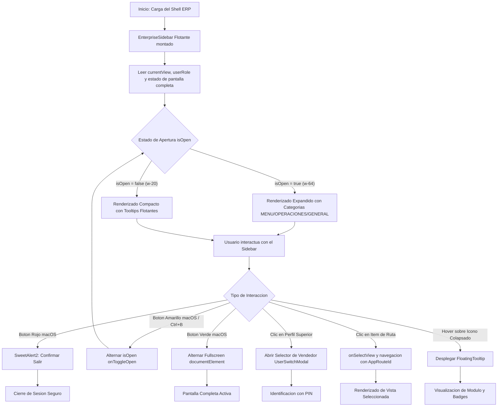
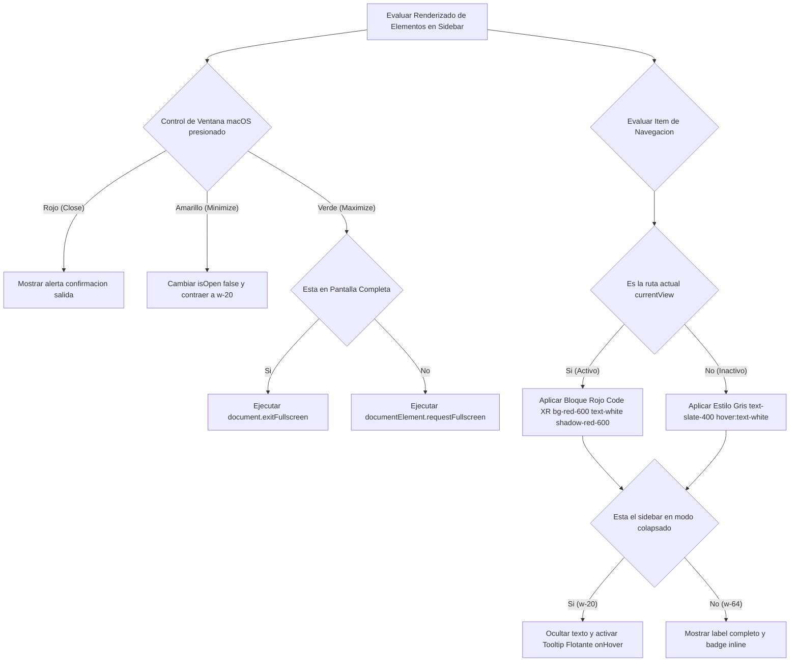
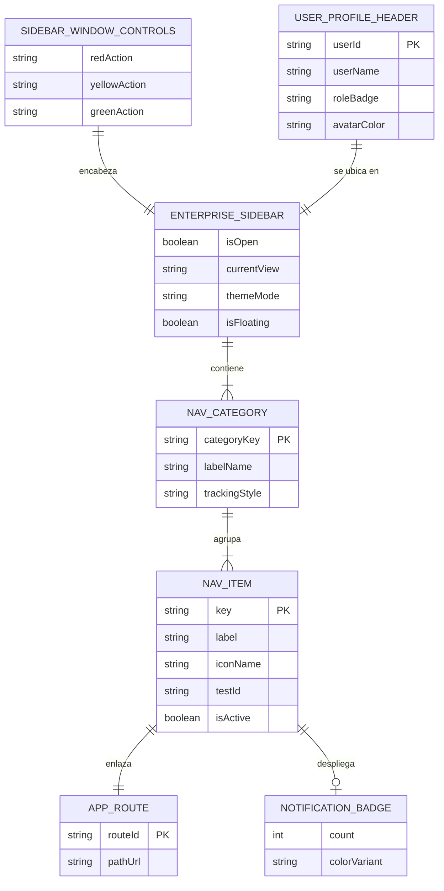
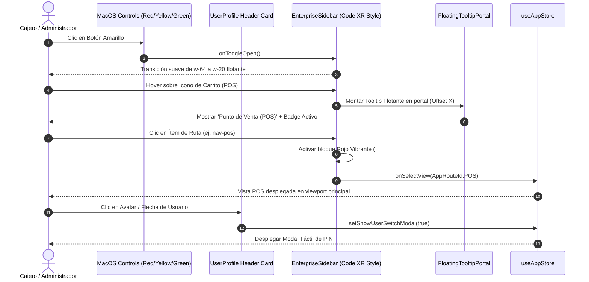
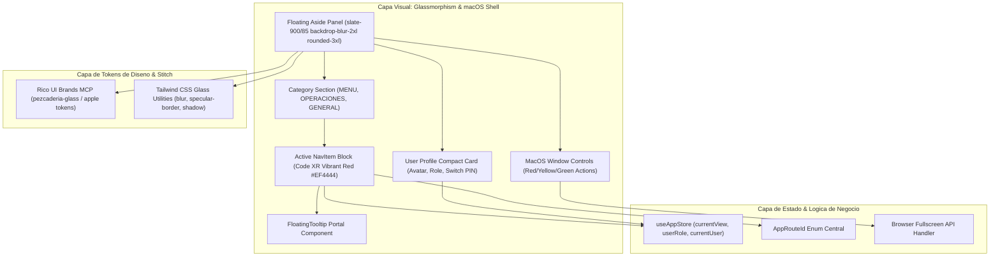

# Especificación Técnica: /speckit.specify (SPEC-030)

**Código:** SPEC-030  
**Ticket:** UIUX-SIDEBAR-FINAL  
**Título:** Implementación Definitiva: Premium Sidebar UI (Glassmorphism & macOS Style)  
**Dominio:** Shell de Navegación / UI-UX Industrial / Glassmorphism Dark Theme  
**Referencia:** SideBar UI por Code XR & Apple Pro UI Design System (Google Stitch / Rico UI Brands)  
**Estado:** PENDIENTE_APROBACION_USUARIO  
**Fecha:** 2026-10-26  
**Límite Kanban:** `WIP = 1` (Una sola tarea activa a la vez)  

---

## 1. Justificación y Objetivos de Producto (El "Qué" y el "Por Qué")

### 1.1 Contexto de Referencia Visual (Code XR & macOS Style)
El diseño implementa la versión definitiva de la barra lateral inspirada en el concepto **"SideBar UI"** de Code XR y los principios de diseño de interfaz de escritorio de macOS:
1. **Estética Glassmorphism / Panel Flotante:**
   - El sidebar flota sutilmente sobre el fondo con márgenes perimetrales (`inset-y-3 left-3 fixed` o `m-3`), bordes continuos suavizados (`rounded-3xl`), fondo oscuro translúcido (`bg-slate-900/85 backdrop-blur-2xl`), borde con brillo especular (`border border-white/12`) y sombras ambientales profundas (`shadow-2xl shadow-black/60`).
2. **Controles de Ventana macOS Funcionales:**
   - En la esquina superior izquierda se ubican tres botones circulares estilizados:
     - **Rojo (`#FF5F56`):** Confirmación para cerrar sesión / salir mediante SweetAlert2.
     - **Amarillo (`#FFBD2E`):** Colapsar / expandir el sidebar (atajo rápido equivalente a `Ctrl+B`).
     - **Verde (`#27C93F`):** Alternar modo Pantalla Completa nativa (`fullscreen`).
3. **Módulo de Usuario Superior Compacto:**
   - Inmediatamente debajo de los controles macOS: tarjeta de perfil compacta con avatar circular con halo de luz, nombre del usuario activo, badge de rol y selector emergente para cambio de vendedor / PIN.
4. **Arquitectura de Información Categorizada (Etiquetas de Alto Tracking):**
   - Agrupación por categorías en mayúsculas con bajo contraste y tracking amplio (`text-[10px] font-bold tracking-widest text-slate-400/80`):
     - **`MENU`:** Venta Rápida POS, Ventas B2B Bodega, Cotizaciones B2B, Directorio de Clientes.
     - **`OPERACIONES`:** Bodegas & WMS, Alistamiento B2B, Despachos & Rutas, Alquiler Cuarto Frío, Métricas OTIF, Compras Muelle, Producción & Despiece.
     - **`GENERAL`:** Caja Disponible, Cartera & Cuentas, Nómina & RRHH, Configuración de Bodegas / Siigo.
5. **Iconografía y Estado Activo de Alto Contraste (Rojo Vibrante de Code XR):**
   - **Inactivo:** Icono y etiqueta en gris tenue (`text-slate-400 hover:text-white hover:bg-white/5 transition-all`).
   - **Activo:** Bloque completo en color de acento rojo vibrante de Code XR (`bg-red-600 text-white font-bold shadow-lg shadow-red-600/30 rounded-xl`), con el icono en blanco puro, ocupando el ancho del panel para impacto y escaneo visual inmediato.
6. **Tooltips Interactivos Flotantes en Modo Colapsado (`w-20`):**
   - Al colapsar el menú, los iconos permanecen perfectamente centrados y, al pasar el cursor (`hover`), despliegan un tooltip flotante oscuro con glassmorphism que revela el nombre del módulo y su badge de alerta.

---

## 2. Modelado de Ingeniería de Sistemas (5 Diagramas Canónicos Mermaid)

### Diagrama 1: Flujo de Procesos y Ciclo de Vida (`1_process_flowcharts`)

---

### Diagrama 2: Lógica de Decisiones y Edge Cases (`2_decision_logic_diagrams`)

---

### Diagrama 3: Modelo Entidad-Relación (`3_entity_relationship_diagrams`)

---

### Diagrama 4: Diagrama de Secuencia Temporal (`4_sequence_diagrams`)

---

### Diagrama 5: Arquitectura de Componentes por Capas (`5_component_architecture_diagrams`)

---

## 3. Criterios de Aceptación y Validación

1. **Panel Flotante Glassmorphism:**
   - Flotante con margen perimetral (`left-3 top-3 bottom-3 fixed` o `m-3`), esquinas `rounded-3xl`.
   - `backdrop-blur-2xl bg-slate-900/85 border border-white/12 shadow-2xl shadow-black/50`.
   - Hardware accelerated: `transform: translateZ(0)`.
2. **Controles macOS Funcionales:**
   - Tres botones de 12px con colores exactos (`#FF5F56`, `#FFBD2E`, `#27C93F`).
   - Rojo: Diálogo SweetAlert2 para cerrar sesión.
   - Amarillo: Alternar colapso/expansión.
   - Verde: Alternar pantalla completa (`fullscreen`).
3. **Módulo de Usuario Superior:**
   - Inmediatamente debajo de los controles macOS en formato ultracompacto con selector accesible.
4. **Categorías Híbridas de Alto Tracking:**
   - Encabezados en mayúsculas `MENU`, `OPERACIONES`, `GENERAL` con `text-[10px] tracking-widest text-slate-400 font-bold`.
5. **Estado Activo Rojo Vibrante (Code XR):**
   - Ítem seleccionado con `bg-red-600 text-white font-bold shadow-lg shadow-red-600/30 rounded-xl`.
   - Ítems inactivos con `text-slate-400 hover:text-white hover:bg-white/5`.
6. **Tooltips Flotantes en Modo Colapsado (`w-20`):**
   - Tooltips interactivos flotantes al pasar el cursor en modo mini.
7. **Calidad y Verificación:**
   - `tsc --noEmit` en 0 errores.
   - Suite de pruebas de `enterpriseSidebar.test.tsx` 100% verde.
   - Bucle DevTools MCP en vivo con 0 errores en consola JS y móvil (375px).
