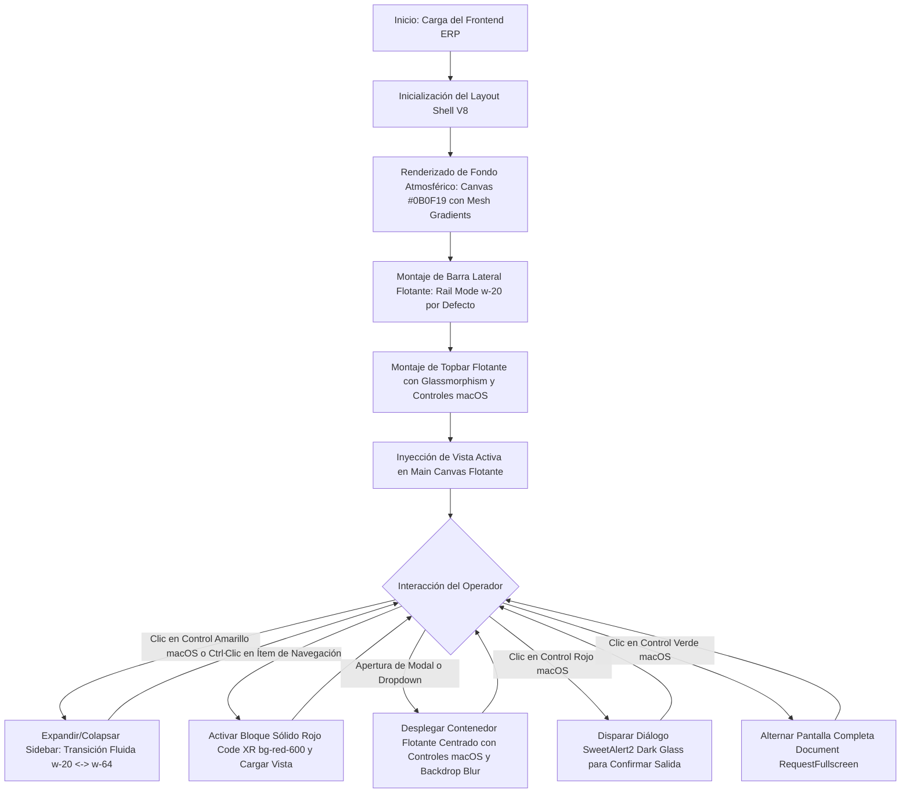
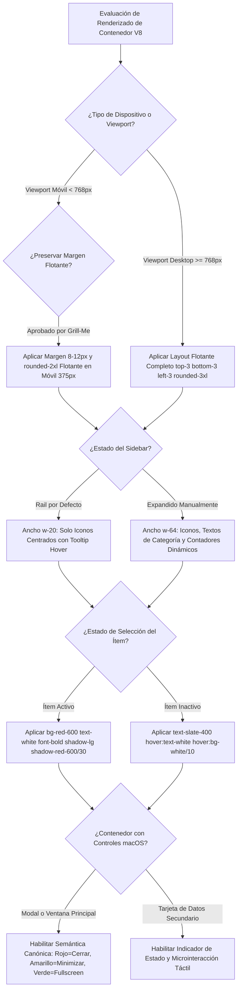
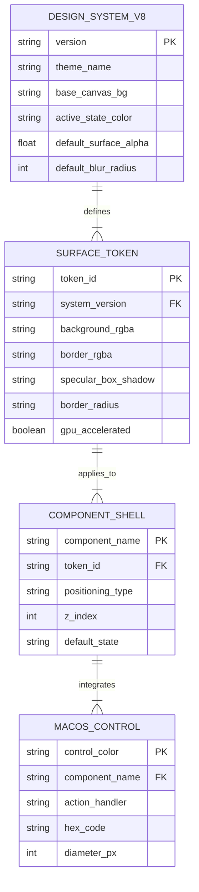
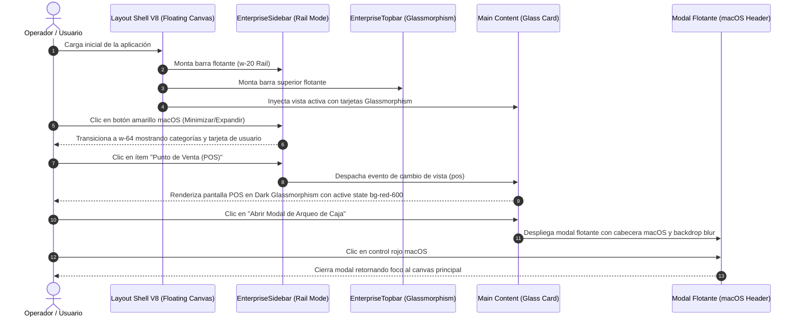
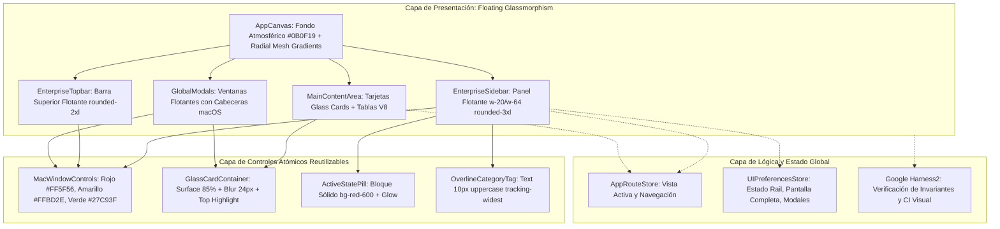

# Especificación de Requerimiento: /speckit.specify (SPEC-031)

**Código:** SPEC-031  
**Fase:** /speckit.specify (SDD v3.0)  
**Ticket:** EPIC-FRONTEND-GLASSMORPHISM-V8  
**Título:** Transformación Global del Frontend: Sistema de Diseño Premium (Glassmorphism & Dark UI V8)  
**Emisor:** Director de Agencia / Tech Lead  
**Receptores:** Equipo de Arquitectura Frontend, Equipo de Diseño UI/UX, Agentes de IA  
**Prioridad:** Máxima / Épica  
**Estado:** PENDIENTE_APROBACION_USUARIO  
**Fecha:** 2026-10-26  

---

## 1. El "Qué" y el "Por Qué" (Objetivo de la Épica)

### 1.1. Propósito de Negocio y Ergonómico
Escalar los conceptos de diseño del **Dashboard V8** (Glassmorphism, Dark UI, macOS Window Controls, Menú Flotante, Rail Navigation por defecto) aplicándolos de forma absoluta e innegociable a **TODO el frontend** de La Pezcadería ERP.
Se erradican los contenedores planos y los layouts pegados a los bordes de la pantalla. Todo el sistema se estructura sobre lienzos oscuros atmosféricos (`#0B0F19`), superficies flotantes translúcidas (`rgba(15, 23, 42, 0.85)` / `backdrop-blur-2xl`), controles de ventana macOS semánticos (`#FF5F56`, `#FFBD2E`, `#27C93F`), y estados activos en bloque de color sólido de altísimo contraste en **Rojo Vibrante Code XR (`bg-red-600` / `#EF4444`)**.

---

## 2. Multi-Phase System Modeling (5 Diagramas Mermaid Obligatorios)

### Diagrama 1: Flujo de Procesos y Ciclo de Vida Secuencial (Process Flowchart)

---

### Diagrama 2: Lógica de Decisiones y Casos Límite (Decision Logic Diagram)

---

### Diagrama 3: Modelo Entidad-Relación de Tokens y Componentes (ERD)

---

### Diagrama 4: Secuencia de Interacción Global (Sequence Diagram)

---

### Diagrama 5: Arquitectura de Componentes por Capas (Component Architecture)

---

## 3. Criterios de Aceptación Innegociables
1. **Glassmorphism Global:** 100% de los contenedores principales desacoplados de los bordes con `top-3 bottom-3 left-3` o `p-3/p-4`, esquinas `rounded-3xl` y superficies `bg-slate-900/85 backdrop-blur-2xl border-white/12`.
2. **Controles macOS:** Integrados en la barra lateral, cabecera superior y modales con acciones canónicas (Rojo=Cerrar, Amarillo=Minimizar, Verde=Fullscreen).
3. **Active State:** Bloque de color sólido rojo vibrante `bg-red-600` con texto e icono en blanco puro `text-white font-bold`.
4. **Validación DevTools:** Cero errores de consola JS y comprobación visual en móvil (375 px) y desktop (1440 px).
5. **Calidad de Código:** `tsc --noEmit` en 0 errores y 100% tests unitarios pasando.
