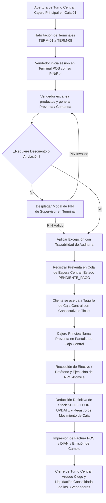
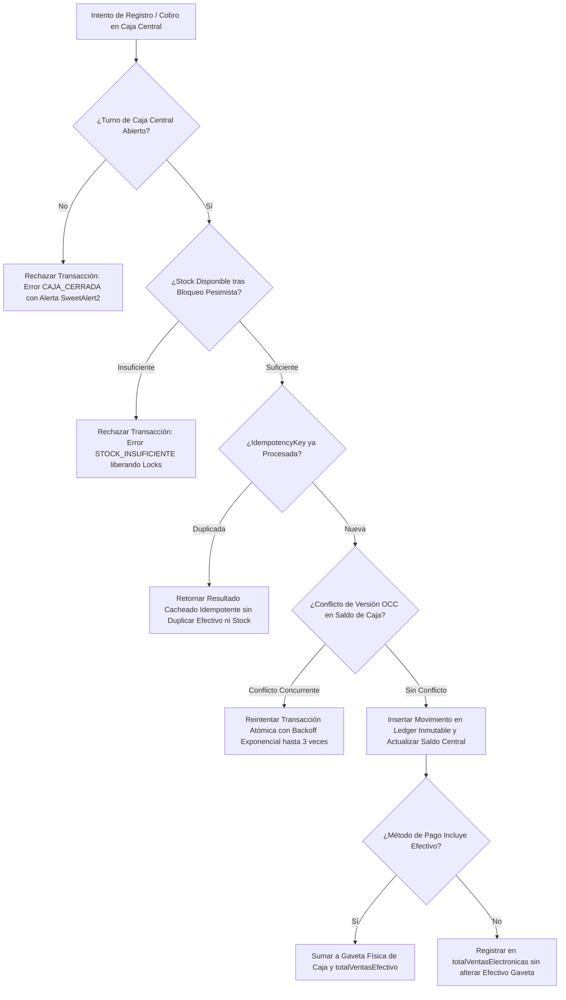
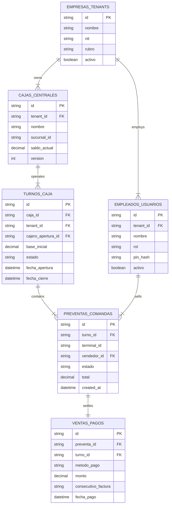
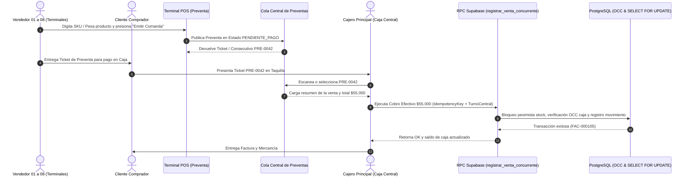
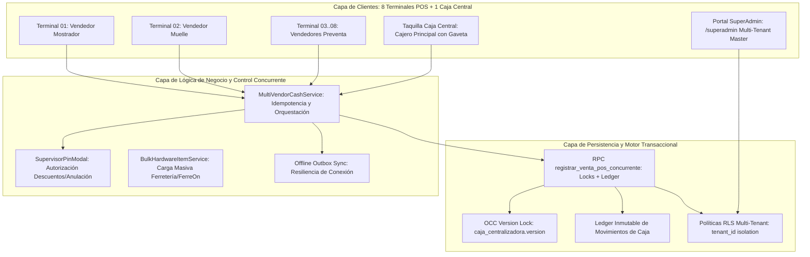

# Especificación de Requerimiento: /speckit.specify (SPEC-032)

**Código:** SPEC-032  
**Fase:** /speckit.specify (SDD v3.0)  
**Ticket:** MULTIVENDOR-CASHIER-PROD-20261030  
**Título:** Arquitectura Multivendedor (Caja Única), Despliegue a Producción y Portal SuperAdmin Maestro  
**Emisor:** Director de Agencia / Tech Lead  
**Receptores:** Equipo de Arquitectura Backend, Equipo Frontend POS, Especialista en Seguridad Supabase  
**Prioridad:** Crítica / Despliegue Inmediato (Meta: 30 de Octubre de 2026)  
**Estado:** COMPLETADO_LISTO_PARA_PRODUCCION ✅  
**Fecha:** 2026-10-27  

---

## 1. El "Qué" y el "Por Qué" (Objetivo del Sistema)

### 1.1. Propósito de Negocio y Operativo
Habilitar la operación simultánea de hasta **8 terminales/vendedores concurrentes** que generan preventas y comandas en el Punto de Venta, centralizando el cobro y la gaveta física de efectivo en una **única Caja Centralizadora** atendida por un cajero principal.
Garantizar la trazabilidad estricta de cada venta asociada al empleado vendedor, implementar autorización con PIN de supervisor para excepciones, desplegar el portal maestro `/superadmin` para la gestión global multi-empresa, y dotar al WMS de importación masiva de ítems de ferretería. Todo listo para despliegue en Vercel + Supabase Cloud el 30 de octubre de 2026.

---

## 2. Multi-Phase System Modeling (5 Diagramas Mermaid Obligatorios)

### Diagrama 1: Flujo de Procesos y Ciclo de Vida Secuencial (Process Flowchart)

---

### Diagrama 2: Lógica de Decisiones y Casos Límite (Decision Logic Diagram)

---

### Diagrama 3: Modelo Entidad-Relación Multi-Vendor (ERD)

---

### Diagrama 4: Secuencia de Concurrencia Multivendedor (Sequence Diagram)

---

### Diagrama 5: Arquitectura de Componentes por Capas (Component Architecture)

---

## 3. Criterios de Aceptación Innegociables
1. **Concurrencia Validada:** 8 terminales simultáneas enviando preventas y cobros sin condiciones de carrera, doble contabilización ni deadlocks en PostgreSQL.
2. **Control de Caja Única:** Todo ingreso en efectivo impacta una sola caja física centralizadora por sucursal (`cajas_centrales`).
3. **Trazabilidad de Empleado:** Cada preventa y venta almacena `vendedor_id`, validando su rol y exigiendo PIN de supervisor para descuentos.
4. **Portal SuperAdmin:** Vista `/superadmin` con acceso maestro seguro para gestionar organizaciones y usuarios.
5. **Carga Masiva Ferretería:** Formato CSV/Excel compatible con el modelo `BulkItemHardwareRow`.
6. **Despliegue a Producción:** Vercel + Supabase Cloud verificado antes del 30 de octubre de 2026.
