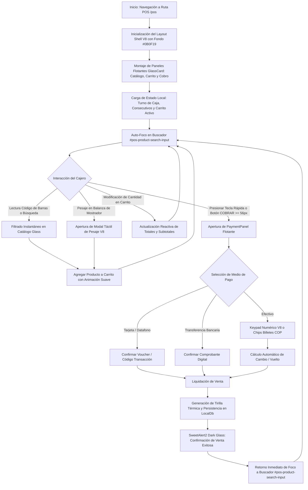
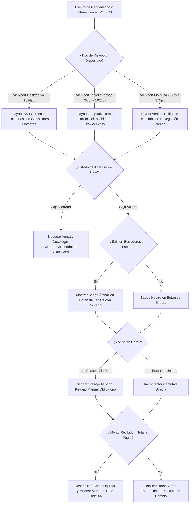
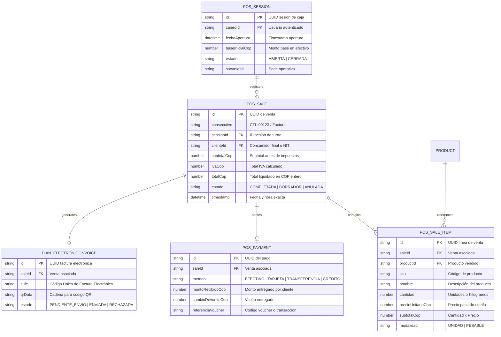
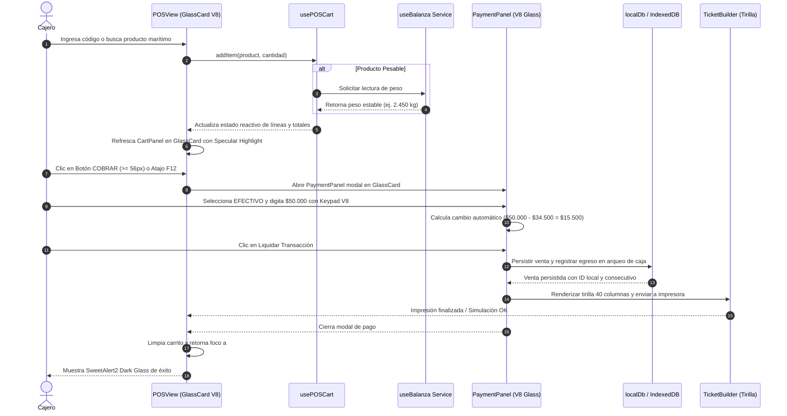
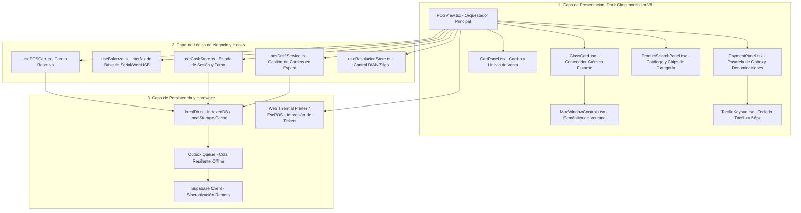

# Especificación de Requerimiento: /speckit.specify (SPEC-032)

**Código:** SPEC-032  
**Fase:** /speckit.specify (SDD v3.0)  
**Ticket:** POS-DARK-GLASSMORPHISM-V8  
**Título:** Migración del Módulo POS (Punto de Venta y Facturación) al Estándar Dark Glassmorphism V8  
**Emisor:** Tech Lead & Software Architect (Agency Swarm + Google Harness²)  
**Receptores:** Implementadores Frontend, Especialistas UI/UX, QA & Automation Engineers  
**Prioridad:** Alta (Core Operativo de Facturación de Mostrador)  
**Estado:** PENDIENTE_APROBACION_USUARIO  
**Fecha:** 2026-10-26  

---

## 1. El "Qué" y el "Por Qué"

### 1.1. Contexto y Justificación Operativa
Tras la culminación exitosa de la transformación del shell global del ERP bajo el estándar **Dark Glassmorphism V8** (SPEC-031), el canvas principal del sistema reside en un lienzo atmosférico oscuro (`#0B0F19`), con topbar flotante desacoplada y menú lateral en Rail Mode. 

Sin embargo, el módulo crítico de Punto de Venta (`POSView.tsx`) y sus submódulos (`CartPanel.tsx`, `PaymentPanel.tsx`, Keypad táctil, selector de báscula) utilizaban anteriormente contenedores de fondo plano claro o bordes rectos pegados a las márgenes, generando una disonancia visual y privando al cajero de la aceleración por hardware en GPU (`translateZ(0)`), el desenfoque gaussiano de alta fidelidad (`backdrop-blur-2xl`) y los controles de ventana estilo escritorio macOS (`#FF5F56`, `#FFBD2E`, `#27C93F`).

### 1.2. Alcance del Requerimiento
1. **Contenedor Principal `POSView`:** Reestructurar la vista en un ecosistema de paneles flotantes independientes `GlassCard` montados sobre el canvas `#0B0F19`.
2. **Panel de Búsqueda y Catálogo de Mostrador (`ProductSearchPanel` / Grid):** Encapsular la búsqueda y chips de categorías rápidas en paneles translúcidos con reflejo especular (`inset 0 1px 0 0 rgba(255, 255, 255, 0.15)`), manteniendo áreas táctiles $\ge 48\text{ px}$.
3. **Panel de Carrito y Líneas de Venta (`CartPanel`):** Integrar `GlassCard` con controles macOS semánticos (minimizar/expandir panel, badge dinámico de cantidad de ítems, tabla fluida con filas en `hover:bg-white/5` y tipografía financiera monoespaciada).
4. **Panel de Liquidación y Medios de Cobro (`PaymentPanel`):** Transformar el cuadrante de cobro, selector de método (Efectivo, Tarjeta, Transferencia, Crédito), botones de denominaciones rápidas COP ($10k, $20k, $50k, $100k) y botón gigante de cobro ($\ge 56\text{ px}$) al estándar V8.
5. **Keypad Numérico Táctil y Báscula:** Diseñar teclas táctiles de vidrio oscuro con estados activos de micro-animación física (`active:scale-95`), alto contraste WCAG AAA ($> 12:1$) y retorno automático de foco.
6. **Invariantes Funcionales Intactas:** 0 regresiones en `usePOSCart`, almacenamiento offline en IndexedDB / `localDb`, cálculos de redondeo COP a enteros, emisión de tirilla térmica 40 columnas y sincronización DIAN/Siigo.

---

## 2. Multi-Phase System Modeling (5 Diagramas Mermaid de Ingeniería)

### Diagrama 1: Flujo de Procesos y Ciclo de Vida Secuencial (Process Flowchart)

---

### Diagrama 2: Lógica de Decisiones y Casos Límite (Decision Logic Diagram)

---

### Diagrama 3: Modelo Entidad-Relación y Persistencia (ERD)

---

### Diagrama 4: Diagrama de Secuencia Temporal (Sequence Diagram)

---

### Diagrama 5: Arquitectura de Componentes y Límites de Capas (Component Architecture)

---

## 3. Criterios de Aceptación Innegociables (DoD)
1. **Estándar Visual V8:** El 100% de los contenedores de `POSView`, `CartPanel` y `PaymentPanel` deben utilizar `GlassCard` con `bg-slate-900/85`, `backdrop-blur-2xl`, borde `border-white/12` y aceleración `translateZ(0)`.
2. **Controles macOS Semánticos:** Cabeceras con botones de ventana funcionales (`#FF5F56` cerrar/salir con SweetAlert2, `#FFBD2E` colapsar/minimizar, `#27C93F` alternar fullscreen).
3. **Ergonomía Táctil del Niño de 12 Años:** Botones de acción principal $\ge 52\text{ px}$, teclas numéricas $\ge 56\text{ px}$, chips de categoría $\ge 48\text{ px}$, y retorno inmediato de foco a `#pos-product-search-input`.
4. **Cero Regresiones de Negocio:** 100% de la suite de pruebas unitarias y de integración de POS pasando en verde (122/122 archivos de test, 0 errores `tsc --noEmit`).
5. **Calidad de Código y SOLID:** Respeto estricto a las capas de arquitectura, sin lógica pesada dentro de JSX y separación limpia de subcomponentes.

---

**NOTA:** Esta especificación se entrega formalmente para la revisión y aprobación explícita del usuario antes de proceder a la siguiente fase (`/speckit.clarify`).
