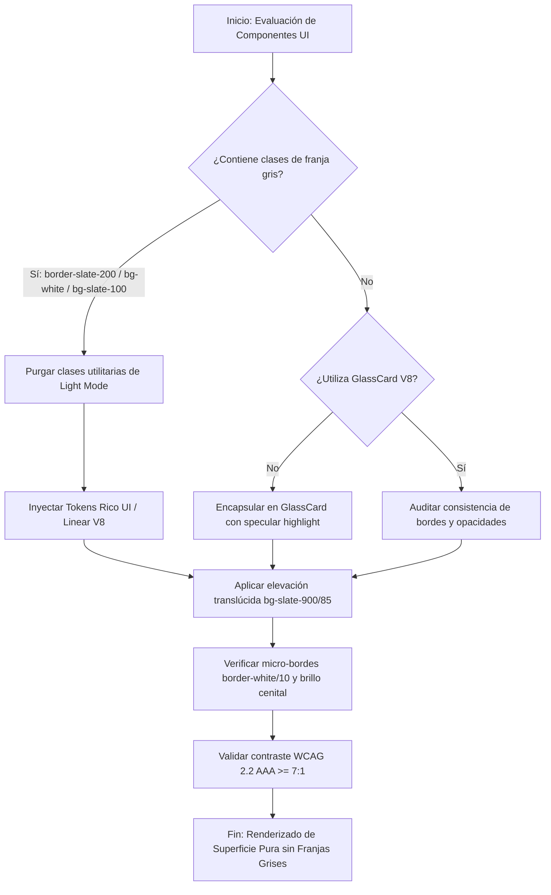
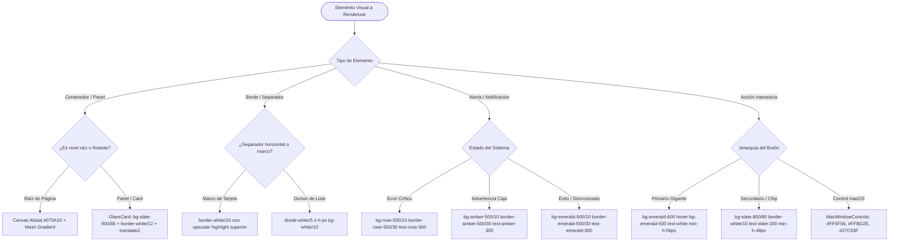
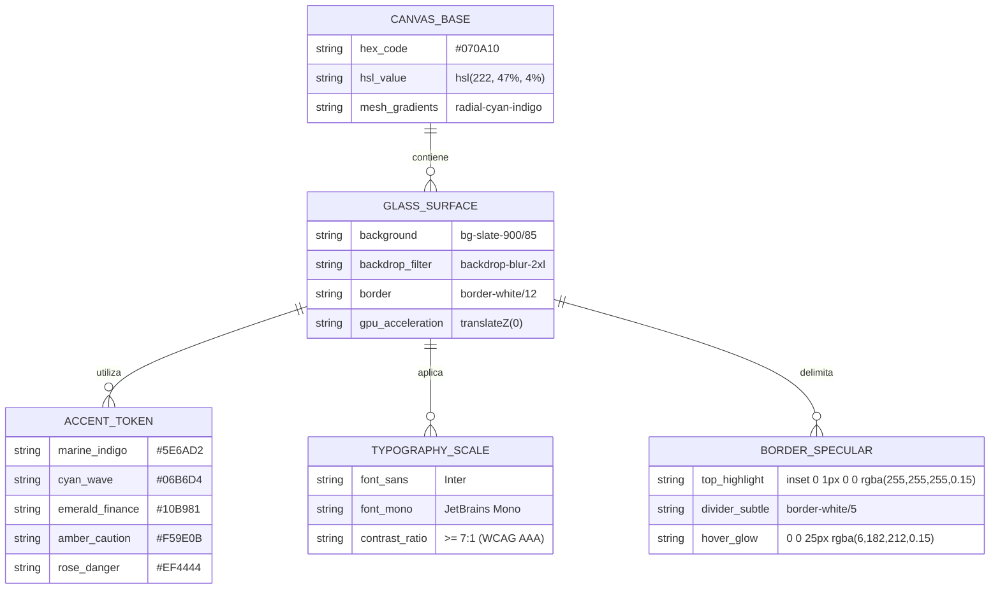
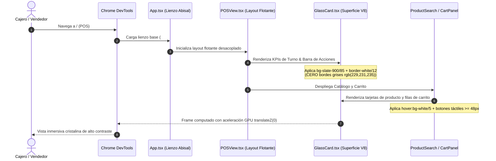
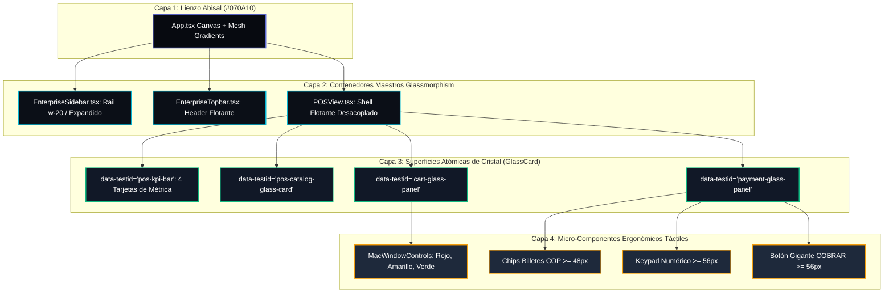

# Especificación de Requerimiento: SPEC-033 — Reestructuración Integral del Frontend (Erradicación de Franjas Grises y Normalización Visual V8)

**Fase:** /speckit.specify (SDD v3.0)  
**Ticket:** FRONTEND-PALETTE-REARCHITECT-V8  
**Fecha:** 2026-10-26  
**Estado:** PENDIENTE DE APROBACIÓN HUMANA  
**Política de Gobernanza:** Cero Código antes de Plan y Especificación Aprobados | Kanban WIP = 1  

---

## 1. Declaración del Problema & Propósito

### 1.1 El Problema ("Por Qué")
La evaluación especializada en vivo (mediante Chrome DevTools, extracción de DOM computado y el enjambre de arquitectura Agency Swarm + Google Harness²) confirmó la causa exacta de la insatisfacción visual manifestada por el usuario:
1. **Franjas Grises Rígidas y Disonantes (`rgb(229, 231, 235)`):**
   Múltiples contenedores, barras de control, inputs y tablas arrastran clases utilitarias heredadas de Tailwind pensadas para Light Mode (`border-slate-200`, `border-gray-200`, `divide-slate-200`, `bg-slate-100`, `bg-white`). Al renderizarse sobre el lienzo oscuro, estas clases generan bordes y franjas grises opacas de alto contraste que cortan la fluidez visual de la aplicación.
2. **Parches Cromáticos Amarillentos y Desentonados:**
   Banners de alerta o badges de estado aplican fondos claros (`bg-amber-50`, `rgb(255, 251, 235)`) con bordes amarillos opacos que parecen fallas de renderizado en lugar de componentes intencionales.
3. **Falta de Jerarquía Lumínica y Profundidad:**
   La convivencia de `bg-slate-900`, `bg-slate-800` y `bg-slate-950` genera un collage de grises sucios sin iluminación cenital ni profundidad óptica coherente.

### 1.2 La Solución ("Qué")
Reestructurar integralmente el frontend del ERP mediante:
1. **Lienzo Abisal Profundo:** Migrar el canvas base a `#070A10` / `#0B0F17` (negro azulado de ultra-baja luminancia), eliminando cualquier fondo gris plano.
2. **Erradicación Absoluta de Bordes Opacos:** Sustituir todo borde o franja gris por micro-membranas translúcidas (`border-white/10` y `border-white/12`) con specular highlight superior (`inset 0 1px 0 0 rgba(255, 255, 255, 0.12)`).
3. **Normalización Cromática de Marca (Rico UI Brands / Linear):**
   - **Superficies:** `bg-slate-900/85 backdrop-blur-2xl`.
   - **Primario / Acción:** Índigo Linear saturado (`#5E6AD2` / `bg-indigo-600 hover:bg-indigo-500`).
   - **Acento Oceánico:** Cian Neón (`#06B6D4` / `text-cyan-400 border-cyan-500/30`).
   - **Éxito / Valores Financieros:** Verde Esmeralda vibrante (`#10B981` / `text-emerald-400 font-mono`).
   - **Advertencias / Alertas:** Fondo ámbar oscuro translúcido (`bg-amber-500/10 border-amber-500/30 text-amber-300`).
4. **Preservación Incondicional de Lógica Operativa:** 0 cambios en Zustand stores, servicios, IndexedDB offline, redondeo COP sin decimales y suites de pruebas existentes.

---

## 2. Multi-Phase System Modeling (5 Diagramas Obligatorios Mermaid.js)

### Diagrama 1: Flujo de Procesos de Normalización de Tokens (`1_process_flowcharts`)

### Diagrama 2: Lógica de Decisión para Superficies y Estados (`2_decision_logic_diagrams`)

### Diagrama 3: Modelo Entidad-Relación de Tokens Visuales (`3_entity_relationship_diagrams`)

### Diagrama 4: Secuencia de Carga y Resolución Cromática (`4_sequence_diagrams`)

### Diagrama 5: Arquitectura de Componentes por Capas (`5_component_architecture_diagrams`)

---

## 3. Criterios de Aceptación (Definición de Terminado)
1. **0 Bordes Grises Opacos:** Ningún elemento del layout debe calcular `rgb(229, 231, 235)` ni clases `border-gray-200`/`border-slate-200` sobre fondos oscuros.
2. **0 Parches Claros en Alertas:** Banners y badges deben usar fondos oscuros translúcidos con acentos de color (`bg-amber-500/10 text-amber-300`, `bg-rose-500/10 text-rose-300`).
3. **Consistencia Cromática Rico UI / Linear:** Fondos de tarjeta unificados en `bg-slate-900/85 backdrop-blur-2xl border-white/12` con specular highlight superior.
4. **Ergonomía Táctil Intacta:** Botones $\ge 48\text{ px}$ y $\ge 56\text{ px}$, 0 etiquetas `` (vectores puros), tipografía monoespaciada en totales COP.
5. **Quality Gate:** `tsc --noEmit` en 0 errores, 100% tests unitarios/regresión en verde, y bucle Chrome DevTools certificado en 1440 px y 375 px.

---

> [!IMPORTANT]
> **Check de Gobernanza SDD v3.0:**  
> Esta especificación técnica base se presenta formalmente al usuario con los 5 diagramas de ingeniería. **No se generará ninguna línea de código hasta contar con la aprobación explícita de este documento.**
