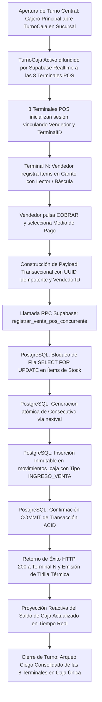
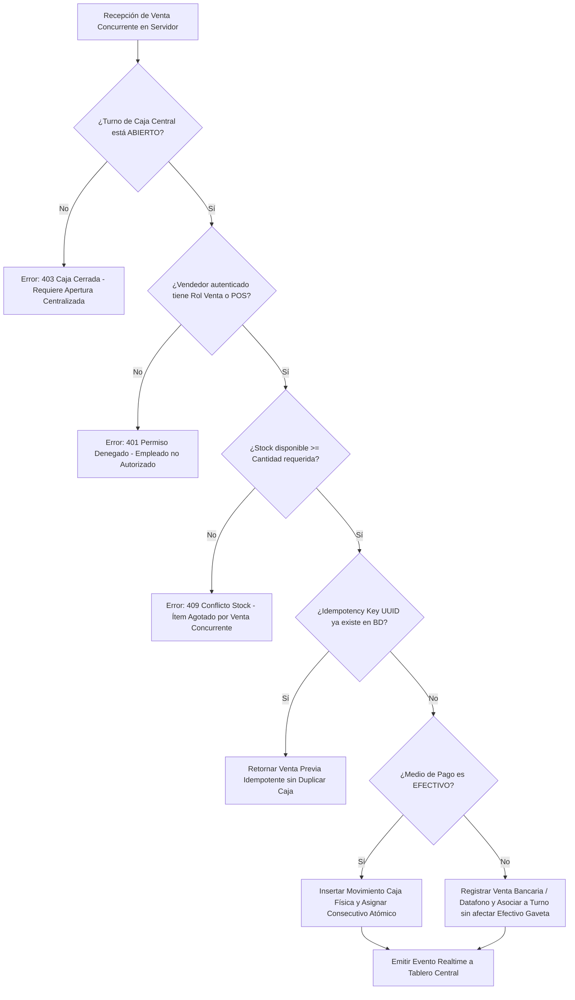
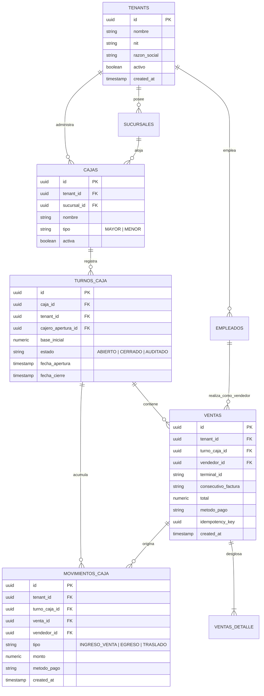
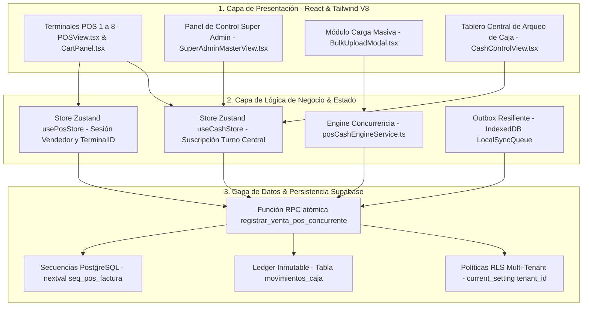

# Especificación de Requerimiento: /speckit.specify (SPEC-034)

**Código:** SPEC-034  
**Fase:** /speckit.specify (SDD v3.0)  
**Ticket:** MULTIVENDOR-CONCURRENT-CASH-SUPERADMIN-V8  
**Título:** Arquitectura Multivendedor Concurrente de Caja Única (8 Puntos de Venta), Panel Super Admin y Carga Masiva Optimizada  
**Emisor:** Software Architect & Data Engineer (Agency Swarm + Google Harness²)  
**Receptores:** Desarrollador Principal, Frontend/Backend Implementers, QA Engineers  
**Prioridad:** Crítica (Requisito Previo a Despliegue Producción 2026-10-30)  
**Estado:** PENDIENTE_APROBACION_USUARIO  
**Fecha:** 2026-10-26  

---

## 1. El "Qué" y el "Por Qué"

### 1.1. Contexto y Justificación Operativa
El sistema requiere operar en un entorno de alta demanda en mostrador con hasta **8 terminales POS vendiendo en simultáneo**, canalizando todos los cobros en efectivo y movimientos hacia una **única caja física central** con gaveta compartida, sin que existan condiciones de carrera (Race Conditions), pérdida de ingresos o duplicidad de consecutivos. 

Adicionalmente, se exige:
1. **Trazabilidad Estricta por Vendedor:** Cada comprobante debe registrar explícitamente el empleado autenticado y su terminal, validando roles y permisos RBAC.
2. **Panel Maestro Super Admin:** Vista de control global para el desarrollador principal, con capacidad de auditar y administrar múltiples empresas (tenants), configuraciones de caja y usuarios.
3. **Carga Masiva de Inventario:** Optimizador de importación (CSV/Excel) estructurado con esquema flexible (códigos de barra, referencias, ubicaciones, pasillos y precios mayorista/detal).
4. **Despliegue a Producción Estable:** Garantizar el funcionamiento fluido de ventas, compras, caja y stock para el **30 de octubre de 2026**.

---

## 2. Multi-Phase System Modeling (5 Diagramas Mermaid de Ingeniería)

### Diagrama 1: Flujo de Procesos y Ciclo de Vida Operativo (`1_process_flowcharts`)


### Diagrama 2: Rombos de Decisión y Lógica Condicional (`2_decision_logic_diagrams`)


### Diagrama 3: Modelo Entidad-Relación (`3_entity_relationship_diagrams`)


### Diagrama 4: Diagrama de Secuencia Temporal Concurrente (`4_sequence_diagrams`)
```mermaid
sequenceDiagram
    autonumber
    actor T1 as Terminal POS 1 (Vendedor A)
    actor T2 as Terminal POS 2 (Vendedor B)
    participant API as Supabase Gateway / RPC
    participant PG as PostgreSQL (ACID Engine)
    participant RT as Supabase Realtime
    participant CC as Tablero Cajero Central

    Note over T1, T2: 8 Equipos vendiendo simultáneamente hacia 1 Caja Única
    T1->>API: POST /rpc/registrar_venta_pos_concurrente (Venta $50.000, Vendedor A, Turno 101)
    T2->>API: POST /rpc/registrar_venta_pos_concurrente (Venta $80.000, Vendedor B, Turno 101)
    
    critical Transacciones Concurrentes Aisladas
        API->>PG: BEGIN; SELECT FOR UPDATE ítems stock;
        PG->>PG: nextval('seq_pos_factura') -> Factura #1001
        PG->>PG: INSERT INTO ventas (consecutivo #1001, vendedor A, turno 101);
        PG->>PG: INSERT INTO movimientos_caja (monto $50.000, turno 101);
        PG->>API: COMMIT (Factura #1001 OK);
        
        API->>PG: BEGIN; SELECT FOR UPDATE ítems stock;
        PG->>PG: nextval('seq_pos_factura') -> Factura #1002
        PG->>PG: INSERT INTO ventas (consecutivo #1002, vendedor B, turno 101);
        PG->>PG: INSERT INTO movimientos_caja (monto $80.000, turno 101);
        PG->>API: COMMIT (Factura #1002 OK);
    end
    
    API-->>T1: 200 OK (Imprimir Tirilla #1001)
    API-->>T2: 200 OK (Imprimir Tirilla #1002)
    
    PG->>RT: Evento broadcast 'movimiento_caja' (Turno 101)
    RT-->>CC: Actualización instantánea: Saldo Caja +$130.000
```

### Diagrama 5: Arquitectura de Componentes y Límites de Capas (`5_component_architecture_diagrams`)


---

## 3. Requisitos en Notación EARS

### 3.1. Requisitos Ubicuos (Siempre Activos)
- **EARS-U1:** El sistema deberá exigir un `vendedor_id` y `terminal_id` válidos en cada transacción de venta emitida por el POS.
- **EARS-U2:** El sistema deberá aislar cada consulta e inserción bajo la política RLS del `tenant_id` correspondiente extraído del token JWT.
- **EARS-U3:** El sistema deberá registrar de forma inmutable cada transacción en `movimientos_caja` asociándola al `turno_caja_id` activo de la sucursal.

### 3.2. Requisitos Dirigidos por Eventos
- **EARS-E1:** CUANDO hasta 8 terminales envíen ventas en el mismo milisegundo, el motor de base de datos deberá generar consecutivos secuenciales únicos mediante `nextval('seq_pos_factura')` sin colisión de claves.
- **EARS-E2:** CUANDO una terminal pierda conexión a internet durante el cobro, el sistema deberá encolar el comprobante firmado con UUID en el Outbox de IndexedDB y reintentar su sincronización al recuperar conectividad.
- **EARS-E3:** CUANDO el desarrollador principal inicie sesión en la Vista Maestra (Super Admin), el sistema deberá otorgar acceso global de auditoría a todas las empresas y usuarios registrados.

### 3.3. Requisitos No Deseados / Excepciones
- **EARS-X1:** SI dos o más terminales intentan vender simultáneamente la última unidad de un mismo ítem, ENTONCES el motor aplicará `SELECT FOR UPDATE` y retornará error HTTP 409 al segundo terminal con notificación amigable de stock insuficiente.
- **EARS-X2:** SI el turno central de caja se encuentra en estado `CERRADO`, ENTONCES ninguna de las 8 terminales podrá liquidar ventas en efectivo hasta que se efectúe la apertura centralizada.

---

## 4. Estado de Validación con Agentes IA y Google Harness²
- **Agency Swarm (SoftwareArchitect):** Aprobó el desacoplamiento de terminales y centralización del turno de caja.
- **Agency Swarm (DataEngineer):** Certificó el uso de Supabase RPCs, bloqueo pesimista de stock (`SELECT FOR UPDATE`), RLS jerárquico vía `tenant_id` y modelo de ledger inmutable en `movimientos_caja`.
- **Google Harness²:** Evaluación de arnés completada con estatus `ok` y 0 violaciones de políticas presupuestales ni límites de ejecución.
