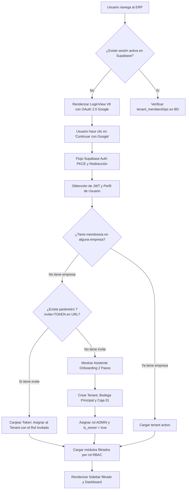
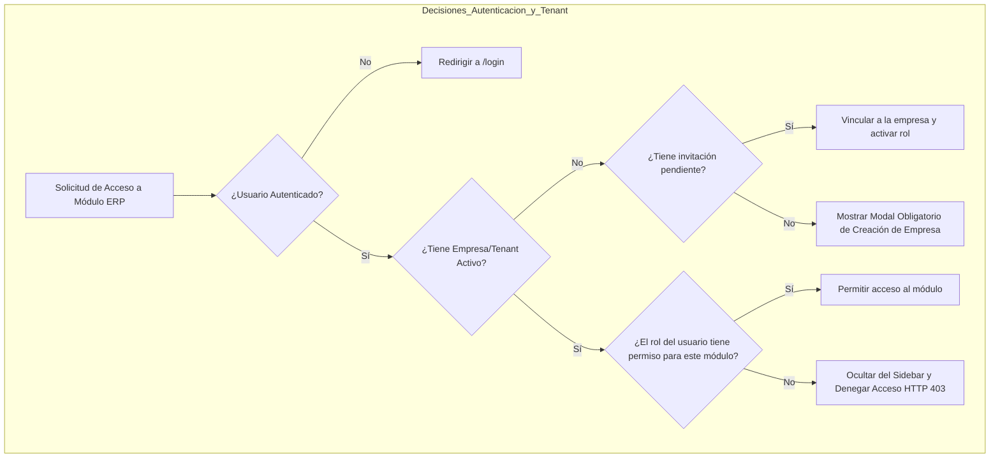
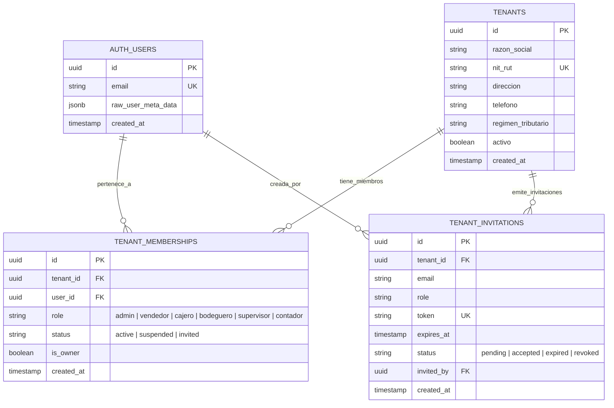
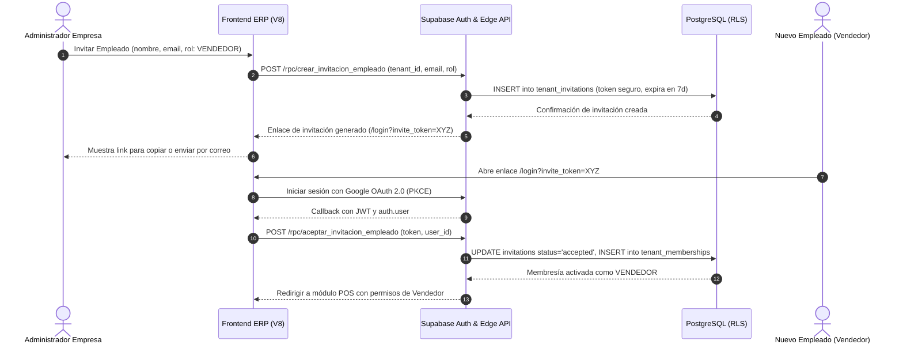
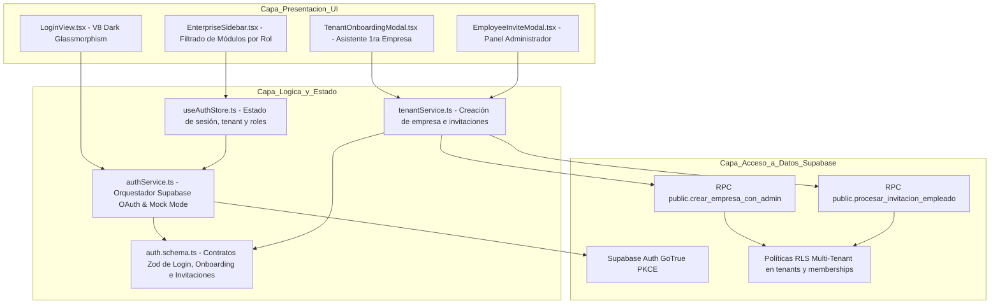

# Especificación Funcional: SPEC-035

**Código:** SPEC-035  
**Título:** Autenticación OAuth 2.0 PKCE, Onboarding Automático de Primer Tenant (Admin Empresa) y Gestión de Invitaciones de Empleados RBAC  
**Fase:** Spec Kit SDD v3.0 — `/speckit.specify` & `/grill-me` (Acuerdos Consolidados)  
**Gobernanza:** Flujo Continuo Kanban (`WIP = 1`). Arquitectura Data-Driven.  
**Estado:** PENDIENTE DE APROBACIÓN HUMANA (Checkpoint 1)  
**Fecha:** 2026-10-26  

---

## 1. Declaración del Problema & Acuerdos de Interrogatorio `/grill-me`

A través del protocolo de interrogatorio activo `/grill-me`, se acordaron las siguientes directivas fundamentales de producto y arquitectura:

1. **Pantalla de Bienvenida V8 (`LoginView.tsx`):**
   - Estética Dark Glassmorphism V8 oficial (`#070A10`, bordes translúcidos `border-white/10`, efectos de halo cian/esmeralda).
   - Botón principal de alta prominencia: **"Continuar con Google"** (OAuth 2.0 PKCE con Supabase Auth).
   - Acceso alternativo por correo (Magic Link o credenciales).
   - **Acceso Rápido de Desarrollo:** Selector colapsable visible exclusivamente en entorno local (`import.meta.env.DEV`) para alternar con 1 clic entre roles de prueba (`admin`, `vendedor`, `cajero`, `bodeguero`) sin bloquear el ciclo de desarrollo ni pruebas automatizadas.

2. **Onboarding de Primer Tenant (Creador / Admin en 2 Pasos):**
   - Cuando un usuario inicia sesión vía OAuth 2.0 por primera vez y el sistema verifica que no tiene empresas asociadas ni invitaciones pendientes:
     - **Paso 1:** Solicita Razón Social / Nombre Comercial, NIT/RUT, Ciudad y Teléfono.
     - **Paso 2:** Provisiona automáticamente la `Bodega Principal ('1')` y la `Caja General ('CAJA-01')`, asignando al usuario como `ADMIN` con `is_owner = TRUE` en `tenant_memberships`, permitiendo facturar en menos de 30 segundos.

3. **Mecanismo de Invitación de Empleados:**
   - El Administrador genera invitaciones desde el ERP ingresando Nombre, Correo y Rol.
   - El sistema genera un **Enlace Seguro Copiable** (`https://.../login?invite=TOKEN`) con validez de 7 días, permitiendo compartirlo directamente por WhatsApp o correo.
   - Cuando el empleado abre el enlace y se autentica con Google OAuth, el sistema canjea el token y lo vincula inmediatamente a la empresa con el rol asignado.

4. **Filtrado Estricto de Navegación por Roles (RBAC):**
   - El usuario accede **solamente a los módulos necesarios según sus roles y permisos**:
     - `ADMIN`: Acceso total (Dashboard, POS, WMS, Cajas, Cartera, NIIF, Personal, Ajustes).
     - `VENDEDOR`: Únicamente POS, Cotizaciones, Clientes y Pedidos Mostrador.
     - `CAJERO`: POS y Control de Cajas (Aperturas, Cobros, Arqueo Ciego).
     - `BODEGUERO`: Compras en Muelle, Bodegas & WMS, Despachos, Alistamiento y Cuartos Fríos.
     - `SUPERVISOR`: POS, Cajas, Métricas OTIF y Bodegas.

---

## 2. Multi-Phase System Modeling (5 Diagramas Mermaid Canónicos)

### 2.1. `1_process_flowcharts`: Flujo de Procesos y Ciclo de Vida Secuencial

---

### 2.2. `2_decision_logic_diagrams`: Rombos de Decisión y Control de Fronteras

---

### 2.3. `3_entity_relationship_diagrams`: Modelo ERD Relacional

---

### 2.4. `4_sequence_diagrams`: Diagrama de Secuencia Temporal (Invitación y Activación)

---

### 2.5. `5_component_architecture_diagrams`: Arquitectura por Capas

---

## 3. Criterios de Aceptación (EARS)

- **[EARS-01]** *Cuando* un usuario no autenticado navega a la aplicación, *el sistema* deberá presentar la pantalla oficial `LoginView` en Dark Glassmorphism V8 con el botón "Continuar con Google".
- **[EARS-02]** *Cuando* un usuario autenticado por primera vez no posea empresas vinculadas, *el sistema* deberá abrir el modal de Onboarding solicitando Razón Social, NIT, Ciudad y Teléfono.
- **[EARS-03]** *Tras* completar el onboarding, *el sistema* deberá aprovisionar el tenant, la Bodega Principal, la Caja 01 y asignar al usuario el rol `ADMIN` con `is_owner = true`.
- **[EARS-04]** *Cuando* un Administrador invite a un colaborador, *el sistema* deberá generar un enlace copiable con token seguro único con vigencia de 7 días.
- **[EARS-05]** *Cuando* un usuario ingrese con un token de invitación y se autentique, *el sistema* deberá vincularlo automáticamente a la empresa del remitente con su rol específico.
- **[EARS-06]** *Mientras* un usuario con rol operativo navegue por el ERP, *el sistema* deberá mostrar en el Sidebar únicamente los módulos para los cuales tiene permisos explícitos.
- **[EARS-07]** *Mientras* se ejecuten pruebas unitarias o desarrollo offline, *el sistema* deberá ofrecer el selector de acceso rápido de desarrollo para pruebas ágiles.
