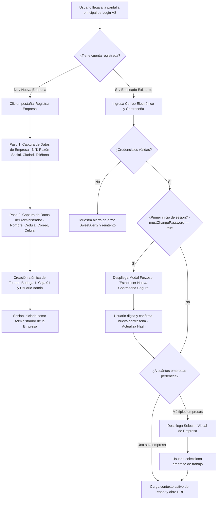
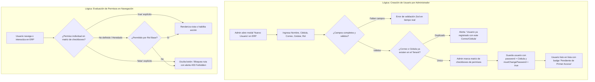
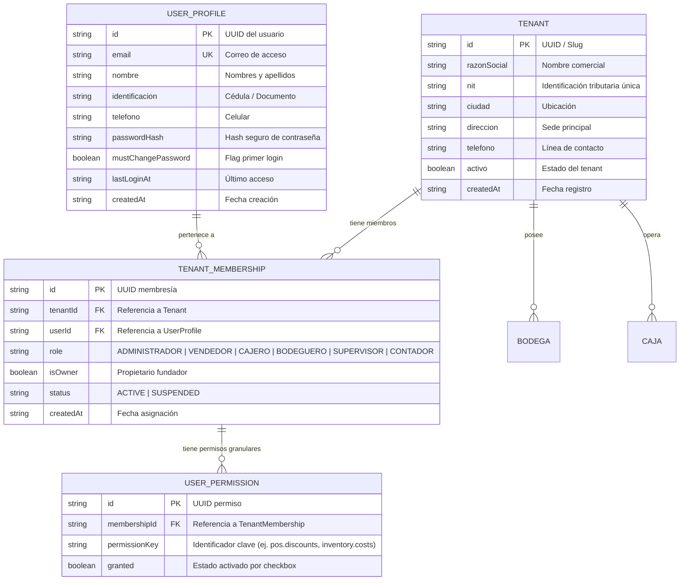
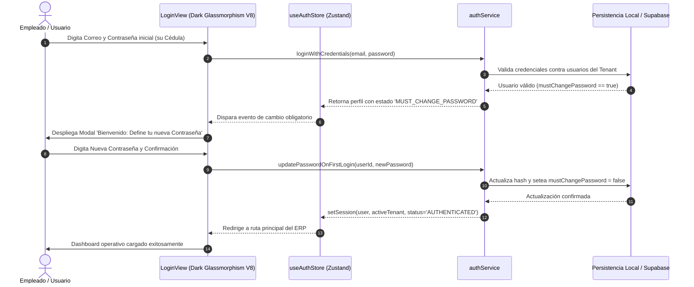
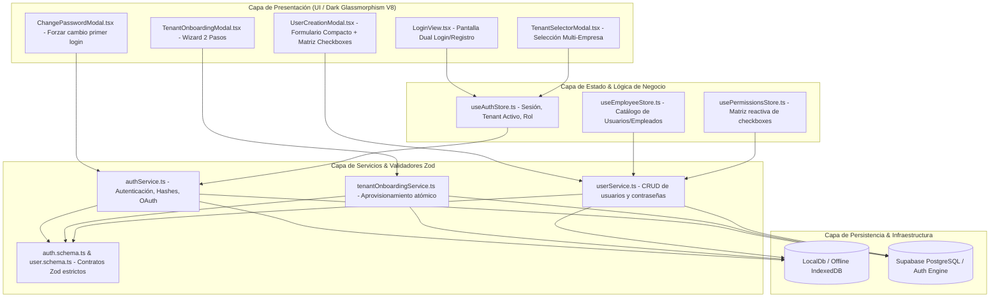

# Especificación de Requerimiento: /speckit.specify (SPEC-036)

**Código:** SPEC-036  
**Fase:** /speckit.specify (SDD v3.0)  
**Ticket:** AUTH-ONBOARDING-USER-MGMT-V8  
**Título:** Sistema Profesional de Inicio de Sesión, Registro Multi-Tenant en 2 Pasos y Creación de Usuarios con Matriz Granular de Permisos  
**Emisor:** Director de Agencia / Tech Lead  
**Receptores:** Equipo de Arquitectura de Seguridad, Frontend UI/UX, Backend Supabase  
**Prioridad:** Alta / Constitucional  
**Estado:** PENDIENTE_APROBACION_USUARIO  
**Fecha:** 2026-10-27  

---

## 1. El "Qué" y el "Por Qué" (Objetivo del Sistema)

### 1.1. Propósito de Negocio y Operativo
Proveer a **La Pezcadería ERP** y sus empresas inquilinas (tenants) de un sistema de acceso, registro y control de identidades de estándar SaaS empresarial:
1. **Inicio de Sesión Profesional & Seguro:** Vista corporativa bajo la estética oficial **Dark Glassmorphism V8** (`#070A10`), con pestañas alternables entre *Iniciar Sesión* y *Registrar Empresa*, soportando autenticación por Correo + Contraseña y Google OAuth.
2. **Onboarding Guiado de Empresa en 2 Pasos:**
   - **Paso 1 (Empresa):** Razón Social, NIT/RUT, Ciudad, Teléfono y Dirección.
   - **Paso 2 (Admin Fundador):** Nombre completo, Cédula de ciudadanía, Correo corporativo y Celular. Se genera automáticamente la membresía de Propietario/Administrador, provisionando de forma atómica su primera Bodega y Caja.
3. **Gestión de Usuarios con Matriz Granular de Permisos:**
   - Creación rápida de usuarios con campos obligatorios completos (Nombre, Cédula, Correo, Celular y Rol base).
   - Asignación de contraseña predeterminada igual a su número de identificación (cédula).
   - **Política Estricta OWASP/NIST:** En su primer inicio de sesión, el sistema detecta `mustChangePassword = true` y bloquea el acceso hasta que el empleado defina una contraseña personal robusta.
   - **Matriz de Permisos por Checkboxes:** El administrador puede encender o apagar individualmente cada vista y acción de permiso para el usuario de forma 100% personalizada.
4. **Selector Inteligente Multi-Empresa:** Conduce directamente al ERP si el usuario pertenece a 1 empresa, o despliega un modal elegante de selección si gestiona varias organizaciones.

---

## 2. Multi-Phase System Modeling (5 Diagramas Mermaid Obligatorios)

### Diagrama 1: Flujo de Procesos y Ciclo de Vida Secuencial (Process Flowchart)

---

### Diagrama 2: Lógica de Decisión y Edge Cases (Decision Logic Diagrams)

---

### Diagrama 3: Modelo Entidad-Relación (Entity Relationship Diagram)

---

### Diagrama 4: Diagrama de Secuencia Temporal (Sequence Diagram)

---

### Diagrama 5: Arquitectura por Capas de Componentes (Component Architecture)

---

## 3. Matriz de Roles y Checkboxes de Permisos Granulares

| Módulo del ERP | Clave de Permiso (`permissionKey`) | Descripción de la Acción / Vista | Marcado Predeterminado por Rol |
| :--- | :--- | :--- | :--- |
| **Punto de Venta** | `pos.access` | Acceso a pantalla y terminales de POS | Admin, Supervisor, Cajero, Vendedor |
| **Punto de Venta** | `pos.apply_discounts` | Aplicar descuentos discrecionales > 10% | Admin, Supervisor |
| **Punto de Venta** | `pos.cancel_tickets` | Cancelar o anular tickets y preventas | Admin, Supervisor |
| **Caja & Tesorería**| `cash.access` | Ver arqueo y movimientos de caja central | Admin, Supervisor, Cajero |
| **Caja & Tesorería**| `cash.register_expenses` | Registrar egresos operativos de caja menor | Admin, Supervisor, Cajero |
| **Inventario & WMS**| `inventory.view` | Ver existencias multibodega y Kardex | Admin, Supervisor, Bodeguero |
| **Inventario & WMS**| `inventory.view_costs`| Ver costos de compra y márgenes de utilidad | Admin, Supervisor, Contador |
| **Inventario & WMS**| `inventory.adjust` | Realizar ajustes manuales de stock o mermas | Admin, Supervisor |
| **Compras & Muelle**| `purchases.reception` | Recibir furgones de muelle y registrar lotes| Admin, Supervisor, Bodeguero |
| **Configuración**   | `admin.users_manage` | Crear usuarios y modificar matriz de permisos | Admin |
| **Configuración**   | `admin.tenant_edit` | Editar datos fiscales y bodegas de la empresa| Admin |

---

## 4. Requerimientos No Funcionales y Criterios de Aceptación
1. **Ergonomía y Estética:** Sistema 100% bajo estética **Dark Glassmorphism V8** (`#070A10`), con micro-animaciones fluidas y controles táctiles mínimos de 48 px.
2. **Seguridad y Validación:** Tipado estricto con TypeScript (`tsc --noEmit` 0 errores), validación Zod en fronteras y cifrado/hashing de contraseñas.
3. **Calidad TDD:** 100% de pruebas unitarias e integración en verde con Vitest antes de cada entrega.
4. **DevTools MCP:** 0 errores/warnings en consola JS y renderizado móvil verificado en 375 px.

---

> [!IMPORTANT]
> **PROHIBIDO GENERAR CÓDIGO DE PRODUCCIÓN TODAVÍA.**  
> Esta especificación requiere la aprobación formal del usuario antes de proceder a la fase `/speckit.clarify` y `/speckit.plan`.
