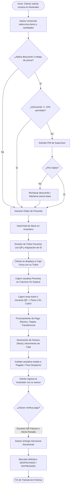
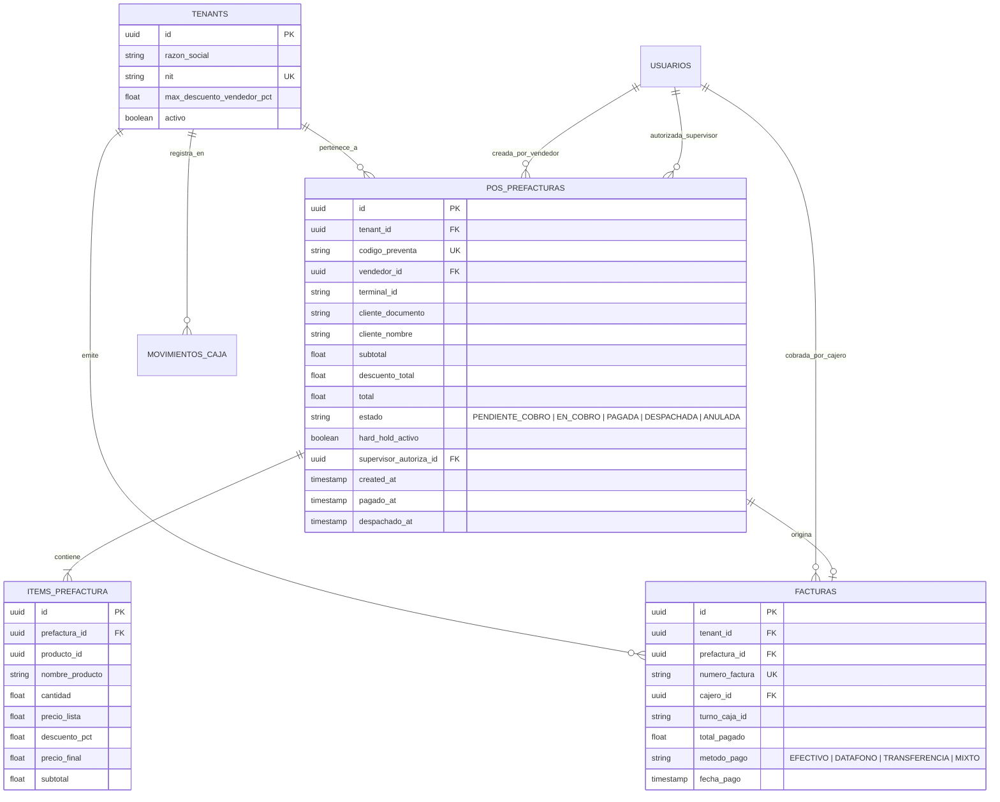
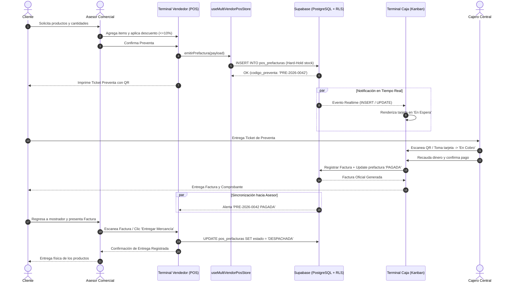
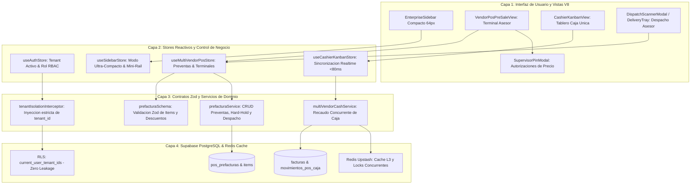

# Especificación de Requerimientos: SPEC-037
## Flujo de Preventa Multivendedor sin Recaudo, Kanban en Caja Única, Despacho Verificado y Sidebar Compacto con Leyes de UX

**Código:** SPEC-037  
**Versión:** 1.0.0  
**Fecha:** 2026-10-27  
**Fecha Límite de Entrega:** 2026-10-30  
**Fase:** Spec Kit SDD v3.0 — `/speckit.specify`  
**Gobernanza:** Flujo Continuo Kanban (`WIP = 1`). TDD Quirúrgico. Zero Cross-Tenant Leakage.  
**Estado:** PENDIENTE DE APROBACIÓN HUMANA (Checkpoint 1)  

---

## 1. Resumen Ejecutivo & Contexto de Negocio (PRD)

En una empresa comercial de alta rotación (ferretería, marisquería, retail de mostrador técnico), la dispersión del manejo de dinero en múltiples vendedores genera descuadres de caja, lentitud en la atención y riesgos de fuga de inventario.

Este módulo implementa el desacoplamiento operativo en 3 fases:
1. **Piso de Venta / Asesor Comercial (Preventa sin Recaudo):**
   - Los asesores seleccionan productos, modifican cantidades y aplican descuentos comerciales controlados (hasta un umbral máximo porcentual configurable en el tenant, por defecto **10%**).
   - Descuentos superiores o alteraciones de precio mayores exigen autorización con PIN de Supervisor (`SupervisorPinModal`).
   - El asesor **NO** cobra ni recibe dinero, ni genera movimientos de caja. Genera una **Preventa / Prefactura** con reserva inmediata de stock (**Hard-Hold**) y entrega al cliente un ticket térmico con código QR único.
2. **Caja Central Única (Recaudo & Facturación en Kanban):**
   - El cajero dispone de un tablero Kanban reactivo (<80ms) con 3 columnas operativas:
     - `1. En Espera de Cobro`: Preventas emitidas pendientes de pago, con filtros táctiles por asesor.
     - `2. En Cobro Activo`: Preventa cargada en la terminal del cajero para cobro (efectivo, datáfono, transferencia, crédito).
     - `3. Pagado / Listo para Despacho`: Cobro completado, factura electrónica/POS emitida y stock confirmado.
3. **Despacho y Entrega por el Asesor:**
   - El cliente regresa con su asesor comercial.
   - El asesor verifica el pago de forma híbrida: a través de su bandeja sincronizada en tiempo real de preventas pagadas o escaneando con pistola/cámara el código QR del ticket de factura.
   - Al validar el pago, el asesor ejecuta la entrega física y el sistema registra el estado `ENTREGADO / DESPACHADO`.
4. **Menú Lateral (EnterpriseSidebar) Ultra-Compacto con Leyes de UX:**
   - Rediseño ergonómico a **64px** de ancho en modo rail dock.
   - **Ley de Miller:** Agrupación en 4 núcleos cognitivos principales ($\le 7$ ítems directos por rol).
   - **Ley de Hick:** Eliminación de saturación visual, insignias redundantes y textos largos innecesarios.
   - **Ley de Fitts:** Hit-boxes táctiles de 48px con espaciado generoso.
   - **Progressive Disclosure:** Tooltips translúcidos y flyouts flotantes contextuales.

---

## 2. Decisiones de Arquitectura y Acuerdos de `/grill-me`

| Frontera de Decisión | Resolución Acordada en `/grill-me` | Justificación Técnica |
| :--- | :--- | :--- |
| **Límite de Descuento Vendedor** | Configurable por tenant en `TenantConfig` (default: **10%**). Superar el límite exige PIN de Supervisor. | Protege el margen bruto sin quitar flexibilidad comercial rápida en mostrador. |
| **Reserva de Stock (Hard-Hold)** | Hard-Hold sin expiración automática hasta cobro o cancelación manual por supervisor. | Evita ventas duplicadas en inventarios de mostrador y piezas únicas. |
| **Verificación de Despacho** | Modalidad Híbrida: Bandeja reactiva en pantalla del asesor + Escáner de QR del ticket. | Máxima agilidad: el asesor puede entregar al ver la alerta o escanear en horas pico. |
| **Columnas Kanban Caja** | 3 Columnas: `En Espera`, `En Cobro Activo`, `Pagado / Listo Despacho` con filtro por asesor. | Minimiza sobrecarga cognitiva del cajero según la Ley de Hick. |
| **Aislamiento Multi-Tenant** | Clave foránea `tenant_id` en todas las tablas, índices B-Tree y RLS `current_user_tenant_ids()`. | Zero-leakage: los datos de una empresa jamás son visibles para otra. |
| **Sidebar UX** | Rail de 64px, 4 grupos Miller, badges prioritarios, tooltips translúcidos Dark Glassmorphism. | Libera el 100% del área de trabajo para la cuadrícula POS y el Kanban. |

---

## 3. Modelado de Sistema Multifase (MANDATORY MERMAID.JS)

### 3.1. Diagrama 1: Flujo de Procesos y Ciclo de Vida Secuencial (`1_process_flowcharts`)

---

### 3.2. Diagrama 2: Lógica de Decisión y Edge Cases (`2_decision_logic_diagrams`)

```mermaid
flowchart TD
    subgraph Decisiones_Piso_Venta [Reglas del Asesor Comercial]
        A1[Intento de Descuento por Item] --> B1{Descuento <= max_descuento_pct?}
        B1 -- Verdadero --> C1[Aplicar descuento en linea de venta]
        B1 -- Falso --> D1{Supervisor presente?}
        D1 -- Autoriza PIN --> C1
        D1 -- Rechaza --> E1[Revertir al precio lista]
        
        A2[Intento de Recaudo por Asesor] --> B2{Rol del Usuario?}
        B2 -- Vendedor --> C2[ACCESO DENEGADO: Solo consulta y preventa]
        B2 -- Cajero/Admin --> D2[Permitir cobro]
    end

    subgraph Decisiones_Caja_Central [Reglas de Caja y Kanban]
        A3[Cliente llega a Caja] --> B3{Preventa existe y activa?}
        B3 -- No encontrada --> C3[Error: Ticket invalido o cancelado]
        B3 -- Encontrada --> D3{Estado Preventa?}
        D3 -- PENDIENTE_COBRO --> E3[Pasar a EN_COBRO_ACTIVO]
        D3 -- YA_PAGADA --> F3[Informar: Preventa ya pagada. Dirigir a despacho]
        D3 -- ANULADA --> G3[Informar: Preventa anulada por supervisor]
        
        E3 --> H3{Monto Recaudado == Total Factura?}
        H3 -- Pago Completo --> I3[Emitir Factura y Actualizar a PAGADA]
        H3 -- Pago Parcial / Cancelacion --> J3{¿Cancela cliente?}
        J3 -- Sí --> K3[Supervisor autoriza liberacion de Hard-Hold stock]
        J3 -- No --> E3
    end

    subgraph Decisiones_Despacho [Reglas de Entrega]
        A4[Cliente solicita mercancia a Asesor] --> B4{Verificacion de Factura}
        B4 -- Estado == PAGADA --> C4[Entregar articulos y registrar despacho]
        B4 -- Estado != PAGADA --> D4[BLOQUEO: Exigir comprobante de pago en caja]
    end
```

---

### 3.3. Diagrama 3: Modelo Entidad-Relación (`3_entity_relationship_diagrams`)

---

### 3.4. Diagrama 4: Diagrama de Secuencia Temporal (`4_sequence_diagrams`)

---

### 3.5. Diagrama 5: Arquitectura de Componentes por Capas (`5_component_architecture_diagrams`)

---

## 4. Rediseño del Sidebar con Leyes de UX

1. **Ley de Miller ($7 \pm 2$ chunks):**
   - Agrupación en 4 bloques operativos principales:
     - `1. VENTAS & POS` (Punto de Venta / Preventa, Clientes)
     - `2. CAJA & RECAUDO` (Kanban de Caja, Movimientos)
     - `3. BODEGA & DESPACHO` (Despachos, WMS, Muelle)
     - `4. CONTROL & REPORTES` (Métricas, Auditoría)
2. **Ley de Fitts:**
   - Botones táctiles con altura mínima de **48px**, padding generoso y centrado vertical en modo rail de **64px**.
3. **Ley de Hick & Progressive Disclosure:**
   - Supresión de badges innecesarios (solo 1 badge crítico de preventas pendientes en caja).
   - Ocultamiento de textos largos; tooltips flotantes translúcidos estilo macOS Abisal V8 (`#070A10`).
   - Atajo `Ctrl+B` conservado para expandir/colapsar temporalmente.

---

## 5. Criterios de Aceptación (EARS)

- **Ubiquitous:** El sistema **siempre** filtrará todas las consultas a `pos_prefacturas` y `facturas` por el `tenant_id` del usuario autenticado.
- **Event-driven:** Cuando un asesor comercial aplique un descuento $> 10\%$, el sistema **deberá** desplegar de forma obligatoria el `SupervisorPinModal` y bloquear la emisión hasta recibir un PIN válido de rol supervisor/admin.
- **Event-driven:** Cuando un asesor confirme la preventa, el sistema **deberá** reservar inmediatamente el stock (`hard_hold_activo = true`) y generar un código QR único para el ticket.
- **State-driven:** Mientras el estado de la preventa sea `PENDIENTE_COBRO`, el asesor **no deberá** tener habilitado el botón de despacho.
- **Event-driven:** Cuando el cajero procese el recaudo exitoso en caja, el sistema **deberá** actualizar el estado a `PAGADA` en menos de 80ms y notificar a la terminal del asesor.
- **Event-driven:** Cuando el cliente regrese con su factura y el asesor confirme la entrega, el sistema **deberá** actualizar el estado a `DESPACHADA` y liberar la tarjeta del flujo activo.
