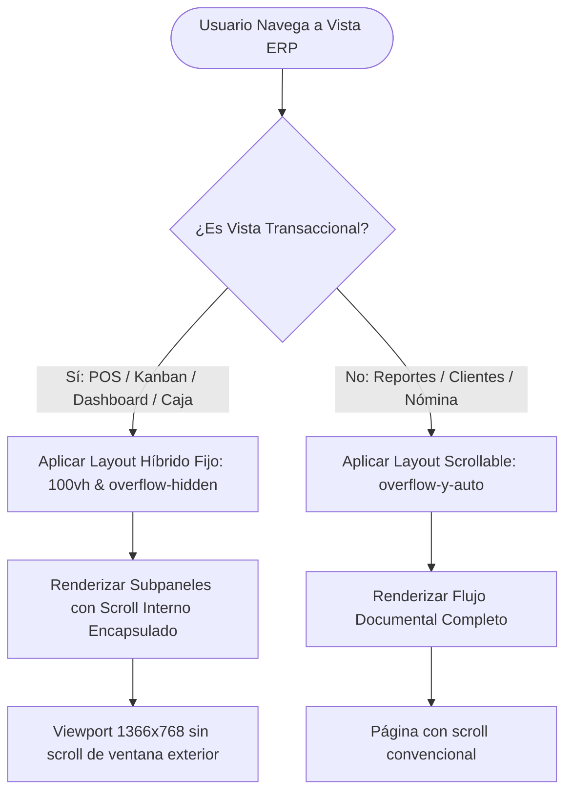
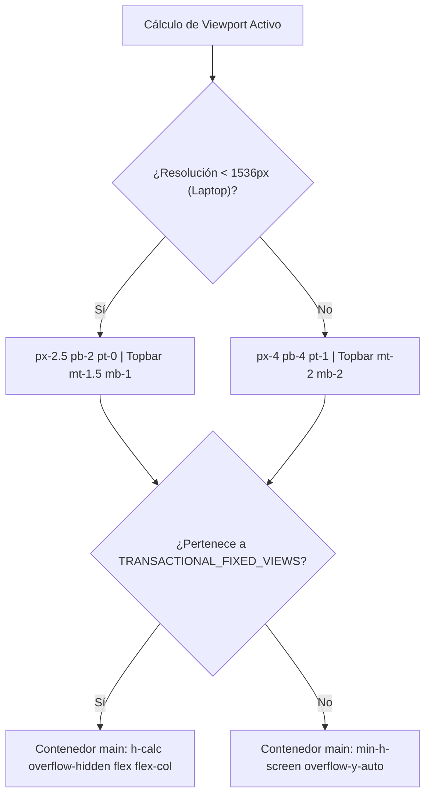
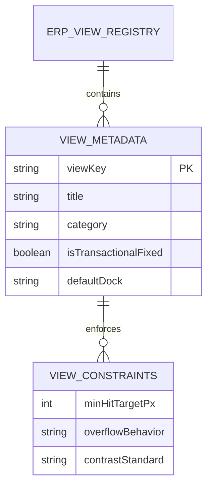
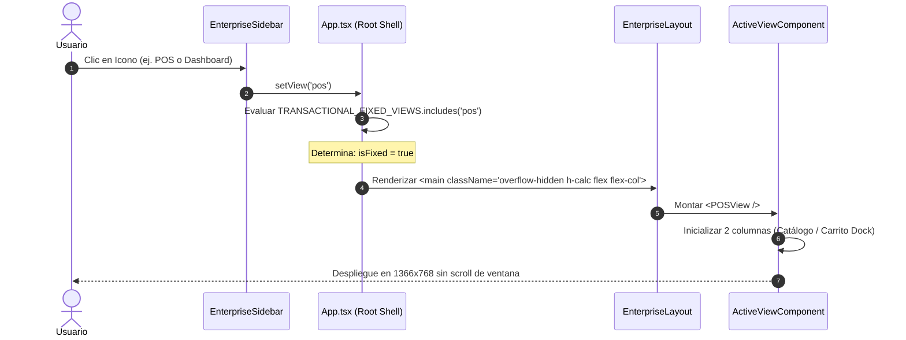
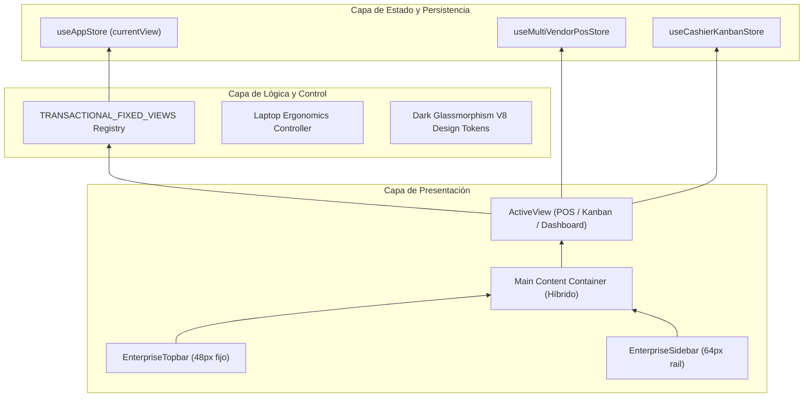

# SPEC-038: Optimización Ergonómica y Leyes de UX en Frontend para Pantallas de Laptop (1366×768 / 1080p)

## 1. Requerimientos en Notación EARS (Easy Approach to Requirements Syntax)

- **[UBIQUITOUS]** El sistema **SIEMPRE DEBE** proveer interfaces conformes con el Estándar Dark Glassmorphism V8 (`bg-[#070A10]`, bordes `border-white/10`, texto accesible WCAG 2.2 AA ratio $\ge 4.5:1$).
- **[STATE-DRIVEN]** Mientras una vista pertenezca al conjunto de vistas transaccionales fijas (`TRANSACTIONAL_FIXED_VIEWS`: `pos`, `order-kanban`, `dashboard`, `cash-flow`, `alistamiento`), el contenedor principal de la aplicación **DEBE** aplicar altura rígida `h-[calc(100vh-theme(spacing.12)-theme(spacing.3))]` con `overflow-hidden`, evitando que la ventana del navegador genere scroll vertical global.
- **[STATE-DRIVEN]** Mientras una vista pertenezca al conjunto de vistas administrativas o de reportes largos (`clients`, `suppliers`, `payroll`, `accounting`, `crm`), el contenedor principal **DEBE** permitir scroll vertical fluido (`overflow-y-auto`).
- **[EVENT-DRIVEN]** Cuando la resolución del viewport sea inferior o igual a 1366×768 px, los paddings envolventes del contenedor de contenido **DEBEN** fijarse en `px-2.5 pb-2 pt-0` para maximizar el área de datos útil.
- **[UBIQUITOUS]** Todos los elementos interactivos primarios y secundarios **DEBEN** tener un área táctil/cliqueable mínima de $36 \times 36\text{px}$ conforme a la Ley de Fitts.

---

## 2. Multi-Phase System Modeling (5 Diagramas Obligatorios Mermaid.js)

### Diagrama 1: Process Flowcharts (Flujo de Decisión de Layout por Vista)

### Diagrama 2: Decision Logic Diagrams (Lógica de Contenedor y Densidad)

### Diagrama 3: Entity Relationship Diagrams (Configuración de Layout y Vistas)

### Diagrama 4: Sequence Diagrams (Ciclo de Renderizado del Shell Híbrido)

### Diagrama 5: Component Architecture Diagrams (Arquitectura por Capas)

