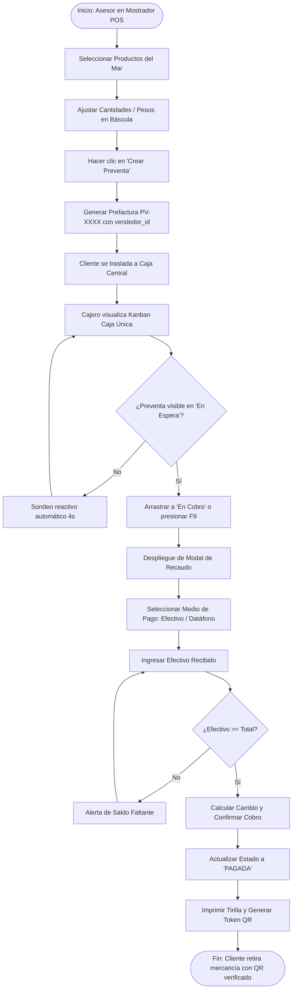
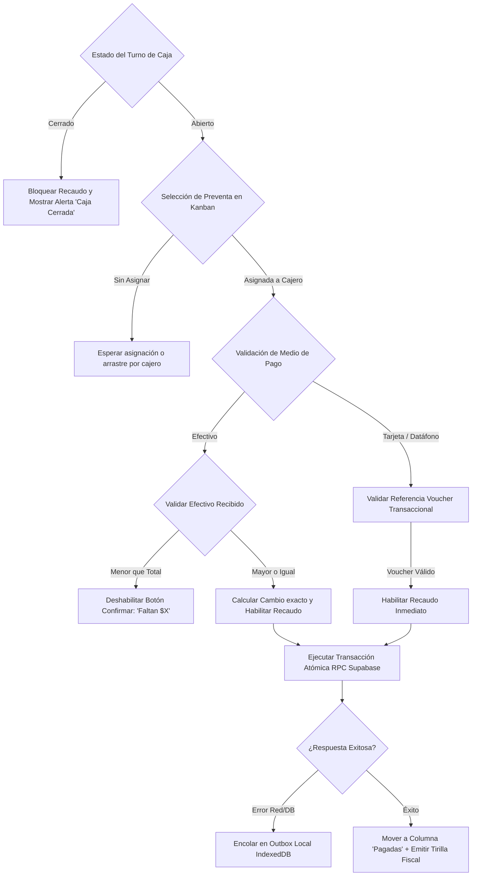
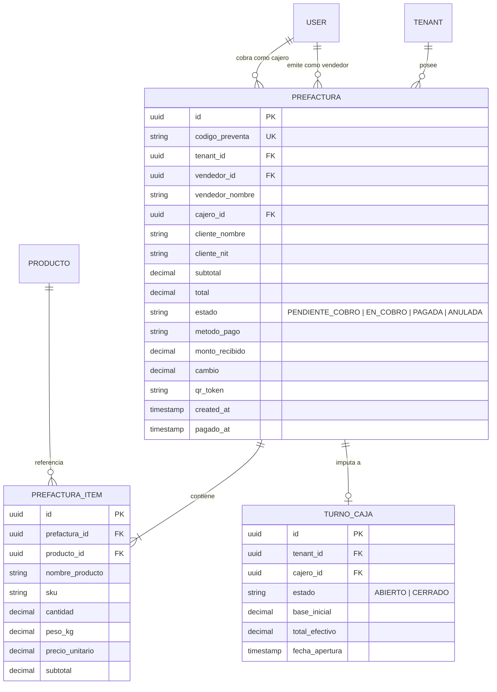
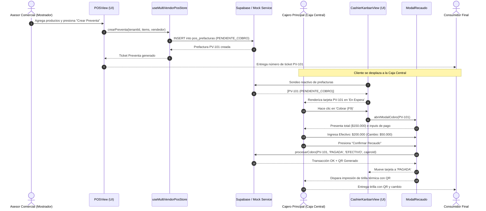
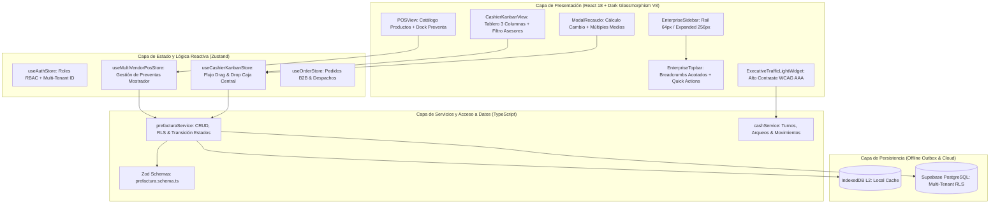

# Especificación Técnica — SPEC-039
**Calidad Frontend Enterprise, Accesibilidad WCAG 2.2 AA+ y Suite E2E Multivendedor - Caja Única**

---

## 1. Contexto & Objetivos del Negocio
- **Objetivo Primario:** Implementar y ejecutar una suite de pruebas End-to-End (E2E) con Playwright para blindar el flujo crítico operativo **Multivendedor - Caja Única (SPEC-037)**: desde la creación de una preventa en mostrador por parte del asesor comercial, su aparición reactiva en el tablero Kanban de Caja Central, hasta la toma de la orden, liquidación con recaudo F9, generación de tirilla y emisión de código QR de despacho.
- **Objetivo Secundario (Accesibilidad & Ergonomía Visual):**
  1. Corregir los problemas de contraste detectados en el Semáforo Operativo Ejecutivo (Tarjeta 3: "Stock en Cuarto Frío"), elevando la relación de contraste a $\ge 7:1$ (WCAG AAA) mediante superficies dark glassmorphism balanceadas y tipografía legible.
  2. Acotar el truncamiento de breadcrumbs en la barra superior (`EnterpriseTopbar.tsx`) evitando que los títulos largos empujen los controles de acción.
  3. Descongestionar el área derecha de la barra superior (padding/gap ergonómico) para prevenir toques accidentales en pantallas táctiles y laptops.
  4. Optimizar el layout base del Sidebar para evitar cualquier sensación de superposición sobre los controles de la ventana principal y garantizar aislamiento de scroll en el catálogo y liquidación del POS.

---

## 2. Requisitos del Sistema (Notación EARS)

### 2.1 Requisitos Ubicuos (Ubiquitous Requirements)
- **EARS-UBI-01:** El sistema DEBE mantener en todo momento el estándar estético **Dark Glassmorphism V8** con escala OKLCH, microbordes translúcidos `border-white/10` y retícula estricta de 8px.
- **EARS-UBI-02:** Todo texto informativo y numérico en tarjetas de estado DEBE cumplir con la norma de contraste WCAG 2.2 AA (mínimo 4.5:1 para texto normal, 3:1 para texto grande/bold).

### 2.2 Requisitos Guiados por Eventos (Event-Driven Requirements)
- **EARS-EVT-01:** CUANDO un Asesor Comercial presione el botón "Crear Preventa" en el POS, el sistema DEBE registrar la prefactura con estado `PENDIENTE_COBRO`, asignar un código único `PV-XXXX`, vincular el ID del vendedor y no solicitar cobro monetario en mostrador.
- **EARS-EVT-02:** CUANDO una preventa sea registrada, el tablero `CashierKanbanView` en la estación de Caja Única DEBE reflejar la tarjeta en la columna "En Espera de Cobro" dentro de un intervalo reactivo $\le 4$ segundos.
- **EARS-EVT-03:** CUANDO el cajero presione "Cobrar (F9)" o arrastre la tarjeta a "En Cobro", el modal de liquidación DEBE desplegarse con el saldo precalculado, permitiendo seleccionar el medio de pago e ingresar el efectivo recibido.
- **EARS-EVT-04:** CUANDO se confirme el recaudo exitoso, el sistema DEBE transicionar la prefactura a estado `PAGADA`, generar la tirilla de control interno y habilitar el token QR para verificación de salida en bodega.

### 2.3 Requisitos de Estado (State-Driven Requirements)
- **EARS-STA-01:** MIENTRAS el turno de caja se encuentre en estado `CERRADO`, el botón de liquidación DEBE alertar visiblemente y restringir la finalización del recaudo hasta que el cajero abra el turno correspondiente.
- **EARS-STA-02:** MIENTRAS la pantalla se visualice en laptops (`1366×768`), el breadcrumb de `EnterpriseTopbar` DEBE acotarse con `truncate max-w-[220px]` con atributo `title` accesible, garantizando que los botones de acción rápida permanezcan siempre alineados e interactivos.

### 2.4 Requisitos de Comportamiento No Deseado (Unwanted Behavior Requirements)
- **EARS-UNW-01:** SI el cajero ingresa un importe en efectivo inferior al total de la preventa, el sistema DEBE deshabilitar el botón de confirmación e indicar claramente el valor faltante sin procesar la venta.
- **EARS-UNW-02:** SI el usuario interactúa con la barra superior en pantallas táctiles, el sistema NO DEBE disparar clics accidentales entre el indicador de red "ONLINE" y el botón primario "Facturar POS", manteniendo una separación física mínima de 12px.

---

## 3. Mandatory Multi-Phase System Modeling (Mermaid.js)

### 3.1 Flujo de Procesos y Ciclo de Vida (`1_process_flowcharts`)

---

### 3.2 Diagrama de Lógica de Decisión (`2_decision_logic_diagrams`)

---

### 3.3 Diagrama de Entidad-Relación (`3_entity_relationship_diagrams`)

---

### 3.4 Diagrama de Secuencia Temporal (`4_sequence_diagrams`)

---

### 3.5 Arquitectura de Componentes por Capas (`5_component_architecture_diagrams`)

---

## 4. Criterios de Aceptación (Garantía de Calidad)
1. **Suite Playwright E2E Verde:** Se creará el archivo `tests/e2e/multivendor-cashier-flow.spec.ts` que simulará exitosamente el ciclo completo de preventa mostrador $\rightarrow$ cobro caja única $\rightarrow$ tirilla con QR en modo headless y headed.
2. **Contraste WCAG 2.2 AA+ Verificado:** La tarjeta 3 del Semáforo Operativo no presentará fondos burdeos saturados con texto fucsia; utilizará `bg-slate-900/80` y `text-white font-mono` con badge `text-rose-300`, superando el ratio de contraste 7:1.
3. **Topbar Acotado:** El breadcrumb usará `truncate max-w-[220px]` y el gap entre elementos de la derecha será de mínimo `gap-3` para evitar toques accidentales.
4. **Layout Estable en Laptops:** El sidebar mantendrá su contenedor adyacente sin solapar controles y las columnas del POS tendrán scrollbars independientes sin romper el layout exterior.
