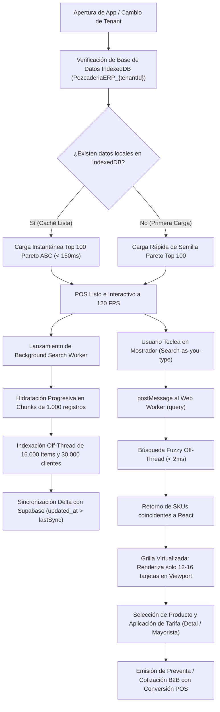
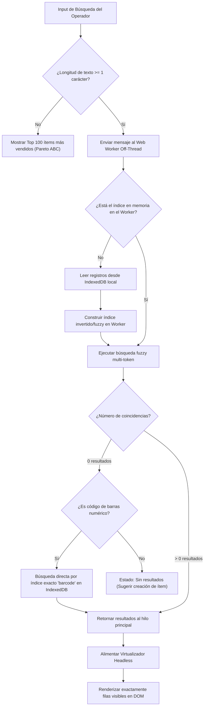
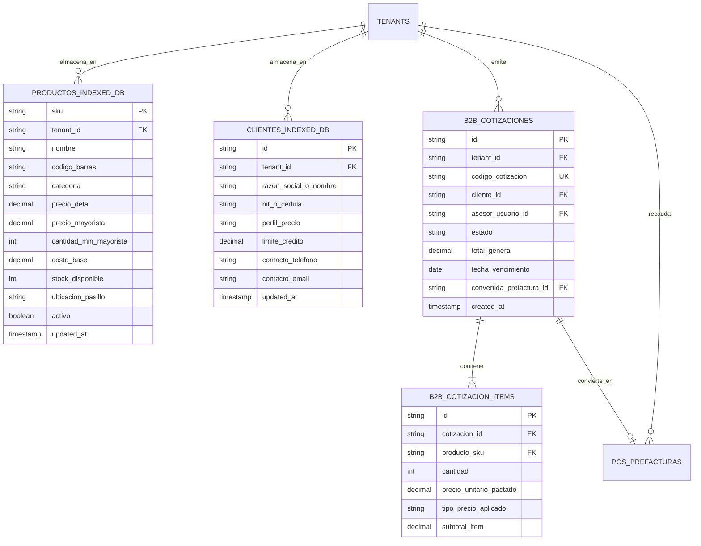
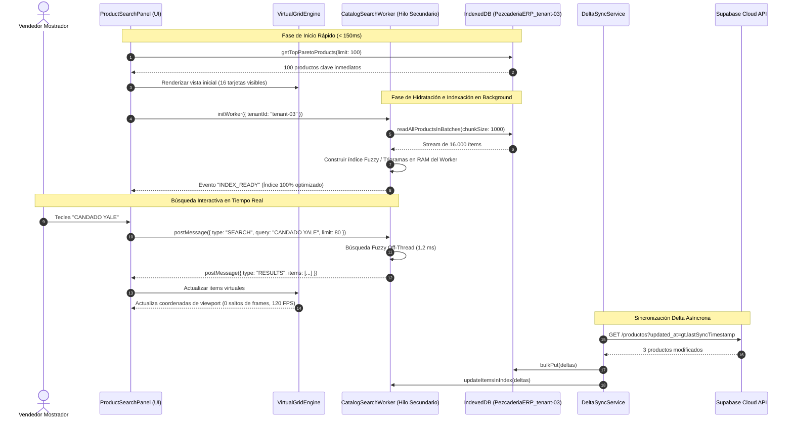
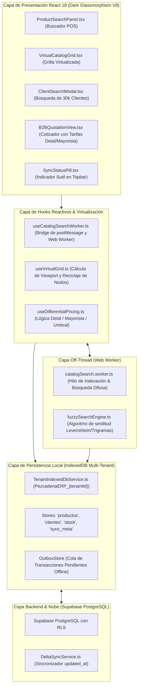

# Especificación Funcional & Técnica: SPEC-040
## Arquitectura Enterprise Cero-Latencia para Catálogos Masivos (IndexedDB Aislada, Web Worker Search & Virtualización 3X) con Precios Diferenciales y Cotizaciones B2B POS

- **Código:** SPEC-040
- **Fase:** Spec Kit SDD v3.0 — `/speckit.specify`
- **Estado:** Especificación Consolidada Post-Interrogatorio `/grill-me`
- **Gobernanza:** Flujo Continuo Kanban (`WIP = 1`). TDD Quirúrgico.
- **Tenants Operativos:** `tenant-03` (Ferretería Josase S.A.S. - Catálogo real de 5.351 ítems y 9.550 clientes, dimensionado a **escala 3X: 16.000 ítems y 30.000 clientes**) y `tenant-01` (La Pezcadería S.A.S.).
- **Estándar Visual:** Dark Glassmorphism V8 (`#070A10`), retícula de 8px, composite GPU 120 FPS, WCAG 2.2 AA+.

---

### 1. El "Qué" y el "Por Qué" (Business Problem & Enterprise Architecture Solution)

#### 1.1. Contexto y Diagnóstico Crítico de Latencia
En la versión previa, la carga del catálogo de Ferretería Josase (5.351 productos y 9.550 clientes) presentaba cuellos de botella severos:
1. **Sobrecarga del Hilo Principal (Main UI Thread Jank):** La importación dinámica de JSONs (~9 MB en total) y la deserialización síncrona bloqueaban el bucle de eventos de V8 por más de 1.5 a 3.5 segundos, congelando la interfaz.
2. **Límite de `localStorage` Excedido (`QuotaExceededError`):** El almacenamiento web estándar de 5MB colapsaba al intentar persistir los 9.550 clientes y 5.351 productos, obligando a mantener los datasets únicamente en memoria volátil de Zustand.
3. **Escala 3X (16.000 ítems y 30.000 clientes):** Asumiendo la carga de una empresa de ferretería o distribución del triple de tamaño (~25-30 MB de datos), el filtrado reactivo con `.filter()` síncrono en cada pulsación del teclado (`search-as-you-type`) degrada los fotogramas por debajo de 20 FPS y arriesga crashes por memoria en laptops de mostrador.

#### 1.2. Solución Arquitectónica Enterprise de Cero Latencia
Basada en las investigaciones MCP (`context7`, `brave`), el diagnóstico del enjambre `Agency Swarm` (`SoftwareArchitect`) y los 5 acuerdos cerrados en el interrogatorio `/grill-me`:

1. **Persistencia Local Aislada por Tenant en IndexedDB:**  
   Bases de datos independientes por empresa: `PezcaderiaERP_{tenantId}` (ej. `PezcaderiaERP_tenant-03`). Aislamiento físico estricto, cuota de gigabytes, operaciones de lectura/escritura asíncronas no bloqueantes e inmunidad contra fugas de datos entre inquilinos (Zero Cross-Tenant Leakage).
2. **Motor de Búsqueda Off-Thread en Web Worker Dedicado:**  
   Un Web Worker desacoplado ejecuta la indexación de tokens y el algoritmo de búsqueda difusa (Fuzzy Search / Trigram Index) en un hilo secundario del navegador. Tiempo de respuesta de búsqueda **$\le 2\text{ ms}$** sin afectar los 120 FPS del hilo de renderizado de React.
3. **Virtualización Headless de la Grilla de Catálogo:**  
   Implementación de virtualización con ventana dinámica (`useVirtualGrid` / `@tanstack/react-virtual`). El DOM renderiza exclusivamente las 12-16 tarjetas visibles en el viewport actual, reciclando nodos DOM al scrollear. Consumo de memoria constante $\mathcal{O}(1)$.
4. **Ingesta Progresiva con Prioridad Pareto ABC (80/20):**  
   Al abrir la app o conmutar de empresa, el POS se vuelve interactivo en **$< 150\text{ ms}$** cargando el Top 100 de productos y clientes más frecuentes (principio Pareto 80/20 constitucional). En segundo plano, el Worker descarga e hidrata IndexedDB en lotes (*chunks*) de 1.000 registros, con un indicador de sincronización en la barra superior (`EnterpriseTopbar`).
5. **Sincronización Delta y Resiliencia Offline (Outbox Pattern):**  
   Mantenimiento de marcas de tiempo `updated_at > lastSync` para sincronizar únicamente novedades con Supabase. Descuento de stock instantáneo y optimista en IndexedDB local con cola de salida asíncrona.
6. **Motor de Precios Dual & Cotizaciones B2B con Conversión a Venta POS:**  
   Soporte nativo para `precioDetal`, `precioMayorista`, umbral `cantidadMinimaMayorista`, perfiles de cliente B2B y conversión atómica en 1-clic de Cotización a Preventa (`pos_prefacturas`) en el Kanban de Caja Central (SPEC-037).

---

### 2. Mandatory Multi-Phase System Modeling (5 Diagramas Mermaid)

#### 2.1. Diagrama 1: Flujo de Procesos y Ciclo de Vida Secuencial (`1_process_flowcharts`)

---

#### 2.2. Diagrama 2: Lógica de Decisión y Edge Cases (`2_decision_logic_diagrams`)

---

#### 2.3. Diagrama 3: Modelo Entidad-Relación (`3_entity_relationship_diagrams`)

---

#### 2.4. Diagrama 4: Diagrama de Secuencia Temporal (`4_sequence_diagrams`)

---

#### 2.5. Diagrama 5: Arquitectura de Componentes por Capas (`5_component_architecture_diagrams`)

---

### 3. Requerimientos Funcionales EARS

- **REQ-040-01 (Aislamiento Físico Multi-Tenant en IndexedDB):**  
  *CUANDO* se inicie sesión o se conmute de empresa, *EL SISTEMA DEBERÁ* conectarse exclusivamente a la base de datos IndexedDB `PezcaderiaERP_{tenantId}`, garantizando segregación física local y cero mezcla de datos entre empresas.

- **REQ-040-02 (Inicio Instantáneo Pareto ABC):**  
  *AL ABRIR* el POS o catálogo, *EL SISTEMA DEBERÁ* renderizar y habilitar la interacción del usuario en menos de **$150\text{ ms}$** utilizando los 100 ítems más comercializados de la bodega activa, sin esperar la carga del catálogo completo.

- **REQ-040-03 (Búsqueda Off-Thread en Web Worker con Tolerancia a Erratas):**  
  *MIENTRAS* el operador escribe en el buscador de productos o clientes, *EL SISTEMA DEBERÁ* delegar la consulta al `catalogSearch.worker`, ejecutando la búsqueda difusa en un hilo secundario y devolviendo resultados en menos de **$2\text{ ms}$** sin degradar los 120 FPS del hilo UI.

- **REQ-040-04 (Virtualización Headless de Grilla):**  
  *EN TODO MOMENTO*, la grilla de productos y la lista de clientes deberán renderizar en el DOM únicamente los elementos visibles en el viewport (12 a 16 tarjetas), reciclando elementos y manteniendo un consumo de memoria constante $\mathcal{O}(1)$.

- **REQ-040-05 (Tarificación Automática Mayorista / Detal):**  
  *CUANDO* la cantidad agregada al carrito o cotización alcance o supere `cantidadMinimaMayorista` (o el cliente posea perfil B2B `MAYORISTA`), *EL SISTEMA DEBERÁ* conmutar el precio al `precioMayorista`, notificando el ahorro obtenido.

- **REQ-040-06 (Conversión Atómica Cotización -> Preventa POS):**  
  *CUANDO* el asesor presione "Convertir a Venta POS" en una cotización aprobada, *EL SISTEMA DEBERÁ* generar una preventa inmutable en `pos_prefacturas`, aplicar la reserva de inventario en bodega (`Hard-Hold`), vincular ambas entidades y trasladar la orden al Kanban de Caja Central (SPEC-037).

- **REQ-040-07 (Sincronización Delta y Operatividad Offline):**  
  *CUANDO* la conexión a internet sea inestable o inexistente, *EL SISTEMA DEBERÁ* permitir la búsqueda completa y la emisión de preventas descontando stock localmente en IndexedDB y encolando las operaciones en el almacén Outbox para su sincronización automática al restablecerse la red.

---

### 4. Quality Gate & Criterios de Aceptación
1. **Rendimiento UI:** 120 FPS sostenidos en scroll continuo y $\le 2\text{ ms}$ de latencia en búsqueda off-thread con 16.000 ítems y 30.000 clientes cargados.
2. **Memoria DOM:** Menos de 50 nodos DOM activos en la grilla virtualizada en todo momento.
3. **TypeScript Estricto:** `npx tsc --noEmit` en 0 errores.
4. **TDD Coverage:** $\ge 80\%$ en servicios de base de datos local, worker de búsqueda y lógica de precios.
5. **Aislamiento Multi-Tenant:** Verificación de 0 fugas cruzadas en pruebas automatizadas y Chrome DevTools.
