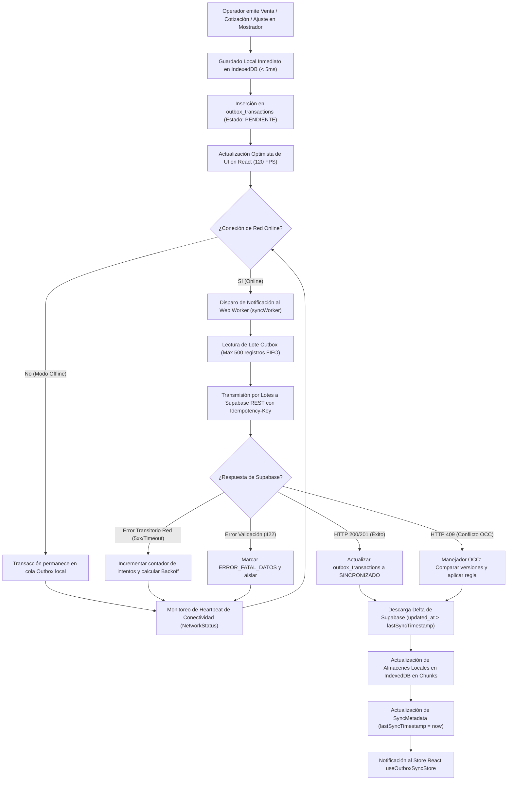
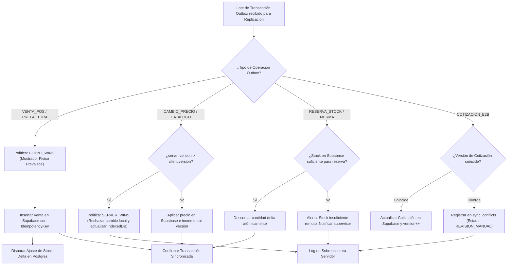
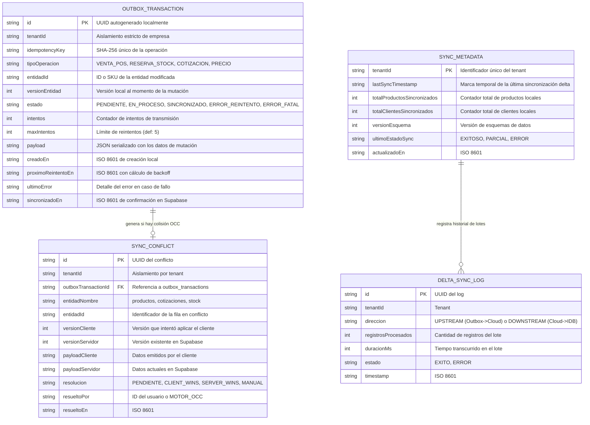
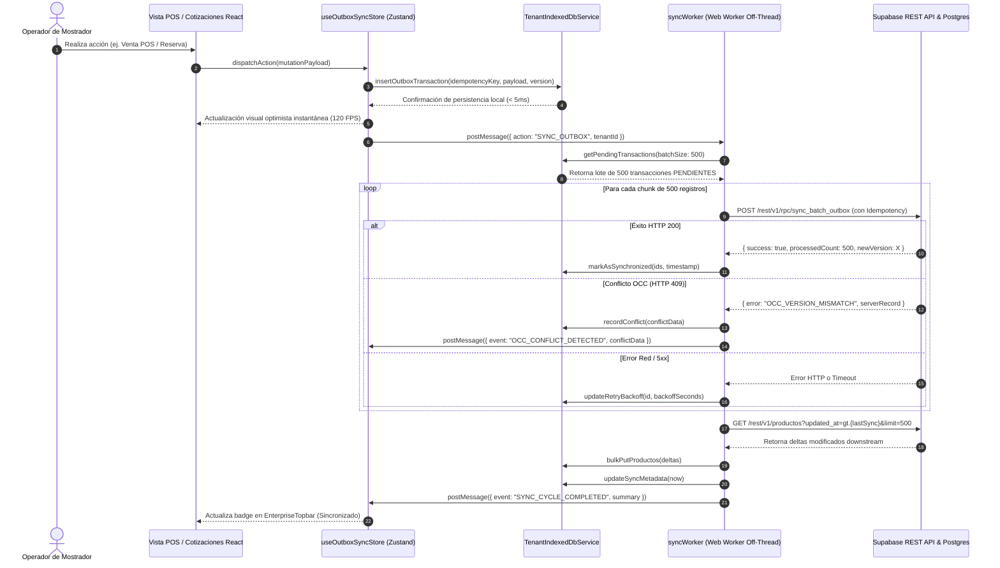
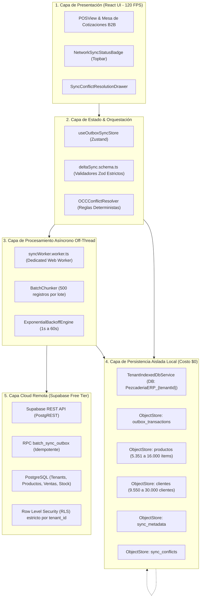

# Especificación Funcional & Técnica: SPEC-041
## Sincronización Bidireccional Supabase <-> IndexedDB (Outbox Worker Resiliente, Control de Concurrencia Optimista OCC & Transmisión en Lotes Off-Thread)

- **Código:** SPEC-041
- **Fase:** Spec Kit SDD v3.0 — `/speckit.specify`
- **Estado:** Especificación Base Generada con Co-Ejecución Swarm + Harness² (Aprobación Pendiente)
- **Gobernanza:** Flujo Continuo Kanban (`WIP = 1`). TDD Quirúrgico.
- **Tenants Operativos:** `tenant-03` (Ferretería Josase S.A.S. - 5.351 ítems, 9.550 clientes, dimensionado a **escala 3X: 16.000 ítems y 30.000 clientes**) y `tenant-01` (La Pezcadería S.A.S.).
- **Presupuesto & Costo:** **Costo Estricto $0** (Web Workers nativos de navegador, IndexedDB asíncrono, Supabase REST API Free Tier; cero servicios SaaS de pago).
- **Estándar Visual:** Dark Glassmorphism V8 (`#070A10`), retícula de 8px, composite GPU 120 FPS, WCAG 2.2 AA+.

---

### 1. El "Qué" y el "Por Qué" (Business Problem & Technical Requirements)

#### 1.1. Contexto Operativo y Diagnóstico del Problema
En entornos comerciales e industriales reales (como mostradores de ferretería con múltiples asesores táctiles y bodegas de despacho):
1. **Inestabilidad de Red y Latencia Fluctuante:** La conectividad WiFi/4G en mostradores físicos sufre microcortes o caídas prolongadas. Si el sistema dependiera de llamadas síncronas a Supabase para emitir ventas, reservar inventario o actualizar cotizaciones, la atención al cliente se congelaría.
2. **Impacto en el Hilo Principal (Main UI Thread):** La transmisión masiva de catálogos y transacciones (5.351 a 16.000 productos) deserializados en el hilo de React bloquea los 120 FPS de la interfaz.
3. **Colisiones y Conflictos de Datos (Race Conditions & Concurrency):** Múltiples terminales operando offline u online simultáneamente pueden modificar el mismo registro de stock o cotización. Sin un control de concurrencia optimista (OCC) determinista con marcas de versión, se producirían sobreescrituras silenciosas (*lost updates*) o inconsistencias de inventario (*ghost stock*).
4. **Desconexión y Reintentos Caóticos:** Sin un patrón Outbox transaccional estructurado, los reintentos descontrolados generan duplicación de operaciones fiscales o saturación del ancho de banda.

#### 1.2. Solución de Ingeniería Enterprise a Costo $0
1. **Patrón Outbox Resiliente en IndexedDB:** Toda mutación local (ventas POS, reservas de stock, cambios de precio, cotizaciones B2B) se almacena instantáneamente ($\le 5\text{ ms}$) en la tabla local `outbox_transactions` dentro de la base aislada `PezcaderiaERP_{tenantId}` con estado `PENDIENTE` e `idempotencyKey` determinista.
2. **Web Worker Dedicado Off-Thread (`syncWorker.worker.ts`):** La sincronización upstream (Outbox -> Supabase) y downstream (Supabase -> IndexedDB Delta) se ejecuta en un hilo secundario del navegador, procesando lotes de máximo 500 registros con backoff exponencial sin degradar la UI.
3. **Control de Concurrencia Optimista (OCC):**
   - Cada entidad sincronizable incluye una columna `version: number` y `updated_at: string`.
   - Reglas de resolución deterministas:
     - **Ventas POS & Prefacturas:** *Client-Wins* con registro de auditoría (el dinero cobrado en mostrador prevalece y se concilia).
     - **Maestros de Productos & Precios:** *Server-Wins* si `server.version > client.version`.
     - **Stock / Inventario:** Conciliación delta atómica (se descuenta la cantidad consumida localmente, sin sobreescribir el absoluto).
     - **Cotizaciones B2B:** Si hay divergencia de versión, se marca en estado `CONFLICTO_CONCURRENCIA` y se almacena en el store para resolución visual asistida.
4. **Sincronización Delta Bidireccional:** El cliente solo solicita a Supabase registros modificados desde `sync_metadata.lastSyncTimestamp` (`updated_at > lastSync`), reduciendo la transferencia de datos en más del 95%.

---

### 2. Requisitos en Notación EARS (Easy Approach to Requirements Syntax)

- **UBIQUITOUS (Siempre Activo):**
  - **REQ-UBI-01:** El sistema DEBE garantizar aislamiento estricto de datos por tenant en IndexedDB (`PezcaderiaERP_{tenantId}`), impidiendo cualquier fuga cross-tenant.
  - **REQ-UBI-02:** El sistema DEBE operar con costo $0, utilizando exclusivamente Web Workers estándar y Supabase REST.

- **EVENT-DRIVEN (Disparado por Eventos):**
  - **REQ-EVE-01:** CUANDO el operador confirme una venta POS o cotización B2B, el sistema DEBE persistir la transacción en `outbox_transactions` en menos de 5 ms y notificar al worker de fondo.
  - **REQ-EVE-02:** CUANDO el navegador detecte restauración de conectividad (`navigator.onLine` o heartbeat exitoso), el sistema DEBE activar el ciclo de transmisión Outbox inmediatamente sin esperar el intervalo de sondeo.
  - **REQ-EVE-03:** CUANDO Supabase retorne un código de error de colisión de versión (OCC HTTP 409 o divergencia de `version`), el sistema DEBE registrar el incidente en `sync_conflicts` y aplicar la política de resolución correspondiente.

- **STATE-DRIVEN (Dependiente del Estado):**
  - **REQ-STA-01:** MIENTRAS el estado de conectividad sea `OFFLINE`, el sistema DEBE acumular operaciones en la cola Outbox local y continuar permitiendo ventas y reservas en modo optimista.
  - **REQ-STA-02:** MIENTRAS se esté ejecutando una sincronización delta masiva (hasta 16.000 ítems), el Web Worker DEBE procesar en fragmentos (*chunks*) de 500 registros, emitiendo progreso porcentual a la UI sin bloquear los 120 FPS.

- **UNWANTED BEHAVIOUR (Manejo de Errores y Fallos):**
  - **REQ-UNW-01:** SI una petición de sincronización falla por error de red transitorio (timeout, HTTP 500/503), ENTONCES el sistema DEBE aplicar backoff exponencial (1s, 2s, 4s, 8s, 16s, máx 60s) hasta un máximo de 5 intentos antes de marcar `ERROR_REINTENTO`.
  - **REQ-UNW-02:** SI una transacción de la Outbox contiene datos inválidos o esquema incompatible (HTTP 422), ENTONCES el sistema DEBE marcarla como `ERROR_FATAL_DATOS`, aislarla de la cola activa y generar alerta en la consola de sincronización para evitar bucles infinitos de reintento.

---

### 3. Mandatory Multi-Phase System Modeling (5 Diagramas Mermaid)

#### 3.1. Diagrama 1: Flujo de Procesos y Ciclo de Vida Secuencial (`1_process_flowcharts`)

---

#### 3.2. Diagrama 2: Lógica de Decisión y Resolución de Conflictos OCC (`2_decision_logic_diagrams`)

---

#### 3.3. Diagrama 3: Modelo Entidad-Relación (`3_entity_relationship_diagrams`)

---

#### 3.4. Diagrama 4: Diagrama de Secuencia Temporal (`4_sequence_diagrams`)

---

#### 3.5. Diagrama 5: Arquitectura de Componentes por Capas (`5_component_architecture_diagrams`)

---

### 4. Tareas Granulares de Implementación Planificadas (WIP = 1)

1. **`TASK-041-01`:** Esquemas Zod y validadores de deltas de sincronización ([`deltaSync.schema.ts`](file:///c:/Users/Personal/Documents/Yurgen/Maestro_Pezcaderia_ERP/maestro_ERP_Pezcaderia/src/types/deltaSync.schema.ts)):
   - Validación de contratos de entrada/salida para ítems Outbox, transacciones delta y conflictos OCC.
   - Pruebas unitarias de validación con Vitest (TDD).

2. **`TASK-041-02`:** Manejador de resolución de conflictos OCC (Optimistic Concurrency Control) en [`useOutboxSyncStore`](file:///c:/Users/Personal/Documents/Yurgen/Maestro_Pezcaderia_ERP/maestro_ERP_Pezcaderia/src/stores/useOutboxSyncStore.ts):
   - Motor de resolución con políticas `CLIENT_WINS`, `SERVER_WINS` y `MERGE_DELTA`.
   - Soporte para tabla de conflictos `sync_conflicts` en [`TenantIndexedDbService`](file:///c:/Users/Personal/Documents/Yurgen/Maestro_Pezcaderia_ERP/maestro_ERP_Pezcaderia/src/services/tenantIndexedDbService.ts).
   - Pruebas unitarias completas de escenarios de colisión.

3. **`TASK-041-03`:** Web Worker en background para transmisión en lotes de 500 registros sin bloqueo de UI ([`syncWorker.worker.ts`](file:///c:/Users/Personal/Documents/Yurgen/Maestro_Pezcaderia_ERP/maestro_ERP_Pezcaderia/src/workers/syncWorker.worker.ts)):
   - Chunking asíncrono de 500 registros, backoff exponencial ante fallos transitorios e integración con [`NetworkConnectivityService`](file:///c:/Users/Personal/Documents/Yurgen/Maestro_Pezcaderia_ERP/maestro_ERP_Pezcaderia/src/services/networkConnectivityService.ts).
   - Verificación de 0 impacto en los 120 FPS del hilo principal y 0 errores en consola JS con Chrome DevTools.

---

### 5. Verificación & Criterios de Aceptación

1. **Latencia Local Inmediata:** Toda mutación local en POS o cotizaciones se almacena en IndexedDB en $\le 5\text{ ms}$.
2. **Escala y No Bloqueo:** La sincronización de 5.351 a 16.000 ítems ocurre en chunks de 500 registros en el Web Worker sin degradar los 120 FPS del renderizado de React.
3. **Control de Concurrencia (OCC):** Ninguna sobreescritura silenciosa ocurre ante colisiones de versión; se aplica la política correspondiente y se audita el 100% de los incidentes.
4. **Resiliencia Offline:** En modo sin conexión, las transacciones se acumulan en `outbox_transactions` y se vacían ordenadamente al recuperar conectividad sin duplicación (idempotencia garantizada).
5. **Calidad de Código:** `tsc --noEmit` con 0 errores, suite Vitest 100% verde y 0 errores en consola Chromium DevTools (Desktop 1280px y Móvil 375px).

