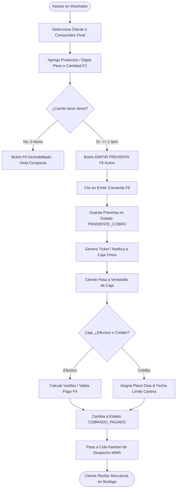
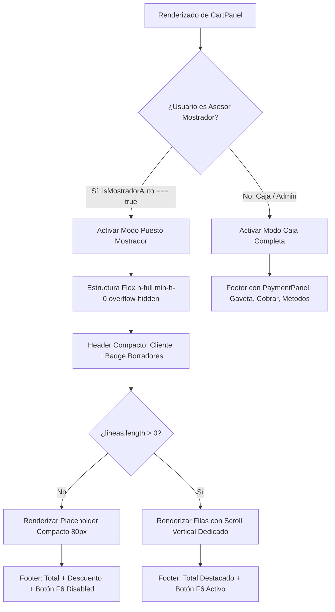
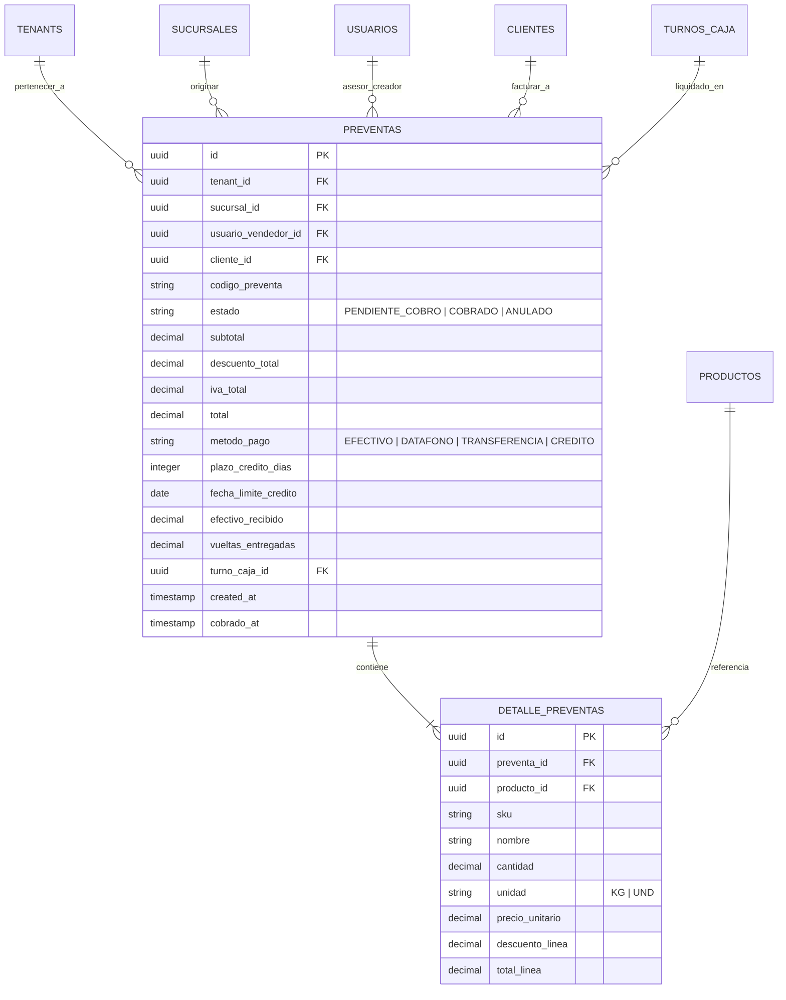
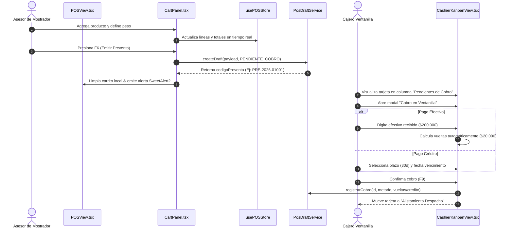
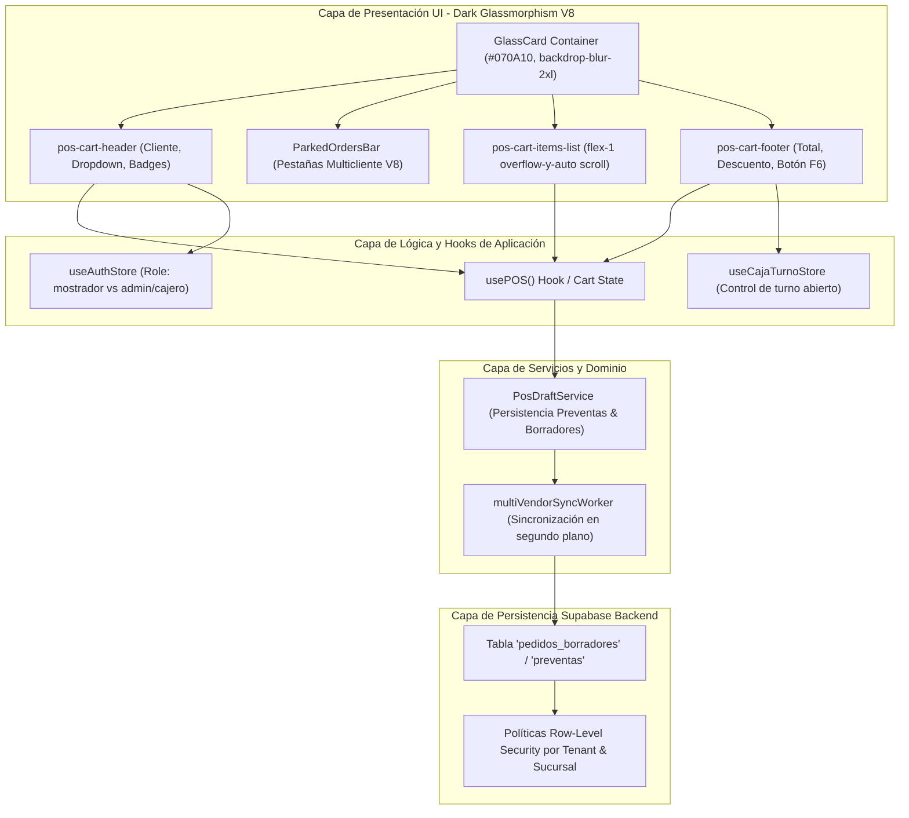

# SPEC-042: Ajuste Ergonómico del Mostrador para Comandas y Ciclo de Vida Preventa Multivendedor

## 1. Contexto, "Qué" y "Por Qué"

### ¿Qué se va a construir?
1. **Resolución Quirúrgica de Colisión y Clipping Visual en `CartPanel.tsx`:**
   - Corrección del layout en el carrito de compras donde el pie de página (`pos-cart-footer`) colisiona y superpone los botones de cabecera (`Consumidor Final`, `En Espera`, `Borradores`) en resoluciones de mostrador/laptop (`1024×768`, `1280×800`, `1366×768`).
   - Eliminación del patrón `sticky bottom-0` dentro de contenedores `overflow-y-auto`. Se migra a un layout flexbox de contención estricta: `flex flex-col h-full min-h-0 overflow-hidden`, donde únicamente el contenedor de ítems (`pos-cart-items-list`) tiene scroll vertical (`flex-1 min-h-0 overflow-y-auto`), manteniendo cabecera y pie fijos, legibles y no solapados.
2. **Unificación Estricta con Dark Glassmorphism V8 (`DesignSystem_V8.md`):**
   - Eliminación de fondos claros huérfanos (`bg-slate-50`, `border-slate-200`, `bg-indigo-50`, `bg-amber-50`) en `pos-cart-header`, `ParkedOrdersBar` y `DiscountPanel`.
   - Conversión a tokens oscuros de alto contraste: `bg-slate-900/60`, `border-white/10`, texto accesible WCAG 2.2 AA (ratio $\ge 4.5:1$), números monoespaciados legibles y contrastes de colorimetría esmeralda/cian sobre fondo obsidiana (`#070A10`).
3. **Ergonomía Táctil y Operativa para Asesores de Mostrador (`isMostradorAuto === true`):**
   - El Asesor de Mostrador **NO** realiza cobro en dinero ni gestiona gaveta de efectivo. Su botón de acción principal es **`EMITIR PREVENTA / COMANDA (F6)`** con altura $\ge 50\text{px}$, gradiente cian/azul y feedback visual táctil.
   - En estado vacío (`0 ítems`), exhibir un placeholder compacto y minimalista que no fuerce scroll ni deforme el viewport.
   - Cabecera de mostrador limpia en una sola línea (selector de cliente rápido y contador badge de borradores), impidiendo que los botones se quiebren verticalmente en pantallas de ancho reducido (~380px).
4. **Ciclo de Vida Preventa / Ventanilla Validado por Co-Ejecución Agency Swarm + Google Harness²:**
   - Transaccionalidad ACID en Supabase con RLS: la comanda reserva stock temporal en mostrador $\rightarrow$ Caja Única (Ventanilla) liquida con Efectivo (con cálculo de vueltas) o Crédito Cartera (con fecha límite) $\rightarrow$ Despacho WMS entrega la mercancía.

---

## 2. Requerimientos en Notación EARS (Easy Approach to Requirements Syntax)

- **[UBIQUITOUS]** El sistema **SIEMPRE DEBE** encapsular el panel del carrito de mostrador (`CartPanel.tsx`) dentro de `GlassCard` bajo el estándar Dark Glassmorphism V8 (`bg-slate-900/85`, `border-white/12`, texto WCAG AA+), sin elementos huérfanos en fondo blanco/gris claro.
- **[UBIQUITOUS]** El contenedor `pos-cart-panel` **SIEMPRE DEBE** gestionar el espacio mediante flexbox vertical (`flex flex-col h-full min-h-0 overflow-hidden`), garantizando que la cabecera (`pos-cart-header`) y el pie (`pos-cart-footer`) permanezcan anclados a sus respectivos extremos sin colisionar ni superponerse.
- **[STATE-DRIVEN]** Mientras la lista de líneas del carrito esté vacía (`lineas.length === 0`), el contenedor de ítems **DEBE** renderizar un mensaje ergonómico compacto y el botón de acción principal `EMITIR PREVENTA / COMANDA (F6)` **DEBE** permanecer deshabilitado visualmente sin alterar la altura del panel.
- **[EVENT-DRIVEN]** Cuando el usuario asesor de mostrador presione la tecla de atajo `F6` o pulse el botón `EMITIR PREVENTA / COMANDA`, el sistema **DEBE** invocar el pipeline transaccional de guardado de preventa y emitir la comanda al Kanban de Ventanilla.
- **[STATE-DRIVEN]** Mientras el rol activo del usuario sea `mostrador` o la propiedad `isMostradorAuto` sea `true`, el pie de página **DEBE** ocultar estrictamente el panel de pago (`PaymentPanel`) y desplegar exclusivamente el módulo de comanda rápida hacia Ventanilla.
- **[UBIQUITOUS]** Todos los controles táctiles interactivos de la cabecera y el pie **DEBEN** cumplir con un área de interacción mínima de $44 \times 44\text{px}$ (con altura $\ge 50\text{px}$ para el botón de emisión principal) según la Ley de Fitts.

---

## 3. Mandatory Multi-Phase System Modeling (5 Diagramas Mermaid.js)

### Diagrama 1: Process Flowcharts (Ciclo de Vida Secuencial de la Comanda)

### Diagrama 2: Decision Logic Diagrams (Lógica de Contenedor, Roles y Disposición)

### Diagrama 3: Entity Relationship Diagrams (Modelo ERD de Preventas y Ventanilla)

### Diagrama 4: Sequence Diagrams (Interacción Temporal entre Componentes)

### Diagrama 5: Component Architecture Diagrams (Arquitectura por Capas)

---

## 4. Plan de Verificación y Criterios de Aceptación
1. **Ausencia de Solapamiento:** Con 0 ítems o con múltiples ítems, la cabecera, la barra de multicliente, el contenedor de ítems y el pie inferior nunca colisionan ni se montan uno sobre otro.
2. **Cohesión Estética V8:** Cero fondos claros huérfanos (`bg-slate-50`). Integración con `bg-slate-900/60`, bordes sutiles `border-white/10` y acentos cian/esmeralda.
3. **Ergonomía Táctil:** Altura del botón de emisión $\ge 50\text{px}$, atajo `F6` mapeado y comprobado.
4. **Validación DevTools & Vitest:** 0 errores en consola JS, vista 375px móvil sin desbordamiento horizontal y suites de pruebas 100% verdes.

