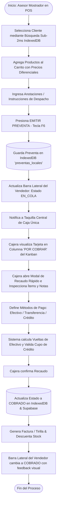
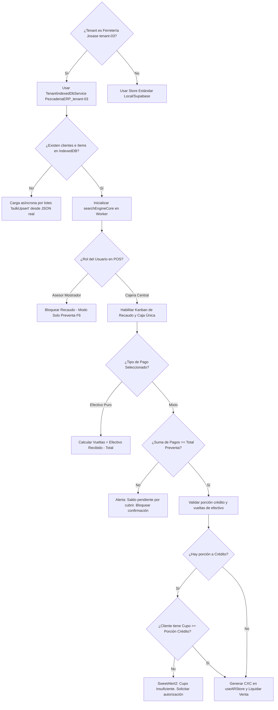
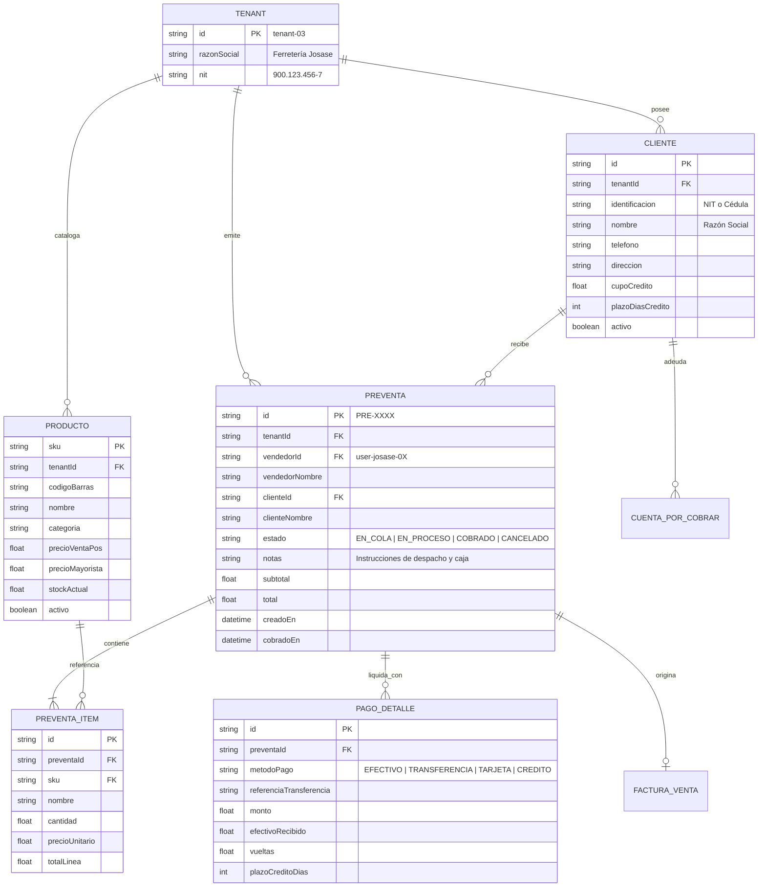
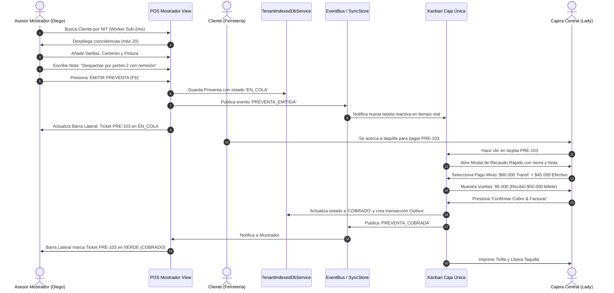
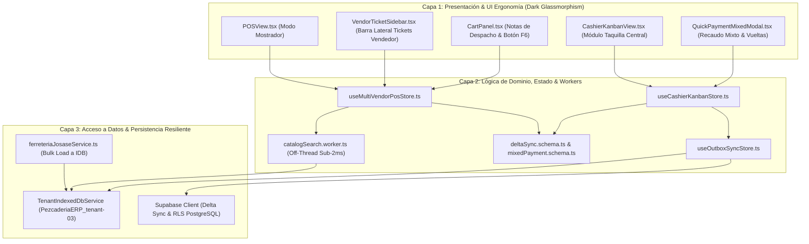

# Especificación Funcional & Técnica: SPEC-043
# Flujo Integral Multivendedor - Caja Única Kanban con Cero-Latencia para Ferretería Josase

- **Código:** SPEC-043
- **Fase:** Spec Kit SDD v3.0 — `/speckit.specify`
- **Tenant Primario:** `tenant-03` ("Ferretería Josase")
- **Estado:** PENDIENTE DE APROBACIÓN DEL USUARIO (Checkpoints SDD)
- **Autoría:** Ecosistema Multi-Agente (Agency Swarm + Google Harness² + Master Architect)

---

## 1. Declaración del Problema & Justificación del "Por Qué"

### 1.1 Diagnóstico en Producción
Durante las pruebas operativas en vivo en `https://maestro-erp-pezcaderia.vercel.app/` bajo el tenant `tenant-03` (Ferretería Josase), se identificaron cinco (5) cuellos de botella críticos:
1. **Fallo de Carga de Catálogo y Clientes:** El dataset real de Ferretería Josase (9.550 clientes y 5.351 productos) pesa más de 8.5 MB en JSON. Al intentar cargarlo en `localStorage` a través de `localDb`, los navegadores lanzan la excepción `QuotaExceededError` (límite de 5 MB a 10 MB), dejando los stores vacíos o con datos truncados.
2. **Latencia Severa & Congelamiento del Hilo Principal (Main Thread):** La búsqueda de clientes en modales itera de forma síncrona sobre 9.550 registros y crea miles de nodos DOM directos con `document.createElement('div')` sin límite (`limit`) ni virtualización, degradando la tasa de cuadros por segundo de 120 FPS a 5 FPS y bloqueando la interfaz por más de 3 segundos por pulsación.
3. **Ausencia de Trazabilidad para el Asesor de Mostrador:** Los vendedores de mostrador emiten preventas, pero no disponen de una barra lateral persistente donde monitorear el estado en tiempo real de sus propios tickets emitidos (`EN ESPERA DE COBRO`, `COBRADO`, `CANCELADO`), generando incertidumbre sobre si el cliente ya fue atendido en caja.
4. **Taquilla de Caja Única Inflexible:** La cajera central no dispone de un modal ergonómico de recaudo rápido que permita:
   - Inspeccionar y validar ítems, cantidades y precios de la preventa antes de cobrar.
   - Procesar **pagos mixtos** divididos en tiempo real (ejemplo: $100.000 = $50.000 Efectivo + $30.000 Transferencia Nequi + $20.000 Crédito a 30 días).
   - Calcular automáticamente vueltas / cambio sobre la porción pagada en efectivo.
   - Validar cupo de crédito y generar automáticamente la cuenta por cobrar en `useARStore`.
5. **Carencia de Notas de Despacho en Preventa:** Los vendedores no pueden registrar anotaciones contextuales ("Empacar para finca", "Reclama don Pedro con cédula", "Tornillos galvanizados 1 pulgada"), perdiendo instrucciones operativas clave al llegar el cliente a la taquilla.

---

## 2. Requerimientos Funcionales (EARS Notation)

- **REQ-043-01 (Carga IndexedDB Zero-LocalStorage):** Cuando el tenant activo sea `tenant-03`, el sistema **DEBE** persistir y sincronizar los 9.550 clientes y 5.351 productos en `TenantIndexedDbService` (`PezcaderiaERP_tenant-03`), sin tocar `localStorage` para evitar `QuotaExceededError`. La carga es progresiva en segundo plano con indicador discreto, iniciando por defecto con 'Consumidor Final (Josase)'.
- **REQ-043-02 (Búsqueda Sub-2ms con Paginación Segura):** Cuando el usuario busque un cliente o producto, el motor **DEBE** consultar `searchEngineCore` (off-thread en Web Worker) y retornar como máximo 20 resultados en menos de 2 milisegundos, renderizando un DOM ligero.
- **REQ-043-03 (Segregación de Roles y Conmutación Topbar):** El sistema **DEBE** conmutar la vista por rol y selector rápido: Asesores Mostrador acceden al POS sin permisos de recaudo (solo `EMITIR PREVENTA F6`), mientras que Cajeras y Admins acceden a la Taquilla Central Kanban con recaudo rápido.
- **REQ-043-04 (Barra Lateral de Tickets del Vendedor):** El sistema **DEBE** presentar en el mostrador una barra lateral (`VendorTicketSidebar`) que filtre reactivamente las preventas del día asociadas al `vendedorId` activo, permitiendo 'Recuperar y Editar' o 'Cancelar' tickets en `EN_COLA` y mostrando el cambio reactivo a verde `COBRADO` con número de factura.
- **REQ-043-05 (Anotaciones en Doble Nivel):** La preventa **DEBE** admitir observaciones generales de despacho/entrega a nivel de comanda, más notas específicas opcionales por ítem (medidas de corte, calibres), visibles en el Kanban y en la tirilla.
- **REQ-043-06 (Módulo de Recaudo Mixto en Taquilla Única):** Cuando la cajera seleccione una preventa del Kanban, el sistema **DEBE** abrir el modal de recaudo rápido permitiendo editar cantidades/precios libremente, seleccionar métodos de pago múltiples (Efectivo, Tarjeta, Transferencia, Crédito con plazo incluso a Consumidor Final bajo responsabilidad de caja), con cálculo automático de vueltas para el efectivo.

---

## 3. Mandatory Multi-Phase System Modeling (5 Diagramas Mermaid)

### Diagrama 1: Flujo de Procesos y Ciclo de Vida Secuencial (`1_process_flowcharts`)

---

### Diagrama 2: Lógica de Decisión y Edge Cases (`2_decision_logic_diagrams`)

---

### Diagrama 3: Modelo Entidad-Relación (`3_entity_relationship_diagrams`)

---

### Diagrama 4: Diagrama de Secuencia Temporal (`4_sequence_diagrams`)

---

### Diagrama 5: Arquitectura por Capas (`5_component_architecture_diagrams`)

---

## 4. Estrategia de Mitigación de Riesgos y Control de Calidad

1. **Riesgo de Quota Exceeded:** `localStorage` queda 100% excluido del almacenamiento masivo de clientes y productos. Todo se canaliza a `TenantIndexedDbService`.
2. **Riesgo de Bloqueo del Hilo Principal (Jank):** Ningún componente podrá iterar sobre más de 20 elementos para renderizado de búsqueda. Se aplicará debounce estricto de 150 ms y paginación headless.
3. **Riesgo de Descuadre en Pagos Mixtos:** Zod validará en el cliente que `sum(pagos.monto) === totalPreventa`. No se permitirá confirmar si la diferencia es mayor a $0.
4. **Riesgo de Doble Cobro Concurrente:** Una preventa seleccionada por la cajera entra en estado `EN_PROCESO` con OCC (`updatedAt`), bloqueando que otra terminal de caja intente recaudarla simultáneamente.

---

## 5. Próximo Paso Preceptivo
Esperar la confirmación y retroalimentación explícita del usuario sobre esta especificación (`/speckit.specify`) para proceder al paso de preguntas de refinamiento y clarificación (`/speckit.clarify`).
