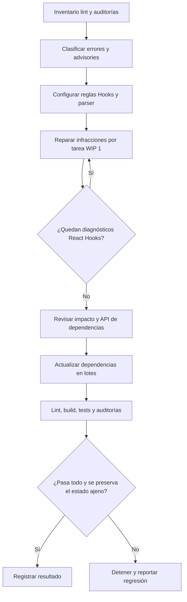
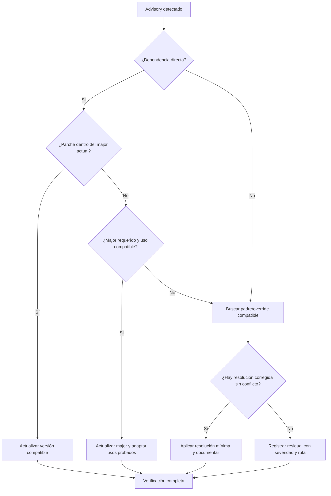
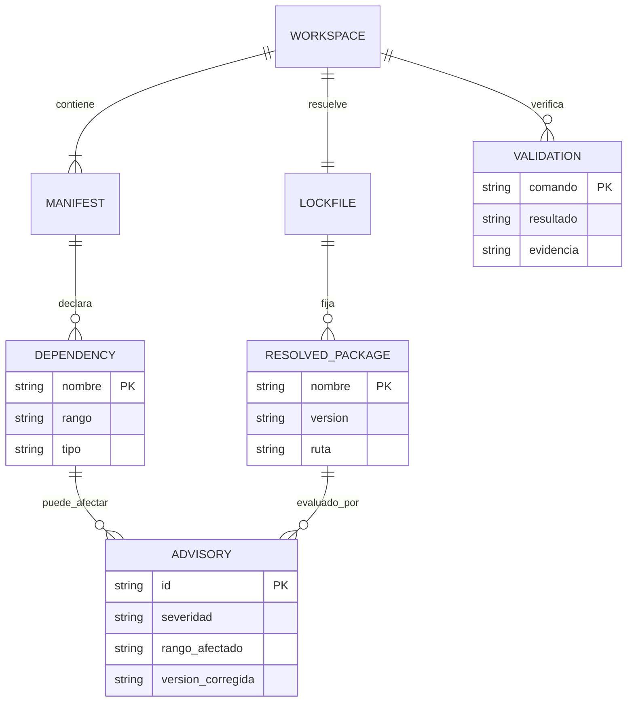
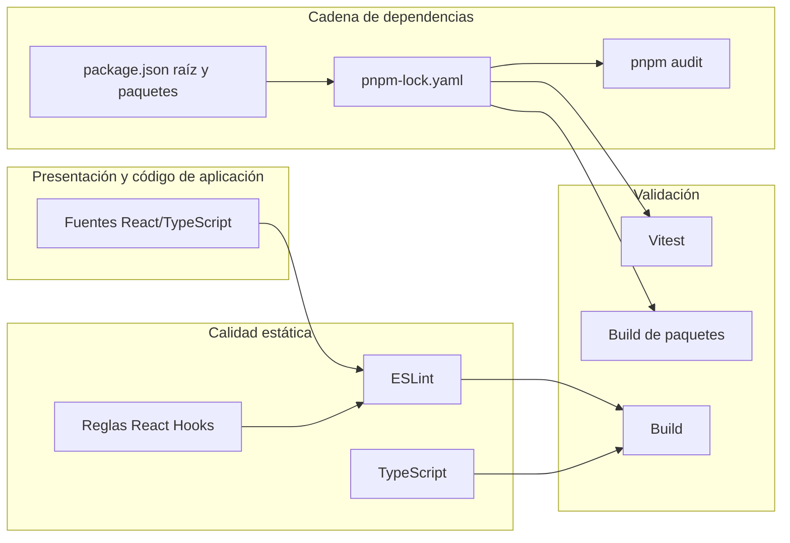

# Especificación — Integridad de lint y dependencias vulnerables

- **ID:** SPEC-044
- **Estado:** Revisión ampliada pendiente de aprobación
- **Alcance:** Restaurar lint reproducible, corregir las 68 infracciones React Hooks y una advertencia detectadas en 36 archivos, y remediar vulnerabilidades conocidas del lockfile sin tocar cambios preexistentes ajenos.

## Problema y objetivo

En la línea base, `pnpm run lint` fallaba con cuatro errores y dos advertencias porque ESLint no tenía instalado/configurado `eslint-plugin-react-hooks`. Al instalar y activar sus reglas reales, el análisis encontró **68 errores React Hooks** (41 `exhaustive-deps` y 27 `rules-of-hooks`) distribuidos en 36 archivos, además de una advertencia `prefer-const`. No se acepta desactivar reglas para maquillar esos resultados: deben corregirse en su origen conservando comportamiento. `pnpm audit --prod` reporta 2 vulnerabilidades críticas, 31 altas, 33 moderadas y 5 bajas; `pnpm audit` reporta 5 críticas, 55 altas, 63 moderadas y 11 bajas. Varias incidencias afectan dependencias directas de producción y otras llegan transitivamente por Express, ExcelJS, Vitest y Vite.

El propósito es obtener lint ejecutable, conservar la semántica del ERP y actualizar dependencias vulnerables a versiones corregidas, limitando cambios de API y documentando cualquier aviso que no tenga solución compatible.

## Requisitos EARS

- **REQ-01:** El sistema deberá ejecutar ESLint con las reglas de React Hooks disponibles y configuradas explícitamente para reglas de hooks y dependencias de efectos.
- **REQ-02:** CUANDO ESLint analice `src`, deberá terminar sin errores ni advertencias; las 68 infracciones React Hooks detectadas y cualquier otra infracción real del alcance deberán corregirse en su origen, sin silenciar reglas para ocultarlas.
- **REQ-03:** El sistema deberá conservar la semántica de tipos y el comportamiento del test arquitectónico al corregir incompatibilidades del linter.
- **REQ-04:** CUANDO el registro de auditoría marque una dependencia como vulnerable, el proyecto deberá resolverla con una versión corregida, una actualización compatible de su padre o una resolución de workspace justificada.
- **REQ-05:** SI una corrección requiere un salto mayor, ENTONCES se deberán revisar usos/API afectados y verificar build y pruebas antes de considerarla completa.
- **REQ-06:** El sistema deberá mantener coherentes `package.json` de raíz/paquetes y `pnpm-lock.yaml`.
- **REQ-07:** El sistema deberá conservar intactos los cambios preexistentes no relacionados y no conectarse a servicios externos ni bases de datos durante estas verificaciones.
- **REQ-08:** La verificación final deberá ejecutar lint, build, pruebas automatizadas, compilación recursiva de paquetes y auditoría de dependencias de producción y desarrollo.
- **REQ-09:** Para cada componente/hook cuyo símbolo se modifique, el agente deberá analizar previamente el impacto GitNexus, informar el blast radius y detenerse ante riesgo HIGH/CRITICAL hasta revisar el cambio con pruebas específicas.
- **REQ-10:** La remediación de dependencias vulnerables comenzará solo después de completar y aprobar la fase de lint, respetando WIP=1 y pausando para aprobación humana tras cada tarea.

## Criterios de aceptación

- `pnpm run lint` termina con código 0 y 0 errores/advertencias.
- Las llamadas a hooks no son condicionales y sus dependencias reflejan todos los valores reactivos utilizados; los refrescos explícitos conservan su semántica sin hacks de dependencias.
- Build de frontend y compilación de paquetes del workspace pasan.
- Suite Vitest completa pasa; se compara con la línea base (181 suites / 1.185 tests aprobados).
- `pnpm audit` y `pnpm audit --prod` no reportan vulnerabilidades conocidas corregibles dentro del alcance; todo aviso residual queda identificado con razón y ruta.
- El lockfile está sincronizado con los manifiestos.
- No se alteran los cambios preexistentes indicados por el usuario.

## Diagramas requeridos

### 1. Flujo de proceso


### 2. Decisiones y casos límite


### 3. Entidades y relaciones


### 4. Secuencia temporal
```mermaid
sequenceDiagram
  actor Usuario
  participant Agente
  participant Git as GitNexus/Repo
  participant Pnpm as pnpm audit/update
  participant CI as Lint/Build/Tests
  Usuario->>Agente: Aprueba SPEC-044 y preservación de cambios
  Agente->>Git: Analiza impacto antes de editar símbolos
  Agente->>Pnpm: Actualiza solo dependencias justificadas
  Pnpm-->>Agente: Manifiestos, lockfile, advisory residual
  Agente->>CI: Ejecuta verificaciones por tarea
  CI-->>Agente: Resultados y regresiones
  Agente-->>Usuario: Evidencia; pausa tras cada tarea
```

### 5. Arquitectura por capas

