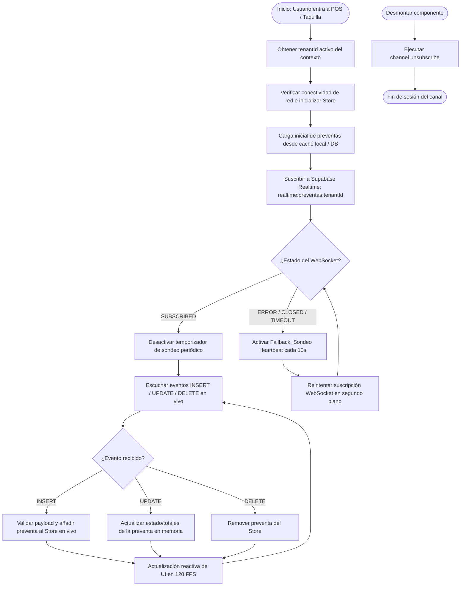
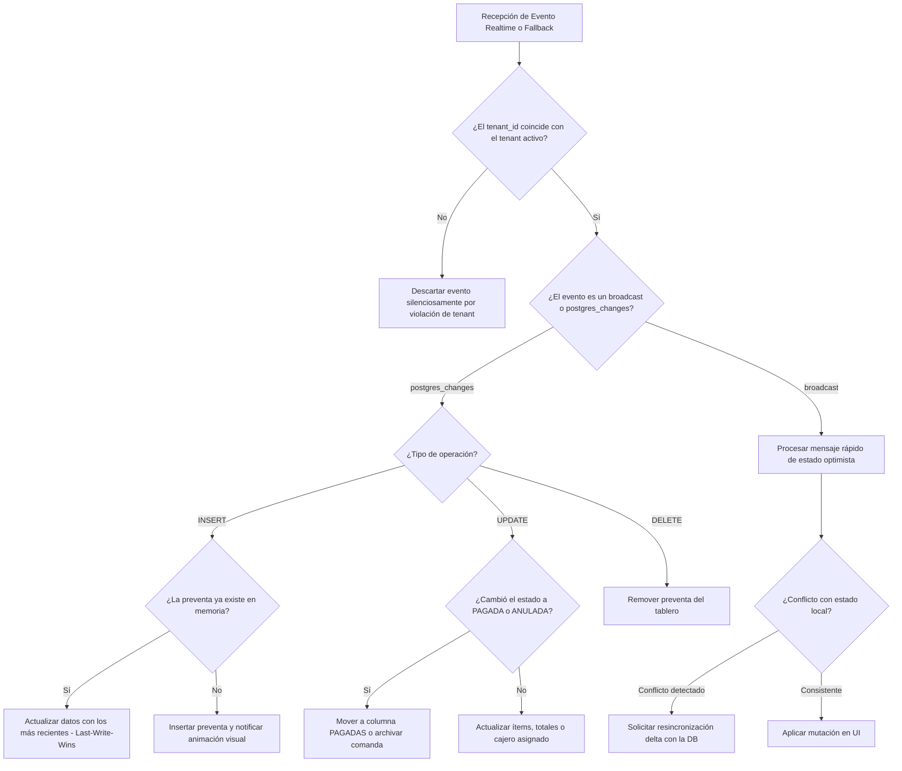
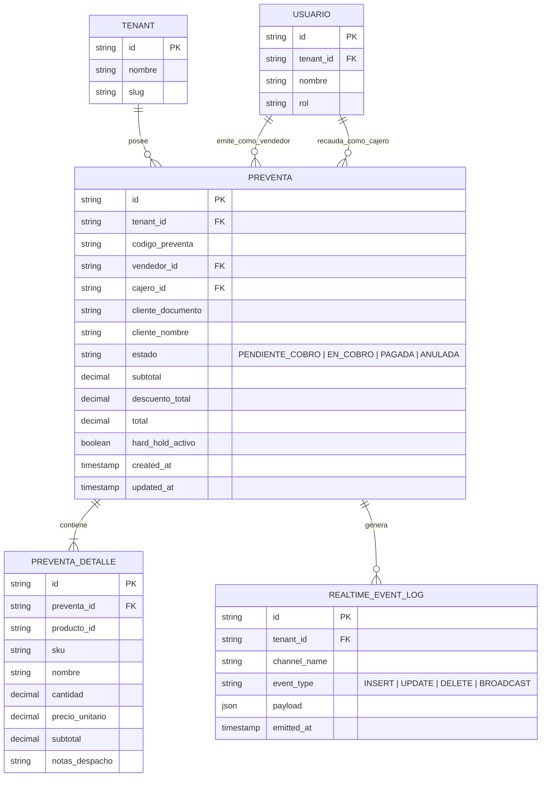
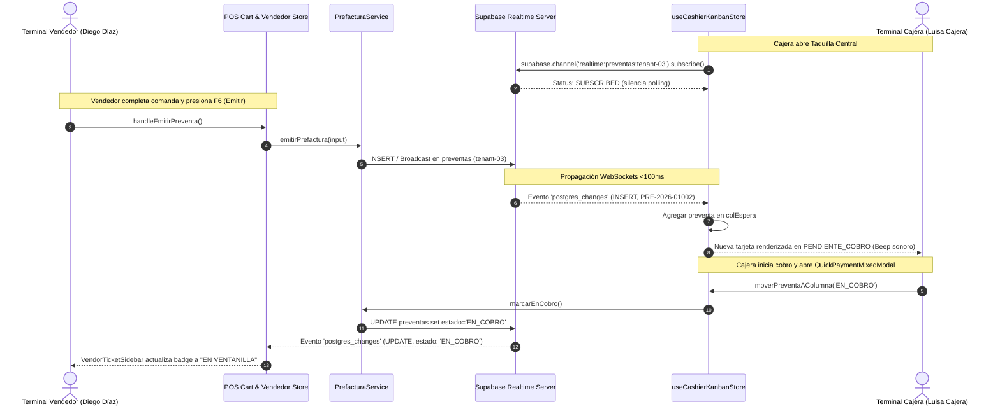
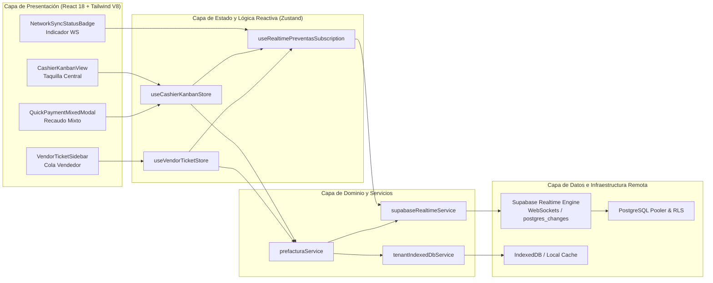

# Especificación — Sincronización en Tiempo Real Supabase (Realtime Channels)

- **ID:** SPEC-045
- **Título:** Sincronización en Tiempo Real con Supabase Realtime Channels para Preventas, Comandas y Taquilla Central (Caja Única)
- **Estado:** Propuesta Inicial SDD v3.0 — En espera de aprobación humana
- **Alcance:** Reemplazar el sondeo periódico por temporizador (`setInterval` de 4s / 3s) por una suscripción reactiva a canales WebSockets de Supabase (`realtime:preventas:${tenantId}`), con degradación elegante a sondeo heartbeat en caso de desconexión, actualización instantánea (<100ms) en el Tablero Kanban de Caja Única (`CashierKanbanView`) y en la barra lateral de tickets de vendedores (`VendorTicketSidebar`).

---

## 1. Problema y Objetivo

### Problema Actual
En la arquitectura multivendedor y caja única (implementada en SPEC-043 para ferreterías y puntos de venta de alto tráfico), los asesores de mostrador generan comandas y preventas desde múltiples terminales, mientras las cajeras recaudan en la taquilla central.
Actualmente, la sincronización entre terminales depende de un sondeo ciego por intervalos (`setInterval` cada 4000ms en `CashierKanbanView.tsx` y cada 3000ms en `DispatchScannerModal.tsx`), lo que ocasiona:
1. **Latencia perceptual de hasta 4 segundos:** Una comanda emitida por el asesor tarde hasta 4s en verse reflejada en la pantalla de la cajera, ralentizando la cola física de clientes.
2. **Desperdicio de recursos y cuota de red:** Decenas de peticiones HTTP repetitivas e innecesarias cuando no hay preventas nuevas, saturando potencialmente el rate limit de capa gratuita de Supabase/Vercel.
3. **Falta de feedback bidireccional instantáneo:** Cuando la cajera toma una preventa y la pasa a `EN_COBRO` o la liquida en `PAGADA`, el vendedor de mostrador no se entera de inmediato en su `VendorTicketSidebar`, pudiendo intentar modificar o reenviar la comanda.

### Objetivo
Diseñar e implementar un servicio de suscripción reactivo y resiliente basado en **Supabase Realtime Channels (`postgres_changes` + `broadcast`)** con:
1. **Notificación en sub-100ms** de eventos `INSERT`, `UPDATE`, `DELETE` en preventas y comandas.
2. **Aislamiento Multi-Tenant Estricto:** Canales nombrados `realtime:preventas:${tenantId}` y filtrados por `tenant_id=eq.${tenantId}`.
3. **Mecanismo Híbrido Resiliente (WebSocket + Polling Fallback):** Suscripción activa mientras la conexión WebSocket esté en estado `SUBSCRIBED`; si la conexión se degrada o cae a `CHANNEL_ERROR` / `CLOSED` / `OFFLINE`, se activa un sondeo degradado de respaldo (heartbeat cada 10s) hasta que el WebSocket se restablezca.
4. **Cero regresiones:** Compatibilidad transparente con el modo Mock/Test y cobertura 100% en pruebas automatizadas.

---

## 2. Requisitos en Notación EARS

- **REQ-01 (Suscripción al Canal):** CUANDO un usuario ingrese a `CashierKanbanView` o `VendorTicketSidebar`, EL SISTEMA DEBERÁ abrir una suscripción a Supabase Realtime en el canal `realtime:preventas:${tenantId}` con filtro `tenant_id=eq.${tenantId}`.
- **REQ-02 (Recepción Reactiva de Inserción):** CUANDO un vendedor emita una preventa desde el mostrador, EL SISTEMA DEBERÁ propagar el evento `INSERT` en sub-100ms y agregar automáticamente la tarjeta en la columna `PENDIENTE_COBRO` de la Taquilla Central sin requerir recarga manual ni esperar temporizadores.
- **REQ-03 (Transición de Estado Reactiva):** CUANDO una cajera arrastre una tarjeta a `EN_COBRO` o complete el recaudo mixto a `PAGADA`, EL SISTEMA DEBERÁ emitir un evento `UPDATE` y reflejar el cambio en vivo en todos los puestos de venta y monitores conectados en el mismo tenant.
- **REQ-04 (Silenciamiento del Sondeo Ciego):** MIENTRAS el canal de Supabase Realtime reporte estado `SUBSCRIBED`, EL SISTEMA DEBERÁ suspender completamente el sondeo periódico de 4 segundos, eliminando peticiones HTTP redundantes.
- **REQ-05 (Degradación Resiliente Offline/Fallback):** SI la conexión WebSocket pasa a `CLOSED`, `CHANNEL_ERROR` o el navegador entra en modo `offline`, ENTONCES EL SISTEMA DEBERÁ activar un temporizador de contingencia con sondeo exponencial/heartbeat (10s) hasta que el canal WebSocket confirme su reconexión.
- **REQ-06 (Limpieza de Suscripciones):** CUANDO los componentes que consumen preventas se desmonten, EL SISTEMA DEBERÁ desuscribirse y limpiar los canales en Supabase para evitar fugas de memoria o escuchas duplicadas.
- **REQ-07 (Modo Test & Offline Seguro):** EN entorno de pruebas Vitest o cuando `isMockMode=true`, EL SISTEMA DEBERÁ permitir la simulación determinista de eventos realtime mediante un emisor de eventos desacoplado sin requerir un servidor WebSocket real.

---

## 3. Criterios de Aceptación (DoD)

1. **Latencia de Propagación:** < 100ms entre la emisión de la comanda en terminal vendedor y su renderizado en la taquilla central en condiciones de red estándar.
2. **Ahorro de Tráfico:** 0 peticiones HTTP GET periódicas a la base de datos mientras el canal WebSocket esté saludable (`status === 'SUBSCRIBED'`).
3. **Recuperación Automática:** Reconexión transparente sin pérdida de estado tras desconexión transitoria de red.
4. **Aislamiento Multi-Tenant:** Ningún terminal de un `tenant_A` recibe eventos o prefacturas correspondientes a un `tenant_B`.
5. **Quality Gate:** TypeScript estricto con 0 errores (`tsc --noEmit`), Vitest 100% pasando (incluyendo suites E2E y unitarias con simulación realtime), y 0 errores en consola JS.

---

## 4. Mandatorio Multi-Phase System Modeling (5 Diagramas Mermaid.js)

### 4.1. Flujo de Procesos y Ciclo de Vida Secuencial (`1_process_flowcharts`)

---

### 4.2. Rombos de Decisión y Edge Cases (`2_decision_logic_diagrams`)

---

### 4.3. Modelo Entidad-Relación (`3_entity_relationship_diagrams`)

---

### 4.4. Diagrama de Secuencia Temporal (`4_sequence_diagrams`)

---

### 4.5. Arquitectura por Capas (`5_component_architecture_diagrams`)

---

## 5. Próximos Pasos (Flujo Spec Kit)
Con la especificación y los 5 diagramas de ingeniería Mermaid formulados:
1. **Control de Calidad 1:** Esperar la aprobación o ajustes del usuario para pasar a `/speckit.clarify` y `/speckit.checklist`.
2. **Plan Técnico:** Elaborar `/speckit.plan` con la descomposición de componentes y pruebas.
3. **Tareas:** Dividir en tareas atómicas con límite estricto `WIP = 1`.
4. **Implementación TDD:** Desarrollo guiado por pruebas paso a paso sin avanzar sin confirmación.
