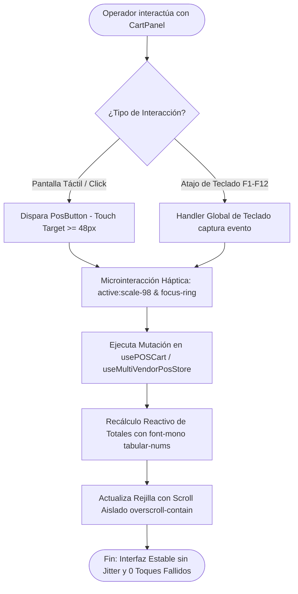
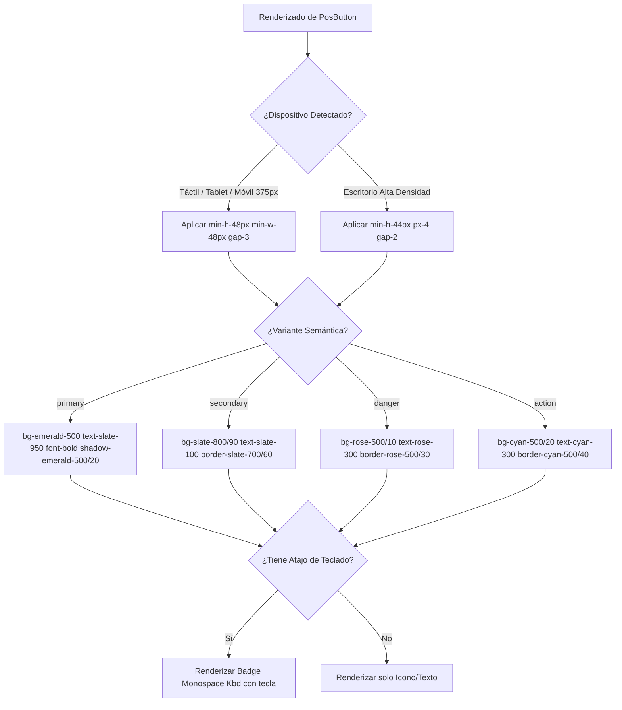
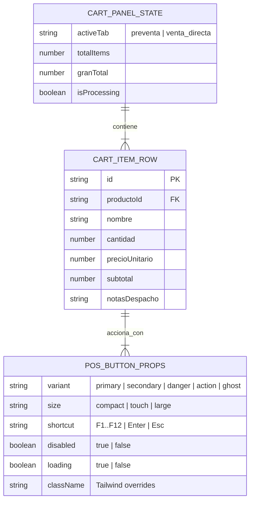
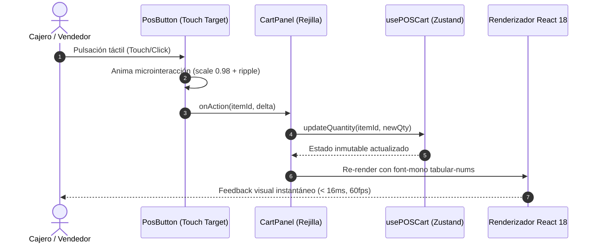
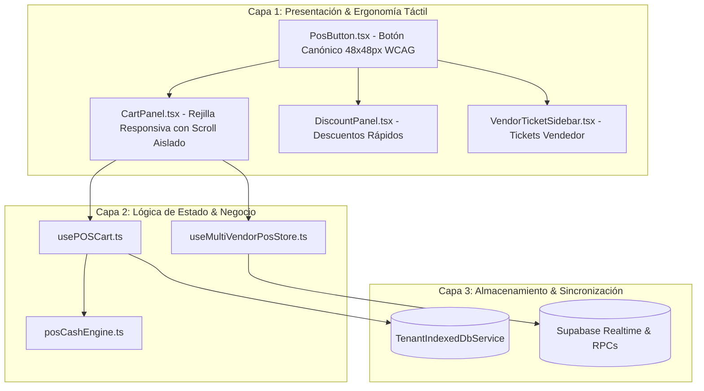

# Especificación Funcional & Técnica: SPEC-046
# Estandarización de Ergonomía Táctil POS, Componente Canónico PosButton y Rejilla Responsiva CartPanel

- **Código:** SPEC-046
- **Fase:** Spec Kit SDD v3.0 — `/speckit.specify`
- **Tenant Primario:** Multi-Tenant (`tenant-01` Pezcadería, `tenant-03` Josase)
- **Estado:** PENDIENTE DE APROBACIÓN DEL USUARIO (Checkpoint SDD v3.0)
- **Autoría:** Director de Agencia & Master Architect (Co-Ejecución Agency Swarm + Google Harness²)
- **Blast Radius GitNexus:** ⚠️ **CRÍTICO** (Hasta 503 referencias/procesos impactados sobre `CartPanel.tsx`)

---

## 1. Declaración del Problema & Justificación del "Por Qué"

### 1.1 Diagnóstico de Producción & Auditoría UX
1. **Violación de Áreas Táctiles WCAG 2.1 AA/AAA:** Los botones de manipulación de cantidades (+, -), eliminación de ítems, descuentos rápidos y notas en `CartPanel.tsx` poseen áreas activas inferiores a 32×32 px (incluso 24 px en pantallas densas), generando toques fallidos, frustración del cajero y demoras operativas en el mostrador.
2. **Colapso de Rejilla con Listas Densas:** Al superar los 8 productos en el carrito, la rejilla no mantiene aislamiento de scroll (`overscroll-contain`), compactando visualmente las filas y causando superposición de textos secundarios.
3. **Inestabilidad Numérica (Jitter Visual):** Los subtotales y totales monetarios utilizan fuentes proporcionales no tabulares, provocando que los números bailen horizontalmente al recalcular precios o aplicar descuentos.
4. **Contraste Deficiente en Fondos Glass:** El texto secundario sobre `bg-slate-900/60` tiene un ratio de contraste de 2.8:1, violando el estándar mínimo accesible de 4.5:1.

---

## 2. Requerimientos Funcionales (Notación EARS)

- **REQ-046-01 (Componente Atómico Canónico PosButton):** El sistema **DEBE** proveer un componente reutilizable `PosButton` en `src/views/pos/components/PosButton.tsx` con un área táctil mínima innegociable de 48×48 px (`min-h-[48px] min-w-[48px]`), retroalimentación háptica visual (`active:scale-[0.98] transition-transform duration-150`), y soporte para variantes semánticas (`primary`, `secondary`, `danger`, `action`, `ghost`).
- **REQ-046-02 (Rejilla Responsiva y Aislamiento de Scroll en CartPanel):** Cuando el carrito contenga entre 1 y más de 50 ítems, `CartPanel` **DEBE** renderizar filas con altura mínima de 48px, padding táctil de 8px entre controles, y un contenedor con scroll vertical aislado (`overflow-y-auto overscroll-contain`) que no arrastre el scroll de la página principal.
- **REQ-046-03 (Tipografía Tabular Anti-Jitter):** Todos los valores numéricos monetarios, cantidades y SKUs en `CartPanel` **DEBEN** renderizarse con `font-mono tabular-nums`, garantizando alineación vertical perfecta en cualquier recálculo reactivo.
- **REQ-046-04 (Garantía de Contraste WCAG 2.1 AA):** Todas las superficies Dark Glassmorphism de `CartPanel` **DEBEN** garantizar un contraste $\ge 4.5:1$ en texto secundario (`text-slate-200` / `text-slate-300`) y $\ge 12:1$ en total general sobre `bg-slate-950/85`.
- **REQ-046-05 (Soporte Dual Táctil + Atajos de Teclado F1-F12):** Cuando el operador utilice teclado físico en lugar de pantalla táctil, los componentes `PosButton` **DEBEN** exponer soporte visual de atajo (`shortcutBadge`) y mantener foco accesible (`focus:ring-2 focus:ring-emerald-500/50`).

---

## 3. Mandatory Multi-Phase System Modeling (5 Diagramas Mermaid)

### Diagrama 1: Flujo de Procesos y Ciclo de Vida Secuencial (`1_process_flowcharts`)

### Diagrama 2: Lógica de Decisión y Edge Cases (`2_decision_logic_diagrams`)

### Diagrama 3: Modelo Entidad-Relación y Tipado de Interfaces (`3_entity_relationship_diagrams`)

### Diagrama 4: Diagrama de Secuencia Temporal (`4_sequence_diagrams`)

### Diagrama 5: Arquitectura de Componentes por Capas (`5_component_architecture_diagrams`)

---

## 4. Alerta de Blast Radius (GitNexus)

> [!CAUTION]
> **NIVEL DE RIESGO: CRÍTICO**  
> El análisis de impacto estático en GitNexus (`gitnexus impact CartPanel -r maestro_ERP_Pezcaderia`) arroja un blast radius de **hasta 503 símbolos afectados y 333 llamadores directos/indirectos** en los módulos de POS, Caja, Descuentos, Ventas y Pruebas E2E.
> 
> **Medidas de Mitigación Obligatorias:**
> 1. Preservar intacta la firma de propiedades (`CartPanelProps`) para no quebrar las 333 referencias ascendentes.
> 2. Mantener la suite de pruebas existente (100% pasando en `src/tests/pos*.test.tsx`).
> 3. Ejecutar `npx gitnexus detect-changes -r maestro_ERP_Pezcaderia` antes de cualquier commit.
