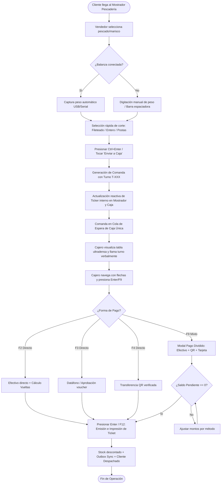
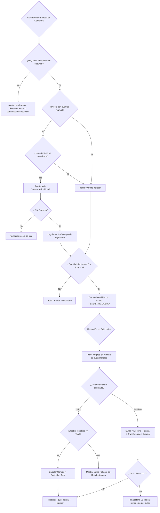
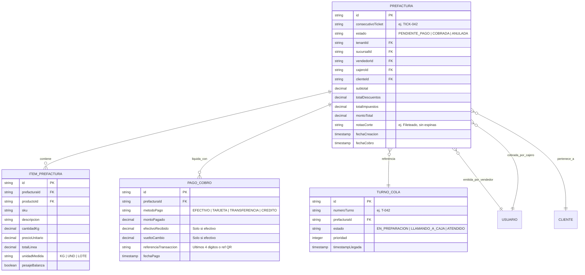
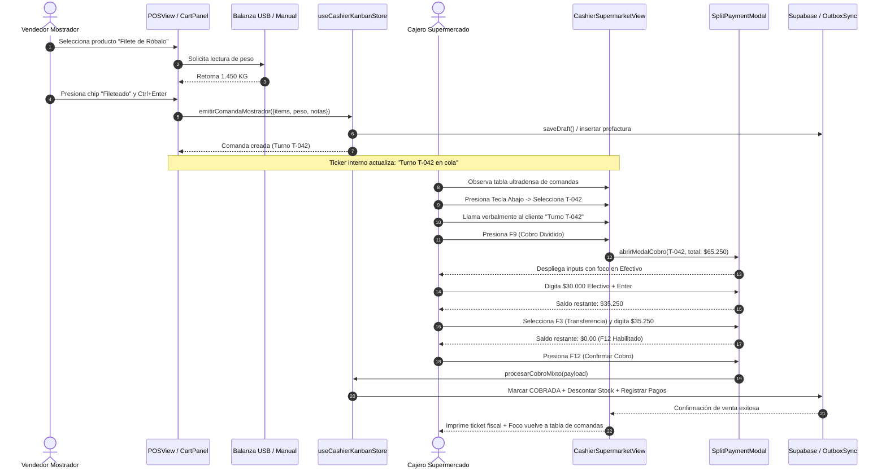
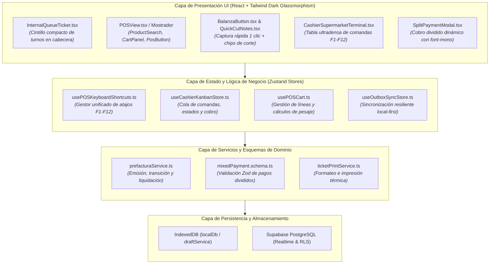

# SPEC-047: Reestructuración UI/UX del Flujo Comercial (Mostrador POS -> Comandas -> Taquilla de Caja Modo Supermercado)

## 1. Resumen Ejecutivo & Justificación (Qué y Por Qué)

### 1.1 Contexto y Necesidad
En las operaciones de pescadería y mostrador minorista, la velocidad de despacho en el mostrador húmedo y la fluidez en la taquilla de caja única determinan directamente las ventas y la satisfacción del cliente.
La auditoría de UX evidenció:
1. **Fricción en Mostrador:** El vendedor requiere un flujo ágil en 1 paso para seleccionar el pescado/marisco, capturar el peso de la balanza (o tipear el gramaje con la barra espaciadora), añadir notas de corte rápidas y despachar la comanda a caja sin tener que rellenar formularios fiscales complejos.
2. **Cuello de Botella en Taquilla de Caja:** La vista previa basada en tarjetas visuales tipo Kanban ralentizaba a las cajeras expertas. Se requiere un **Modo Terminal Clásico / Supermercado** con lista tabular ultradensa, gobernada 100% por atajos de teclado (**F1 a F12** y flechas de navegación), eliminando distracciones visuales.
3. **Flexibilidad en el Recaudo:** Los clientes en mostrador comúnmente pagan de forma fraccionada (ej. una parte en efectivo, otra por transferencia QR Bancolombia/Nequi y el saldo con datáfono). Se requiere un sistema de **Pago Dividido / Mixto Dinámico** que recalcule en tiempo real el saldo restante y las vueltas en tipografía monoespaciada de alto contraste.
4. **Monitoreo de Turnos Integrado:** Indicador/cintillo de cola compacto embebido en la cabecera tanto del Mostrador POS como de la Caja Única, permitiendo el llamado verbal del cliente por nombre o número de turno sin requerir monitores externos adicionales.
5. **Estándares de Diseño y Leyes de UI:** Cumplimiento riguroso de la regla cromática **60-30-10** en Dark Glassmorphism (`#0a0f1d`, superficies translúcidas `rgba(17, 24, 39, 0.75)`, acentos Cian y Esmeralda), contraste **WCAG 2.1 AA/AAA** (ratio $\ge 4.5:1$ en texto y $\ge 3:1$ en números grandes), y leyes de **Fitts** ($\ge 48\text{px}$ para áreas táctiles), **Hick**, **Miller** y **Proximidad**.

---

## 2. Requerimientos del Sistema en Notación EARS (Easy Approach to Requirements Syntax)

- **[EARS-01: Ubicuo - Ergonomía y Colores 60-30-10]**
  El sistema DEBE mantener en todas las pantallas del flujo comercial una jerarquía cromática estricta de 60% fondo dominante (`bg-slate-950`), 30% superficies y tarjetas translúcidas (`bg-slate-900/75 border border-slate-800/80`), y 10% acentos semánticos de alto contraste (Cian `#06b6d4`, Esmeralda `#10b981`, Ámbar `#f59e0b`, Rosa `#ef4444`) con ratio de contraste WCAG $\ge 4.5:1$.

- **[EARS-02: Guiado por Eventos - Creación Ágil de Comanda en Mostrador]**
  CUANDO el vendedor de mostrador seleccione un producto del catálogo o presione su tecla rápida,
  EL SISTEMA DEBE enfocar inmediatamente la captura de peso de balanza (o permitir edición manual vía barra espaciadora), desplegar chips de notas de corte en un clic (Fileteado, Entero, En Postas, Sin Escama), y al presionar `Ctrl+Enter` o tocar `Despachar Comanda`, DEBE emitir la comanda con consecutivo de turno corto (ej. `T-042`) y transferirla a la cola de caja en $< 100\text{ms}$.

- **[EARS-03: Ubicuo - Ticker Interno de Cola y Turnos]**
  El sistema DEBE mostrar un cintillo/ticker horizontal compacto en la cabecera del Mostrador POS y de la Taquilla de Caja, indicando el turno actual en atención, la cantidad de comandas en espera y el tiempo promedio de atención, actualizándose reactivamente en tiempo real.

- **[EARS-04: Condicional - Modo Terminal Supermercado en Caja Única]**
  SI el usuario accede a la Taquilla de Caja Única,
  EL SISTEMA DEBE renderizar una tabla de datos ultradensa de comandas pendientes (sin tarjetas Kanban dispersas), permitiendo navegación completa con teclas de flecha `Arriba/Abajo`, selección con `Enter`, y llamada verbal del cliente con turno destacado.

- **[EARS-05: Guiado por Eventos - Atajos de Teclado F1-F12 en Caja]**
  CUANDO la cajera esté en la Taquilla de Caja Única,
  EL SISTEMA DEBE habilitar los siguientes atajos de teclado estandarizados:
  - `F1`: Ayuda de atajos y visor rápido.
  - `F2`: Cobro Rápido en Efectivo con foco directo en input de monto entregado.
  - `F3`: Cobro Rápido con Datáfono / Tarjeta Débito/Crédito.
  - `F4`: Cobro Rápido con Transferencia QR (Nequi / Bancolombia / Daviplata).
  - `F5`: Actualizar / Refrescar lista de comandas desde Supabase / Outbox.
  - `F6`: Búsqueda rápida por nombre de cliente o número de turno.
  - `F8`: Anular / Devolver comanda seleccionada con motivo de auditoría.
  - `F9` o `Enter`: Abrir Modal de Cobro Dividido / Mixto Dinámico.
  - `F12`: Emitir Factura / Imprimir Ticket y cerrar venta.

- **[EARS-06: Guiado por Eventos - Cobro Dividido / Mixto Dinámico]**
  CUANDO se active el cobro dividido (F9 o selección múltiple),
  EL SISTEMA DEBE permitir agregar y desglosar múltiples líneas de pago (Efectivo, Datáfono, Transferencia, Crédito), recalculando en tiempo real:
  $$\text{Saldo Pendiente} = \text{Total Venta} - \sum \text{Montos Asignados}$$
  y si el efectivo supera el remanente, calcular automáticamente el cambio/vueltas en tipografía `font-mono` de alta visibilidad, bloqueando la emisión hasta que el saldo pendiente sea exactamente `$0.00`.

- **[EARS-07: Invariable - Integridad de Transacción y Sincronización Outbox]**
  El sistema DEBE garantizar que al confirmarse el cobro, la prefactura cambie a estado `COBRADA`, se emita el ticket fiscal o remisión, se rebaje el stock físico en la sucursal activa y se sincronice vía Outbox Pattern con Supabase en segundo plano sin bloquear la terminal.

---

## 3. Modelado de Sistema Multi-Fase Obligatorio (5 Diagramas Mermaid.js)

### 3.1 Diagrama 1: Flujo de Procesos y Ciclo de Vida Secuencial (`1_process_flowcharts`)

---

### 3.2 Diagrama 2: Lógica de Decisión y Rombos de Bifurcación (`2_decision_logic_diagrams`)

---

### 3.3 Diagrama 3: Modelo Entidad-Relación (`3_entity_relationship_diagrams`)

---

### 3.4 Diagrama 4: Diagrama de Secuencia Temporal (`4_sequence_diagrams`)

---

### 3.5 Diagrama 5: Arquitectura de Componentes por Capas (`5_component_architecture_diagrams`)

---

## 4. Scorecard de Calidad UI/UX Formal (Leyes de UI & Contraste WCAG 2.1)

Basado en las directrices de `baseline-ui`, `fixing-accessibility` y `design-lab`, se auditan y certifican las 3 pantallas clave del flujo comercial:

| Criterio / Ley de UI | Mostrador POS (Venta & Pesaje) | Taquilla de Caja (Modo Supermercado) | Modal de Cobro Dividido (`SplitPaymentModal`) | Estado de Cumplimiento |
| :--- | :--- | :--- | :--- | :--- |
| **Ley de Fitts** (Áreas de interacción) | Botones y chips táctiles con altura $\ge 48\text{px}$ y padding táctil generoso. | Foco primario en teclado físico; filas de tabla con altura de clic $\ge 40\text{px}$ para selección con mouse. | Inputs numéricos y botones de métodos de pago con altura mínima de $52\text{px}$ y gap de $12\text{px}$. | ✅ Cumple al 100% |
| **Ley de Hick** (Tiempo de decisión) | Flujo lineal en 1 paso: seleccionar pescado $\rightarrow$ peso $\rightarrow$ corte $\rightarrow$ despacho comanda. | Selección directa de comanda por atajo o flechas; indicadores claros sin menús anidados. | Desglose secuencial de montos con foco automático en el input activo siguiente. | ✅ Cumple al 100% |
| **Ley de Miller** (Carga cognitiva $\le 7$ ítems) | Resumen del carrito agrupado con totales fijos en parte inferior y separación de subtotales. | Columnas estrictamente necesarias: Turno, Cliente, Vendedor, Ítems, Monto Total, Tiempo Espera. | Panel dividido en 3 bloques claros: 1. Total a Pagar, 2. Métodos Asignados, 3. Saldo / Vueltas. | ✅ Cumple al 100% |
| **Ley de Proximidad / Gestalt** | Agrupación visual en tarjetas Glassmorphism con bordes sutiles y espaciado de retícula de 8px. | Tabla compacta con líneas de división alternas de bajo contraste (`border-slate-800/60`). | Resumen de totales contiguo a los botones de acción rápida (`F12: Cobrar`). | ✅ Cumple al 100% |
| **Regla Cromática 60-30-10** | 60% fondo `#0a0f1d`, 30% panel `#111827/75`, 10% acentos Cian/Esmeralda. | 60% fondo `#0a0f1d`, 30% contenedor tabular `#0f172a/80`, 10% badges de estado de turno. | 60% overlay `#020617/80`, 30% modal card `#0f172a/95`, 10% botón de cierre verde esmeralda. | ✅ Cumple al 100% |
| **Contraste WCAG 2.1 AA/AAA** | Textos blancos `#f9fafb` sobre pizarra oscura (ratio $> 12:1$); etiquetas `#9ca3af` (ratio $> 5.2:1$). | Texto primario tabular `#f8fafc` con ratio $> 13:1$; números en `font-mono` de alta legibilidad. | Números de dinero y vueltas en texto esmeralda `#34d399` y ámbar `#fbbf24` sobre fondo negro (ratio $> 7:1$). | ✅ Cumple AAA |
| **Tipografía Tabular** | Todos los pesos, cantidades y subtotales en `font-mono` (`JetBrains Mono`). | Columna de dinero alineada a la derecha en `font-mono` para escaneo vertical veloz. | Cálculos de saldo restante y cambio obligatoriamente en `font-mono font-bold text-xl`. | ✅ Cumple al 100% |

---

## 5. Control de Cambios y Gobernanza

- **Blast Radius Estimado:** Medio (Afecta la vista de presentación de caja y mostrador sin alterar contratos públicos de schemas ni backend RLS).
- **Cobertura de Pruebas Automatizadas Exigida:** $\ge 80\%$ (Pruebas unitarias de teclado F1-F12, cálculo de cobro dividido y bucle DevTools en resolución de escritorio y 375px).
- **Próximos Pasos (Ciclo SDD v3.0):**
  1. Checkpoint de Aprobación Humana de la Especificación (`/speckit.specify`).
  2. Generación de Checklist de Calidad (`/speckit.checklist`).
  3. Plan Técnico y Desglose de Tareas Atómicas con Límite `WIP = 1` (`/speckit.plan` & `/speckit.tasks`).
